# Reference process: Answer a Billing Question

`ref/sup/answer-a-billing-question v1`

**value stream:** [Account and billing requests](../../streams/customer-support/account-and-billing-requests.md)
A customer asks about a charge, an invoice or a payment, in a case on any
channel, and the answer has to come from the bill as it stands, which
support can read and never change. The case-manager agent takes in the
question with the charge, the invoice or the payment it names, and checks
that the asker has passed the identity check for billing details and is
a billing contact or an administrator on file. The
customer-question-responder agent tells an explanation the customer wants
from a claim that an invoice is wrong, a request for money back or a
request to change the plan or the price, because each goes a different
way. For a question, it reads the invoice, the charge or the payment in
`<your billing system>` and the billing terms of the agreement, finds the
approved answer in `<your knowledge base>`, and answers directly, saying
that it is an agent and offering a person. A question with no approved
answer, or one in a category a person must answer, goes to a support
specialist with a draft, and a reply that admits a billing error, promises
a date or offers money is sent by a named person. A claim that an invoice
is wrong goes the same day, in the customer's own words, to Finance's
Resolve a Billing Dispute, where the dispute-coordinator agent takes it
in and tells the customer who holds it and when the answer will come. A
request for money back goes to Decide a Refund Request, and a request to
change the plan or the price goes to the account owner. The run closes
when the customer has the answer, or when the claim or the request is
held by the process that answers it and the customer knows who holds it.

**delivers:** document, an answer to a billing question

## The goals

- Answer [90%] of billing questions inside the service level
- Settle [60%] of billing questions with no person involved
- Give a wrong answer about a bill in fewer than [1%] of cases
- Pass each claim that an invoice is wrong to Finance within [1 working day]

## The activities

| # | Activity | What happens | Agents |
|---|---|---|---|
| 1 | Take In the Billing Question | the question in the customer's words and the bill it names | [case-manager](../../agents/case-manager.md) |
| 2 | Confirm the Asker Was Verified | the identity check covers billing details for this account | case-manager |
| 3 | Tell a Question from a Claim | an explanation, a claim, money back or a change of plan | [customer-question-responder](../../agents/customer-question-responder.md) |
| 4 | Read the Billing Records | the invoice, charge or payment, and the billing terms | customer-question-responder |
| 5 | Find the Approved Answer | the article that answers it, and the reply category | customer-question-responder |
| 6 | Answer from Approved Content | a reply that says it is an agent and offers a person | customer-question-responder |
| 7 | Pass the Question to a Specialist | a draft, the records read and the reason it needs a person | customer-question-responder |
| 8 | Answer as a Support Specialist | from the records, checked before it goes | support specialist (person) |
| 9 | Hand the Claim to Finance | the invoice, the line, the amount and the customer's words | case-manager |
| 10 | Take In the Claim at Finance | logged at Finance's dispute process with its holder | [dispute-coordinator](../../agents/dispute-coordinator.md) |
| 11 | Tell the Customer Who Holds It Now | the holder and the date the answer will come | dispute-coordinator · case-manager |
| 12 | Send a Refund or Plan Request On | a refund to its process, a plan or price change to the owner | case-manager |
| 13 | Keep the Case Open Until Finance Answers | the promised date kept on the case, raised before it passes | case-manager |
| 14 | Close the Question on the Case | closed once answered, or left with the process holding it | case-manager |
| 15 | Record What the Question Taught | the bills that confused, answers missing, claims upheld | case-manager |

A billing question reaches this process from `ref/sup/take-in-a-request`
once the asker has been checked at `ref/sup/verify-a-customers-identity`,
and a reply a support specialist writes is checked as every reply is at
`ref/sup/resolve-a-case`, with one that admits a billing error, promises a
date or offers money sent through `ref/sup/approve-a-sensitive-reply`. A
claim that an invoice is wrong is answered at
`ref/fin/resolve-a-billing-dispute`, which pauses the reminders on the
amount claimed and decides the answer with the billing lead, and a
payment the customer says it made is applied at
`ref/fin/apply-a-customer-payment`. A request for money back runs at
`ref/sup/decide-a-refund-request`, and a request to change the plan or
the price is the account owner's to answer in Sales.

## The graph

```mermaid
flowchart LR
  T([a customer asks about a charge, an invoice or a payment]) --> A1[1. Take In the Billing Question]
  A1 --> A2[2. Confirm the Asker Was Verified]
  A2 -. the asker has not passed the identity check for billing details .-> A1
  A2 --> A3[3. Tell a Question from a Claim]
  A3 --> A4[4. Read the Billing Records]
  A3 -. the customer says an invoice is wrong .-> A9[9. Hand the Claim to Finance]
  A3 -. the customer asks for money back or a change of plan .-> A12[12. Send a Refund or Plan Request On]
  A4 --> A5[5. Find the Approved Answer]
  A5 --> A6[6. Answer from Approved Content]
  A5 -. there is no approved answer or a person must answer .-> A7[7. Pass the Question to a Specialist]
  A6 -. the customer says the answer does not settle it .-> A7
  A7 --> A8[8. Answer as a Support Specialist]
  A8 -. the records show an invoice may be wrong .-> A9
  A9 --> A10[10. Take In the Claim at Finance]
  A10 --> A11[11. Tell the Customer Who Holds It Now]
  A11 --> A13[13. Keep the Case Open Until Finance Answers]
  A13 -. Finance's answer leaves a question open .-> A7
  A6 --> A14[14. Close the Question on the Case]
  A8 --> A14
  A12 --> A14
  A13 --> A14
  A14 -. the customer reopens the case .-> A4
  A14 --> A15[15. Record What the Question Taught]
  A15 --> DONE([the customer has the answer, or knows who holds the claim or the request])
```



## The document, with the blanks marked

```
PROCESS: answer a billing question    id: <team>/answer-a-billing-question   v1
from: ref/sup/answer-a-billing-question v1
owner: <who>                          effective: <date>
trigger: a case taken in at ref/sup/take-in-a-request is sorted in <your
         support system> as a question about a charge, an invoice or a
         payment
         watch: record=<support case> system=<your support system>
                change=<a case is sorted to the billing topic>
concurrency: runs may overlap freely - one case is one run, a second
             message on the same bill joins the open case, and a question
             about another invoice is a run of its own held by the same
             support specialist
goal: the customer's question answered inside the service level from
      <your billing system> and the agreement, which support reads and
      never changes, by an agent from approved content or by a support
      specialist, with every reply that admits a billing error, promises a
      date or offers money sent by a named person, every claim that an
      invoice is wrong handed the same day to
      ref/fin/resolve-a-billing-dispute, and every request for money back
      or a change of plan held by the process that answers it
phases:
  take-in-question   - system: the case from ref/sup/take-in-a-request
                       with the question in the customer's own words, the
                       charge, the invoice or the payment it names, and the
                       account
                       owner: case-manager        after: trigger
                       automation: <level>
  confirm-verified   - runs assessment: the identity check on the case from
                       ref/sup/verify-a-customers-identity covers reading
                       out billing details, and the asker is a billing
                       contact or an administrator on file
                       owner: case-manager
                       after: take-in-question    automation: <level>
  sort-question      - runs assessment: the message read as an explanation
                       the customer wants, a claim that an invoice is
                       wrong, a request for money back, or a request to
                       change the plan or the price
                       owner: customer-question-responder
                       after: confirm-verified    automation: <level>
  read-records       - runs collect-and-report: the invoice, the charge or
                       the payment in <your billing system> and the billing
                       terms of the agreement at its version, reading only
                       what the answer needs
                       owner: customer-question-responder
                       after: sort-question, when it is a question
                       automation: <level>
  find-answer        - runs assessment: the approved article in <your
                       knowledge base> that answers the question, and its
                       category under <your reply rules>
                       owner: customer-question-responder
                       after: read-records        automation: <level>
  answer-directly    - human: the answer written from the approved article
                       and the customer's own records only, naming the
                       invoice line and the article, saying that it comes
                       from an agent and how to reach a person, and sent
                       inside the service level
                       owner: customer-question-responder
                       after: find-answer         by: <your service level>
                       automation: <level>
  pass-to-specialist - system: the case passed to a support specialist
                       with a draft, the records read and the reason it
                       needs a person, such as no approved answer or a
                       category a person must answer
                       owner: customer-question-responder
                       after: find-answer, or answer-directly when the
                       customer says it does not settle the question
                       automation: <level>
  answer-as-person   - human: <your support specialist role> answers from
                       the records, the reply is checked as every reply is
                       at ref/sup/resolve-a-case, and one that admits a
                       billing error, promises a date or offers money is
                       sent through ref/sup/approve-a-sensitive-reply
                       owner: <your support specialist role>
                       after: pass-to-specialist  by: <your service level>
                       automation: never
  hand-claim         - system: the claim handed to
                       ref/fin/resolve-a-billing-dispute the same day, with
                       the invoice, the line, the amount and the customer's
                       own words, and the case linked to it
                       owner: case-manager
                       after: sort-question or answer-as-person, when the
                       customer says an invoice is wrong
                       automation: <level>
  take-in-claim      - system: the claim logged in <your dispute register>
                       at ref/fin/resolve-a-billing-dispute, with the person
                       who holds it and the date the answer will come
                       owner: dispute-coordinator
                       after: hand-claim          automation: <level>
  tell-holder        - human: the customer told who holds the claim and the
                       date the answer will come, as Finance's process
                       promised it, and the date put on the case
                       owner: dispute-coordinator
                       after: take-in-claim       by: <hours>
                       automation: <level>
  send-request-on    - system: a request for money back sent to
                       ref/sup/decide-a-refund-request, or a request to
                       change the plan or the price sent to the account
                       owner in <your CRM>, each in the customer's own
                       words, and the customer told who holds it now
                       owner: case-manager
                       after: sort-question, when it is a request
                       automation: <level>
  wait-for-finance   - system: the case kept open and linked to the
                       dispute, the date Finance promised raised before it
                       passes, and each further message from the customer
                       passed to the dispute's holder
                       owner: case-manager
                       after: tell-holder         automation: <level>
  close-question     - system: the case closed once the customer has the
                       answer, or left with the process now holding it,
                       and reopened when the customer says the answer did
                       not settle the question
                       owner: case-manager
                       after: answer-directly, answer-as-person,
                       send-request-on or wait-for-finance
                       automation: <level>
  record-learning    - convenes debrief: the invoice lines that confused
                       customers, the answers that were missing from <your
                       knowledge base>, and the claims Finance upheld, sent
                       to <your billing lead role> and the knowledge lead
                       owner: case-manager
                       after: close-question      automation: <level>
run-scoped:
  clock         - runs roll-call                owner: case-manager
                  every: <cadence>
                  from: take-in-question  until: close-question
  dispute-date  - runs roll-call                owner: case-manager
                  every: <cadence>
                  from: tell-holder       until: wait-for-finance
handoffs:
  take-in-question -> confirm-verified [billing-question]: the question in
    the customer's own words, the bill it names and the account
  confirm-verified -> sort-question [verified-asker]: the identity check
    on the case and the asker's role on the account
  sort-question -> read-records [billing-query]: the question and the
    invoice, charge or payment it is about
  sort-question -> hand-claim [invoice-claim]: the claim in the customer's
    own words, with the invoice and the amount it names
  sort-question -> send-request-on [billing-request]: the request for
    money back or for a change of plan, in the customer's own words
  read-records -> find-answer [billing-records]: what the bill and the
    agreement say, each with where it was read
  find-answer -> answer-directly [approved-answer]: the article and the
    records the answer rests on
  find-answer -> pass-to-specialist [needs-a-person]: the reason no agent
    may answer, and what was found
  pass-to-specialist -> answer-as-person [specialist-brief]: the draft,
    the records read and the reason it needs a person
  answer-as-person -> hand-claim [invoice-claim]: the claim, when the
    records show an invoice may be wrong
  hand-claim -> take-in-claim [claim-handed-over]: the invoice, the line,
    the amount and the customer's own words
  take-in-claim -> tell-holder [logged-claim]: the claim as logged, with
    its holder and the date promised
  tell-holder -> wait-for-finance [holder-told]: the message as sent, and
    the date put on the case
  answer-directly / answer-as-person / send-request-on / wait-for-finance
    -> close-question [question-answered]: the answer as sent, or the
    process and the person now holding the request
  close-question -> record-learning [closed-question]: the question, the
    answer, the route it took and whether the customer came back
deviations:
  confirm-verified -> take-in-question [asker-not-verified]: the asker has
    not passed the identity check for billing details, so the case goes to
    ref/sup/verify-a-customers-identity and is taken in again once it
    passes, with nothing about the bill read out meanwhile
  sort-question -> hand-claim [claim-not-question]: the customer says an
    invoice is wrong, so the claim goes to Finance the same day
  sort-question -> send-request-on [request-not-question]: the customer
    asks for money back or a change of plan, so it goes to the process or
    the person who answers it
  find-answer -> pass-to-specialist [no-approved-answer]: no approved
    article answers the question, or it falls in a category a person must
    answer, so a support specialist takes it
  answer-directly -> pass-to-specialist [answer-not-enough]: the customer
    says the agent's answer does not settle the question, so a support
    specialist takes it
  answer-as-person -> hand-claim [invoice-may-be-wrong]: the records show
    an invoice may be wrong, so it goes to Finance as a claim
  wait-for-finance -> pass-to-specialist [question-left-open]: Finance's
    answer leaves a question about the bill open, so a support specialist
    answers it
  close-question -> read-records [case-reopened]: the customer says the
    answer was wrong or did not settle the question, so the records are
    read again
bindings:
  roster:  <who holds each role - agents claiming the abstract agents
           above, and named people for <your support specialist role>, the
           named approvers at ref/sup/approve-a-sensitive-reply, <your
           billing lead role> and the account owner>
  systems: <your support system> (write), <your billing system> (read),
           <your contract repository> (read), <your knowledge base>
           (read), <your dispute register> (write), <your CRM> (read), the
           notification channel (write)
  data:    <your reply rules> <version>, <your service level policy>
           <version>, the approved billing articles at their versions, the
           agreement at its version
policy:
  support reads <your billing system> and never changes a charge, an
    invoice or a payment
  nothing about a bill is read out before the asker has passed the
    identity check for billing details on this account
  an agent answers only from approved content and the customer's own
    records, says that it is an agent and offers a person, and a question
    with no approved answer goes to a support specialist
  a reply that admits a billing error, promises a date or offers money is
    sent by a named person through ref/sup/approve-a-sensitive-reply
  every claim that an invoice is wrong goes to
    ref/fin/resolve-a-billing-dispute the same day in the customer's own
    words, and support decides no dispute
  a request for money back runs at ref/sup/decide-a-refund-request, and a
    request to change the plan or the price goes to the account owner,
    and support discusses no price
  the agents promise no refund, no credit and no change to a bill
measures:
  cycle time: <hours> from the question to the answer or the handover
  on time: <target> share of billing questions answered inside the
           service level
  volume: <billing questions per period>, by kind
  quality gate: every answer names the invoice line and the approved
                article or the records behind it, and every claim reached
                Finance on the day it was made
```

## The failure edges

- **The asker has not been verified for billing details.** The case goes
  to `ref/sup/verify-a-customers-identity`, and nothing about the bill is
  read out until the check passes. A person who is not a billing contact
  or an administrator is told who on the account can ask.
- **The records do not answer the question.** The bill shows a charge the
  agreement does not explain, or two systems disagree. The agent says so
  and passes the case to a support specialist, and it never writes an
  answer from general knowledge. A charge the records cannot explain is
  treated as a possible claim and goes to Finance.
- **The customer says it paid and the bill shows no payment.** The
  customer is asked once for the date, the amount and the reference, and
  the question goes to Finance, which applies the payment at
  `ref/fin/apply-a-customer-payment`. Support confirms no payment itself.
- **The customer asks support to change the bill.** Support changes
  nothing in `<your billing system>`. A claim that the bill is wrong goes
  to Finance's dispute process, and a request for a lower price or a
  different plan goes to the account owner.
- **Finance's promised date will be missed.** The dispute-date roll-call
  raises it on the case before the date passes, and Finance's process
  tells the customer the new date and the reason.
- **The question carries a legal threat or a complaint.** A legal threat
  goes to `<your legal team>` the same day and the reply waits for them,
  and a formal complaint runs at `ref/sup/answer-a-formal-complaint`.
- **The trigger fires while a run is in flight.** A second message on the
  same bill joins the open case. A question about another invoice is a
  run of its own, held by the same support specialist so the customer
  hears one voice.
- **A run is abandoned.** The customer stops answering after the days
  `<your service level policy>` sets. The case closes with its reason, a
  claim already with Finance stays there, and the customer can reopen the
  case by replying.
