# Reference process: Answer a Data Request

`ref/sup/answer-a-data-request v1`

**value stream:** [Account and billing requests](../../streams/customer-support/account-and-billing-requests.md)
A person asks for a copy of the data the company holds about them, for a
correction to it or for its deletion. The person may be a customer, a
user on a business customer's account or someone who only ever wrote to
support, and the request may arrive in a case, through a form, by letter
or from someone acting for them. The account-request-coordinator agent
recognizes the request, logs it with
`<your jurisdiction's deadline for answering a data request>` and
acknowledges it in the approved words, which say nothing about the data
itself. The identity-check agent verifies the person against what
`<your identity system>` and the account already hold, and checks the
authority of anyone who asks for someone else, with the privacy lead
confirming any case in doubt. The account-request-coordinator agent finds
the data in every system that holds it, the consent-manager agent finds
the consent record and every system that keeps a copy of the person's
contact details, and other people's details are set aside. The privacy
lead decides what is released, corrected, deleted or withheld, and why,
and a record that a legal hold or a local rule keeps stays, with the
person told which rule keeps it. The named owner of each record makes
each correction and deletion, the consent-manager agent carries a
deletion to every copy of the contact details, and the
account-request-coordinator agent searches every system again to confirm
what is gone. The privacy lead reads the whole answer and sends it by a
secure route to the contact the verified identity names. The run closes
when the person has the answer within the deadline and the record shows
the request, the checks, the decision and what was sent.

**delivers:** document, an answer to a data request

## The goals

- Answer [100%] of requests inside their deadline
- Release data to [zero] people whose identity or authority was not confirmed
- Ask a person for proof of identity no more than [once]
- Leave [zero] copies of deleted data in any system the data map names

## The activities

| # | Activity | What happens | Agents |
|---|---|---|---|
| 1 | Take In the Request | from a case, a form, a letter or someone acting for them | [account-request-coordinator](../../agents/account-request-coordinator.md) |
| 2 | Log the Request with Its Deadline | the person, what they ask for and the local deadline | account-request-coordinator |
| 3 | Acknowledge the Request | the receipt, the deadline and anything more it needs | account-request-coordinator |
| 4 | Verify the Person | checked against what the company already holds | [identity-check](../../agents/identity-check.md) |
| 5 | Check the Authority to Ask | for someone else, their consent, an order or a mandate | identity-check · privacy lead (person) |
| 6 | Find the Data in Every System | the cases, the calls, the account, the bills and the surveys | account-request-coordinator |
| 7 | Find Every Copy of the Contact Details | the consent record and each system that keeps a copy | [consent-manager](../../agents/consent-manager.md) |
| 8 | Set Aside Other People's Details | the names and words of others marked for removal | account-request-coordinator |
| 9 | Decide What Is Released | what is given, corrected, deleted or withheld, and why | privacy lead (person) · legal team (person) |
| 10 | Make Each Correction | each granted correction made by the owner of the record | record owner (person) |
| 11 | Delete What the Rules Allow | deleted by each record's owner, or kept with its rule named | record owner (person) |
| 12 | Carry the Deletion to Every Copy | each copy of the contact details removed and confirmed | consent-manager |
| 13 | Confirm What Is Gone | every system searched again for what was deleted | account-request-coordinator |
| 14 | Prepare the Answer | the data released, the changes made and the reasons | account-request-coordinator |
| 15 | Review and Send the Answer | the privacy lead reads it in full and sends it securely | privacy lead (person) |
| 16 | Answer Questions About the Answer | each follow-up answered by a named person | privacy lead (person) |
| 17 | Record the Request | the request, the checks, the decision and what was sent | account-request-coordinator |

A request reaches this process from `ref/sup/take-in-a-request`, and a
person who asks to stop being contacted only has the withdrawal recorded
by the consent-manager agent the way Marketing's
`ref/mkt/contact-database-hygiene` carries an opt-out. A request about an
employee's own records, including a support specialist's, runs at
`ref/hr/answer-a-records-request`. A correction to a field in `<your CRM>`
is made by the owner of that field through Revenue operations' own
processes, and a request that arrives with a claim against the company,
or from a regulator or a court, goes to `<your legal team>` the day it
arrives, and the answer waits for them.

## The graph

```mermaid
flowchart LR
  T([a person asks for a copy, a correction or the deletion of their data]) --> A1[1. Take In the Request]
  A1 --> A2[2. Log the Request with Its Deadline]
  A2 --> A3[3. Acknowledge the Request]
  A3 --> A4[4. Verify the Person]
  A4 -. the identity cannot be confirmed .-> A3
  A4 -. the request is made for someone else .-> A5[5. Check the Authority to Ask]
  A5 -. the authority is not shown .-> A3
  A4 --> A6[6. Find the Data in Every System]
  A4 --> A7[7. Find Every Copy of the Contact Details]
  A5 --> A6
  A5 --> A7
  A6 --> A8[8. Set Aside Other People's Details]
  A7 --> A8
  A8 --> A9[9. Decide What Is Released]
  A9 -. a correction is granted .-> A10[10. Make Each Correction]
  A9 -. a deletion is granted .-> A11[11. Delete What the Rules Allow]
  A9 -. a deletion is granted .-> A12[12. Carry the Deletion to Every Copy]
  A11 --> A13[13. Confirm What Is Gone]
  A12 --> A13
  A13 -. data is still found after the deletion .-> A11
  A9 --> A14[14. Prepare the Answer]
  A10 --> A14
  A13 --> A14
  A14 --> A15[15. Review and Send the Answer]
  A15 -. the answer misses data or shows too much .-> A6
  A15 --> A16[16. Answer Questions About the Answer]
  A16 -. the person shows that data was missed .-> A6
  A15 --> A17[17. Record the Request]
  A16 --> A17
  A17 --> DONE([the person has the answer within the deadline, and the request, the decision and what was sent are recorded])
```



## The document, with the blanks marked

```
PROCESS: answer a data request        id: <team>/answer-a-data-request   v1
from: ref/sup/answer-a-data-request v1
owner: <who>                          effective: <date>
trigger: a person, or someone acting for them, asks for a copy, a
         correction or the deletion of the data the company holds about
         them, in a case in <your support system>, through <your data
         request form> or by letter, and the request is logged
         watch: record=<data request> system=<your data request log>
                change=<a request is logged with the person it is about>
concurrency: runs may overlap freely, and one request is one run. A second
             request from the same person about the same data while the
             first is open joins the open run, and the earlier deadline
             applies
goal: every request answered within <your jurisdiction's deadline for
      answering a data request> to a person whose identity and authority
      were confirmed, with only the data the request covers, every
      decision to release, correct, delete or withhold made by <your
      privacy lead role> with its reason, every granted deletion confirmed
      in every system on <your data map>, and the answer sent by a named
      person
phases:
  take-in-request    - runs assessment: a data request recognized among
                       the cases in <your support system>, or taken in from
                       <your data request form>, a letter or someone acting
                       for the person, with who asks and who it is about
                       owner: account-request-coordinator
                       after: trigger             automation: <level>
  log-request        - system: the request logged in <your data request
                       log> with the person, who asked, what they ask for,
                       the route it came by and <your jurisdiction's
                       deadline for answering a data request>
                       owner: account-request-coordinator
                       after: take-in-request     automation: <level>
  acknowledge        - system: the person told the request has arrived,
                       what happens next, the deadline and anything more it
                       needs, in the approved words, which say nothing
                       about the data itself
                       owner: account-request-coordinator
                       after: log-request         by: <days>
                       automation: <level>
  verify-person      - runs assessment: the person checked under <your
                       identity policy> at its version against what <your
                       identity system> and the account already hold, never
                       against details the request supplied, asking once
                       for anything missing
                       owner: identity-check
                       after: acknowledge         automation: <level>
  check-authority    - runs assessment: for a request about someone else,
                       the consent, the order or the mandate behind it
                       checked under <your jurisdiction's rules on data
                       requests>, and any case in doubt confirmed by <your
                       privacy lead role>
                       owner: identity-check
                       after: verify-person, when the request is made for
                       someone else               automation: <level>
  find-data          - runs collect-and-report: every record the request
                       covers in <your support system>, <your CRM>, <your
                       billing system>, <your chat tool>, <your phone
                       system>, <your survey tool>, <your identity system>
                       and the other systems on <your data map>, each with
                       where it was found
                       owner: account-request-coordinator
                       after: verify-person, and check-authority when it
                       ran                        automation: <level>
  find-copies        - runs collect-and-report: the person's consent
                       record, and every system that keeps its own copy of
                       their contact details, with what each copy holds
                       owner: consent-manager
                       after: verify-person, and check-authority when it
                       ran                        automation: <level>
  set-aside-others   - runs assessment: the names, the words and the
                       details of other people in the records found, such
                       as a colleague on the same case, marked for removal
                       unless they have agreed or a rule requires their
                       release
                       owner: account-request-coordinator
                       after: find-data + find-copies
                       automation: <level>
  decide-release     - convenes decide-and-announce: <your privacy lead
                       role> decides what is given, corrected, deleted or
                       withheld, the rule behind each choice, and any
                       record a legal hold or <your retention schedule>
                       keeps, with <your legal team> where the rule is in
                       doubt
                       owner: <your privacy lead role>
                       after: set-aside-others    by: <days>
                       automation: never
  correct-records    - human: each granted correction made by the named
                       owner of the record in its system, with the request
                       as its evidence, and a field in <your CRM> sent to
                       its owner through Revenue operations' processes
                       owner: <your record owner role>
                       after: decide-release, when a correction is granted
                       by: <days>                 automation: never
  delete-records     - human: each granted deletion made by the named owner
                       of each record in every system that holds it, and
                       each record a rule keeps left in place with the rule
                       named
                       owner: <your record owner role>
                       after: decide-release, when a deletion is granted
                       by: <days>                 automation: never
  delete-copies      - system: the deletion carried to every system that
                       keeps a copy of the person's contact details, each
                       one confirmed, and only what is needed to stop them
                       being contacted again kept where <your
                       jurisdiction's rules on data requests> allow
                       owner: consent-manager
                       after: decide-release, when a deletion is granted
                       automation: <level>
  confirm-deleted    - runs assessment: every system on <your data map>
                       searched again for what was deleted, with anything
                       still found named by system
                       owner: account-request-coordinator
                       after: delete-records + delete-copies
                       automation: <level>
  prepare-answer     - human: the data released with other people's details
                       removed, the corrections and deletions made, and the
                       reason and the rule for anything withheld or kept
                       owner: account-request-coordinator
                       after: decide-release, and correct-records and
                       confirm-deleted when they ran
                       automation: <level>
  send-answer        - convenes approval: <your privacy lead role> reads
                       the whole answer against the decision, signs it and
                       sends it by <your secure delivery route> to the
                       contact the verified identity names
                       owner: <your privacy lead role>
                       after: prepare-answer
                       by: <your jurisdiction's deadline for answering a
                       data request>              automation: never
  answer-questions   - human: each question the person asks about the
                       answer answered by <your privacy lead role> or the
                       named person the privacy lead chooses
                       owner: <your privacy lead role>
                       after: send-answer         by: <days>
                       automation: never
  record-request     - runs collect-and-report: the request, the identity
                       and authority checks, the decision and its reasons,
                       each change made and confirmed, what was sent, and
                       when
                       owner: account-request-coordinator
                       after: send-answer, and answer-questions when it
                       ran                        automation: <level>
run-scoped:
  deadline     - runs roll-call             owner: account-request-coordinator
                 every: <cadence>
                 from: log-request      until: send-answer
  request-file - runs collect-and-report    owner: account-request-coordinator
                 from: log-request      until: run close
handoffs:
  take-in-request -> log-request [data-request]: the request as made, who
    made it, who it is about and the route it came by
  log-request -> acknowledge [logged-request]: the person, what they ask
    for and the deadline
  acknowledge -> verify-person [acknowledged-request]: the request and the
    date the person was told of the deadline
  verify-person -> check-authority / find-data / find-copies
    [verified-person]: the identity confirmed and how
  check-authority -> find-data / find-copies [confirmed-authority]: the
    consent, order or mandate, and what it covers
  find-data -> set-aside-others [found-data]: every record the request
    covers, by system
  find-copies -> set-aside-others [contact-copies]: the consent record and
    each system that keeps a copy of the contact details
  set-aside-others -> decide-release [marked-records]: the records with
    other people's details marked for removal
  decide-release -> correct-records / delete-records / delete-copies /
    prepare-answer [release-decision]: what is given, corrected, deleted
    or withheld, and the rule behind each
  delete-records / delete-copies -> confirm-deleted [deletions-made]: each
    deletion made, by system and by whom
  correct-records / confirm-deleted -> prepare-answer [changes-confirmed]:
    each correction and deletion, confirmed in every system
  prepare-answer -> send-answer [draft-answer]: the answer and every record
    it releases
  send-answer -> answer-questions / record-request [sent-answer]: what was
    sent, to which contact, by which route and when. A change after
    signing voids the signature
  answer-questions -> record-request [follow-up-answers]: each question and
    its answer
deviations:
  verify-person -> acknowledge [identity-unconfirmed]: the identity cannot
    be confirmed, so the person is asked once for what is missing, and
    nothing is released meanwhile
  check-authority -> acknowledge [authority-not-shown]: the requester shows
    no consent, order or mandate for someone else's data, so they are told
    what is needed, and nothing is released meanwhile
  confirm-deleted -> delete-records [data-still-found]: data the decision
    deleted is still found in a system, so its owner deletes it and the
    search runs again
  send-answer -> find-data [answer-sent-back]: the answer misses data or
    shows more than the decision allows, so the data is found and set
    aside again
  answer-questions -> find-data [data-missed]: the person shows data the
    answer missed, so the search runs again and a further answer is sent
bindings:
  roster:  <who holds each role - agents claiming the abstract agents
           above, and named people for <your privacy lead role>, each
           <your record owner role> and the contacts at <your legal team>>
  systems: <your support system> (read), <your data request log> (write),
           <your CRM> (read), <your billing system> (read), <your chat
           tool> (read), <your phone system> (read), <your survey tool>
           (read), <your identity system> (read), the consent record
           (write), each system on <your data map> (write by its record
           owner only), <your secure delivery route> (write), the
           notification channel (write)
  data:    <your jurisdiction's rules on data requests>, <your
           jurisdiction's deadline for answering a data request>, <your
           retention schedule> <version>, <your identity policy>
           <version>, <your data map> <version>, the legal holds in force,
           the consent, order or mandate behind the request
policy:
  no data is released before the person's identity is confirmed against
    what the company already held, and the answer goes only to a contact
    the verified identity names
  a request about someone else is answered only with that person's
    consent, an order or another authority <your jurisdiction's rules on
    data requests> recognize, confirmed where in doubt by <your privacy
    lead role>
  the answer covers only what the request asks for, and other people's
    names and details are removed unless they have agreed or a rule
    requires their release
  every decision to release, withhold, correct or delete is made by <your
    privacy lead role> with its reason recorded, and the agents never make
    it
  the answer is read in full and sent by a named person, and an agent
    sends nothing about the data itself
  each correction and deletion is made by the named owner of the record,
    and a deletion is confirmed in every system on <your data map> before
    the answer says it is done
  a record that a legal hold or <your retention schedule> keeps is not
    deleted, and the person is told which rule keeps it
  a request is answered within <your jurisdiction's deadline for
    answering a data request>, and any extension the rule allows is told
    to the person in writing before the deadline, with the reason
  a request that arrives with a claim against the company, or from a
    regulator or a court, goes to <your legal team> the day it arrives
  the person is asked once for anything missing, and only for what the
    request needs
measures:
  cycle time: <days> from the request to the answer sent
  on time: <target> share of requests answered within their deadline
  volume: <requests per period>, by kind
  quality gate: every answer traces to a confirmed identity, a decision by
                the privacy lead, a list of what was sent and every
                deletion confirmed by system
```

## The failure edges

- **The identity cannot be confirmed.** The person is asked once for what
  is missing, through a contact already on file. Nothing is released
  until the identity holds, and the deadline runs as
  `<your jurisdiction's rules on data requests>` set while the company
  waits.
- **Someone asks about another person without authority.** The requester
  is told what consent, order or mandate is needed, and nothing is
  released. A request that looks like an attempt to find someone, such as
  a request for a home address, goes to the privacy lead the same day.
- **A business customer asks about its own users.** The request is
  handled under what the customer's agreement says about the data the
  company holds for it, and the privacy lead decides with
  `<your legal team>` who answers each user.
- **The request is very broad.** The privacy lead asks the person to say
  what they most need where the rule allows it, and the company answers in
  full what it can by the deadline.
- **A record names other people.** Their names and details are removed,
  and the privacy lead decides any case in doubt. Where removing them
  would leave the record meaningless, the privacy lead decides with
  `<your legal team>` whether to release a summary.
- **A record is kept by a hold or a local rule.** It is not deleted, and
  the person is told which rule keeps it and until when.
- **Data is still found after a deletion.** The owner of that record
  deletes it, the search runs again, and the answer does not say the data
  is gone until every system on the data map shows it is.
- **The request comes with a claim or from a regulator.** It goes to
  `<your legal team>` the same day. The request is answered on its own
  terms, and nothing is withheld because of the claim alone unless a rule
  allows it.
- **The deadline will be missed.** The deadline roll-call raises it at the
  warning point the company sets, and where the rule allows more time the
  privacy lead tells the person in writing before the deadline, with the
  reason.
- **The trigger fires while a run is in flight.** A second request from
  the same person about the same data joins the open run, and the earlier
  of the two deadlines applies. Any other request is its own run.
- **A run is abandoned.** The person withdraws the request in writing.
  Nothing more is sent, the record shows the withdrawal, and any
  correction or deletion already made stands.
