# Reference process: Answer a Formal Complaint

`ref/sup/answer-a-formal-complaint v1`

**value stream:** [Listening to customers](../../streams/customer-support/listening-to-customers.md)
A customer makes a formal complaint on any channel, or says something that
`<your complaints policy>` treats as one. The complaint-coordinator agent
logs it once in the customer's own words with
`<your jurisdiction's deadline for answering a complaint>`, sends a legal
threat or a regulator's letter to `<your legal team>` the same day, and
sends the acknowledgment in the approved words, naming who holds the
complaint and the date the answer is due. The complaints lead names a
complaint handler who had no part in the matter complained about. The
case-manager agent gathers the case history and the customer's records,
and the complaint handler hears the customer and the people who handled
the case, decides each point the complaint raises with its reasons, and
writes the answer. Any refund or credit the answer would offer is decided
first by the named person at Decide a Refund Request or Offer a Goodwill
Credit, and when the legal team holds part of the complaint the answer
waits for what it says. The reply-check agent checks every fact in the
answer against the record and holds it for the complaint handler, who
reads it with the case beside it and sends it. The run closes when the
customer has the answer by its deadline with the route to take the
complaint further, every promise in the answer has an owner and a date on
the case, and the outcome is recorded, ready for any report
`<your jurisdiction's rules on complaints>` require.

**delivers:** document, a written answer to a complaint

## The goals

- Send each answer within [10 working days]
- Have fewer than [10%] of answers taken further by the customer
- Cut repeat complaints of the same cause by [50%]
- Spend no more than [4 hours] of a person's time on each complaint

## The activities

| # | Activity | What happens | Agents |
|---|---|---|---|
| 1 | Take In the Complaint | the customer's words, the channel, the account and the cases | [complaint-coordinator](../../agents/complaint-coordinator.md) |
| 2 | Check It against the Complaints Policy | whether the policy treats it as formal, doubts to a person | complaint-coordinator · complaints lead (person) |
| 3 | Log the Complaint with Its Deadline | the deadline the local rule sets, on the register | complaint-coordinator |
| 4 | Send Anything Legal the Same Day | a legal threat or a regulator's letter, to the legal team | complaint-coordinator · legal team (person) |
| 5 | Acknowledge the Complaint | the approved words, who holds it and when the answer is due | complaint-coordinator |
| 6 | Name the Complaint Handler | a named person with no part in the matter | complaints lead (person) |
| 7 | Gather the Case History and the Records | every case, reply and promise behind the complaint | [case-manager](../../agents/case-manager.md) · complaint-coordinator |
| 8 | Hear the Customer | what went wrong and what would put it right | complaint handler (person) |
| 9 | Hear Those Who Handled the Case | the specialist and the team lead, with what they can show | complaint handler (person) · support specialist (person) · team lead (person) |
| 10 | Decide Each Point | upheld, partly upheld or not upheld, with the reasons | complaint handler (person) |
| 11 | Get Any Refund or Credit Decided | sent to the process where a named person decides it | complaint-coordinator · complaint handler (person) |
| 12 | Write the Answer | each point decided, what changes, and the route further | complaint handler (person) |
| 13 | Check the Answer | every fact against the record, each rule it touches named | [reply-check](../../agents/reply-check.md) |
| 14 | Send the Answer | the complaint handler reads it with the case and sends it | complaint handler (person) · case-manager |
| 15 | Keep the Promises the Answer Makes | each action with its owner and its date on the case | case-manager |
| 16 | Review an Answer the Customer Does Not Accept | a named person with no part in the answer hears the customer | head of support (person) · complaint-coordinator |
| 17 | Record the Outcome | each outcome, its dates and the next route, on the register | complaint-coordinator |
| 18 | Feed the Cause Back | the cause sent to whoever owns it | complaint-coordinator · complaints lead (person) |

A complaint arrives on any channel through `ref/sup/take-in-a-request`,
from a case at `ref/sup/resolve-a-case`, or from a survey comment at
`ref/sup/survey-customers-after-a-case`. The answer is one of the replies
`ref/sup/approve-a-sensitive-reply` holds, and here the complaint handler
is the named person who reads and sends it. A claim that an invoice is
wrong goes to Finance's `ref/fin/resolve-a-billing-dispute` through
`ref/sup/answer-a-billing-question`, a request about a person's own data
goes to `ref/sup/answer-a-data-request`, and a security or safety report
goes to `ref/sup/escalate-a-security-or-safety-report` within the hour. A
refund or a credit in the answer is decided at
`ref/sup/decide-a-refund-request` or `ref/sup/offer-a-goodwill-credit` and
booked by Finance. Each period the complaints and their outcomes feed
`ref/sup/report-what-customers-say`.

## The graph

```mermaid
flowchart LR
  T([a customer makes a formal complaint on any channel]) --> A1[1. Take In the Complaint]
  A1 --> A2[2. Check It against the Complaints Policy]
  A2 --> A3[3. Log the Complaint with Its Deadline]
  A3 -. the complaint holds a legal threat or a regulator's letter .-> A4[4. Send Anything Legal the Same Day]
  A3 --> A5[5. Acknowledge the Complaint]
  A3 --> A6[6. Name the Complaint Handler]
  A6 --> A7[7. Gather the Case History and the Records]
  A5 --> A8[8. Hear the Customer]
  A7 --> A8
  A7 --> A9[9. Hear Those Who Handled the Case]
  A4 --> A10[10. Decide Each Point]
  A8 --> A10
  A9 --> A10
  A10 -. the complaint handler needs more of the record .-> A7
  A10 -. the answer would offer money .-> A11[11. Get Any Refund or Credit Decided]
  A10 --> A12[12. Write the Answer]
  A11 --> A12
  A12 --> A13[13. Check the Answer]
  A13 -. a fact does not match the record .-> A12
  A13 --> A14[14. Send the Answer]
  A14 --> A15[15. Keep the Promises the Answer Makes]
  A14 -. the customer does not accept the answer .-> A16[16. Review an Answer the Customer Does Not Accept]
  A16 -. the review reopens a point .-> A10
  A15 --> A17[17. Record the Outcome]
  A16 --> A17
  A17 --> A18[18. Feed the Cause Back]
  A18 --> DONE([the customer has the answer by its deadline, every promise has an owner, and the outcome is recorded])
```



## The document, with the blanks marked

```
PROCESS: answer a formal complaint    id: <team>/answer-a-formal-complaint   v1
from: ref/sup/answer-a-formal-complaint v1
owner: <who>                          effective: <date>
trigger: a customer makes a complaint on any channel that says it is
         formal, or that <your complaints policy> treats as formal, and it
         is logged in <your complaints register>
         watch: record=<complaint> system=<your complaints register>
                change=<a complaint is logged>
         or watch: record=<case> system=<your support system>
                change=<a case is marked as a formal complaint>
concurrency: runs may overlap freely - one complaint is one run, a second
             complaint from the same customer about the same matter joins
             it, and a complaint about a different matter is a run of its
             own, held by the same complaint handler when <your complaints
             lead role> decides so
goal: the complaint logged with <your jurisdiction's deadline for
      answering a complaint> and acknowledged in the approved words, each
      point it raises decided by a named complaint handler who had no part
      in the matter, the answer checked and sent by that person by the
      deadline with the route to take it further, anything legal with
      <your legal team> the same day, every promise in the answer owned
      and dated, and the outcome recorded on the register
phases:
  take-in-complaint  - system: the complaint logged once in the customer's
                       own words, with the channel, the date, the account
                       and the cases it concerns
                       owner: complaint-coordinator   after: trigger
                       automation: <level>
  check-policy       - runs assessment: whether <your complaints policy>
                       treats the complaint as formal, with any doubt
                       decided by <your complaints lead role>, and the
                       complaint handled as formal until that decision is
                       made
                       owner: complaint-coordinator
                       after: take-in-complaint   by: <hours>
                       automation: <level>
  log-deadline       - system: the complaint entered on <your complaints
                       register> with the date it arrived, its class under
                       <your complaints policy>, and the deadline <your
                       jurisdiction's deadline for answering a complaint>
                       sets
                       owner: complaint-coordinator
                       after: check-policy        automation: <level>
  send-to-legal      - human: a legal threat, a regulator's letter or a
                       request from a court or the police sent to <your
                       legal team> the same day with the complaint in the
                       customer's own words, and the answer held until the
                       legal team has said what it may say
                       owner: complaint-coordinator
                       after: log-deadline, when the complaint holds
                       anything legal             by: <hours>
                       automation: <level>
  acknowledge        - system: the acknowledgment sent in the approved words
                       within <your jurisdiction's deadline for
                       acknowledging a complaint>, naming who holds the
                       complaint and the date the answer is due, saying it
                       comes from an agent and how to reach a person, and
                       saying nothing about the substance
                       owner: complaint-coordinator
                       after: log-deadline        by: <hours>
                       automation: <level>
  name-handler       - convenes decide-and-announce: <your complaints lead
                       role> names the complaint handler, a person who had
                       no part in the matter the complaint describes and
                       who holds the authority <your complaints policy>
                       sets for its class
                       owner: <your complaints lead role>
                       after: log-deadline        by: <hours>
                       automation: never
  gather-records     - runs collect-and-report: every case, reply, call
                       record and promise behind the complaint, the
                       approved content each reply cited, and the
                       customer's agreement, each with where it was read
                       owner: case-manager
                       after: name-handler        automation: <level>
  hear-customer      - human: the complaint handler hears what the customer
                       says went wrong, what would put it right, and what
                       the customer holds that the record does not
                       owner: <your complaint handler role>
                       after: acknowledge + gather-records   by: <days>
                       automation: never
  hear-handlers      - convenes briefing: the support specialist and the
                       team lead who handled the case say what happened,
                       each with what they can show, and decide nothing
                       owner: <your complaint handler role>
                       after: gather-records      by: <days>
                       automation: <level>
  decide-points      - convenes decide-and-announce: <your complaint
                       handler role> decides each point the complaint
                       raises as upheld, partly upheld or not upheld, with
                       the record behind each reason and what will change
                       owner: <your complaint handler role>
                       after: hear-customer + hear-handlers, and
                       send-to-legal when it ran  by: <days>
                       automation: never
  get-money-decided  - human: any refund or credit the answer would offer
                       sent to ref/sup/decide-a-refund-request or
                       ref/sup/offer-a-goodwill-credit, and the decision of
                       the named person there read into the answer
                       owner: complaint-coordinator
                       after: decide-points, when the answer would offer
                       money                      automation: <level>
  write-answer       - human: the answer written by the complaint handler,
                       with the decision on each point and its reasons, any
                       refund or credit as a named person decided it, what
                       will change, and the route and the window to take
                       the complaint further under <your jurisdiction's
                       rules on complaints>
                       owner: <your complaint handler role>
                       after: decide-points, and get-money-decided when it
                       ran                        automation: never
  check-answer       - runs assessment: every fact in the answer checked
                       against the case and the records, every promise and
                       date against what the people who own them agreed,
                       and the answer held for the complaint handler under
                       <your reply rules>, with each rule it touches named
                       owner: reply-check
                       after: write-answer        automation: <level>
  send-answer        - convenes approval: <your complaint handler role>
                       reads the answer with the checks and the case beside
                       it, and sends it in writing by the deadline through
                       the channel the customer used
                       owner: <your complaint handler role>
                       after: check-answer        by: <the deadline>
                       automation: never
  keep-promises      - system: each action the answer commits to recorded
                       on the case with one owner and one date, and raised
                       with its owner before the date passes
                       owner: case-manager
                       after: send-answer         automation: <level>
  review-answer      - convenes decide-and-announce: a customer who does
                       not accept the answer and asks within the window is
                       heard by <your head of support role>, or the person
                       <your complaints policy> names, who had no part in
                       the answer and who confirms it or reopens a point
                       owner: <your head of support role>
                       after: send-answer, when the customer does not
                       accept                     by: <days>
                       automation: never
  record-outcome     - system: the outcome of each point, the dates, any
                       money decided, the route further and whether the
                       customer took it, recorded on <your complaints
                       register> ready for any report <your jurisdiction's
                       rules on complaints> require, and kept as long as
                       <your jurisdiction's rule on keeping complaint
                       records> sets
                       owner: complaint-coordinator
                       after: keep-promises, and review-answer when it ran
                       automation: <level>
  feed-cause-back    - convenes debrief: the cause named as a reply, a saved
                       reply, an article, a routing rule, a service level,
                       a policy or the product, and sent to whoever owns it
                       so the same complaint does not arrive again
                       owner: complaint-coordinator
                       after: record-outcome      automation: <level>
run-scoped:
  clock - runs roll-call                      owner: complaint-coordinator
          every: <cadence>
          from: log-deadline        until: send-answer
  legal - runs assessment                     owner: complaint-coordinator
          from: take-in-complaint   until: send-answer
handoffs:
  take-in-complaint -> check-policy [complaint]: the complaint in the
    customer's own words, with its channel, date, account and cases
  check-policy -> log-deadline [formal-complaint]: the complaint as formal,
    with the clause of the complaints policy that makes it so
  log-deadline -> send-to-legal / acknowledge / name-handler
    [logged-complaint]: the complaint on the register, with its class and
    its deadline
  send-to-legal -> decide-points [legal-instruction]: what the legal team
    said the answer may and may not say, with the date
  acknowledge -> hear-customer [acknowledgment]: the acknowledgment as
    sent, and the date the answer is due
  name-handler -> gather-records [named-handler]: the complaint handler,
    and why that person had no part in the matter
  gather-records -> hear-customer / hear-handlers [complaint-records]: the
    cases, replies, call records, promises and agreement, each with where
    it was read
  hear-customer -> decide-points [customer-account]: what the customer
    said went wrong and what would put it right
  hear-handlers -> decide-points [handlers-account]: what the specialist
    and the team lead said happened, and what each can show
  decide-points -> get-money-decided / write-answer [decided-points]: each
    point upheld, partly upheld or not upheld, with its reasons, and any
    money the answer would offer
  get-money-decided -> write-answer [money-decision]: the refund or credit
    as the named person decided it, with the decision's reference
  write-answer -> check-answer [draft-answer]: the answer at a version
  check-answer -> send-answer [checked-answer]: the answer with every fact
    matched to the record, and each rule it touches named
  send-answer -> keep-promises / review-answer [answer-sent]: the answer as
    sent, the date, and the window to take it further
  keep-promises -> record-outcome [promises-held]: each action with its
    owner and its date
  review-answer -> record-outcome [review-outcome]: the review's decision,
    who made it and the date
  record-outcome -> feed-cause-back [recorded-outcome]: the outcome of each
    point and the dates, as recorded
deviations:
  decide-points -> gather-records [needs-more-record]: the complaint
    handler cannot decide a point on the record in hand, so what the
    handler named is gathered and the customer is told if the date moves
  check-answer -> write-answer [answer-does-not-match]: a fact in the
    answer does not match the record, or a promise has no owner who agreed
    it, so the complaint handler writes that part again
  review-answer -> decide-points [point-reopened]: the review reopens a
    point, so it is decided again by a named person who had no part in the
    first answer
bindings:
  roster:  <who holds each role - agents claiming the abstract agents
           above, and named people for <your complaints lead role>, each
           <your complaint handler role>, <your head of support role> and
           <your legal team>>
  systems: <your complaints register> (write), <your support system>
           (read, write), <your phone system> (read), <your CRM> (read),
           <your billing system> (read), <your knowledge base> (read), the
           notification channel (write)
  data:    <your complaints policy> <version>, <your reply rules>
           <version>, the approved acknowledgment <version>, <your
           jurisdiction's rules on complaints>, <your jurisdiction's
           deadline for answering a complaint>, <your jurisdiction's rule
           on keeping complaint records>
policy:
  every complaint is logged once with its deadline and acknowledged in the
    approved words within <your jurisdiction's deadline for acknowledging
    a complaint>, and the acknowledgment says nothing about the substance
  a complaint the policy may treat as formal is handled as formal until
    <your complaints lead role> decides otherwise
  each point is decided and the answer sent by a named complaint handler
    who had no part in the matter, and neither is ever delegated to an
    agent
  the agents log, gather, check, record and remind, and they decide no
    point of a complaint and send no answer
  a legal threat, a regulator's letter or a request from a court or the
    police goes to <your legal team> the same day, and the answer waits
    for what the legal team says it may say
  a refund or a credit in an answer is decided first by the named person
    at ref/sup/decide-a-refund-request or ref/sup/offer-a-goodwill-credit,
    and the answer offers only what that person decided
  every answer names the route and the window to take the complaint
    further under <your jurisdiction's rules on complaints>
  a complaint about a support person is answered on what the customer
    experienced, and this answer decides nothing about that person's job,
    which goes only through their team lead and Human resources
  when the answer will be late, the complaint handler tells the customer
    before the deadline passes, with the reason and the new date
  the record of each complaint is kept as long as <your jurisdiction's
    rule on keeping complaint records> sets
measures:
  cycle time: <days> from the complaint to the answer sent
  on time: <target> share of complaints answered by their deadline
  volume: <complaints per period, by class and by outcome>
  quality gate: every complaint has an acknowledgment, a named handler who
                had no part in the matter, an answer sent by that person
                with the route further, and an outcome on the register
```

## The failure edges

- **The policy does not treat it as a formal complaint.** The complaints
  lead decides so and records why, the matter goes back to its case at
  `ref/sup/resolve-a-case`, and the customer is told how to make it formal
  if they want to. A doubt is resolved in the customer's favor, so the
  complaint runs as formal until the complaints lead has decided.
- **The complaint holds a legal threat or a regulator's letter.** The
  complaint-coordinator agent sends it to `<your legal team>` the same
  day. The acknowledgment uses only the approved words, and nothing
  further reaches the customer until the legal team has said what the
  answer may say.
- **The complaint is about a named support specialist.** The complaint
  handler comes from outside that specialist's team, and the specialist is
  heard and decides nothing. Nothing in the answer decides anything about
  the specialist's job, and any matter about their work goes from their
  team lead to Human resources.
- **The answer will miss its deadline.** The complaint-coordinator agent
  raises it with the complaints lead `<days>` before the deadline, and the
  complaint handler tells the customer before the deadline passes, with
  the reason and the new date, in the form
  `<your jurisdiction's rules on complaints>` set for a late answer.
- **The complaint also says an invoice is wrong.** That claim goes to
  Finance's `ref/fin/resolve-a-billing-dispute` through
  `ref/sup/answer-a-billing-question`, and the answer here covers the rest
  and names who holds the dispute.
- **The complaint holds a data request or a security report.** A request
  about a person's own data runs at `ref/sup/answer-a-data-request`
  with its own deadline, and the security or safety report goes to
  `ref/sup/escalate-a-security-or-safety-report` within the hour. The
  complaint keeps its own deadline beside them.
- **The customer does not accept the answer.** The head of support, or the
  person the complaints policy names, hears the customer inside the window
  the answer gave and confirms the answer or reopens a point, and the
  customer is told the route to take it outside the company under
  `<your jurisdiction's rules on complaints>`.
- **The trigger fires while a run is in flight.** One complaint is one
  run. A second complaint about the same matter joins it, the customer is
  told it has joined, and the earlier deadline holds. A complaint about a
  different matter is a run of its own.
- **A run is abandoned.** The customer withdraws the complaint. The
  withdrawal is recorded in the customer's own words, and the complaints
  lead decides whether the matter still needs an answer, as a safety
  matter or a breach of the law may. The register shows the complaint
  withdrawn, and no promise already made is dropped without the customer
  being told.
