# Reference process: Answer a Routine Question

`ref/sup/answer-a-routine-question v1`

**value stream:** [Answering customers](../../streams/customer-support/answering-customers.md)
The request-sorter agent places a case sorted as a routine question in the
queue the agents answer. The customer-question-responder agent takes it up
and reads it against the categories `<your reply rules>` keep for a
person. A question whose answer would admit fault, promise a fix or a
date, offer money or touch the contract, or that is a complaint, a legal
threat, a security or safety report, from a regulator or the press, or
about a person's own data goes straight to a support specialist. For the
rest, the knowledge-keeper agent finds the article or approved answer in
`<your knowledge base>` that answers the question, and confirms that its
owner approved it, that it is current and that it is on the list the
agents may answer from. Where the answer would read anything from the
account, the case-manager agent has the identity check run first. The
responder reads only the parts of the customer's record the answer needs,
writes the answer from that content and that record alone, checks that
every sentence rests on one of them, and sends it inside the service level
in a reply that says it comes from an agent, names the article and says
how to reach a person. A question with no approved answer, content that is
out of date, or a customer who asks for a person goes to a support
specialist with the case as it stands, and the gap is recorded for the
help center. The agent never writes an answer from general knowledge,
promises nothing and offers no money. The run closes when the customer has
an answer that settled the question, or a named support specialist holds
the case.

**delivers:** document, an answer from approved content

**starts:** on an event, a routine question is placed in the queue the agents answer

## The goals

- Send the answer within [2 minutes] of the question
- Answer [60%] of routine questions without a person
- Keep answers corrected after sending under [1%]
- Have [85%] of customers answered by an agent say it settled their question

## The activities

| # | Activity | What happens | Agents |
|---|---|---|---|
| 1 | Take Up the Question | the case as sorted, with its service level and its clock | [customer-question-responder](../../agents/customer-question-responder.md) |
| 2 | Sort Out What a Person Must Answer | the question read against the categories kept for a person | customer-question-responder |
| 3 | Find the Approved Answer | the article or approved answer that answers the question | [knowledge-keeper](../../agents/knowledge-keeper.md) |
| 4 | Confirm the Content Is Approved and Current | its owner's approval, version, review date and the list | knowledge-keeper |
| 5 | Start the Identity Check Where Needed | an answer that reads the account waits for the check | [case-manager](../../agents/case-manager.md) |
| 6 | Read Only What the Answer Needs | the parts of the customer's record the answer depends on | customer-question-responder |
| 7 | Write the Answer from Approved Content | the content and the record, nothing from general knowledge | customer-question-responder |
| 8 | Check the Answer Before It Goes | every sentence rests on the content or the record | customer-question-responder |
| 9 | Send the Answer as an Agent | says an agent wrote it, names the article, offers a person | customer-question-responder |
| 10 | Record the Gap | a question with no approved answer, for the help center | knowledge-keeper |
| 11 | Hand the Case to a Person | the case as it stands, and why it was handed over | customer-question-responder · case-manager |
| 12 | Check the Question Is Settled | the customer says whether the answer settled it | customer-question-responder |
| 13 | Correct an Answer Found Wrong | the customer told in writing, the content taken off the list | support specialist (person) · knowledge-keeper |
| 14 | Close the Run on the Case | answered and closed, or held by a named specialist | case-manager |

A question arrives here from `ref/sup/take-in-a-request`, or overnight
from `ref/sup/cover-after-hours-requests`, which answers by the same
rules. A case handed to a person goes on to `ref/sup/resolve-a-case` with
its clock still running. A question about a bill is answered at
`ref/sup/answer-a-billing-question`, where support reads
`<your billing system>` and never changes it. Content reaches the list the
agents may answer from only through `ref/sup/write-a-help-article` and
`ref/sup/publish-a-saved-reply`, once its named owner has approved it, and
the gaps recorded here are ranked at `ref/sup/find-gaps-in-the-help-center`.
When the case closes, `ref/sup/survey-customers-after-a-case` asks the
customer how it went.

## The graph

```mermaid
flowchart LR
  T([a routine question is placed in the queue the agents answer]) --> A1[1. Take Up the Question]
  A1 --> A2[2. Sort Out What a Person Must Answer]
  A2 -. a person must answer it .-> A11[11. Hand the Case to a Person]
  A2 --> A3[3. Find the Approved Answer]
  A3 -. no approved answer fits .-> A10[10. Record the Gap]
  A3 --> A4[4. Confirm the Content Is Approved and Current]
  A4 -. the content is out of date or not on the list .-> A10
  A10 --> A11
  A4 --> A5[5. Start the Identity Check Where Needed]
  A5 -. the identity check does not pass .-> A11
  A5 --> A6[6. Read Only What the Answer Needs]
  A6 --> A7[7. Write the Answer from Approved Content]
  A7 --> A8[8. Check the Answer Before It Goes]
  A8 -. a sentence goes beyond the content or the record .-> A7
  A8 --> A9[9. Send the Answer as an Agent]
  A9 --> A12[12. Check the Question Is Settled]
  A12 -. the customer says it is not settled or asks for a person .-> A11
  A12 -. the answer proves wrong .-> A13[13. Correct an Answer Found Wrong]
  A12 --> A14[14. Close the Run on the Case]
  A13 --> A14
  A11 --> A14
  A14 --> DONE([the customer has an answer that settled the question, or a named support specialist holds the case])
```



## The document, with the blanks marked

```
PROCESS: answer a routine question    id: <team>/answer-a-routine-question   v1
from: ref/sup/answer-a-routine-question v1
owner: <who>                          effective: <date>
trigger: the request-sorter agent places a case sorted as a routine
         question in the queue the agents answer in <your support system>
         watch: record=<support case> system=<your support system>
                change=<a case enters the queue the agents answer>
concurrency: runs may overlap freely - one case is one run, and a
             follow-up from the customer on the same case joins the open
             run
goal: every routine question answered inside the service level from
      content in <your knowledge base> that its owner approved and from
      the customer's own records only, in a reply that says it comes from
      an agent, names its source and says how to reach a person, or
      handed with the case as it stands to a named support specialist,
      with the source of every answer on the case
phases:
  take-up-question   - system: the case as the request-sorter agent placed
                       it, with the question, the account, the service
                       level and the clock
                       owner: customer-question-responder
                       after: trigger             automation: <level>
  sort-for-person    - runs assessment: the question read against the
                       categories <your reply rules> keep for a person,
                       such as a reply that admits fault, promises a fix
                       or a date, offers money or any change to the
                       contract, a complaint, a legal threat, a security
                       or safety report, a regulator, the press or a
                       request about a person's own data
                       owner: customer-question-responder
                       after: take-up-question    automation: <level>
  find-answer        - runs assessment: the question matched to an article
                       or an approved answer in <your knowledge base>, or
                       marked as having none
                       owner: knowledge-keeper
                       after: sort-for-person     automation: <level>
  confirm-content    - runs assessment: the matched content checked for its
                       owner's approval, its version, its review date and
                       its place on the list the agents may answer from
                       owner: knowledge-keeper
                       after: find-answer         automation: <level>
  check-identity     - system: the case sent to
                       ref/sup/verify-a-customers-identity when the answer
                       would read out anything from the account, and the
                       answer held until the check passes at the level it
                       needs
                       owner: case-manager
                       after: confirm-content     automation: <level>
  read-record        - runs collect-and-report: only the parts of the
                       customer's record the answer depends on, such as
                       the plan, a setting or the state of an order, each
                       with where it was read
                       owner: customer-question-responder
                       after: check-identity      automation: <level>
  write-answer       - runs build-by-talent: the answer written from the
                       approved content at its version and the parts of
                       the record read, in plain words for what the
                       customer is trying to do
                       owner: customer-question-responder
                       after: read-record         automation: <level>
  check-answer       - runs assessment: every sentence of the answer read
                       back against the content and the record it rests
                       on, and the answer read again for anything in a
                       category <your reply rules> keep for a person
                       owner: customer-question-responder
                       after: write-answer        automation: <level>
  send-answer        - human: the answer sent in the channel the customer
                       used, saying that it comes from an agent, naming the
                       article and saying how to reach a person, as <your
                       jurisdiction's rule on telling a customer it is
                       dealing with an agent> requires where it applies
                       owner: customer-question-responder
                       after: check-answer        by: <minutes>
                       automation: <level>
  record-gap         - system: a question with no approved answer, or one
                       whose content was out of date, recorded with the
                       customer's words and the content nearest to it
                       owner: knowledge-keeper
                       after: find-answer or confirm-content, when no
                       approved content fits      automation: <level>
  hand-to-person     - system: the case passed to a support specialist's
                       queue with the question, what was found, why it was
                       handed over and the clock still running, and the
                       customer told in the approved words that a person
                       will reply and when
                       owner: customer-question-responder
                       after: sort-for-person, record-gap, check-identity
                       or check-settled, when a person must take it
                       automation: <level>
  check-settled      - human: the customer asked whether the answer
                       settled the question, and any reply read as a
                       follow-up on the same case
                       owner: customer-question-responder
                       after: send-answer         by: <days>
                       automation: <level>
  correct-answer     - human: an answer found wrong corrected to the
                       customer in writing by a support specialist, the
                       content taken off the list the agents may answer
                       from, and its owner told
                       owner: <your support specialist role>
                       after: check-settled, when the answer proves wrong
                       by: <hours>                automation: never
  close-run          - runs collect-and-report: the question, the answer,
                       the content and its version, the parts of the
                       record read and the time it took, or the specialist
                       who holds the case and why it was handed over
                       owner: case-manager
                       after: check-settled, correct-answer or
                       hand-to-person             automation: <level>
run-scoped:
  clock - runs roll-call                        owner: case-manager
          every: <cadence>
          from: take-up-question    until: close-run
handoffs:
  take-up-question -> sort-for-person [routine-question]: the question,
    the account, the service level and the clock
  sort-for-person -> find-answer [answerable-question]: a question no
    category keeps for a person
  sort-for-person -> hand-to-person [person-question]: the question and
    the category that keeps it for a person
  find-answer -> confirm-content [matched-content]: the article or
    approved answer and its version
  find-answer / confirm-content -> record-gap [no-approved-content]: the
    question and the content nearest to it, with why it does not serve
  confirm-content -> check-identity [approved-content]: the content, its
    owner's approval, its version and its review date
  check-identity -> read-record [identity-passed]: the pass and the level
    reached, or a note that the answer reads nothing from the account
  read-record -> write-answer [answer-facts]: the parts of the record the
    answer needs, each with its source
  write-answer -> check-answer [draft-answer]: the answer, the content it
    rests on and the parts of the record it uses
  check-answer -> send-answer [checked-answer]: the answer with every
    sentence traced to the content or the record
  send-answer -> check-settled [sent-answer]: the answer as sent, its
    source and the time
  record-gap -> hand-to-person [recorded-gap]: the gap as recorded, and
    the question for a person to answer
  check-settled -> close-run [settled-question]: whether the customer said
    it settled the question
  check-settled -> correct-answer [wrong-answer]: what was wrong and which
    content it came from
  correct-answer -> close-run [corrected-answer]: the correction as sent,
    and the content taken off the list
  hand-to-person -> close-run [handed-case]: the specialist's queue, the
    reason and the time
deviations:
  sort-for-person -> hand-to-person [person-must-answer]: the question
    falls in a category a person must answer, so no agent replies on it
  find-answer -> record-gap [no-approved-answer]: no approved content
    answers the question, so it is recorded as a gap and goes to a person
  confirm-content -> record-gap [content-not-current]: the content is out
    of date, past its review date or off the list, so it is not used and
    goes back to its owner
  check-identity -> hand-to-person [identity-not-passed]: the check does
    not pass, so nothing from the account is read out and a person takes
    the case
  check-answer -> write-answer [answer-goes-beyond]: a sentence rests on
    neither the content nor the record, so the answer is written again
    from the content alone
  check-settled -> hand-to-person [not-settled]: the customer says the
    answer did not settle it or asks for a person, so a person takes the
    case and the same answer is never sent twice
  check-settled -> correct-answer [answer-wrong]: the answer proves wrong,
    so a person corrects it and the content comes off the list
bindings:
  roster:  <who holds each role - agents claiming the abstract agents
           above, and named people for the support specialists who take
           handed cases and correct answers>
  systems: <your support system> (write), <your knowledge base> (read),
           <your CRM> (read), <your billing system> (read), the
           notification channel (write)
  data:    <your reply rules> <version>, the list of content the agents
           may answer from <version>, <your service level policy>
           <version>, <your jurisdiction's rule on telling a customer it
           is dealing with an agent> <version>
policy:
  an agent answers only from content in <your knowledge base> that its
    named owner approved and that is on the list the agents may answer
    from, and from the customer's own records, and never from general
    knowledge
  every reply an agent sends says that it comes from an agent and how to
    reach a person, and a customer who asks for a person is handed to one
  a question whose answer would admit fault, promise a fix or a date, or
    offer money or any change to what the contract says, and one that is
    a formal complaint, a legal threat, a security or safety report, from
    a regulator or the press, or a request about a person's own data,
    goes to a person, and the agent sends nothing on it
  nothing from the account is read out until
    ref/sup/verify-a-customers-identity has passed at the level the
    answer needs
  the agent reads only the parts of the record the answer needs
  the agents promise nothing, offer no money and change nothing in the
    account or the bill
  content found out of date comes off the list the moment it is found,
    and every customer who received an answer from it in the last <days>
    is sent the correction
  a question with no approved answer is recorded as a gap, and no agent
    fills the gap itself
measures:
  cycle time: <minutes> from the question to the answer sent
  on time: <target> share of questions answered inside the service level
  answered by an agent: <target> share of routine questions answered
                        without a person
  volume: <questions per period, by topic>
  quality gate: every answer names the content and its version and the
                parts of the record it read, and says it comes from an
                agent
```

## The failure edges

- **A person must answer it.** The question falls in a category the reply
  rules keep for a person. The case goes to a support specialist with what
  is known, the customer is told a person will reply and when, and no
  agent sends anything on the substance.
- **No approved answer fits.** The question is recorded as a gap with the
  customer's own words, and a support specialist answers it. That answer
  reaches the list the agents may answer from only once its owner has
  approved it through `ref/sup/write-a-help-article` or
  `ref/sup/publish-a-saved-reply`.
- **The content is out of date.** The knowledge-keeper agent takes it off
  the list that moment and tells its owner, the question goes to a person,
  and nobody else receives an answer from that content until its owner
  approves a new version.
- **The identity check does not pass.** Nothing from the account is read
  out. The case goes to a person with the hold, and the customer hears
  only what `ref/sup/verify-a-customers-identity` allows.
- **The answer goes beyond its content.** A sentence rests on neither the
  approved content nor the record. The answer is written again from the
  content alone, and an answer that still fails the check goes to a
  person.
- **A sent answer was wrong.** A support specialist corrects it to the
  customer in writing, the content comes off the list, and every customer
  who received an answer from the same content in the period the owner
  sets is sent the correction. Where a customer acted on the wrong answer,
  the specialist takes the case on at `ref/sup/resolve-a-case`.
- **The customer says it did not settle the question, or asks for a
  person.** A support specialist takes the case, and the same answer is
  never sent twice for the same question.
- **The knowledge base cannot be read.** No agent answers. Every case in
  the queue goes to a person with the clock running, and the head of
  support is told.
- **The trigger fires while a run is in flight.** A follow-up from the
  customer on the same case joins the open run, and a new question on
  another matter is a run of its own.
- **A run is abandoned.** The customer withdraws the question or stops
  replying. The case closes with the reason, and a case already with a
  support specialist stays with that person until they close it.
