# Reference process: Approve a Sensitive Reply

`ref/sup/approve-a-sensitive-reply v1`

**value stream:** [Answering customers](../../streams/customer-support/answering-customers.md)
The reply-check agent holds a drafted reply because it admits fault,
promises a fix or a date, offers money or any change to what the contract
says, or answers a formal complaint, a legal threat, a security or safety
report, a regulator, the press or a request about a person's own data. It
names the rule that held the reply and the person `<your reply rules>`
name for that category, and the case-manager agent sets the case beside
the reply: its history, the records, the promises already made and what
the customer has said. A support specialist tells the customer when they
will hear, and says nothing of substance meanwhile. A legal threat, a
regulator's letter or a request from a court or the police goes to
`<your legal team>` the same day and the reply waits for them, and a
question from a reporter goes to Marketing's press work. The reply-check
agent sets out what the reply commits the company to, such as the fault
it admits, the date it gives and the money it offers, and checks that any
money offered has already been decided by the named person who decides
it. The approver reads the reply with the case beside it and sends it,
changes it or passes it to `<your legal team>`, and a changed reply is
checked again before it goes. No agent approves or sends a reply in these
categories, and a reply that offers money goes only once a named person
who did not propose the refund or the credit has decided it. The run
closes when the approved reply has reached the customer under the
approver's name, or the legal team holds it, and the case records who
approved it and what it commits the company to.

**delivers:** verdict, a sensitive reply approved to send

## The goals

- Send each held reply within [4 working hours] of its draft
- Let [0] replies in a sensitive category reach a customer without their named approver
- Keep replies held without need under [10%] of those held
- Keep approved replies corrected after sending under [1%]

## The activities

| # | Activity | What happens | Agents |
|---|---|---|---|
| 1 | Take In the Held Reply | the draft, the rule that held it and the case | [reply-check](../../agents/reply-check.md) |
| 2 | Name the Approver for Its Category | the person the reply rules name for that category | reply-check |
| 3 | Set the Case Beside the Reply | the history, records, promises and the customer's words | [case-manager](../../agents/case-manager.md) |
| 4 | Tell the Customer When They Will Hear | a holding message with nothing of substance in it | support specialist (person) |
| 5 | Pass What Another Team Must Answer | legal matters to the legal team, reporters to the press team | reply-check · legal team (person) |
| 6 | Set Out What the Reply Commits To | the fault, the date, the money and any contract change | reply-check |
| 7 | Check the Money Was Decided | any refund or credit already decided by a named person | reply-check |
| 8 | Read the Reply with the Case | the approver reads it against the facts and the policy | reply approver (person) |
| 9 | Decide What Happens to the Reply | send it, change it or pass it on, with the reason | reply approver (person) |
| 10 | Check a Changed Reply Again | the new words against the facts and the reply rules | reply-check |
| 11 | Wait for the Legal Team | the reply waits for the words the legal team approves | legal team (person) · reply approver (person) |
| 12 | Send the Approved Reply | sent by the approver under their own name | reply approver (person) |
| 13 | Record the Approval on the Case | who approved it, the version sent and when | case-manager |
| 14 | Record What the Reply Commits To | each promise with its owner and its date | case-manager |
| 15 | Record What the Holds Taught | replies held without need, and rules that missed | reply-check |

Held replies come from `ref/sup/resolve-a-case`, and from the other
processes that write to customers on these matters, such as
`ref/sup/answer-a-formal-complaint`, where the complaint handler answers,
`ref/sup/answer-a-data-request`, where the privacy lead decides what is
released, `ref/sup/escalate-a-security-or-safety-report` and
`ref/sup/follow-up-an-outage`. A reply that offers money carries a
decision made at `ref/sup/decide-a-refund-request` or
`ref/sup/offer-a-goodwill-credit`, and this process never stands in for
that decision. A question from a reporter goes to Marketing's press work,
and an outage or a security event that will become news goes to
`ref/mkt/crisis-communication` for what the company tells the press. A
legal matter goes to `<your legal team>`, and the reply waits for them. A
saved reply in a category a person must send is marked at
`ref/sup/publish-a-saved-reply` to come through here each time it is used.

## The graph

```mermaid
flowchart LR
  T([the reply-check agent holds a reply in a category a person must send]) --> A1[1. Take In the Held Reply]
  A1 --> A2[2. Name the Approver for Its Category]
  A2 --> A3[3. Set the Case Beside the Reply]
  A3 --> A4[4. Tell the Customer When They Will Hear]
  A3 -. the matter belongs to the legal team or the press team .-> A5[5. Pass What Another Team Must Answer]
  A3 --> A6[6. Set Out What the Reply Commits To]
  A6 --> A7[7. Check the Money Was Decided]
  A7 -. the money waits for a named person to decide it .-> A6
  A7 --> A8[8. Read the Reply with the Case]
  A4 --> A8
  A8 --> A9[9. Decide What Happens to the Reply]
  A9 -. the approver changes the reply .-> A10[10. Check a Changed Reply Again]
  A10 -. the changed reply commits the company to something new .-> A8
  A10 --> A12[12. Send the Approved Reply]
  A9 -. the approver passes it to the legal team .-> A11[11. Wait for the Legal Team]
  A5 --> A11
  A11 --> A12
  A9 --> A12
  A12 --> A13[13. Record the Approval on the Case]
  A13 --> A14[14. Record What the Reply Commits To]
  A14 --> A15[15. Record What the Holds Taught]
  A15 --> DONE([the approved reply has reached the customer under the approver's name, or the legal team holds it])
```



## The document, with the blanks marked

```
PROCESS: approve a sensitive reply    id: <team>/approve-a-sensitive-reply   v1
from: ref/sup/approve-a-sensitive-reply v1
owner: <who>                          effective: <date>
trigger: the reply-check agent holds a drafted reply in <your support
         system> because it falls in a category <your reply rules> keep
         for a named person
         watch: record=<held reply> system=<your support system>
                change=<a drafted reply is held for a named person>
concurrency: runs may overlap freely - one held reply is one run, a
             second reply held on the same case joins it so the approver
             reads them together, and held replies on other cases are runs
             of their own
goal: the held reply read with the case beside it by the named person
      <your reply rules> give its category, and sent, changed and sent, or
      passed to <your legal team> by that person, with any money it offers
      already decided by a named person who did not propose it, the
      customer told when they would hear, and the approval and what the
      reply commits the company to recorded on the case
phases:
  take-in-reply      - system: the held reply at its version, the rule
                       that held it, the sentences that meet the rule, and
                       the case it belongs to
                       owner: reply-check         after: trigger
                       automation: <level>
  name-approver      - runs assessment: the named person <your reply
                       rules> give the reply's category, such as the
                       complaints lead for a formal complaint or the
                       privacy lead for a request about a person's own
                       data, and the one behind them when they are away
                       owner: reply-check
                       after: take-in-reply       automation: <level>
  set-case           - runs collect-and-report: the case's history, the
                       records the reply relies on, the promises already
                       made and what the customer has said, set beside the
                       reply for the approver
                       owner: case-manager
                       after: name-approver       automation: <level>
  tell-customer      - human: the customer told when they will hear, in
                       the approved words, with nothing said about the
                       substance of the reply
                       owner: <your support specialist role>
                       after: set-case            by: <hours>
                       automation: never
  pass-to-team       - system: a legal threat, a regulator's letter or a
                       request from a court or the police sent to <your
                       legal team> the same day, and a question from a
                       reporter sent to Marketing's press work, each with
                       the case and the customer's own words
                       owner: reply-check
                       after: set-case, when the matter belongs to the
                       legal team or the press team
                       by: <hours>                automation: <level>
  list-commitments   - runs assessment: what the reply commits the company
                       to, set out line by line: the fault it admits, the
                       fix or the date it gives, the money it offers and
                       any change to what the contract says, each with the
                       fact or the decision behind it
                       owner: reply-check
                       after: set-case            automation: <level>
  check-money        - runs assessment: any refund, credit or goodwill
                       gesture the reply offers matched to a decision a
                       named person made at ref/sup/decide-a-refund-request
                       or ref/sup/offer-a-goodwill-credit, for the same
                       amount, by someone who did not propose it
                       owner: reply-check
                       after: list-commitments    automation: <level>
  read-reply         - human: the approver reads the reply with the case,
                       the commitments and the rule that held it beside it
                       owner: <your reply approver role for the category>
                       after: check-money + tell-customer
                       by: <hours>                automation: never
  decide-reply       - convenes approval: the approver sends the reply as
                       it stands, changes it, or passes it to <your legal
                       team>, and records the reason
                       owner: <your reply approver role for the category>
                       after: read-reply          by: <hours>
                       automation: never
  recheck-reply      - runs assessment: the changed reply read again
                       against the facts in the case and <your reply
                       rules>, with any new commitment named for the
                       approver
                       owner: reply-check
                       after: decide-reply, when the approver changes the
                       reply                      automation: <level>
  wait-for-legal     - convenes approval: <your legal team> approves the
                       words of the reply, or writes them, and the
                       approver sends only what they approved
                       owner: <your legal team>
                       after: decide-reply or pass-to-team, when the
                       reply goes to the legal team
                       by: <days>                 automation: never
  send-approved      - human: the approved reply sent to the customer by
                       the approver under their own name, in the channel
                       the customer used
                       owner: <your reply approver role for the category>
                       after: decide-reply, recheck-reply or
                       wait-for-legal             by: <hours>
                       automation: never
  record-approval    - system: who approved the reply, the version sent,
                       any change made and the reason, and the time,
                       recorded on the case
                       owner: case-manager
                       after: send-approved       automation: <level>
  record-promises    - system: each promise the reply made recorded on the
                       case with its owner and its date, and any money
                       offered linked to the decision behind it
                       owner: case-manager
                       after: record-approval     automation: <level>
  record-learning    - runs collect-and-report: which replies were held
                       without need, which the approver changed and why,
                       which went to the legal team, how long each waited,
                       and any rule that missed a reply, added to the
                       period's record for the owner of <your reply rules>
                       owner: reply-check
                       after: record-promises     automation: <level>
run-scoped:
  clock - runs roll-call                        owner: case-manager
          every: <cadence>
          from: take-in-reply       until: send-approved
handoffs:
  take-in-reply -> name-approver [held-reply]: the reply at its version,
    the rule that held it and the sentences that meet it
  name-approver -> set-case [named-approver]: the approver for the
    category, and the one behind them
  set-case -> tell-customer / list-commitments [case-beside-reply]: the
    history, the records, the promises and the customer's words
  set-case -> pass-to-team [other-team-matter]: the matter, the team it
    belongs to and the customer's own words
  tell-customer -> read-reply [customer-told]: the holding message as
    sent, and when
  list-commitments -> check-money [reply-commitments]: each commitment
    with the fact or decision behind it
  check-money -> read-reply [money-checked]: each offer of money matched
    to its decision, or a note that the reply offers none
  read-reply -> decide-reply [reply-read]: the reply as the approver read
    it, with the case beside it
  decide-reply -> send-approved [reply-approved]: the reply as approved,
    with the approver and the version. A change to it voids the approval
  decide-reply -> recheck-reply [reply-changed]: the reply as the approver
    changed it
  decide-reply -> wait-for-legal [reply-to-legal]: the reply, the case and
    why it went to the legal team
  pass-to-team -> wait-for-legal [legal-matter]: the matter as sent to
    the legal team
  recheck-reply -> send-approved [changed-reply-checked]: the changed
    reply with nothing new found
  wait-for-legal -> send-approved [legal-approved-reply]: the words the
    legal team approved
  send-approved -> record-approval [approved-reply-sent]: the reply as
    sent, by whom and when
  record-approval -> record-promises [approval-recorded]: the approval on
    the case
  record-promises -> record-learning [commitments-recorded]: each promise
    and each offer of money, with its owner and its date
deviations:
  set-case -> pass-to-team [belongs-to-another-team]: the reply answers a
    legal threat, a regulator, a court, the police or a reporter, so the
    matter goes to the legal team or the press team the same day and the
    reply waits
  check-money -> list-commitments [money-not-decided]: the reply offers
    money no named person has decided, so the offer goes to
    ref/sup/decide-a-refund-request or ref/sup/offer-a-goodwill-credit
    and the commitments are set out again once it is decided
  decide-reply -> recheck-reply [approver-changes-reply]: the approver
    changes the reply, so it is checked again before it goes
  recheck-reply -> read-reply [new-commitment]: the changed reply commits
    the company to something new, so the approver reads it again
  decide-reply -> wait-for-legal [passed-to-legal]: the approver passes the
    reply to the legal team, so it waits for their words
bindings:
  roster:  <who holds each role - agents claiming the abstract agents
           above, and named people for each category in <your reply
           rules> with the one behind each, the support specialists, and
           the contact in <your legal team>>
  systems: <your support system> (write), <your knowledge base> (read),
           <your CRM> (read), <your billing system> (read), the
           notification channel (write)
  data:    <your reply rules> <version>, <your delegation of authority>
           <version>, <your refund limit> <version>, <your jurisdiction's
           deadline for answering a data request> <version>, <your
           jurisdiction's deadline for answering a complaint> <version>
policy:
  a reply that admits fault, promises a fix or a date, offers money or
    any change to what the contract says, or answers a formal complaint,
    a legal threat, a security or safety report, a regulator, the press
    or a request about a person's own data reaches a customer only once
    the named person <your reply rules> give its category has read it
    with the case beside it and sent it
  no agent approves or sends a reply in these categories, and no agent
    rewords or splits a held reply to bring it out of its category
  a reply that offers money goes only once a named person who did not
    propose the refund or the credit has decided it, within <your refund
    limit> or, above it, the person <your delegation of authority> names
  a date for a fix is given only once <your engineering team> has
    confirmed it and the approver has approved it
  a legal threat, a regulator's letter or a request from a court or the
    police goes to <your legal team> the same day, and the reply waits for
    them
  support sends nothing to the press, and a question from a reporter goes
    to Marketing's press work
  a reply about a person's own data follows the privacy lead's decision
    and <your jurisdiction's deadline for answering a data request>
  a change the approver makes is checked again before it goes, and a
    change to an approved reply after approval voids the approval
  while a reply is held the customer is told when they will hear, and
    nothing of substance is said
measures:
  cycle time: <hours> from the reply held to the reply sent
  on time: <target> share of held replies sent inside the service level
  held without need: <target> share of held replies the approver marked
                     as needing no approval
  volume: <held replies per period, by category>
  quality gate: every reply in a sensitive category names its approver,
                the version sent and what it committed the company to
```

## The failure edges

- **The approver is away.** The reply goes to the person behind them in
  `<your reply rules>`, and the customer is told before the promised time
  passes if the reply will come later. A held reply never falls to an
  agent because nobody is free.
- **The money has not been decided.** The offer goes to
  `ref/sup/decide-a-refund-request` or `ref/sup/offer-a-goodwill-credit`,
  where a named person who did not propose it decides, and the reply
  waits. The customer hears nothing about money until it is decided.
- **The matter belongs to the legal team or the press.** A legal threat, a
  regulator's letter or a request from a court or the police goes to
  `<your legal team>` the same day, and a question from a reporter goes to
  Marketing's press work. Support sends nothing on it until they answer.
- **The approver changes the reply.** The changed reply is checked again,
  and a change that commits the company to something new goes back to the
  approver before it is sent.
- **The reply was held without need.** The approver sends it as it stands
  and marks it, and the rule that held it goes to the owner of the reply
  rules at the period's review.
- **A sensitive reply reached a customer without its approver.** The head
  of support hears the same day. The named approver for the category
  reads what was sent and decides what the customer is told now, and the
  rule or the step that let it through goes to its owner.
- **The service level will be missed.** The customer hears before the
  time passes, with when they will hear, and the approver is told which
  held replies are closest to their time.
- **The trigger fires while a run is in flight.** A second reply held on
  the same case joins the run, and the approver reads both together so
  the customer hears one voice.
- **A run is abandoned.** The customer withdraws the request or the case
  closes another way. The held reply is never sent, and the case records
  why, with the approver named.
