# Reference process: Build the Support Schedule

`ref/sup/build-the-support-schedule v1`

**value stream:** [Running the support desk](../../streams/customer-support/running-the-support-desk.md)
The next schedule period comes due, and the support desk needs a
schedule that puts enough people on every channel in every interval to
meet the service levels, with a person on call for every hour outside
the team's hours. The staffing-planner agent opens the period from the
published volume forecast and the people each interval needs, and reads
the people available with their contracted hours and the channels each
can take, the leave already approved in `<your HR system>`, and the
working time rules that bind every shift. The response-clock-monitor
agent reads where the last schedule's queues missed their service level,
by channel and interval. The staffing-planner agent drafts the schedule
and the after-hours rota, checks every shift against
`<your working time policy>` and
`<your jurisdiction's working time rules>`, checks every interval's
planned people against its need, and shows the draft to the team leads,
who name what will not work. The support operations lead approves the
schedule at a version, and each person receives their shifts. While the
schedule runs, each swap a support specialist asks for is checked for
cover and for the working time rules after the swap, and a team lead
approves or refuses it. The response-clock-monitor agent measures each
queue against its service level in the schedule's first week. The run
closes when the schedule period has ended, every swap has a decision
from a named person, and what the schedule taught is recorded for the
next one.

**delivers:** sheet, the support schedule

## The goals

- Publish each schedule at least [2 weeks] before it starts
- Staff [95%] of intervals with the people they need
- Keep scheduled hours within [3%] of the hours the service levels need
- Grant [85%] of the shift swaps specialists ask for

## The activities

| # | Activity | What happens | Agents |
|---|---|---|---|
| 1 | Open the Schedule Period | the weeks, the channels and the forecast at its version | [staffing-planner](../../agents/staffing-planner.md) |
| 2 | Read the People Available | each person's contracted hours and the channels they take | staffing-planner |
| 3 | Read the Approved Leave | leave approved in the HR system, and each leave of absence | staffing-planner |
| 4 | Read the Working Time Rules | the limits on hours, rest, breaks and nights for each shift | staffing-planner |
| 5 | Read Where the Last Schedule Missed | the intervals where queues missed their service level | [response-clock-monitor](../../agents/response-clock-monitor.md) |
| 6 | Draft the Schedule | shifts for every channel and interval against the need | staffing-planner |
| 7 | Build the After-Hours Rota | who is on call outside team hours, and how to reach them | staffing-planner |
| 8 | Check Every Shift Against the Rules | hours, rest, breaks and nights against working time rules | staffing-planner |
| 9 | Check the Draft Covers the Need | each interval's planned people against the people it needs | staffing-planner |
| 10 | Show the Draft to the Team Leads | the team leads read it and name what will not work | staffing-planner · team lead (person) |
| 11 | Approve the Schedule | the support operations lead approves it at a version | support operations lead (person) |
| 12 | Publish the Schedule | each person's shifts and the rota, sent to each person | staffing-planner |
| 13 | Take In a Swap Request | which shift is swapped, and with whom | staffing-planner · support specialist (person) |
| 14 | Check the Swap for Cover | the channel's cover and working time rules after the swap | staffing-planner |
| 15 | Approve the Swap | the team lead approves or refuses it, with the reason | team lead (person) |
| 16 | Update the Published Schedule | the swap at a new version, and both people told | staffing-planner |
| 17 | Watch the First Week | each queue against its service level under the new schedule | response-clock-monitor |
| 18 | Record What the Schedule Taught | where cover fell short, and what the next schedule changes | staffing-planner |

The people each interval needs come from the forecast published at
`ref/sup/forecast-support-volume`, and the service levels behind them
from `ref/sup/set-a-service-level-policy`. The working time policy the
schedule fits inside is published by Human resources at
`ref/hr/publish-an-hr-policy`, leave is approved under
`<your leave policy>` and a leave of absence at
`ref/hr/manage-a-leave-of-absence`, and the hours people work reach pay at
`ref/hr/run-payroll` through `<your timekeeping system>`. A request from a
specialist to change their pattern of work for a reason of health, family
or belief goes to Human resources at
`ref/hr/handle-an-accommodation-request`, and the schedule waits for its
decision. The day's queues at `ref/sup/run-the-days-queue` work from the
published schedule, and the rota is the one
`ref/sup/cover-after-hours-requests` pages. The schedule names each
person's shifts so that each person knows them, and it is never used to
report a named person's time for discipline.

## The graph

```mermaid
flowchart LR
  T([the next schedule period comes due]) --> A1[1. Open the Schedule Period]
  A1 --> A2[2. Read the People Available]
  A1 --> A3[3. Read the Approved Leave]
  A1 --> A4[4. Read the Working Time Rules]
  A1 --> A5[5. Read Where the Last Schedule Missed]
  A2 --> A6[6. Draft the Schedule]
  A3 --> A6
  A4 --> A6
  A5 --> A6
  A6 --> A7[7. Build the After-Hours Rota]
  A7 --> A8[8. Check Every Shift Against the Rules]
  A8 -. a shift breaks a working time rule .-> A6
  A8 --> A9[9. Check the Draft Covers the Need]
  A9 -. an interval falls short of the people it needs .-> A6
  A9 --> A10[10. Show the Draft to the Team Leads]
  A10 -. a team lead names a shift that will not work .-> A6
  A10 --> A11[11. Approve the Schedule]
  A11 -. the operations lead asks for changes .-> A6
  A11 --> A12[12. Publish the Schedule]
  A12 --> A17[17. Watch the First Week]
  A12 -. a specialist asks to swap a shift .-> A13[13. Take In a Swap Request]
  A13 --> A14[14. Check the Swap for Cover]
  A14 -. the swap leaves a channel short or breaks a rule .-> A13
  A14 --> A15[15. Approve the Swap]
  A15 --> A16[16. Update the Published Schedule]
  A17 -. the same interval misses twice .-> A6
  A16 --> A18[18. Record What the Schedule Taught]
  A17 --> A18
  A18 --> DONE([the period has run, every swap is decided, and the lessons are recorded])
```



## The document, with the blanks marked

```
PROCESS: build the support schedule   id: <team>/build-the-support-schedule   v1
from: ref/sup/build-the-support-schedule v1
owner: <who>                          effective: <date>
trigger: the next schedule period comes due on <your planning calendar>
         once its forecast is published at ref/sup/forecast-support-volume
         watch: record=<support schedule> system=<your scheduling system>
                change=<a schedule period comes due, or its forecast is
                published>
concurrency: one schedule period is one run for each support team - the
             swaps inside a published schedule belong to the run that
             published it, and the next period's run may open while this
             one still takes swaps
goal: a schedule for <weeks> that covers every channel and interval and
      the after-hours rota, fits <your working time policy>, <your
      jurisdiction's working time rules> and the approved leave, is
      approved by <your support operations lead role> at a version and
      published to each person <days> before it starts, with each swap
      checked for cover and decided by a team lead
phases:
  open-schedule      - system: the schedule period opened with its weeks,
                       its channels and the forecast published at
                       ref/sup/forecast-support-volume at its version,
                       with the people each interval needs
                       owner: staffing-planner    after: trigger
                       automation: <level>
  read-people        - runs collect-and-report: each person on the team
                       with their contracted hours, the channels and
                       topics each can take, and the cover the provider in
                       the roster holds, from <your scheduling system>
                       owner: staffing-planner    after: open-schedule
                       automation: <level>
  read-leave         - runs collect-and-report: the leave approved in
                       <your HR system> under <your leave policy> for the
                       period, and each leave of absence, read as dates
                       with no reason attached
                       owner: staffing-planner    after: open-schedule
                       automation: <level>
  read-time-rules    - runs collect-and-report: the limits <your working
                       time policy> and <your jurisdiction's working time
                       rules> set on hours, rest between shifts, breaks,
                       nights and on-call time, at their versions
                       owner: staffing-planner    after: open-schedule
                       automation: <level>
  read-last-misses   - runs assessment: the intervals where each queue
                       missed its service level under the last schedule,
                       by channel and hour, with any clock whose stamps
                       could not be trusted marked as unmeasured
                       owner: response-clock-monitor
                       after: open-schedule       automation: <level>
  draft-schedule     - system: shifts drafted for every channel and
                       interval against the people each needs, inside the
                       approved leave and the contracted hours, at a
                       draft version
                       owner: staffing-planner
                       after: read-people + read-leave +
                       read-time-rules + read-last-misses
                       automation: <level>
  build-rota         - system: the after-hours rota drafted with a person
                       on call for every hour outside the team's hours
                       under <your after-hours rota>, and the way to reach
                       each one
                       owner: staffing-planner    after: draft-schedule
                       automation: <level>
  check-rules        - runs assessment: every shift and every on-call hour
                       checked against the working time rules, with each
                       one that breaks a rule named with the rule
                       owner: staffing-planner    after: build-rota
                       automation: <level>
  check-cover        - runs assessment: each interval's planned people
                       set against the people it needs, with each
                       interval short or over named by channel and hour
                       owner: staffing-planner    after: check-rules
                       automation: <level>
  show-to-leads      - convenes briefing: the team leads read the draft
                       and name each shift that will not work, such as a
                       channel left without someone who can take its
                       topics, and each objection is recorded
                       owner: staffing-planner    after: check-cover
                       by: <days>                 automation: <level>
  approve-schedule   - convenes approval: <your support operations lead
                       role> approves the schedule and the rota at their
                       version with the cover check and the objections
                       beside them
                       owner: <your support operations lead role>
                       after: show-to-leads       by: <days>
                       automation: never
  publish-schedule   - system: the approved schedule published in <your
                       scheduling system>, each person sent their own
                       shifts and on-call hours, and the planned hours
                       passed to <your timekeeping system>
                       owner: staffing-planner    after: approve-schedule
                       by: <days before the period>
                       automation: <level>
  take-in-swap       - system: a support specialist's request to swap a
                       shift taken in with the shift, the person taking
                       it and the date, and no reason asked for
                       owner: staffing-planner
                       after: publish-schedule, each time a specialist
                       asks                       automation: <level>
  check-swap         - runs assessment: the channel's cover and the
                       working time rules for both people checked as the
                       schedule would stand after the swap
                       owner: staffing-planner    after: take-in-swap
                       by: <hours>                automation: <level>
  approve-swap       - convenes approval: <your team lead role> approves
                       or refuses the swap with the cover check beside it,
                       and a refusal carries its reason
                       owner: <your team lead role>
                       after: check-swap          by: <hours>
                       automation: never
  update-schedule    - system: the approved swap written into the
                       schedule at a new version, both people told, and
                       the planned hours updated in <your timekeeping
                       system>
                       owner: staffing-planner    after: approve-swap
                       automation: <level>
  watch-first-week   - runs collect-and-report: each queue measured
                       against its service level by interval in the
                       schedule's first week, with each interval that
                       missed set beside its planned people
                       owner: response-clock-monitor
                       after: publish-schedule    by: <days>
                       automation: <level>
  record-learning    - convenes debrief: where cover fell short and why,
                       which swaps were refused and why, which rules came
                       close to being broken, and what the next schedule
                       does differently
                       owner: staffing-planner
                       after: watch-first-week, and update-schedule for
                       each swap, when the period ends
                       automation: <level>
run-scoped:
  inputs - runs roll-call                       owner: staffing-planner
           every: <cadence>
           from: open-schedule       until: draft-schedule
  swaps  - runs allocate-and-reconcile          owner: staffing-planner
           from: publish-schedule    until: the period ends
handoffs:
  open-schedule -> read-people / read-leave / read-time-rules /
    read-last-misses [schedule-period]: the weeks, the channels and the
    people each interval needs
  read-people -> draft-schedule [people-available]: each person's hours
    and the channels and topics each can take
  read-leave -> draft-schedule [approved-leave]: the dates each person is
    away, with no reason attached
  read-time-rules -> draft-schedule [time-rules]: the limits on hours,
    rest, breaks, nights and on-call time, at their versions
  read-last-misses -> draft-schedule [last-misses]: the intervals that
    missed their service level last time, by channel and hour
  draft-schedule -> build-rota [draft-schedule]: the shifts at a draft
    version
  build-rota -> check-rules [draft-rota]: the on-call hours and who holds
    each
  check-rules -> check-cover [rule-checked-draft]: the draft with every
    shift inside the rules
  check-cover -> show-to-leads [covered-draft]: the draft with each
    interval's planned people beside its need
  show-to-leads -> approve-schedule [lead-objections]: each objection and
    how the draft answers it
  approve-schedule -> publish-schedule [approved-schedule]: the schedule
    and the rota as approved, with the approver and the version. A
    change to any shift after approval runs as a swap
  publish-schedule -> take-in-swap / watch-first-week
    [published-schedule]: the schedule as each person received it
  take-in-swap -> check-swap [swap-request]: the shift, the person taking
    it and the date
  check-swap -> approve-swap [checked-swap]: the cover and the rules for
    both people as they would stand after the swap
  approve-swap -> update-schedule [swap-decision]: approved or refused,
    by whom, and the reason for a refusal
  update-schedule -> record-learning [updated-schedule]: the schedule at
    its new version, and who was told
  watch-first-week -> record-learning [first-week-results]: each queue
    against its service level by interval in the first week
deviations:
  check-rules -> draft-schedule [breaks-time-rule]: a shift or an on-call
    hour breaks a working time rule, so it is drafted again inside the
    rule
  check-cover -> draft-schedule [interval-short]: an interval falls short
    of the people it needs, so hours are moved and the draft is checked
    again, and a gap the team cannot fill goes to the support operations
    lead with the options already decided at
    ref/sup/forecast-support-volume
  show-to-leads -> draft-schedule [leads-object]: a team lead names a
    shift that will not work, so it is drafted again with the objection
    recorded
  approve-schedule -> draft-schedule [changes-requested]: the support
    operations lead asks for changes, and the changed draft is checked
    against the rules and the need again before it returns
  check-swap -> take-in-swap [swap-leaves-gap]: the swap would leave a
    channel short or break a rule for either person, so the specialist is
    told why and may ask for a different swap
  watch-first-week -> draft-schedule [same-interval-misses]: the same
    interval misses its service level twice in the first week with its
    planned people in place, so the remaining weeks are drafted again and
    approved before they are published again
bindings:
  roster:  <who holds each role - agents claiming the abstract agents
           above, and named people for the support operations lead, each
           team lead and the person on call for each hour of the rota>
  systems: <your scheduling system> (write), <your HR system> (read),
           <your support system> (read), <your timekeeping system>
           (write), the notification channel (write)
  data:    <your working time policy> <version>, <your jurisdiction's
           working time rules> <version>, <your leave policy> <version>,
           <your after-hours rota> <version>, <your service level policy>
           <version>, the forecast at its version
policy:
  every shift and every on-call hour fits <your working time policy> and
    <your jurisdiction's working time rules>, and a schedule that breaks
    one is not approved
  the schedule is built around leave already approved, and no agent
    approves, refuses or changes anyone's leave
  the schedule is approved by <your support operations lead role> at a
    version and each swap by a team lead, and no agent approves either
  a swap is approved only once the cover and the working time rules have
    been checked for both people as the schedule would stand after it
  the schedule names each person's shifts so that each person knows
    them, it is shown only to the team and its leads, and no agent uses
    it to report a named person's time for discipline
  the after-hours rota names a person on call for every hour outside the
    team's hours, with the way to reach them
  a person's request to change their pattern of work for a reason of
    health, family or belief goes to Human resources, and the schedule
    waits for its decision
measures:
  cycle time: <days> from the forecast published to the schedule
              published
  on time: <target> share of schedules published <days> before they
           start
  volume: <people scheduled>, <swaps per period>
  quality gate: every interval has its planned people beside its need,
                every shift fits the working time rules, and every swap
                names who approved it
```

## The failure edges

- **The forecast is late.** The schedule cannot wait past the date each
  person must receive their shifts. The staffing-planner agent drafts
  from the last published forecast, marks the schedule as built on it,
  and the support operations lead decides whether it is approved that
  way or the forecast is chased first.
- **An interval cannot be covered with the people the team has.** Hours
  are moved where the rules allow, and a gap that remains goes to the
  support operations lead with the options decided at
  `ref/sup/forecast-support-volume`. The schedule never fills a gap by
  breaking a working time rule.
- **A shift breaks a working time rule.** The shift is drafted again
  inside the rule. Where the rule reads differently in two countries the
  team works in, each person's shifts follow the rule where that person
  works, and a question about which applies goes to Human resources.
- **A specialist asks to change their pattern of work for a personal
  reason.** The request goes to Human resources at
  `ref/hr/handle-an-accommodation-request`, the reason stays with Human
  resources, and the schedule follows the decision once it is made.
- **A swap would leave a channel short.** The specialist is told why the
  swap cannot be approved as asked and may ask for a different one. A
  team lead who approves a swap that leaves a gap records the reason and
  how the gap is covered.
- **Leave is approved after the schedule is published.** The shifts it
  touches are checked for cover as a swap would be, and the team lead
  decides how they are covered. No agent refuses leave to protect the
  schedule.
- **The trigger fires while a run is in flight.** One schedule period is
  one run for each support team. The next period's run may open while
  this one still takes swaps, and a swap belongs to the run that
  published the shift.
- **A run is abandoned.** The schedule cannot be approved in time, for
  example when the scheduling system fails. The last approved pattern of
  shifts is carried into the new period as a draft, each person is told
  their shifts may still change, and the support operations lead
  approves it as soon as the system is back.
