# Reference process: Calibrate Case Reviews

`ref/sup/calibrate-case-reviews v1`

**value stream:** [Quality and coaching](../../streams/customer-support/quality-and-coaching.md)
The date for calibrating the reviewers comes round, or the quality lead
calls a round because the reviewers' scores have drifted apart, a
disputed score showed two readings of the same part of the rubric, or the
rubric is about to change. The case-reviewer agent opens the round with
the reviewers, the version of `<your quality rubric>` in force and the
parts in question. The statistician agent sets how many shared cases the
round needs to measure agreement, and the case-reviewer agent draws them,
with the cases that split reviewers before among them and the
specialists' names hidden. Each reviewer scores the same cases alone, and
the case-reviewer agent scores them too, as one reviewer among the rest,
so its scores are held to the same reading as everyone's. The
statistician agent measures how far the scores agree on each part beyond
what chance would give, and the case-reviewer agent sets out each part
where the scores split, with the moment each reviewer cited. In the
calibration session the reviewers and the quality lead agree what each
part means, with a worked example. Where a part still cannot be read the
same way, the decision-coordinator agent puts a change to the rubric to
the named people who decide it, after the team leads and the
specialists have been heard, and records the answer and any dissent. The
quality lead publishes the rubric at its new version with the date it
applies from. The run closes when the agreed readings are recorded, any
change to the rubric is published at a version, and each reviewer has
their own scores beside the agreed reading.

**delivers:** notes, calibration notes for the quality rubric

## The goals

- Bring reviewers to [85%] agreement on each part of the rubric
- Calibrate on at least [10] shared cases in each round
- Keep each round under [3 hours] of each reviewer's time
- Change the rubric no more than [once a quarter]

## The activities

| # | Activity | What happens | Agents |
|---|---|---|---|
| 1 | Open the Calibration Round | the reviewers, the rubric version and the parts in question | [case-reviewer](../../agents/case-reviewer.md) |
| 2 | Set How Many Shared Cases | enough cases to measure agreement on each part | [statistician](../../agents/statistician.md) |
| 3 | Draw the Shared Cases | cases that split reviewers before, with names hidden | case-reviewer |
| 4 | Score the Cases Alone | each reviewer scores without seeing the others | reviewer (person) · case-reviewer |
| 5 | Measure Where Reviewers Differ | agreement on each part beyond what chance would give | statistician |
| 6 | Set Out Each Split | the part, each score and the moment each reviewer cited | case-reviewer |
| 7 | Hold the Calibration Session | the reviewers talk through each case where scores split | quality lead (person) · reviewer (person) · case-reviewer |
| 8 | Agree What Each Part Means | the reading of each part, with a worked example | quality lead (person) · reviewer (person) |
| 9 | Record the Agreed Readings | each reading with its example, at the rubric version | case-reviewer |
| 10 | Frame a Change to the Rubric | the change, what it fixes and what it does to comparisons | [decision-coordinator](../../agents/decision-coordinator.md) · quality lead (person) |
| 11 | Hear the Team Leads and Specialists | what the change means for coaching and for the cases | decision-coordinator · team lead (person) · support specialist (person) |
| 12 | Decide the Change | named people accept the change, alter it or refuse it | head of support (person) · quality lead (person) |
| 13 | Record the Decision | the answer, the reasons and any dissent, at a version | decision-coordinator |
| 14 | Publish the Rubric at Its New Version | the new parts, the examples and the date it applies | quality lead (person) |
| 15 | Tell the Reviewers and Team Leads | the new version and what changed, before it applies | decision-coordinator |
| 16 | Send Each Reviewer Their Own Scores | each reviewer's scores beside the agreed reading | case-reviewer |
| 17 | Check the Agreement Held | a short second set scored and measured again | reviewer (person) · statistician · case-reviewer |
| 18 | Record What the Round Taught | agreement by part, what changed and the next date | case-reviewer |

The shared cases come from the period's reviews at
`ref/sup/review-support-cases`, and a score read again there that showed
two readings of one part is carried here as a case to calibrate. A
rubric changed here applies to the next review period from the date it
is published, and the reviews already scored stay at the version they
were scored on. Human resources calibrates performance ratings at
`ref/hr/run-the-performance-review`, which is a process of its own: this
one calibrates how cases are scored, and it never compares or rates the
people who handled them. The decision on a change to the rubric is run
the same way as the decision on a service level at
`ref/sup/set-a-service-level-policy`.

## The graph

```mermaid
flowchart LR
  T([the calibration date arrives, or the quality lead calls a round]) --> A1[1. Open the Calibration Round]
  A1 --> A2[2. Set How Many Shared Cases]
  A2 --> A3[3. Draw the Shared Cases]
  A3 --> A4[4. Score the Cases Alone]
  A4 --> A5[5. Measure Where Reviewers Differ]
  A5 -. the shared cases cannot measure agreement on a part .-> A2
  A5 --> A6[6. Set Out Each Split]
  A6 --> A7[7. Hold the Calibration Session]
  A7 --> A8[8. Agree What Each Part Means]
  A8 --> A9[9. Record the Agreed Readings]
  A8 -. a part cannot be read the same way .-> A10[10. Frame a Change to the Rubric]
  A10 --> A11[11. Hear the Team Leads and Specialists]
  A11 --> A12[12. Decide the Change]
  A12 -. the people who decide ask for a different change .-> A10
  A12 --> A13[13. Record the Decision]
  A13 -. the change is accepted .-> A14[14. Publish the Rubric at Its New Version]
  A14 --> A15[15. Tell the Reviewers and Team Leads]
  A9 --> A16[16. Send Each Reviewer Their Own Scores]
  A13 --> A16
  A15 --> A17[17. Check the Agreement Held]
  A16 --> A17
  A17 -. the agreement did not hold .-> A7
  A17 --> A18[18. Record What the Round Taught]
  A18 --> DONE([the agreed readings are recorded, any change is published at a version, and each reviewer has their own scores])
```



## The document, with the blanks marked

```
PROCESS: calibrate case reviews       id: <team>/calibrate-case-reviews   v1
from: ref/sup/calibrate-case-reviews v1
owner: <who>                          effective: <date>
trigger: a calibration date on <your review calendar> arrives, or <your
         quality lead role> calls a round after the reviewers' scores
         drift apart, a disputed score shows two readings of one part, or
         a change to <your quality rubric> is proposed
         watch: record=<calibration round> system=<your review calendar>
                change=<a calibration date arrives or a round is called>
concurrency: one round at a time for the whole desk - a round called
             while one is open joins it with its cases and its question,
             and a review period goes on scoring at the version in force
             while a round is open
goal: the reviewers, the case-reviewer agent among them, scored the same
      shared cases alone, their agreement measured on each part of <your
      quality rubric>, the reading of each part where they split agreed
      with a worked example and recorded at the rubric version, any change
      to the rubric decided by <your rubric approvers> and published at a
      version with the date it applies from, and each reviewer sent their
      own scores beside the agreed reading
phases:
  open-round         - system: the round opened with the reviewers who
                       score cases, the case-reviewer agent among them,
                       the version of <your quality rubric> in force, the
                       parts where scores split or were disputed since the
                       last round, and the agreement the last round found
                       owner: case-reviewer   after: trigger
                       automation: <level>
  size-set           - runs assessment: how many shared cases the round
                       needs to measure agreement on each part in
                       question, from the number of reviewers and how
                       often each part is used, before any case is drawn
                       owner: statistician
                       after: open-round          automation: <level>
  draw-cases         - system: the shared cases drawn from closed cases at
                       the number set, the cases that split reviewers or
                       were disputed since the last round among them, with
                       the specialist's name and the customer's details
                       hidden from every reviewer
                       owner: case-reviewer
                       after: size-set            automation: <level>
  score-alone        - convenes assessment: each reviewer scores every
                       shared case on each part of the rubric alone,
                       without seeing another reviewer's scores, with the
                       moment behind each score, and the case-reviewer
                       agent scores them the same way as one reviewer
                       among the rest
                       owner: <your quality lead role>
                       after: draw-cases          by: <days>
                       automation: never
  measure-agreement  - runs assessment: how far the scores agree on each
                       part beyond what chance would give, each reviewer's
                       distance from the others on each part, and whether
                       the shared cases are enough to say so
                       owner: statistician
                       after: score-alone         automation: <level>
  set-out-splits     - runs collect-and-report: each part where the
                       scores split, with each case, each reviewer's
                       score and the moment each reviewer cited, and no
                       reviewer named to anyone but the quality lead
                       owner: case-reviewer
                       after: measure-agreement   automation: <level>
  hold-session       - convenes briefing: the reviewers and <your quality
                       lead role> talk through each case where the scores
                       split, each reviewer saying what they saw before
                       anyone argues for a score
                       owner: <your quality lead role>
                       after: set-out-splits, and check-agreement when
                       the agreement did not hold  by: <days>
                       automation: never
  agree-readings     - convenes decide-and-announce: the reviewers and
                       <your quality lead role> agree what each part
                       means where they split, with a worked example from
                       the shared cases, inside the rubric as it is
                       written
                       owner: <your quality lead role>
                       after: hold-session        automation: never
  record-readings    - system: each agreed reading with its worked example
                       recorded at the rubric version, where every
                       reviewer and the case-reviewer agent score from it
                       owner: case-reviewer
                       after: agree-readings      automation: <level>
  frame-change       - human: the change to the rubric written out, with
                       the part it replaces, the cases that show why, what
                       it fixes, and what it does to comparisons with
                       earlier periods
                       owner: decision-coordinator
                       after: agree-readings, when a part cannot be read
                       the same way               automation: <level>
  hear-leads         - convenes briefing: the team leads and a few support
                       specialists say what the change means for the
                       cases they handle and for coaching, and what they
                       would change in it
                       owner: decision-coordinator
                       after: frame-change        by: <days>
                       automation: <level>
  decide-change      - convenes decide-and-announce: <your rubric
                       approvers>, such as <your head of support role>
                       with <your quality lead role>, accept the change,
                       alter it or refuse it, with the reasons
                       owner: <your head of support role>
                       after: hear-leads          by: <days>
                       automation: never
  record-decision    - system: the answer at a version with its reasons,
                       anyone who disagreed and why, and the date it is
                       looked at again
                       owner: decision-coordinator
                       after: decide-change       automation: <level>
  publish-rubric     - convenes approval: <your quality lead role>
                       publishes the rubric at its new version, with each
                       changed part, its worked examples and the date it
                       applies from, and keeps the version it replaces
                       owner: <your quality lead role>
                       after: record-decision, when the change is
                       accepted                   automation: never
  tell-reviewers     - human: every reviewer, every team lead and the
                       case-reviewer agent told the new version, what
                       changed and the date it applies from, before the
                       first case is scored on it
                       owner: decision-coordinator
                       after: publish-rubric      automation: <level>
  send-own-scores    - system: each reviewer sent their own scores on the
                       shared cases beside the agreed reading, seen only
                       by that reviewer and <your quality lead role>, and
                       the case-reviewer agent's own scores sent to the
                       quality lead the same way
                       owner: case-reviewer
                       after: record-readings, and record-decision when it
                       ran                        automation: <level>
  check-agreement    - runs assessment: a short second set of shared cases
                       scored alone under the agreed readings, and the
                       agreement on each part measured again
                       owner: statistician
                       after: send-own-scores, and tell-reviewers when it
                       ran                        by: <days>
                       automation: <level>
  record-learning    - convenes debrief: the agreement on each part
                       before and after, which parts were read two ways
                       and why, what changed in the rubric, the hours the
                       round took, and the date of the next round
                       owner: case-reviewer
                       after: check-agreement     automation: <level>
run-scoped:
  round  - runs roll-call                       owner: case-reviewer
           every: <cadence>
           from: open-round          until: check-agreement
handoffs:
  open-round -> size-set [round-scope]: the reviewers, the rubric version,
    the parts in question and the last round's agreement
  size-set -> draw-cases [shared-case-count]: how many shared cases, and
    for which parts, set before any case is drawn
  draw-cases -> score-alone [shared-cases]: the cases with names and the
    customer's details hidden
  score-alone -> measure-agreement [shared-scores]: every reviewer's
    scores on every case, with the moment behind each
  measure-agreement -> set-out-splits [agreement-reading]: the agreement
    on each part, with the method and the figures
  set-out-splits -> hold-session [splits]: each part where scores split,
    with the cases and the moments each reviewer cited
  hold-session -> agree-readings [session-notes]: what each reviewer saw
    in each case
  agree-readings -> record-readings / frame-change [agreed-readings]: the
    reading of each part with its worked example, and each part that
    still cannot be read the same way
  record-readings -> send-own-scores [recorded-readings]: the readings at
    the rubric version
  frame-change -> hear-leads [proposed-change]: the change, the part it
    replaces, the cases behind it and what it does to comparisons
  hear-leads -> decide-change [leads-heard]: what the team leads and the
    specialists said, each with their reasons
  decide-change -> record-decision [rubric-decision]: the answer and the
    reasons, with the people who decided
  record-decision -> publish-rubric / send-own-scores [recorded-decision]:
    the answer at a version, with any dissent
  publish-rubric -> tell-reviewers [published-rubric]: the rubric at its
    new version, with the date it applies from
  tell-reviewers -> check-agreement [reviewers-told]: who was told, and
    when
  send-own-scores -> check-agreement [own-scores-sent]: each reviewer's
    scores sent, and to whom
  check-agreement -> record-learning [agreement-after]: the agreement on
    each part after the round
deviations:
  measure-agreement -> size-set [too-few-cases]: the shared cases cannot
    measure agreement on a part, so the statistician agent sets a larger
    number and more cases are drawn and scored alone
  agree-readings -> frame-change [part-unreadable]: a part cannot be read
    the same way however it is explained, so a change to the rubric is
    put to the people who decide it
  decide-change -> frame-change [different-change-asked]: the people who
    decide ask for a different change, so it is written again with the
    points they named
  check-agreement -> hold-session [agreement-not-held]: the second set
    shows the reviewers still split on a part, so the session is held
    again on that part
bindings:
  roster:  <who holds each role - agents claiming the abstract agents
           above, and named people for the quality lead, each reviewer,
           <your rubric approvers>, each team lead, the support
           specialists who are heard and the head of support>
  systems: <your support system> (read), <your phone system> (read), the
           review record (write), the decision record (write), the
           calendar (write), the notification channel (write)
  data:    <your quality rubric> <version>, <your review calendar>
           <version>, the agreed readings <version>, <your jurisdiction's
           rules on monitoring employees' work> <version>
policy:
  every reviewer scores the shared cases alone before any score is
    shown, and nobody changes a score after seeing another reviewer's
  the case-reviewer agent scores the shared cases like any reviewer, and
    a part where its scores stay apart from the agreed reading is scored
    by people until a later round shows it agrees
  the shared cases are read with the specialist's name and the
    customer's details hidden, and the round never compares or rates the
    people who handled them
  each reviewer's own scores go only to that reviewer and <your quality
    lead role>
  a reading agreed in the session stays inside the rubric as written,
    and anything that changes what a part asks for is a change to the
    rubric
  a change to the rubric is decided by <your rubric approvers> after the
    team leads and the specialists are heard, and no agent decides one
  the rubric is published at a version with the date it applies from,
    the version it replaces is kept, and a case is always scored on the
    version in force when its review period opened
  a recorded decision is never edited, and a later change goes in as a
    new version
measures:
  cycle time: <days> from the round opened to the agreed readings sent
  on time: <target> share of rounds held by their calibration date
  volume: <shared cases per round>
  quality gate: every agreed reading has a worked example and a rubric
                version, every change names who decided it, and every
                reviewer scored alone before any score was shown
```

## The failure edges

- **The shared cases cannot measure agreement on a part.** The
  statistician agent sets a larger number, more cases are drawn, and
  every reviewer scores them alone the same way. The number is set
  before the new cases are drawn.
- **A reviewer sees another reviewer's scores before scoring.** That
  reviewer's scores on those cases are set aside, kept in the record
  marked as such, and left out of the measure, and the reviewer scores
  fresh cases instead.
- **The case-reviewer agent stays apart from the agreed reading.** The
  quality lead decides whether people score that part until a later
  round shows the agent agrees, and the cases it scored on that part in
  the open review period are read again by a reviewer.
- **A part cannot be read the same way however it is explained.** The
  decision-coordinator agent frames a change to the rubric, the team
  leads and the specialists are heard, and the named people decide it.
  Until a new version is published, the part is scored as the session
  agreed and marked in each report as read two ways.
- **The agreement did not hold.** The second set shows the reviewers
  still split, so the session is held again on that part. A part that
  splits the reviewers in two rounds running goes to the people who
  decide the rubric.
- **Someone asks to rank the reviewers or the specialists.** The
  case-reviewer agent refuses and sends the request to the head of
  support. Each reviewer's distance from the agreed reading is shown to
  that reviewer and the quality lead only, to help them read the rubric
  the same way.
- **The trigger fires while a run is in flight.** The desk has one
  round open at a time. A round called while one is open joins it with
  its cases and its question.
- **A run is abandoned.** Too few reviewers can take part before the
  next review period opens. The cases drawn and the scores given are
  kept for the next round, the rubric stays at its version, and the
  parts in question are marked in the next report as not yet
  calibrated.
