# Reference process: Change a Routing Rule

`ref/sup/change-a-routing-rule v1`

**value stream:** [Running the support desk](../../streams/customer-support/running-the-support-desk.md)
Someone asks to change how a kind of request is sorted and routed, such
as a team lead whose queue keeps receiving cases it cannot answer, a
service level report that traces misses to a rule, or a new product,
channel or queue that needs a route. The routing-keeper agent takes in
the request, reads the rule in force at its version with the volume each
clause moves, and reads the cases moved by hand under it with the cause
of each. The support operations lead says in sentences who should get
what before anyone writes a condition. The routing-keeper agent checks
that the fields the rule would read are filled often enough to rely on,
writes the change as plain sentences a support specialist can read
without training, sets which clause wins and the named person anything
unmatched goes to, and checks that each receiving queue can hold what the
change sends it. The support specialists and team leads the rule routes
to read it and argue with it. The tool-administrator agent builds the
change in a copy of `<your support system>` away from live, and the
request-sorter agent sorts past requests under it so the difference
between where they went and where the change would send them shows
before anyone lives with it. The support operations lead approves the
change at a version. The tool-administrator agent switches it on with
the version before kept ready to restore, the request-sorter agent sorts
the first live requests under it, and the routing-keeper agent publishes
the rule where the team reads it, watches for work that lands in the
wrong queue, and moves each misrouted case with its clock still running.
The run closes when the change is live, published and holding, or has
been switched back with the reason recorded.

**delivers:** document, a routing rule change

## The goals

- Put an approved change live within [5 working days]
- Route [97%] of requests to the right queue the first time
- Keep requests sent to the fallback under [3%]
- Switch back fewer than [1 in 10] changes after they go live

## The activities

| # | Activity | What happens | Agents |
|---|---|---|---|
| 1 | Take In the Routing Request | what should go where, who asks, and what goes wrong today | [routing-keeper](../../agents/routing-keeper.md) |
| 2 | Read the Rule in Force | the rule at its version, and the volume each clause moves | routing-keeper |
| 3 | Read the Misroutes Under It | cases moved by hand under the current rule, with each cause | routing-keeper |
| 4 | Say Who Should Get What | the support operations lead says it in sentences first | support operations lead (person) · routing-keeper |
| 5 | Check the Fields the Rule Reads | each field read, how often it is filled and who writes it | routing-keeper |
| 6 | Write the Change in Plain Words | the rule a support specialist can read without training | routing-keeper |
| 7 | Set the Order and the Fallback | which clause wins, and a named person for what is unmatched | routing-keeper |
| 8 | Check the Queues Can Hold It | the volume each clause sends against what each queue holds | routing-keeper |
| 9 | Show It to the People It Routes To | the specialists and team leads read it and argue with it | routing-keeper · team lead (person) · support specialist (person) |
| 10 | Build It Away from Live | the change built in a copy of the support system | [tool-administrator](../../agents/tool-administrator.md) · routing-keeper |
| 11 | Replay It on Past Requests | past requests sorted under the change, and where each lands | [request-sorter](../../agents/request-sorter.md) · tool-administrator |
| 12 | Approve the Change | the support operations lead approves it at a version | support operations lead (person) |
| 13 | Switch It On with a Way Back | the new version live, and the version before kept ready | tool-administrator · routing-keeper |
| 14 | Check the First Requests Land Right | the first live requests sorted under the new version | request-sorter · routing-keeper |
| 15 | Publish the Rule Where the Team Reads It | the rule at its version, open to the whole support team | routing-keeper |
| 16 | Watch for Work in the Wrong Queue | misroutes under the new version, each moved and filed | routing-keeper · request-sorter |
| 17 | Switch Back to the Version Before | the version before restored, and the team told | tool-administrator |
| 18 | Record What the Change Taught | misroutes, fallbacks and what to do differently next time | routing-keeper |

Activities 9 and 11 are the two that are easiest to skip. A rule the
support specialists have not read is a rule they work around, and the
working around shows up later as cases moved by hand that nobody
reported. The replay runs on requests whose right queue is already
known, so a change that would send them somewhere else is caught before
any customer waits in the wrong queue. Requests reach the rule from
`ref/sup/take-in-a-request`, a request for a change often comes from a
pattern found at `ref/sup/report-the-service-levels`, and the service
level each queue carries is set at `ref/sup/set-a-service-level-policy`,
and a routing change leaves it as it is. A field the rule reads from `<your CRM>`
that turns out to be wrong is reported to its owner through Revenue
operations at `ref/rev/fix-a-data-quality-failure`, and the definition of
an account stays with Revenue operations at `ref/rev/define-a-record`.
Routing for the sales team stays at `ref/rev/write-a-routing-rule`.

## The graph

```mermaid
flowchart LR
  T([someone asks to change how a kind of request is routed]) --> A1[1. Take In the Routing Request]
  A1 --> A2[2. Read the Rule in Force]
  A1 --> A3[3. Read the Misroutes Under It]
  A2 --> A4[4. Say Who Should Get What]
  A3 --> A4
  A4 --> A5[5. Check the Fields the Rule Reads]
  A5 -. the fields cannot carry the rule .-> A4
  A5 --> A6[6. Write the Change in Plain Words]
  A6 --> A7[7. Set the Order and the Fallback]
  A7 --> A8[8. Check the Queues Can Hold It]
  A8 -. a queue cannot hold what a clause sends .-> A7
  A8 --> A9[9. Show It to the People It Routes To]
  A9 -. the team does not accept it .-> A6
  A9 --> A10[10. Build It Away from Live]
  A10 --> A11[11. Replay It on Past Requests]
  A11 -. the replay sends requests to the wrong queue .-> A6
  A11 --> A12[12. Approve the Change]
  A12 -. changes requested .-> A6
  A12 --> A13[13. Switch It On with a Way Back]
  A13 --> A14[14. Check the First Requests Land Right]
  A14 -. the first requests land in the wrong queue .-> A17[17. Switch Back to the Version Before]
  A14 --> A15[15. Publish the Rule Where the Team Reads It]
  A15 --> A16[16. Watch for Work in the Wrong Queue]
  A16 -. the switch-back condition is met .-> A17
  A17 -. the change is written again .-> A6
  A16 --> A18[18. Record What the Change Taught]
  A17 --> A18
  A18 --> DONE([the change is live, published and holding, or switched back with its reason])
```



## The document, with the blanks marked

```
PROCESS: change a routing rule        id: <team>/change-a-routing-rule   v1
from: ref/sup/change-a-routing-rule v1
owner: <who>                          effective: <date>
trigger: a team lead, <your support operations lead role> or a finding at
         ref/sup/report-the-service-levels asks to change how a kind of
         request is sorted or routed, or a new product, channel or queue
         needs a route
         watch: record=<routing request> system=<your rule register>
                change=<a request to change a rule is logged>
concurrency: runs may overlap across queues - one change is one run, and
             two changes that touch the same queue never go live at once,
             so the second waits until the first has been watched
goal: a change written as plain sentences the support specialists have
      read, replayed on <how many> past requests away from live, approved
      by <your support operations lead role> at a version, live in <your
      support system> with the version before kept ready to restore,
      published where the team reads it, and watched for <how long> with
      every misroute moved and filed against the version that sent it
phases:
  take-in-request    - system: the request logged with what should go
                       where, who asks, the queue it touches and what goes
                       wrong today without the change
                       owner: routing-keeper      after: trigger
                       automation: <level>
  read-rule          - runs collect-and-report: the rule in force at its
                       version, written out in full, and the volume each
                       of its clauses moves per <period>
                       owner: routing-keeper      after: take-in-request
                       automation: <level>
  read-misroutes     - runs collect-and-report: the cases moved by hand
                       under the rule in force over <period>, each with
                       the cause filed against the clause that sent it
                       owner: routing-keeper      after: take-in-request
                       automation: <level>
  name-who-gets-what - convenes decide-and-announce: <your support
                       operations lead role> says who should get what, in
                       sentences, with the team lead of each queue it
                       touches, before anybody writes a condition
                       owner: <your support operations lead role>
                       after: read-rule + read-misroutes
                       by: <days>                 automation: never
  check-fields       - runs assessment: every field the rule would read,
                       the system that holds it, who writes it, and how
                       often it is filled and right, with any field too
                       few requests carry named
                       owner: routing-keeper
                       after: name-who-gets-what  automation: <level>
  write-change       - human: the change written as <how many> plain
                       sentences a support specialist can read without
                       training, on the rule in force at its version
                       owner: routing-keeper      after: check-fields
                       by: <days>                 automation: <level>
  set-order          - human: which clause wins when two match, and the
                       named person every unmatched request goes to, with
                       the routes for urgent requests kept in front
                       owner: routing-keeper      after: write-change
                       automation: <level>
  check-capacity     - runs assessment: the volume each clause sends, set
                       against the people the schedule puts on each
                       receiving queue
                       owner: routing-keeper      after: set-order
                       automation: <level>
  show-to-team       - convenes briefing: the support specialists and team
                       leads the change routes to read it and say where it
                       is wrong, and each objection is answered or
                       recorded as overruled with who overruled it
                       owner: routing-keeper      after: check-capacity
                       by: <days>                 automation: <level>
  build-test         - system: the change built in a copy of <your support
                       system> away from live, with the configuration at
                       a draft version
                       owner: tool-administrator  after: show-to-team
                       automation: <level>
  replay-past        - runs assessment: <how many> past requests from the
                       last <period> sorted under the change in the copy,
                       and every request it would send to a queue other
                       than the one it belonged in, with every urgent
                       route checked
                       owner: request-sorter      after: build-test
                       by: <days>                 automation: <level>
  approve-change     - convenes approval: <your support operations lead
                       role> approves the change at a version with the
                       replay, the objections and the condition for
                       switching back beside it
                       owner: <your support operations lead role>
                       after: replay-past         by: <days>
                       automation: never
  switch-on          - system: the approved version switched on in <your
                       support system> at a time with the fewest requests
                       arriving, and the version before kept ready to
                       restore
                       owner: tool-administrator  after: approve-change
                       automation: <level>
  check-first-live   - runs assessment: the first <how many> live requests
                       sorted under the new version, each checked against
                       where the rule says it goes
                       owner: request-sorter      after: switch-on
                       by: <hours>                automation: <level>
  publish-rule       - system: the rule at its version posted in plain
                       words where every person on the support team can
                       read it, with the date it went live
                       owner: routing-keeper      after: check-first-live
                       automation: <level>
  watch-misroutes    - runs collect-and-report: each request that lands in
                       the wrong queue under the new version moved to the
                       right one with its clock still running, and filed
                       against the version that sent it
                       owner: routing-keeper      after: publish-rule
                       by: <days>                 automation: <level>
  switch-back        - system: the version before restored in <your support
                       system> when the condition set at approval is met,
                       the team told, and the requests sent wrong moved
                       owner: tool-administrator
                       after: check-first-live or watch-misroutes, when
                       the change sends work wrong
                       automation: <level>
  record-learning    - convenes debrief: the misroutes and fallbacks under
                       the change, the objections that proved right, and
                       what the next change does differently
                       owner: routing-keeper
                       after: watch-misroutes, or switch-back when it ran
                       automation: <level>
run-scoped:
  landing  - runs collect-and-report            owner: request-sorter
             every: <cadence>
             from: switch-on           until: record-learning
  register - runs allocate-and-reconcile        owner: routing-keeper
             from: approve-change      until: record-learning
handoffs:
  take-in-request -> read-rule / read-misroutes [routing-request]: what
    should go where, who asks, and the queue it touches
  read-rule -> name-who-gets-what [rule-in-force]: the rule in force in
    full, and the volume each clause moves
  read-misroutes -> name-who-gets-what [misroutes-in-force]: the cases
    moved by hand, each with its cause and clause
  name-who-gets-what -> check-fields [who-gets-what]: who should get what,
    in sentences, with the disagreements settled and by whom
  check-fields -> write-change [field-quality]: each field the rule reads,
    how often it is filled and right, and any field it may not rely on
  write-change -> set-order [draft-change]: the change in plain sentences
    at a draft version
  set-order -> check-capacity [order-and-fallback]: which clause wins, and
    the named person for anything unmatched
  check-capacity -> show-to-team [queue-volumes]: the volume per queue
    against the people on it, and every queue that would go over
  show-to-team -> build-test [team-objections]: the change as the team
    read it, with each objection answered or overruled
  build-test -> replay-past [test-configuration]: the configuration in the
    copy, and the draft version it was built from
  replay-past -> approve-change [replay-result]: where the past requests
    land under the change, and each that would land wrong
  approve-change -> switch-on [approved-change]: the change as approved,
    with the approver, the version and the condition for switching back.
    A change to the text after approval voids the approval
  switch-on -> check-first-live [live-configuration]: the version live,
    the time it went live, and the version kept ready to restore
  check-first-live -> publish-rule [first-live-check]: the first live
    requests and where each landed
  publish-rule -> watch-misroutes [published-rule]: where the rule can be
    read, and its version
  watch-misroutes -> record-learning [misroutes-filed]: each misroute
    moved and filed against the version that sent it
  switch-back -> record-learning [switch-back-record]: the version
    restored, when, why, and the requests moved
deviations:
  check-fields -> name-who-gets-what [fields-cannot-carry]: a field the
    rule needs is filled too rarely or too often wrong, so who gets what
    is said again against fields that hold up
  check-capacity -> set-order [queue-over-capacity]: a receiving queue
    cannot hold what a clause sends, so the order and the fallback are
    set again or the clause is split
  show-to-team -> write-change [team-objects]: the people the change
    routes to do not accept it, so it is written again with their
    objections recorded
  replay-past -> write-change [replay-sends-wrong]: the replay sends past
    requests to a queue other than the one they belonged in, so the
    change is written again and replayed again
  approve-change -> write-change [changes-requested]: the support
    operations lead asks for changes, and the changed text is replayed
    again before it returns for approval
  check-first-live -> switch-back [first-requests-land-wrong]: the first
    live requests land somewhere the rule does not say, so the version
    before is restored and the requests are moved
  watch-misroutes -> switch-back [switch-back-condition-met]: misroutes
    pass the condition set at approval, so the version before is
    restored
  switch-back -> write-change [change-written-again]: the version before
    is back in force, so the change is written again from what the
    misroutes showed
bindings:
  roster:  <who holds each role - agents claiming the abstract agents
           above, and named people for the support operations lead, each
           team lead whose queue the change touches, and the named person
           who takes unmatched requests>
  systems: <your support system> (write, through the tool-administrator
           agent), a copy of <your support system> away from live
           (write), <your CRM> (read), <your rule register> (write), the
           published rule page (write), the notification channel (write)
  data:    <your routing rules> <version>, <your service level policy>
           <version>, <your queue list> <version>, the day's schedule at
           its version
policy:
  who gets what is said in sentences by <your support operations lead
    role> before anybody writes a condition, and no agent decides it
  a change the support specialists it routes to have not read is not
    approved
  every rule names where an unmatched request goes, and the fallback is
    a named person
  a change is tried on past requests in a copy of <your support system>
    away from live before it is approved, and live work is never the
    first test
  a rule changes in the live system only after it is approved at a
    version, with the version before kept ready to restore and the
    condition for restoring it written down
  the routes for urgent requests, such as a possible account takeover, a
    security or safety report or a legal threat, are checked in every
    replay, and a change that would move one is approved only with the
    person who owns that route
  the rule is published in plain words at the same version it runs at,
    and the published copy is the one people are held to
  a routing change never changes a service level, and a misrouted case
    keeps the clock it started with
  the agents never write to a field in <your CRM>, and a wrong field goes
    to its owner through Revenue operations
measures:
  cycle time: <days> from the request to the change live
  on time: <target> share of approved changes live by the date promised
  volume: <changes per period>
  quality gate: the replay sends no more than <target> of past requests to
                a queue other than the one they belonged in, and every
                misroute after the change is filed against its version
```

## The failure edges

- **The fields cannot carry the rule.** A field the change needs is empty
  or wrong too often. The run goes back to who gets what, and the field
  goes to its owner through Revenue operations at
  `ref/rev/fix-a-data-quality-failure` as work of its own. The change
  waits or is written against fields that hold up.
- **A queue cannot hold what a clause sends.** The clause is split, the
  queue is given more people at `ref/sup/build-the-support-schedule`, or
  the change sends less to it. A change that overloads a queue on its
  first day is never approved.
- **The replay sends requests to the wrong queue.** Either the change is
  wrong or the past routing was wrong, and the run says which before it
  goes to approval. A change approved on an old replay is replayed again,
  because the replay is what the approval rests on.
- **The first live requests land in the wrong queue.** The
  tool-administrator agent restores the version before, the requests
  that landed wrong are moved with their clocks still running, and the
  team is told before anyone is told the change is live.
- **An urgent change is needed today.** A new symptom, an outage or a
  queue that has stopped needs a route at once. It runs as a run of its
  own with the same approval, the replay runs on the requests of the last
  `<hours>`, and the reason for the urgency is recorded. A change is
  never made in the live system without an approval.
- **A change would move an urgent route.** The person who owns that
  route, such as `<your security team>` for a security report, reads the
  change before it is approved, and the replay shows where every urgent
  request in the window would land.
- **The trigger fires while a run is open on the same queue.** The second
  change waits. Two changes going live on the same queue at once mean
  nobody can say which change caused what.
- **A run is abandoned.** The rule in force stays in force and nothing is
  half switched on. If the change went live, the version before is
  restored. The readings, the replay and the objections are kept at
  their dates so a later run can pick them up, and the people who read
  the draft are told it is not coming.
