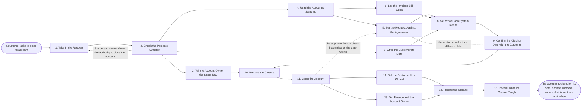

# Reference process: Close a Customer Account

`ref/sup/close-a-customer-account v1`

**value stream:** [Account and billing requests](../../streams/customer-support/account-and-billing-requests.md)
A customer asks to close its account, in a message to support, through a
form inside the product or by letter, and the company has to close it on
the date the customer is entitled to without delaying it or making it
depend on anything else. The account-request-coordinator agent takes in
the request in the customer's own words, and the identity-check agent
checks that the person asking is who they say they are and holds the
authority to close the account. The same day the request goes to the
account owner, where the account has one, in the customer's own words,
and a conversation the account owner has with the customer moves no
date. The account-monitor agent reads the account's plan, its contract
term, its renewal date, the accounts linked to it and its open cases. The
account-request-coordinator agent sets the request against the agreement
and `<your jurisdiction's rules on cancelling a subscription>`, lists the
invoices still open from `<your billing system>`, which support reads and
never changes, offers the customer a copy of its data, and sets out what
each system keeps after the closure and when it goes under
`<your jurisdiction's rule on keeping customer records>`. The customer is
told the closing date and what ends then, and a named closure approver
reads the prepared closure and closes the account on that date. The
customer, the account owner and Finance are told, Finance bills anything
still owed, and any refund the agreement owes for time not used is
decided at Decide a Refund Request. The run closes when the account is
closed on its date, the customer has the confirmation with what is kept
and until when, and the record shows who asked, how their authority was
checked and who closed the account.

**delivers:** status board, a closed customer account

## The goals

- Close [100%] of accounts on the date asked for or the earliest date the agreement allows
- Close [zero] accounts at the request of someone without the authority
- Give [100%] of customers who want their data a copy before the account closes
- Settle [90%] of closures in a single exchange with the customer

## The activities

| # | Activity | What happens | Agents |
|---|---|---|---|
| 1 | Take In the Request | the request in the customer's words, with the date asked for | [account-request-coordinator](../../agents/account-request-coordinator.md) |
| 2 | Check the Person's Authority | who asks, and whether they may close this account | [identity-check](../../agents/identity-check.md) |
| 3 | Tell the Account Owner the Same Day | the request in the customer's words, where there is an owner | account-request-coordinator |
| 4 | Read the Account's Standing | the plan, term, renewal date, linked accounts and open cases | [account-monitor](../../agents/account-monitor.md) |
| 5 | Set the Request Against the Agreement | the notice due, the earliest closing date and what ends then | account-request-coordinator |
| 6 | List the Invoices Still Open | what is unpaid or still to bill, from the billing system | account-request-coordinator |
| 7 | Offer the Customer Its Data | how to take a copy, in what form and by which date | account-request-coordinator |
| 8 | Set What Each System Keeps | what each system keeps, under which rule, and when it goes | account-request-coordinator |
| 9 | Confirm the Closing Date with the Customer | the date, what ends then and what is kept | account-request-coordinator |
| 10 | Prepare the Closure | the authority, agreement, date and data, for the approver | account-request-coordinator |
| 11 | Close the Account | a named person closes it on its date | closure approver (person) |
| 12 | Tell the Customer It Is Closed | the confirmation, what is kept and until when | account-request-coordinator |
| 13 | Tell Finance and the Account Owner | the closing date, what is owed and any refund asked for | account-request-coordinator |
| 14 | Record the Closure | who asked, the authority check, the date and who closed it | account-request-coordinator |
| 15 | Record What the Closure Taught | the reasons the customer gave, and what slowed the closure | account-request-coordinator |

A request to close reaches this process from `ref/sup/take-in-a-request`.
The account owner may work the account at `ref/sls/work-a-churn-risk`,
and a departure that happens anyway closes that run with the customer's
own reason, but this process makes no offer to keep the account and waits
for no save. Finance issues the last invoice at
`ref/fin/issue-a-customer-invoice` and collects anything overdue at
`ref/fin/collect-an-overdue-invoice`, and a refund the customer asks for,
or that the agreement owes for time not used, is decided at
`ref/sup/decide-a-refund-request`. A person's request to delete the data
the company holds about them is a data request and runs at
`ref/sup/answer-a-data-request`, whether or not the account is closing.

## The graph



## The document, with the blanks marked

```
PROCESS: close a customer account     id: <team>/close-a-customer-account   v1
from: ref/sup/close-a-customer-account v1
owner: <who>                          effective: <date>
trigger: a customer asks to close its account, in a message to support,
         through <your account closure form> or by letter, and the request
         is logged against the account in <your support system>
         watch: record=<closure request> system=<your support system>
                change=<a request to close an account is logged>
concurrency: runs may overlap freely - one account has one closure open at
             a time, a second request to close the same account joins it,
             and a request for a linked account is a run of its own held by
             the same person
goal: the account closed by <your closure approver role> on the date the
      customer asked for, or the earliest date the agreement and <your
      jurisdiction's rules on cancelling a subscription> allow, at the
      request of a person whose identity and authority were checked, with
      the account owner told the same day, the customer offered a copy of
      its data first, what each system keeps set under <your
      jurisdiction's rule on keeping customer records>, and the customer,
      the account owner and Finance told
phases:
  take-in-request    - system: the request logged with the customer's own
                       words, who asked, the route it came by, the account
                       and the date the customer asked for
                       owner: account-request-coordinator   after: trigger
                       automation: <level>
  check-authority    - runs assessment: the person checked under <your
                       identity policy> at its version against what <your
                       identity system> and the account already hold, and
                       their authority to close the account checked
                       against the administrators on file and the
                       agreement's signatory
                       owner: identity-check
                       after: take-in-request     automation: <level>
  tell-owner         - system: the request passed the same day, in the
                       customer's own words and with the date asked for,
                       to the account owner named in <your CRM>, where the
                       account has one
                       owner: account-request-coordinator
                       after: check-authority     by: <hours>
                       automation: <level>
  read-standing      - runs collect-and-report: the plan, the entitlement,
                       the contract term, the renewal date, the accounts
                       linked to this one and the open cases, each with the
                       system read and when
                       owner: account-monitor
                       after: check-authority     automation: <level>
  check-agreement    - runs assessment: the request set against the
                       agreement at its version and <your jurisdiction's
                       rules on cancelling a subscription>, giving the
                       notice it needs, the earliest closing date, what
                       ends then, and any refund the agreement owes for
                       time not used
                       owner: account-request-coordinator
                       after: read-standing       automation: <level>
  list-invoices      - runs collect-and-report: the invoices unpaid and
                       the charges still to bill, read from <your billing
                       system>, which support reads and never changes
                       owner: account-request-coordinator
                       after: read-standing       automation: <level>
  offer-data         - human: the customer told how to take a copy of its
                       data, in which form, and the date the copy stops
                       being available, in the approved words
                       owner: account-request-coordinator
                       after: check-authority     automation: <level>
  set-keeping        - runs assessment: what each system that holds the
                       account's data keeps after the closure, under <your
                       jurisdiction's rule on keeping customer records> and
                       <your retention schedule>, and the date each record
                       goes
                       owner: account-request-coordinator
                       after: check-agreement + list-invoices + offer-data
                       automation: <level>
  confirm-date       - human: the customer told the closing date, what ends
                       then, what is kept and until when, and that the
                       closure waits on nothing else, in the approved words
                       owner: account-request-coordinator
                       after: set-keeping         by: <days>
                       automation: <level>
  prepare-closure    - runs collect-and-report: the authority check, the
                       agreement's position, the closing date, the open
                       invoices, the customer's choice about its data and
                       the keeping dates, set out for the approver
                       owner: account-request-coordinator
                       after: confirm-date + tell-owner
                       automation: <level>
  close-account      - convenes approval: <your closure approver role>
                       reads the prepared closure and closes the account on
                       its date in <your support system> and the product,
                       with each keeping date set, and records what was
                       closed
                       owner: <your closure approver role>
                       after: prepare-closure, on the closing date
                       automation: never
  tell-customer      - system: the customer told through details on file
                       that the account is closed, from what date, what is
                       kept and until when, and that any last invoice comes
                       from Finance
                       owner: account-request-coordinator
                       after: close-account       automation: <level>
  tell-finance       - system: the closing date, the open invoices and the
                       charges still to bill sent to <your billing lead
                       role>, any refund asked for or owed sent to
                       ref/sup/decide-a-refund-request, and the account
                       owner told the account is closed
                       owner: account-request-coordinator
                       after: close-account       automation: <level>
  record-closure     - system: who asked, how their identity and authority
                       were checked, when the account owner was told, the
                       closing date, who closed the account, and what is
                       kept and until when
                       owner: account-request-coordinator
                       after: tell-customer + tell-finance
                       automation: <level>
  record-learning    - convenes debrief: the reasons the customer gave, in
                       its own words, passed to the account owner, and what
                       slowed the closure or took a second exchange
                       owner: account-request-coordinator
                       after: record-closure      automation: <level>
run-scoped:
  clock     - runs roll-call                    owner: account-request-coordinator
              every: <cadence>
              from: take-in-request    until: close-account
  data-copy - runs roll-call                    owner: account-request-coordinator
              every: <cadence>
              from: offer-data         until: close-account
handoffs:
  take-in-request -> check-authority [closure-request]: the request in the
    customer's own words, who asked, the account and the date asked for
  check-authority -> tell-owner / read-standing / offer-data
    [authority-checked]: the person, the checks made and the authority
    they hold
  tell-owner -> prepare-closure [owner-told]: the request as passed to the
    account owner, and when
  read-standing -> check-agreement / list-invoices [account-standing]: the
    plan, the term, the renewal date, the linked accounts and the open
    cases, each with where it was read
  check-agreement -> set-keeping [agreement-position]: the notice needed,
    the earliest closing date, what ends then and any refund owed
  list-invoices -> set-keeping [open-invoices]: each unpaid invoice and
    each charge still to bill
  offer-data -> set-keeping [data-offered]: the offer as sent, and what
    the customer chose
  set-keeping -> confirm-date [keeping-dates]: what each system keeps,
    under which rule, and the date each record goes
  confirm-date -> prepare-closure [closing-date]: the date as the customer
    was told, with what ends and what is kept
  prepare-closure -> close-account [prepared-closure]: the authority, the
    agreement, the date, the invoices and the keeping dates
  close-account -> tell-customer / tell-finance [account-closed]: what was
    closed, on which date, by whom, and the keeping dates set
  tell-customer -> record-closure [customer-told]: the confirmation as
    sent, and when
  tell-finance -> record-closure [finance-told]: what went to Finance, to
    the refund process and to the account owner
  record-closure -> record-learning [closure-record]: who asked, the
    checks, who closed the account and what is kept
deviations:
  check-authority -> take-in-request [authority-not-shown]: the person
    cannot show the authority to close the account, so they are told who
    may ask, through details on file, and the request waits for that
    person
  confirm-date -> check-agreement [date-changed]: the customer asks for a
    different date, so the request is set against the agreement again for
    that date
  close-account -> check-agreement [closure-sent-back]: the approver finds
    a check incomplete or the date wrong, so it is put right before the
    account closes, and the customer is told if the date moves
bindings:
  roster:  <who holds each role - agents claiming the abstract agents
           above, and named people for <your closure approver role>, the
           account owner and <your billing lead role>>
  systems: <your support system> (write), <your identity system> (read),
           <your CRM> (read), <your billing system> (read), <your contract
           repository> (read), the product's account settings (write by
           <your closure approver role> only), the notification channel
           (write)
  data:    <your identity policy> <version>, <your jurisdiction's rules on
           cancelling a subscription>, <your jurisdiction's rule on
           keeping customer records>, <your retention schedule>
           <version>, the agreement at its version
policy:
  a closure is never delayed, and never made to depend on a conversation
    with the account owner, a payment or anything else, beyond the date
    the agreement and <your jurisdiction's rules on cancelling a
    subscription> give
  the request goes to the account owner the same day in the customer's
    own words, and support makes no offer to keep the account and
    discusses no price
  an account is closed only by <your closure approver role>, at the
    request of a person whose identity and authority were checked against
    what the company already held
  open invoices are read from <your billing system> and passed to
    Finance, and support collects nothing and changes no bill
  the customer is offered a copy of its data before the account closes
  what each system keeps after the closure, and for how long, follows
    <your jurisdiction's rule on keeping customer records> and <your
    retention schedule>, and the customer is told
  a request to leave before the agreement allows goes to the account
    owner, and any reply that changes what the agreement says is sent by a
    named person through ref/sup/approve-a-sensitive-reply
  the agents close no account and delete no data
measures:
  cycle time: <days> from the request to the account closed
  on time: <target> share of accounts closed on the date asked for or the
           earliest date the agreement allows
  volume: <closures per period>
  quality gate: every closure traces to a checked identity and authority,
                a notice to the account owner on the day of the request,
                an offer of the customer's data and a named approver
```

## The failure edges

- **The person cannot show the authority to close the account.** They are
  told, through the details on file, who at the customer may ask, and the
  request waits for that person. The account's administrators hear of the
  request through the details on file.
- **The customer asks to leave before the agreement allows.** The customer
  is told what the agreement says about the term and the notice, and the
  request to leave early goes to the account owner, who settles any
  change to the agreement with `<your legal team>`. Any reply that changes
  what the agreement says is sent by a named person through
  `ref/sup/approve-a-sensitive-reply`, and without such a change the
  account closes on the earliest date the agreement gives.
- **The account owner wants to talk to the customer first.** The account
  owner may do so, and the closing date stays where it is. Support never
  delays a closure or makes it depend on a conversation, and a customer
  who changes its mind withdraws the request in its own words.
- **The customer has not taken its data by the closing date.** The
  data-copy roll-call reminds the customer before the date. The customer
  may ask for a later date, and the account closes on the date the
  customer settles on.
- **Invoices are still open.** They are passed to Finance, which collects
  them through its own processes, and the closure does not wait for them.
- **A rule keeps data the customer wants deleted.** The record is kept for
  the period the rule sets, and the customer is told which rule keeps it
  and until when. A person's request to delete their own data runs at
  `ref/sup/answer-a-data-request`.
- **The trigger fires while a run is in flight.** One account has one
  closure open at a time, and a second request to close it joins the open
  run. A linked account is a run of its own, held by the same person so
  the customer hears one voice.
- **A run is abandoned.** The customer withdraws the request. The
  withdrawal is recorded in the customer's own words, nothing on the
  account changes, and the account owner is told the same day.
