# Reference process: Coach a Support Person

`ref/sup/coach-a-support-person v1`

**value stream:** [Quality and coaching](../../streams/customer-support/quality-and-coaching.md)
A support specialist's coaching session comes due on the team's cadence,
or the specialist or their team lead asks for one sooner. The
commitment-keeper agent puts the session on both calendars with time off
the queue for both, and the case-reviewer agent prepares the
specialist's cases reviewed since the last session, with the moment in
each case behind each score. The specialist brings their own view: the
cases they choose, the ones they are proud of and the ones they were
unsure about among them, and what they make of the scores. The
commitment-keeper agent reads out the actions agreed last time as met,
running, late or untouched, the support the team lead promised among
them. In a private session the team lead and the specialist go through
the cases together, and the two agree one or two things to practise, the
date for each, and the support the team lead gives, such as time off the
queue, a shift beside a more experienced specialist or a course. The
commitment-keeper agent keeps each action with one owner, one date and a
state in a record only the two of them can open, and on the specialist's
next cases the case-reviewer agent scores the part the two agreed and
shows the result to them. Nothing from the record becomes a decision
about the specialist's job unless the team lead, as a person, takes it to
Human resources. The run closes when each action from the session is
met, carried into the next session with its new date, or closed with its
reason.

**delivers:** document, a coaching plan

## The goals

- Hold [95%] of coaching sessions on their dates
- Keep each session under [45 minutes] of the team lead's time
- Close [80%] of agreed actions by their dates
- Have [85%] of specialists say their coaching was fair and useful

## The activities

| # | Activity | What happens | Agents |
|---|---|---|---|
| 1 | Book the Coaching Session | the date on both calendars, with time off the queue | [commitment-keeper](../../agents/commitment-keeper.md) |
| 2 | Prepare the Reviewed Cases | the cases scored since last time, with the moments | [case-reviewer](../../agents/case-reviewer.md) |
| 3 | Bring the Specialist's Own View | the cases the specialist picks and what they make of them | support specialist (person) |
| 4 | Read Out Last Time's Actions | each action read as met, running, late or untouched | commitment-keeper |
| 5 | Hold the Coaching Session | the two go through the cases together, in private | team lead (person) · support specialist (person) |
| 6 | Send a Questioned Score Back | a score the two think is wrong goes for a second reading | case-reviewer · team lead (person) |
| 7 | Agree What to Practise | one or two points, each with a date | team lead (person) · support specialist (person) |
| 8 | Agree the Support Given | time off the queue, a shift beside a peer or a course | team lead (person) |
| 9 | Record the Actions | each action with one owner, one date and a state | commitment-keeper |
| 10 | Score the Practised Part on New Cases | the agreed part scored on the next cases, for the two | case-reviewer |
| 11 | Chase Each Action to Its Date | each action read as met, running, late or untouched | commitment-keeper |
| 12 | Check In When an Action Runs Late | a short talk, and a new date or a different action | team lead (person) · support specialist (person) |
| 13 | Pass On What Many Need | a need the team shares, with no names, to the quality lead | team lead (person) · quality lead (person) |
| 14 | Close the Coaching Cycle | each action met, carried on or closed with its reason | commitment-keeper · team lead (person) |
| 15 | Record What the Cycle Taught | which actions held, which slipped, and what changes next | commitment-keeper |

The reviewed cases come from `ref/sup/review-support-cases`, and a score
the two think is wrong goes back there for a second reading. A need the
team shares goes to the quality lead for
`ref/sup/calibrate-case-reviews`, `ref/sup/review-the-help-center` or the
course taught at `ref/sup/ramp-a-new-support-person`. A lasting gap in
someone's work, a conduct matter and a concern about how the specialist
is treated belong to Human resources at
`ref/hr/run-a-performance-improvement-plan`,
`ref/hr/issue-a-disciplinary-action` and
`ref/hr/resolve-an-employee-concern`, and they reach those processes only
when a person raises them there. No agent carries anything from the
coaching record into them.

## The graph

```mermaid
flowchart LR
  T([a specialist's coaching session comes due, or either of the two asks for one]) --> A1[1. Book the Coaching Session]
  A1 --> A2[2. Prepare the Reviewed Cases]
  A1 --> A3[3. Bring the Specialist's Own View]
  A1 --> A4[4. Read Out Last Time's Actions]
  A2 --> A5[5. Hold the Coaching Session]
  A3 --> A5
  A4 --> A5
  A5 -. the two think a score is wrong .-> A6[6. Send a Questioned Score Back]
  A5 --> A7[7. Agree What to Practise]
  A6 --> A7
  A7 -. the point is one the team shares .-> A13[13. Pass On What Many Need]
  A7 --> A8[8. Agree the Support Given]
  A8 --> A9[9. Record the Actions]
  A9 --> A10[10. Score the Practised Part on New Cases]
  A9 --> A11[11. Chase Each Action to Its Date]
  A10 --> A11
  A11 -. an action runs late .-> A12[12. Check In When an Action Runs Late]
  A12 -. the two agree a new date or a different action .-> A9
  A11 --> A14[14. Close the Coaching Cycle]
  A13 --> A15[15. Record What the Cycle Taught]
  A14 --> A15
  A15 --> DONE([each action is met, carried into the next session, or closed with its reason])
```



## The document, with the blanks marked

```
PROCESS: coach a support person       id: <team>/coach-a-support-person   v1
from: ref/sup/coach-a-support-person v1
owner: <who>                          effective: <date>
trigger: a coaching session for a support specialist comes due on <your
         coaching cadence>, or the specialist or <your team lead role>
         asks for one sooner, in the commitment tracker
         watch: record=<coaching session> system=<the commitment tracker>
                change=<a session comes due or is asked for>
concurrency: runs may overlap freely across specialists - one coaching
             cycle for one specialist is one run, from one session to the
             next, and a session asked for sooner opens the next cycle
             with the actions still open carried into it
goal: the session held in private on its date, or moved with a reason,
      with the specialist's reviewed cases and their own view in front of
      both, one or two actions to practise and the support the team lead
      gives agreed by the two of them, each action kept with one owner,
      one date and a state in a record only the specialist and <your team
      lead role> can open, and each action met, carried into the next
      session or closed with its reason
phases:
  book-session       - system: the session booked on the calendars of the
                       specialist and <your team lead role> on <your
                       coaching cadence>, or sooner when either asks, with
                       time off the queue held for both
                       owner: commitment-keeper   after: trigger
                       automation: <level>
  prepare-cases      - runs collect-and-report: the specialist's cases
                       reviewed at ref/sup/review-support-cases since the
                       last session, with their final scores, any second
                       reading and the moment behind each score, placed in
                       the record only the two can open
                       owner: case-reviewer
                       after: book-session        automation: <level>
  own-view           - human: the specialist chooses the cases they want
                       to bring, from the review or from their own work,
                       and writes what they make of each and of the
                       scores, in their own words
                       owner: <your support specialist role>
                       after: book-session        automation: never
  read-actions       - runs roll-call: each action from the last session
                       read as met, running, late or untouched, the
                       support <your team lead role> promised read out
                       like any other action
                       owner: commitment-keeper
                       after: book-session        automation: <level>
  hold-session       - convenes briefing: <your team lead role> and the
                       specialist go through the cases together in
                       private, starting from the specialist's own view,
                       with what went well named as plainly as what did
                       not
                       owner: <your team lead role>
                       after: prepare-cases + own-view + read-actions
                       by: <the session date>     automation: never
  send-for-reread    - human: a score the two think is wrong sent back to
                       ref/sup/review-support-cases, for a reviewer who
                       did not give it to read the case again, with the
                       reason in the specialist's own words
                       owner: case-reviewer
                       after: hold-session, when the two think a score is
                       wrong                      automation: <level>
  agree-practice     - convenes decide-and-announce: <your team lead role>
                       and the specialist agree one or two things to
                       practise, the date for each, and how both will
                       know it has landed
                       owner: <your team lead role>
                       after: hold-session, and send-for-reread when it
                       ran                        automation: never
  agree-support      - convenes decide-and-announce: <your team lead role>
                       commits the support the company gives, such as
                       time off the queue, a shift beside a more
                       experienced specialist or a course, each with a
                       date
                       owner: <your team lead role>
                       after: agree-practice      automation: never
  record-actions     - system: each action, the specialist's and the team
                       lead's alike, loaded as an item with one owner, one
                       date and a state in a record only the two of them
                       can open, with the next session on both calendars
                       owner: commitment-keeper
                       after: agree-support, and check-in when the two
                       change an action           automation: <level>
  score-practised    - runs assessment: the part of <your quality rubric>
                       the two agreed scored on the specialist's next
                       cases, with the moment behind each score, and shown
                       only to the two of them
                       owner: case-reviewer
                       after: record-actions      automation: <level>
  chase-actions      - runs roll-call: each action read as met, running,
                       late or untouched, and an action past its date
                       raised to the two of them and nobody else
                       owner: commitment-keeper
                       after: record-actions      every: <cadence>
                       automation: <level>
  check-in           - convenes briefing: <your team lead role> and the
                       specialist talk briefly about an action that runs
                       late, and agree a new date, more support or a
                       different action
                       owner: <your team lead role>
                       after: chase-actions, when an action runs late
                       by: <days>                 automation: never
  pass-on-themes     - human: a need several specialists on the team
                       share, such as an article that confuses, a reply
                       rule read two ways or a topic nobody was taught,
                       sent to <your quality lead role> with no specialist
                       named
                       owner: <your team lead role>
                       after: agree-practice, when the point is one the
                       team shares                automation: never
  close-cycle        - runs roll-call: each action closed as met, carried
                       into the next session with its new date, or closed
                       with the reason, and the specialist's own word on
                       whether the session helped, written by the
                       specialist
                       owner: commitment-keeper
                       after: chase-actions       automation: <level>
  record-learning    - convenes debrief: which actions held and which
                       slipped, whether the support promised arrived on
                       its date, and what the next session changes, with
                       the share of specialists who said coaching helped
                       counted for <your head of support role> with no
                       names
                       owner: commitment-keeper
                       after: close-cycle, and pass-on-themes when it ran
                       automation: <level>
run-scoped:
  actions - runs roll-call                      owner: commitment-keeper
            every: <cadence>
            from: record-actions     until: close-cycle
handoffs:
  book-session -> prepare-cases / own-view / read-actions
    [booked-session]: the date, the time off the queue and the people
  prepare-cases -> hold-session [reviewed-cases]: the specialist's cases
    with their final scores and the moments behind them
  own-view -> hold-session [specialist-view]: the cases the specialist
    chose and what they make of them, in their own words
  read-actions -> hold-session [last-actions]: each action from the last
    session with its state
  hold-session -> agree-practice / send-for-reread [session-held]: what
    the two read together, and any score they think is wrong
  send-for-reread -> agree-practice [score-sent-back]: the score sent
    for a second reading, with the reason
  agree-practice -> agree-support / pass-on-themes [agreed-practice]: the
    points to practise, each with its date and how both will know
  agree-support -> record-actions [agreed-support]: the support the team
    lead gives, each with its date
  record-actions -> score-practised / chase-actions [coaching-plan]: each
    action with one owner, one date and a state, at a version
  score-practised -> chase-actions [practised-part-scores]: the agreed
    part scored on the next cases, for the two of them
  chase-actions -> check-in [late-action]: the action past its date, and
    its owner
  check-in -> record-actions [changed-action]: the new date, the new
    support or the different action the two agreed
  chase-actions -> close-cycle [action-states]: every action with its
    state at the next session
  pass-on-themes -> record-learning [shared-need]: the need, sent with no
    specialist named
  close-cycle -> record-learning [closed-cycle]: each action closed or
    carried on, and the specialist's word on the session
deviations:
  hold-session -> send-for-reread [score-questioned]: the two think a
    score is wrong, so it goes back for a reviewer who did not give it to
    read the case again
  agree-practice -> pass-on-themes [need-shared]: the point is one the
    whole team shares, so it goes to the quality lead with no specialist
    named
  chase-actions -> check-in [action-late]: an action runs late, so the
    two talk before the next session
  check-in -> record-actions [action-changed]: the two agree a new date,
    more support or a different action, so the record is changed and the
    old date stays beside the new one
bindings:
  roster:  <who holds each role - agents claiming the abstract agents
           above, and named people for each team lead, each support
           specialist, the quality lead and the head of support>
  systems: the commitment tracker (write), the calendar (write), <your
           support system> (read), the review record (read), the
           notification channel (write)
  data:    <your quality rubric> <version>, <your coaching cadence>
           <version>, <your jurisdiction's rules on monitoring employees'
           work> <version>, <your record retention schedule> <version>
policy:
  the coaching record is open only to the specialist and their team
    lead, and no agent copies anything from it into another record
  nothing from the record becomes a decision about the specialist's job,
    pay or performance rating unless <your team lead role>, as a person,
    takes it to Human resources, where it runs under that process's own
    rules
  agents score cases, and no agent scores, ranks or rates the specialist
  the support the team lead promised is tracked like the specialist's
    actions, and a late promise is read out at the next session
  the specialist may bring any case and add their own words to any
    score, and their words stay on the record
  a session is held in private, in work time, with time off the queue
    for both
  a concern the specialist raises about how they are treated goes to
    ref/hr/resolve-an-employee-concern, and the coaching record holds no
    note of it
  the record is kept only as long as <your record retention schedule>
    allows, and is deleted after that
measures:
  cycle time: <days> from a session to the actions recorded
  on time: <target> share of sessions held on their dates
  volume: <sessions per team lead per period>
  quality gate: every action has one owner, one date and a state, every
                late promise by the team lead was read out, and nothing
                left the record except by the specialist's agreement or
                a person's own act
```

## The failure edges

- **A session does not happen.** The commitment-keeper agent books it
  again within the days the team sets and tells both of them. A session
  missed twice goes to the team lead's own manager as a missed session,
  with nothing from the record attached.
- **An action runs late.** The two talk before the next session and
  agree a new date, more support or a different action. The old date
  stays beside the new one, and an action moved twice is read out at the
  next session before it is moved again.
- **The two think a score is wrong.** It goes back to
  `ref/sup/review-support-cases` for a reviewer who did not give it to
  read the case again. The session goes on with the case, and the
  practice agreed does not wait for the second reading.
- **The team lead sees a lasting gap or a conduct matter.** Coaching
  does not decide it. The team lead, as a person, raises it with Human
  resources at `ref/hr/run-a-performance-improvement-plan` or
  `ref/hr/issue-a-disciplinary-action`, and the agents copy nothing from
  the coaching record into that process.
- **Someone else asks to see the record.** The commitment-keeper agent
  refuses and tells the two of them. The record is opened to anyone else
  only when the specialist agrees, or when `<your jurisdiction's rules>`
  require it, and then a named person decides with `<your legal team>`.
- **The team lead changes.** The record passes to the new team lead only
  when the specialist agrees. Without that, the new team lead starts from
  the reviewed cases, and the old record is closed and kept as the
  retention schedule allows.
- **The specialist raises a concern.** It goes to
  `ref/hr/resolve-an-employee-concern` and its own restricted record, and
  the coaching record holds no note of it.
- **The trigger fires while a run is in flight.** A specialist has one
  coaching cycle open at a time. A session asked for sooner closes the
  open cycle and opens the next, with every open action carried into it.
- **A run is abandoned.** The specialist leaves the team or the company.
  The record is closed with the reason, nothing from it moves to the new
  team or to the leaving process, and it is kept only as the retention
  schedule allows.
