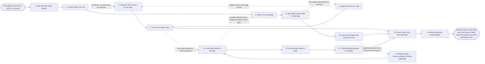

# Reference process: Cover After-Hours Requests

`ref/sup/cover-after-hours-requests v1`

**value stream:** [Answering customers](../../streams/customer-support/answering-customers.md)
The support team's hours end for the day, a weekend or a public holiday
under `<your support hours>`. The staffing-planner agent opens the period
with the channels that stay open and the named person on call under
`<your after-hours rota>`, and confirms that person and the one behind
them can be reached. The request-sorter agent takes in each request as it
would during the day and reads it for what cannot wait until morning,
such as a sign of an account takeover, an outage, a safety report or a
security report, or anything else `<your after-hours rules>` name, and it
pages the person on call within minutes, and the next person on the rota
when nobody answers. The person on call decides what happens to each
urgent case. The customer-question-responder agent answers what approved
content covers by the same rules as during the day, in a reply that says
it comes from an agent and offers a person, and tells every other
customer in the approved words when a person will pick the case up. Every
other case is held with its clock running. Before the team's hours open,
the request-sorter agent sets the held cases in order of urgency and
service level, the staffing-planner agent checks that the morning team
has the people for the queue, and the person on call hands over what they
did. No agent decides an urgent case, and the rota keeps the person on
call inside `<your jurisdiction's working time rules>`. The run closes
when the team's hours open with every held case in order and every urgent
case with a named person, and the record shows each page and each answer
given while the team was away.

**delivers:** status board, the after-hours queue handed to the morning team

**starts:** on a schedule, the support team's hours end on a channel

## The goals

- Page the person on call within [15 minutes] for every urgent case
- Keep pages that prove not to be urgent under [20%] of pages
- Answer [50%] of after-hours requests from approved content before morning
- Start every held case within [1 hour] of the team's hours opening

## The activities

| # | Activity | What happens | Agents |
|---|---|---|---|
| 1 | Open the After-Hours Period | the hours, the channels that stay open and the rota | [staffing-planner](../../agents/staffing-planner.md) |
| 2 | Confirm Who Is on Call | the named person on call and the one behind them | staffing-planner · person on call (person) |
| 3 | Take In Each Request | matched, joined and sorted as during the day | [request-sorter](../../agents/request-sorter.md) |
| 4 | Spot What Cannot Wait for Morning | a takeover, an outage, or a safety or security report | request-sorter |
| 5 | Page the Person on Call | the case and why it cannot wait, within minutes | request-sorter |
| 6 | Page the Next Person on the Rota | when nobody answers the page in time | request-sorter · staffing-planner |
| 7 | Act on the Urgent Case | the person on call holds it, raises it or hands it on | person on call (person) |
| 8 | Answer What Approved Content Covers | by the same rules as during the day, as an agent | [customer-question-responder](../../agents/customer-question-responder.md) |
| 9 | Tell Each Other Customer When a Person Will Reply | the approved notice with the time the team returns | customer-question-responder |
| 10 | Hold What Waits for Morning | each case kept with its clock running | request-sorter |
| 11 | Set the Held Cases in Order | by urgency and by how close each is to its service level | request-sorter |
| 12 | Check the Morning Has the People | the held queue against the morning schedule | staffing-planner |
| 13 | Hand Over to the Morning Team | the queue, what the person on call did and what was promised | request-sorter · person on call (person) · team lead (person) |
| 14 | Record What the Period Taught | pages that were not urgent, answers given and the waits | staffing-planner |

The intake here is `ref/sup/take-in-a-request` run outside the team's
hours, and the answers follow `ref/sup/answer-a-routine-question` with the
same approved content and the same categories kept for a person. The
person on call raises an outage at `ref/sup/raise-a-suspected-outage`,
holds a possible takeover under `ref/sup/verify-a-customers-identity`, and
sends a security or safety report on at
`ref/sup/escalate-a-security-or-safety-report`. Nothing about an outage
is said in public overnight unless a named person approved it at
`ref/sup/post-a-status-update`. A legal threat that arrives overnight goes
to `<your legal team>` when their hours open, unless
`<your after-hours rules>` name it as one that cannot wait. The rota is
built at `ref/sup/build-the-support-schedule`, inside the working time
policy Human resources owns, and the morning queue is worked at
`ref/sup/run-the-days-queue` and `ref/sup/resolve-a-case`.

## The graph



## The document, with the blanks marked

```
PROCESS: cover after-hours requests   id: <team>/cover-after-hours-requests   v1
from: ref/sup/cover-after-hours-requests v1
owner: <who>                          effective: <date>
trigger: the support team's hours end on a channel for the day, a weekend
         or a public holiday under <your support hours>
         watch: record=<support hours> system=<your support system>
                change=<the team's hours end on a channel>
concurrency: runs never overlap for one support desk - one period between
             the team's hours closing and opening is one run, a channel
             whose hours differ is a run of its own, and a request that
             arrives during the run is handled inside it
goal: every request that arrived while the team was away answered from
      approved content by an agent that said it is one, or told in the
      approved words when a person will pick it up, every urgent case
      paged to the named person on call under <your after-hours rota>
      within <minutes> and decided by that person, and every held case
      handed to the morning team in order of urgency with its clock
phases:
  open-period        - system: the period opened with the hours it covers,
                       the channels that stay open, the notice customers
                       will see, and the rota for the period from <your
                       after-hours rota>
                       owner: staffing-planner    after: trigger
                       automation: <level>
  confirm-on-call    - human: the named person on call and the one behind
                       them confirm they can be reached for the period,
                       inside <your jurisdiction's working time rules>
                       owner: staffing-planner
                       after: open-period         by: <minutes>
                       automation: <level>
  take-in-requests   - runs assessment: each request taken in, matched to
                       an account, joined to any case already open and
                       sorted under <your routing rules> at their version,
                       as at ref/sup/take-in-a-request
                       owner: request-sorter
                       after: confirm-on-call     automation: <level>
  spot-urgent        - runs assessment: each request read against <your
                       after-hours rules> for what cannot wait until
                       morning, such as a sign of an account takeover, an
                       outage, a safety report or a security report
                       owner: request-sorter
                       after: take-in-requests    automation: <level>
  page-on-call       - human: the person on call paged with the case and
                       the reason it cannot wait, through the notification
                       channel the rota names
                       owner: request-sorter
                       after: spot-urgent, when the request cannot wait
                       by: <minutes>              automation: <level>
  page-next          - human: the next person on the rota paged when the
                       page goes unanswered for <minutes>, or when the
                       person on call cannot be reached, and <your head of
                       support role> told when the rota runs out
                       owner: request-sorter
                       after: confirm-on-call or page-on-call, when nobody
                       answers                    by: <minutes>
                       automation: <level>
  act-on-urgent      - convenes decide-and-announce: the person on call
                       decides what happens to the case, such as holding
                       the account under ref/sup/verify-a-customers-identity,
                       raising ref/sup/raise-a-suspected-outage, sending a
                       report to <your security team>, or holding the case
                       for the morning, and records the reason
                       owner: <your on-call role>
                       after: page-on-call or page-next
                       by: <minutes>              automation: never
  answer-routine     - human: each question that approved content covers
                       answered by the rules of
                       ref/sup/answer-a-routine-question, in a reply that
                       says it comes from an agent and how to reach a
                       person
                       owner: customer-question-responder
                       after: spot-urgent         by: <minutes>
                       automation: <level>
  tell-when          - human: every other customer told, in the approved
                       after-hours notice, that a person will pick the
                       case up and when the team's hours open, with
                       nothing said about the substance
                       owner: customer-question-responder
                       after: answer-routine, when no approved answer fits
                       or a person must answer    by: <minutes>
                       automation: <level>
  hold-for-morning   - system: each case that waits for a person held in
                       <your support system> with its clock running from
                       the time the request arrived
                       owner: request-sorter
                       after: tell-when, or act-on-urgent when the person
                       on call holds the case     automation: <level>
  order-held-cases   - runs assessment: the held cases set in order by
                       urgency and by how close each is to its service
                       level, with any promise made overnight beside it
                       owner: request-sorter
                       after: hold-for-morning, before the team's hours
                       open                       automation: <level>
  check-morning      - runs assessment: the held queue set against the
                       people on the morning schedule for each channel,
                       with any shortfall named for <your team lead role>
                       owner: staffing-planner
                       after: order-held-cases    automation: <level>
  hand-over          - convenes briefing: the morning team lead receives
                       the queue in order, each urgent case with what the
                       person on call did and who holds it now, and what
                       customers were told overnight
                       owner: request-sorter
                       after: check-morning, and act-on-urgent and
                       answer-routine when they ran
                       automation: <level>
  record-learning    - runs collect-and-report: the requests by channel and
                       hour, the pages and how many proved urgent, the
                       time each page took to answer, the questions
                       answered from approved content and the cases held,
                       added to the record behind the rota at
                       ref/sup/build-the-support-schedule
                       owner: staffing-planner
                       after: hand-over           automation: <level>
run-scoped:
  pages - runs roll-call                        owner: request-sorter
          every: <cadence>
          from: open-period         until: hand-over
handoffs:
  open-period -> confirm-on-call [after-hours-period]: the hours, the
    channels that stay open and the rota
  confirm-on-call -> take-in-requests [on-call-confirmed]: the person on
    call and the one behind them, with how to reach each
  confirm-on-call -> page-next [on-call-unreachable]: the person on call
    who could not be reached, and when
  take-in-requests -> spot-urgent [sorted-request]: the request matched,
    joined and sorted
  spot-urgent -> page-on-call [urgent-request]: the case and what marks it
    as one that cannot wait
  spot-urgent -> answer-routine [request-that-can-wait]: the case with
    nothing found that cannot wait
  page-on-call -> act-on-urgent [page-answered]: the page and who
    answered it, and when
  page-on-call -> page-next [page-unanswered]: the page and how long it
    went unanswered
  page-next -> act-on-urgent [page-answered]: the next person who answered,
    and when
  act-on-urgent -> hold-for-morning [held-by-on-call]: the case the person
    on call decided can wait, with the reason
  act-on-urgent -> hand-over [urgent-decision]: what the person on call
    decided, who holds the case now, and the reason
  answer-routine -> tell-when [needs-a-person]: the case with no approved
    answer, or in a category a person must answer
  answer-routine -> hand-over [answered-overnight]: each answer sent, its
    source and the time
  tell-when -> hold-for-morning [customer-told]: the notice as sent, and
    when
  hold-for-morning -> order-held-cases [held-cases]: every held case with
    its clock
  order-held-cases -> check-morning [ordered-queue]: the held cases in
    order, with any promise made overnight
  check-morning -> hand-over [morning-cover]: the queue against the people
    on the morning schedule, and any shortfall
  hand-over -> record-learning [handed-over]: the queue as the morning
    team lead received it
deviations:
  confirm-on-call -> page-next [on-call-not-reached]: the person on call
    cannot be reached when the period opens, so the next person on the
    rota is asked to cover
  spot-urgent -> page-on-call [cannot-wait]: the request cannot wait until
    morning, so the person on call is paged
  page-on-call -> page-next [page-not-answered]: nobody answers the page in
    time, so the next person on the rota is paged
  act-on-urgent -> hold-for-morning [can-wait-after-all]: the person on
    call decides the case can wait, so it joins the held queue with the
    reason
  answer-routine -> tell-when [no-approved-answer]: no approved answer fits
    or a person must answer, so the customer is told when a person will
    pick it up
  hold-for-morning -> take-in-requests [another-request]: another request
    arrives before the team's hours open, so it is taken in like the rest
bindings:
  roster:  <who holds each role - agents claiming the abstract agents
           above, and named people for <your on-call role> and the one
           behind them in each period, <your team lead role> for the
           morning, and <your head of support role>>
  systems: <your support system> (write), <your knowledge base> (read),
           <your CRM> (read), <your phone system> (read), the
           notification channel (write)
  data:    <your support hours> <version>, <your after-hours rota>
           <version>, <your after-hours rules> <version>, <your routing
           rules> <version>, <your reply rules> <version>, <your
           jurisdiction's working time rules> <version>
policy:
  the agents answer after hours only from approved content and the
    customer's own records, by the same rules as during the day, in a
    reply that says it comes from an agent and how to reach a person
  a reply in a category a person must send waits for a person, and the
    customer is told when that will be
  anything <your after-hours rules> name as unable to wait, such as a
    sign of an account takeover, an outage, a safety report or a
    security report, is paged to the person on call within <minutes>, and
    to the next person on the rota when the page goes unanswered for
    <minutes>
  the person on call decides what happens to each urgent case, and no
    agent holds an account, raises an outage or answers a security report
    itself
  nothing in an account is read out or changed overnight until
    ref/sup/verify-a-customers-identity has passed, and a possible
    takeover is held for the person on call
  nothing about an outage is said in public unless a named person has
    approved it at ref/sup/post-a-status-update
  the rota and the pages follow <your jurisdiction's working time rules>
    and the working time policy Human resources owns, and no agent
    reports a named person's response to a page for discipline
  every held case keeps the clock it started with, and the morning team
    receives every held case in order of urgency
measures:
  cycle time: <minutes> from an urgent request to the person on call
              answering the page
  pages: <target> share of pages that proved urgent
  answered after hours: <target> share of after-hours requests answered
                        from approved content
  volume: <requests per period, by channel and hour>
  quality gate: every urgent case names the person on call who took it,
                every page has its time and its answer, and every held
                case reaches the morning queue in order
```

## The failure edges

- **Nobody on the rota answers.** The request-sorter agent pages each
  person on the rota in turn and then the head of support, and the
  customer receives the after-hours notice meanwhile. A rota that ran out
  goes to the support operations lead the next day for
  `ref/sup/build-the-support-schedule`.
- **The rota has a gap.** The staffing-planner agent finds it when the
  period opens and tells the support operations lead, who decides who
  covers. No agent covers an urgent case in place of a person.
- **A routine request turns out to be urgent.** The customer's reply, or a
  second request, shows it cannot wait. It is read again, and the person
  on call is paged.
- **The page proves not to be urgent.** The person on call holds the case
  for the morning with the reason, and the page is counted for the
  period's review of `<your after-hours rules>`. Nobody is judged for a
  page the rules sent.
- **An outage starts while the team is away.** The person on call raises
  it at `ref/sup/raise-a-suspected-outage`, and customers hear nothing in
  public about it until a named person approves the words.
- **The approved content cannot be read.** No agent answers. Every
  customer receives the after-hours notice, every case is held for the
  morning, and the person on call is told.
- **The morning team is short.** The staffing-planner agent names the
  shortfall before the hours open, and the team lead decides at
  `ref/sup/run-the-days-queue` whether to call in cover or tell customers
  to expect a longer wait.
- **The trigger fires while a run is in flight.** One support desk has one
  after-hours period open at a time, and a channel whose hours differ runs
  its own period with the same rota.
- **A run is abandoned.** The team's hours open early, for example during
  an incident. The hand-over happens at once with the queue as it stands,
  and no case leaves the run without a named holder or a place in the
  morning queue.
