# Reference process: Decide a Refund Request

`ref/sup/decide-a-refund-request v1`

**value stream:** [Account and billing requests](../../streams/customer-support/account-and-billing-requests.md)
A customer asks for money back, for an order, a charge or a period of
service, and every refund has to be decided by a named person who did
not propose it and booked by Finance. The refund-coordinator agent takes
in the request from the case with the customer's own words, reads the
order, the invoice and how the customer paid from `<your billing system>`,
sets the request against `<your refund policy>` and any right to a refund
`<your jurisdiction's consumer rules>` give, and reads what the customer
already received, such as earlier refunds and credits. The support
specialist who holds the case says what the case shows, and anyone who
recommends a refund counts among those who proposed it. The
refund-coordinator agent proposes an amount with the evidence and the
rule behind it, and the delegation-keeper agent names who may decide it:
a named refund approver within `<your refund limit>`, and above it the
person the delegation of authority names, never anyone who proposed it.
That person grants it, grants part of it or refuses it, with the reason,
and the delegation-keeper agent checks the decision before it counts.
For a refund granted, the billing-administrator agent drafts the credit
note for exactly what was decided, the decider approves it at its
version, and the billing-administrator agent issues it. The
refund-coordinator agent passes the refund to Finance's payment run,
which pays it back the way the customer paid under two named releasers.
A named person tells the customer the decision, the reason and when to
expect any money. The run closes when the customer has the decision, any
credit note is issued and any refund is in Finance's payment run, and the
record shows who proposed, who decided and under which version of the
delegation.

**delivers:** verdict, a refund decision

## The goals

- Decide each refund request within [2 working days]
- Keep refunds under [1.5%] of the amount billed
- Have fewer than [5%] of refusals overturned on a complaint
- Ask the customer for evidence no more than [once]

## The activities

| # | Activity | What happens | Agents |
|---|---|---|---|
| 1 | Take In the Refund Request | the customer's words, the order or charge, amount and reason | [refund-coordinator](../../agents/refund-coordinator.md) |
| 2 | Read the Order and the Payment | the order, the invoice and how the customer paid | refund-coordinator |
| 3 | Set the Request Against the Policy | the refund policy and any right a local rule gives | refund-coordinator |
| 4 | Read What the Customer Already Received | earlier refunds, credits and anything an agreement owed | refund-coordinator |
| 5 | Hear the Support Specialist | what the case shows and any recommendation | refund-coordinator · support specialist (person) |
| 6 | Propose the Refund | an amount with the evidence and the rule behind it | refund-coordinator |
| 7 | Name Who May Decide | the decider for the amount, who proposed none of it | [delegation-keeper](../../agents/delegation-keeper.md) |
| 8 | Decide the Refund | granted, partly granted or refused, with the reason | refund approver (person) |
| 9 | Check the Decision Counts | the right person, inside the limit, who proposed none of it | delegation-keeper |
| 10 | Draft the Credit Note | for exactly what was decided, naming the invoice it corrects | [billing-administrator](../../agents/billing-administrator.md) |
| 11 | Approve the Credit Note | the decider confirms it carries what was decided | refund approver (person) |
| 12 | Issue the Credit Note | numbered, dated and sent in the customer's form | billing-administrator |
| 13 | Pass the Refund to Finance's Payment Run | an approved item, paid back the way the customer paid | refund-coordinator |
| 14 | Tell the Customer the Decision | the decision, the reason and when to expect the money | support specialist (person) |
| 15 | Record the Decision | who proposed, who decided, the version and the credit note | refund-coordinator |
| 16 | Record What the Request Taught | the causes behind refunds, sent to the people who own them | refund-coordinator |

A refund request reaches this process from a case at
`ref/sup/resolve-a-case`, from `ref/sup/answer-a-billing-question`, or from
`ref/sup/close-a-customer-account` when the agreement owes money for time
not used. A claim that an invoice was wrong is a billing dispute, and it
goes to `ref/fin/resolve-a-billing-dispute` through
`ref/sup/answer-a-billing-question`. Finance pays each granted refund at
`ref/fin/pay-approved-invoices`, where a named approver approves the run
and two named people release it, and the customer's remittance advice
comes from that run. The limits and the deciders are read from the
delegation of authority that `ref/fin/publish-the-delegation-of-authority`
keeps, and a credit offered after a failure the customer bore, with no
refund asked for, runs at `ref/sup/offer-a-goodwill-credit`.

## The graph

```mermaid
flowchart LR
  T([a customer asks for money back]) --> A1[1. Take In the Refund Request]
  A1 --> A2[2. Read the Order and the Payment]
  A1 --> A5[5. Hear the Support Specialist]
  A2 --> A3[3. Set the Request Against the Policy]
  A2 --> A4[4. Read What the Customer Already Received]
  A3 --> A6[6. Propose the Refund]
  A4 --> A6
  A5 --> A6
  A6 --> A7[7. Name Who May Decide]
  A7 --> A8[8. Decide the Refund]
  A8 -. the decider needs more evidence .-> A6
  A8 --> A9[9. Check the Decision Counts]
  A9 -. the decision was made by someone the delegation does not name for it .-> A7
  A9 --> A10[10. Draft the Credit Note]
  A9 -. the refund is refused .-> A14[14. Tell the Customer the Decision]
  A10 --> A11[11. Approve the Credit Note]
  A11 -. the credit note does not carry what was decided .-> A10
  A11 --> A12[12. Issue the Credit Note]
  A12 --> A13[13. Pass the Refund to Finance's Payment Run]
  A13 --> A14
  A14 --> A15[15. Record the Decision]
  A15 --> A16[16. Record What the Request Taught]
  A16 --> DONE([the customer has the decision, and any refund is in Finance's payment run])
```



## The document, with the blanks marked

```
PROCESS: decide a refund request      id: <team>/decide-a-refund-request   v1
from: ref/sup/decide-a-refund-request v1
owner: <who>                          effective: <date>
trigger: a customer asks for money back for an order, a charge or a
         period of service, in a case in <your support system>, or a
         closure at ref/sup/close-a-customer-account finds money the
         agreement owes for time not used
         watch: record=<refund request> system=<your support system>
                change=<a refund is asked for on a case>
concurrency: runs may overlap freely - one request on one order or charge
             is one run, a second request on the same charge joins it, and
             requests on a customer's other charges are runs of their own
             held by the same person
goal: the refund granted, partly granted or refused with its reason by a
      named person whom <your delegation of authority> names for the
      amount and who proposed none of it, within <your refund limit> or by
      the person the delegation names above it, any credit note drafted
      for exactly what was decided, approved by the decider and issued,
      any refund passed to ref/fin/pay-approved-invoices to be paid back
      the way the customer paid, and the decision sent to the customer by
      a named person
phases:
  take-in-request    - system: the request logged from the case with the
                       customer's own words, the order or the charge, the
                       amount asked for, the reason given and who holds the
                       case
                       owner: refund-coordinator   after: trigger
                       automation: <level>
  read-order         - runs collect-and-report: the order, the invoice, the
                       payment and how the customer paid, from <your
                       billing system> and <your order system>, which
                       support reads and never changes
                       owner: refund-coordinator
                       after: take-in-request     automation: <level>
  check-policy       - runs assessment: the request set against <your
                       refund policy> at its version and any right to a
                       refund <your jurisdiction's consumer rules> give,
                       with the rule that applies and the amount it allows
                       owner: refund-coordinator
                       after: read-order          automation: <level>
  read-history       - runs collect-and-report: the refunds, the credits
                       and the goodwill the account already received, and
                       any credit an agreement owed, each with its date and
                       who decided it
                       owner: refund-coordinator
                       after: read-order          automation: <level>
  hear-specialist    - convenes briefing: <your support specialist role>
                       who holds the case says what the case shows and may
                       recommend an amount, and is then counted among those
                       who proposed the refund
                       owner: refund-coordinator
                       after: take-in-request     by: <days>
                       automation: <level>
  propose-refund     - runs assessment: an amount proposed at a version, in
                       full, in part or none, with the rule behind it, the
                       evidence, what the customer already received, and
                       the names of everyone who proposed or recommended it
                       owner: refund-coordinator
                       after: check-policy + read-history + hear-specialist
                       automation: <level>
  name-decider       - runs assessment: who may decide this amount under
                       <your delegation of authority> at its version, the
                       named refund approver within <your refund limit> and
                       the person the delegation names above it, with each
                       stand-in, leaving out everyone who proposed it
                       owner: delegation-keeper
                       after: propose-refund      automation: <level>
  decide-refund      - convenes decide-and-announce: <your refund approver
                       role>, or the person the delegation names for the
                       amount, grants the refund, grants part of it or
                       refuses it, from the proposal and its evidence, with
                       the reason
                       owner: <your refund approver role>
                       after: name-decider        by: <days>
                       automation: never
  check-decision     - runs assessment: the decision checked before it
                       counts, made by someone the version in force names
                       for the amount, inside their limit, and by nobody
                       who proposed or recommended the refund
                       owner: delegation-keeper
                       after: decide-refund       automation: <level>
  draft-credit       - human: the credit note drafted at a version for
                       exactly what was decided, naming the invoice it
                       corrects and treating the tax as <your
                       jurisdiction's indirect tax rules> require
                       owner: billing-administrator
                       after: check-decision, when the refund is granted in
                       whole or in part           automation: <level>
  approve-credit     - convenes approval: the person who decided the refund
                       reads the credit note at its version against the
                       decision and approves it before it is issued
                       owner: <your refund approver role>
                       after: draft-credit        by: <days>
                       automation: never
  issue-credit       - system: the credit note given its number and date in
                       <your billing system>, sent in the customer's form,
                       and passed to <your receivables ledger>
                       owner: billing-administrator
                       after: approve-credit      automation: <level>
  pass-to-payment    - system: the refund passed to
                       ref/fin/pay-approved-invoices as an approved item,
                       with the decision, the credit note and the way the
                       customer paid, so it goes back by the same route
                       owner: refund-coordinator
                       after: issue-credit        automation: <level>
  tell-customer      - human: <your support specialist role> writes the
                       decision, the reason, the amount and when to expect
                       it, and the route to complain, and the reply is sent
                       by a named person through
                       ref/sup/approve-a-sensitive-reply when it offers
                       money
                       owner: <your support specialist role>
                       after: pass-to-payment, or check-decision when the
                       refund is refused          by: <days>
                       automation: never
  record-decision    - system: the request, the evidence, who proposed,
                       who decided, the version of the delegation, the
                       credit note, the payment run and the reply as sent,
                       on the case and in <your refund register>
                       owner: refund-coordinator
                       after: tell-customer       automation: <level>
  record-learning    - convenes debrief: the causes behind the refunds,
                       such as a product fault, a billing error or a policy
                       customers misread, sent to the people who own them
                       owner: refund-coordinator
                       after: record-decision     automation: <level>
run-scoped:
  clock    - runs roll-call                     owner: refund-coordinator
             every: <cadence>
             from: take-in-request    until: tell-customer
  proposer - runs assessment                    owner: delegation-keeper
             from: hear-specialist    until: approve-credit
handoffs:
  take-in-request -> read-order / hear-specialist [refund-request]: the
    customer's own words, the order or charge, the amount and the reason
  read-order -> check-policy / read-history [order-record]: the order, the
    invoice, the payment and how the customer paid, each with where it was
    read
  check-policy -> propose-refund [policy-reading]: the rule that applies
    and the amount it allows
  read-history -> propose-refund [refund-history]: what the account already
    received, with dates and deciders
  hear-specialist -> propose-refund [specialist-account]: what the case
    shows and any recommendation, with the specialist named as a proposer
  propose-refund -> name-decider [proposed-refund]: the amount, the rule,
    the evidence and everyone who proposed it, at a version
  name-decider -> decide-refund [named-decider]: the decider and the
    stand-ins for the amount, from the version in force
  decide-refund -> check-decision [refund-decision]: granted, partly
    granted or refused, with the reason and the amount
  check-decision -> draft-credit / tell-customer [counted-decision]: the
    decision as checked against the version in force
  draft-credit -> approve-credit [draft-credit-note]: the credit note at a
    version, naming the invoice it corrects
  approve-credit -> issue-credit [approved-credit-note]: the credit note as
    approved, with the approver and the version. A change to it voids the
    approval
  issue-credit -> pass-to-payment [issued-credit-note]: the credit note
    with its number and date, as sent
  pass-to-payment -> tell-customer [refund-passed]: the approved item as
    passed to Finance, and the run it joins
  tell-customer -> record-decision [decision-sent]: the reply as sent, by
    whom and when
  record-decision -> record-learning [refund-record]: the request, who
    proposed, who decided and what was paid or refused
deviations:
  decide-refund -> propose-refund [needs-more-evidence]: the decider names
    what is missing, so it is gathered, the refund is proposed again, and
    the customer is told if the decision will come later
  check-decision -> name-decider [decision-does-not-count]: the decision
    was made by someone the version does not name for the amount, past
    their limit, or by someone who proposed it, so it is decided again by
    the person the version names
  check-decision -> tell-customer [refund-refused]: the refund is refused,
    so no credit note is drafted and the customer is told the reason and
    the route to complain
  approve-credit -> draft-credit [credit-does-not-match]: the credit note
    does not carry exactly what was decided, so it is drafted again
bindings:
  roster:  <who holds each role - agents claiming the abstract agents
           above, and named people for <your refund approver role>, each
           decider <your delegation of authority> names above <your refund
           limit>, <your support specialist role> and the named approvers
           at ref/sup/approve-a-sensitive-reply>
  systems: <your support system> (write), <your billing system> (read,
           and write by billing-administrator for credit notes only),
           <your order system> (read), <your refund register> (write),
           <your receivables ledger> (write), the notification channel
           (write)
  data:    <your refund policy> <version>, <your refund limit>, <your
           delegation of authority> <version>, <your jurisdiction's
           consumer rules>, <your jurisdiction's indirect tax rules>
           <version>, the agreement at its version
policy:
  every refund is decided by a named person, <your refund approver role>
    within <your refund limit> and the person <your delegation of
    authority> names above it, and never by an agent
  whoever proposes or recommends a refund never decides it, and the
    delegation-keeper agent checks every decision before it counts
  a credit note carries exactly what was decided, names the invoice it
    corrects, and is issued only once the decider has approved it at its
    version, and an issued invoice is never edited
  a refund is paid only through ref/fin/pay-approved-invoices, approved by
    a named approver and released by two named people under <your dual
    control rule>, back the way the customer paid
  a request to refund to an account other than the one the customer paid
    from is treated as an attempt at fraud until a person confirms it
    through a contact already on file
  a right to a refund that <your jurisdiction's consumer rules> give is
    granted whatever <your refund policy> says
  the decision is sent to the customer by a named person, with the reason
    and the route to complain
  no agent moves money, approves a refund or changes a bill
measures:
  cycle time: <days> from the request to the decision sent
  on time: <target> share of requests decided within <days>
  volume: <refund requests per period>, and <the amount refunded per
          period>
  quality gate: every refund traces to a proposal with its evidence, a
                decider the delegation names who proposed none of it, a
                credit note the decider approved and an item in Finance's
                payment run
```

## The failure edges

- **The customer says an invoice was wrong.** The request is a billing
  dispute. It goes to `ref/fin/resolve-a-billing-dispute` through
  `ref/sup/answer-a-billing-question`, and this run closes with the reason
  once Finance holds the claim, so the customer is not answered twice.
- **The decider needs more evidence.** What the decider named is gathered
  and the refund is proposed again. The customer is asked once for
  anything only the customer holds, and is told if the decision will come
  later, with the new date.
- **The decision does not count.** It was made by someone the version in
  force does not name for the amount, by someone past their limit, or by
  someone who proposed the refund. It is decided again by the person the
  version names, and the customer hears nothing until it counts.
- **A local rule gives the customer a right to the refund.** The right is
  granted whatever the refund policy says, and the record names the rule.
- **The customer asks for the refund to go somewhere new.** A request to
  pay into an account other than the one the customer paid from is
  treated as an attempt at fraud until a person confirms it through a
  contact already on file, and the message that asked for it is never used
  to confirm it.
- **The customer does not accept the decision.** The customer is told the
  route to complain, and a formal complaint runs at
  `ref/sup/answer-a-formal-complaint`. A refusal is reopened only by a
  named person, and a legal threat goes to `<your legal team>` the same
  day.
- **The trigger fires while a run is in flight.** One request on one
  charge is one run, and a second request on the same charge joins it.
  Requests on the customer's other charges are runs of their own, held by
  the same person so the customer hears one voice.
- **A run is abandoned.** The customer withdraws the request. The
  withdrawal is recorded in the customer's own words, no credit note is
  issued and nothing goes to Finance's payment run from an abandoned run.
