# Reference process: Escalate a Case to a Specialist

`ref/sup/escalate-a-case-to-a-specialist v1`

**value stream:** [Escalations and bug reports](../../streams/customer-support/escalations-and-bug-reports.md)
A support specialist holding a case cannot resolve it, because the problem
is beyond what the first tier can see or reach, the case has passed
`<your escalation threshold>` without an answer, or the customer asks for
someone more senior. The case-manager agent gathers the case as it stands:
the customer's records, every reply sent and received, each step tried
with its result, and every promise made to the customer with its date.
The escalation-coordinator agent writes one summary from it, the first
specialist confirms that the summary says what happened, and the
coordinator chooses the tier and a named specialist under
`<your escalation tiers>` from the topic, the account's entitlement and
who is free inside the service level. The escalation specialist accepts
the case or names the tier it belongs in, and the case-manager agent moves
the case to its new owner with its clock and its promises. The new owner
tells the customer who now holds the case and when they will hear next,
with no fix and no date for a fix promised. When the specialist needs to
talk to the customer, the meeting-scheduler agent books the call and
briefs both sides. The specialist works the case to an answer, a
workaround or a reproduced fault, and a case this tier cannot resolve goes
one tier up with the summary brought up to date. The run closes when the
case is resolved by its new owner or its fault has gone to
`ref/sup/report-a-confirmed-bug`, the first specialist knows what solved
it, and the reason for the escalation is recorded.

**delivers:** document, an escalation summary

**starts:** on an event, a support specialist cannot resolve a case

## The goals

- Have each escalated case accepted by a named specialist within [2 working hours]
- Send [90%] of escalations to the right tier the first time
- Keep escalations under [15%] of all cases
- Have [95%] of escalated cases need nothing asked again of the customer

## The activities

| # | Activity | What happens | Agents |
|---|---|---|---|
| 1 | Take In the Escalation | the case and the reason it cannot be resolved where it is | [escalation-coordinator](../../agents/escalation-coordinator.md) |
| 2 | Gather the Case as It Stands | the records, the replies, the steps tried and each promise | [case-manager](../../agents/case-manager.md) |
| 3 | Write the Escalation Summary | the problem, what was tried and what the customer was told | escalation-coordinator |
| 4 | Confirm the Summary | the first specialist checks it says what happened | support specialist (person) |
| 5 | Choose the Tier and the Specialist | a named specialist by topic, entitlement and who is free | escalation-coordinator |
| 6 | Accept the Case | the specialist takes it, or names the tier it belongs in | escalation specialist (person) |
| 7 | Move the Case to Its New Owner | one owner, with the clock and the promises carried over | case-manager |
| 8 | Tell the Customer Who Holds It | the new owner, and when the customer will hear next | escalation specialist (person) · case-manager |
| 9 | Decide Whether a Call Is Needed | to watch the fault happen or to agree what is asked | escalation specialist (person) |
| 10 | Book the Call with the Customer | a time in the customer's own time zone, both sides briefed | [meeting-scheduler](../../agents/meeting-scheduler.md) |
| 11 | Hold the Call | the specialist and the customer, with the notes on the case | escalation specialist (person) · customer (person) · meeting-scheduler |
| 12 | Work the Case to an Answer | an answer, a workaround or a fault reproduced with its steps | escalation specialist (person) |
| 13 | Escalate to the Next Tier | the summary brought up to date and the case sent one tier up | escalation-coordinator |
| 14 | Hand the Outcome Back | resolved by the new owner, or the fault sent to be filed | escalation-coordinator |
| 15 | Tell the First Specialist What Solved It | so the next case like it can stay in the first tier | escalation-coordinator |
| 16 | Record What the Escalation Taught | why it escalated, how long it took, whether the summary held | escalation-coordinator |

A case comes here from `ref/sup/resolve-a-case` when the specialist who
holds it cannot resolve it, and the new owner then resolves it there under
the same rules. A reproduced fault goes on to
`ref/sup/report-a-confirmed-bug`, and a request for something the product
does not do goes to `ref/sup/log-a-feature-request`. A report of a
security weakness, a possible exposure of data or a product that may cause
harm leaves for `ref/sup/escalate-a-security-or-safety-report` within the
hour, and a customer who complains formally is answered at
`ref/sup/answer-a-formal-complaint` while the case goes on here. Any reply
on the case that admits fault, promises a fix or a date, or offers money
goes through `ref/sup/approve-a-sensitive-reply`. An account whose
agreement names a technical contact or a faster tier is read from its
entitlement, and the answer that solved the case reaches
`ref/sup/find-gaps-in-the-help-center` when it belongs in an article.

## The graph

```mermaid
flowchart LR
  T([a support specialist cannot resolve a case]) --> A1[1. Take In the Escalation]
  A1 --> A2[2. Gather the Case as It Stands]
  A2 --> A3[3. Write the Escalation Summary]
  A3 --> A4[4. Confirm the Summary]
  A4 -. the first specialist corrects the summary .-> A3
  A4 --> A5[5. Choose the Tier and the Specialist]
  A5 --> A6[6. Accept the Case]
  A6 -. the specialist names another tier .-> A5
  A6 --> A7[7. Move the Case to Its New Owner]
  A7 --> A8[8. Tell the Customer Who Holds It]
  A7 --> A9[9. Decide Whether a Call Is Needed]
  A9 --> A10[10. Book the Call with the Customer]
  A10 --> A11[11. Hold the Call]
  A8 --> A12[12. Work the Case to an Answer]
  A9 --> A12
  A11 --> A12
  A12 -. this tier cannot resolve the case .-> A13[13. Escalate to the Next Tier]
  A13 -. a specialist in the next tier is chosen .-> A5
  A12 --> A14[14. Hand the Outcome Back]
  A14 --> A15[15. Tell the First Specialist What Solved It]
  A15 --> A16[16. Record What the Escalation Taught]
  A16 --> DONE([the case is resolved by a named specialist or its fault is filed, and the reason is recorded])
```



## The document, with the blanks marked

```
PROCESS: escalate a case to a specialist  id: <team>/escalate-a-case-to-a-specialist   v1
from: ref/sup/escalate-a-case-to-a-specialist v1
owner: <who>                          effective: <date>
trigger: a support specialist marks a case in <your support system> for
         escalation, the case passes <your escalation threshold> without
         an answer, or the customer asks for someone more senior
         watch: record=<support case> system=<your support system>
                change=<a case is marked for escalation or passes the
                escalation threshold>
concurrency: runs may overlap freely - one escalation of one case is one
             run, a case is held by one specialist at a time, and a second
             escalation of the same case to the next tier continues the
             run that is open
goal: the case held by a named specialist in the right tier of <your
      escalation tiers> who accepted it with its full history, what was
      tried and what the customer was told, the customer told who holds it
      and when they will hear next with no fix or date promised, any call
      the specialist needed held with its notes on the case, the case
      resolved by its new owner or its fault sent to
      ref/sup/report-a-confirmed-bug, and the reason for the escalation
      recorded
phases:
  take-in-escalation - system: the case lands with the reason the first
                       specialist gives, the threshold it passed, or the
                       customer's own words asking for someone more senior
                       owner: escalation-coordinator   after: trigger
                       automation: <level>
  gather-case        - runs collect-and-report: the customer's records
                       and the account's entitlement, every reply sent and
                       received, each step tried with its result, and
                       every promise made to the customer with its date
                       owner: case-manager
                       after: take-in-escalation  automation: <level>
  write-summary      - human: one summary of the problem as the customer
                       sees it, the steps tried and what each showed, what
                       the customer was told, and what the specialist is
                       asked to do, each line traced to the case
                       owner: escalation-coordinator
                       after: gather-case         automation: <level>
  confirm-summary    - human: the first specialist reads the summary and
                       confirms it says what happened, or corrects it
                       owner: <your support specialist role>
                       after: write-summary       by: <hours>
                       automation: never
  choose-specialist  - runs assessment: the tier in <your escalation
                       tiers> the problem needs, and a named specialist in
                       it, chosen by the topic, the account's entitlement
                       and who is free inside <your service level policy>
                       owner: escalation-coordinator
                       after: confirm-summary     automation: <level>
  accept-case        - convenes decide-and-announce: <your escalation
                       specialist role> accepts the case with the summary
                       beside it, or names the tier it belongs in and why
                       owner: <your escalation specialist role>
                       after: choose-specialist   by: <hours>
                       automation: never
  move-case          - system: the case moved in <your support system> to
                       its new owner, its clock running on from the
                       customer's first request, each promise carried over
                       with its date, and the first specialist kept on it
                       as a watcher
                       owner: case-manager
                       after: accept-case         automation: <level>
  tell-customer      - human: the customer told by the new owner who now
                       holds the case and when they will hear next, inside
                       the service level, with no fix and no date for a
                       fix promised
                       owner: <your escalation specialist role>
                       after: move-case           by: <hours>
                       automation: never
  decide-on-call     - convenes decide-and-announce: the specialist
                       decides whether the case needs a call with the
                       customer, such as to watch the fault happen or to
                       agree what is being asked
                       owner: <your escalation specialist role>
                       after: move-case           automation: never
  book-call          - system: times offered in the customer's own time
                       zone, the invitation accepted with the joining
                       details, and both sides briefed with the summary
                       owner: meeting-scheduler
                       after: decide-on-call, when a call is needed
                       automation: <level>
  hold-call          - convenes briefing: the specialist and the customer
                       go through the problem, and the notes, with any
                       recording the customer agreed to under <your
                       jurisdiction's rules on recording a call>, are put
                       on the case
                       owner: <your escalation specialist role>
                       after: book-call           automation: never
  work-case          - human: the specialist works the case to an answer,
                       a workaround or a fault reproduced with the steps
                       that show it
                       owner: <your escalation specialist role>
                       after: tell-customer + decide-on-call, and
                       hold-call when it ran      automation: never
  escalate-further   - runs assessment: a case this tier cannot resolve,
                       with the summary brought up to date with what this
                       tier tried and found, sent back to choose a
                       specialist in the next tier up
                       owner: escalation-coordinator
                       after: work-case, when this tier cannot resolve it
                       automation: <level>
  hand-back          - system: the case resolved by its new owner at
                       ref/sup/resolve-a-case, or its reproduced fault
                       sent to ref/sup/report-a-confirmed-bug with the
                       steps and the evidence
                       owner: escalation-coordinator
                       after: work-case           automation: <level>
  tell-first-tier    - human: the first specialist told what solved the
                       case or what the fault was, so the next case like
                       it can stay in the first tier
                       owner: escalation-coordinator
                       after: hand-back           automation: <level>
  record-learning    - convenes debrief: why the case escalated, how long
                       each step took, whether the summary was enough,
                       whether the first tier chosen was right, and
                       whether the answer belongs in the help center at
                       ref/sup/find-gaps-in-the-help-center
                       owner: escalation-coordinator
                       after: tell-first-tier     automation: <level>
run-scoped:
  clock    - runs roll-call                     owner: case-manager
             every: <cadence>
             from: take-in-escalation  until: hand-back
  promises - runs assessment                    owner: case-manager
             from: gather-case         until: run close
handoffs:
  take-in-escalation -> gather-case [escalation-request]: the case and the
    reason for escalating it, in the first specialist's or the customer's
    own words
  gather-case -> write-summary [case-history]: the records, the replies,
    the steps tried and each promise with its date
  write-summary -> confirm-summary [draft-summary]: the summary at a
    version, each line traced to the case
  confirm-summary -> choose-specialist [escalation-summary]: the summary
    as the first specialist confirmed it
  choose-specialist -> accept-case [proposed-owner]: the tier, the named
    specialist and the reason for each
  accept-case -> move-case [accepted-case]: the specialist who accepted
    the case, and when
  move-case -> tell-customer / decide-on-call [moved-case]: the case with
    its new owner, its clock and its promises
  decide-on-call -> book-call [call-needed]: what the call is for, and who
    must attend
  book-call -> hold-call [booked-call]: the time, the joining details and
    the briefing each side received
  tell-customer -> work-case [customer-told]: the message as sent, and the
    date the customer will hear next
  hold-call -> work-case [call-notes]: the notes on the case, and any
    recording the customer agreed to
  work-case -> hand-back [case-outcome]: the answer, the workaround or the
    reproduced fault with its steps
  work-case -> escalate-further [tier-cannot-resolve]: what this tier
    tried and found
  hand-back -> tell-first-tier [case-handed-back]: the case as resolved,
    or the fault as sent to ref/sup/report-a-confirmed-bug
  tell-first-tier -> record-learning [first-tier-told]: what the first
    specialist was told, and when
deviations:
  confirm-summary -> write-summary [summary-corrected]: the first
    specialist corrects the summary, so it is written again before anyone
    else reads it
  accept-case -> choose-specialist [wrong-tier]: the specialist names
    another tier, so the tier and the specialist are chosen again with
    that reason
  work-case -> escalate-further [tier-cannot-resolve]: this tier cannot
    resolve the case, so it goes one tier up with the summary brought up
    to date
  escalate-further -> choose-specialist [next-tier]: a specialist in the
    next tier is chosen, and the customer is told who now holds the case
bindings:
  roster:  <who holds each role - agents claiming the abstract agents
           above, and named people for the support specialists, the
           escalation specialists in each tier of <your escalation tiers>
           and the team leads>
  systems: <your support system> (write), <your CRM> (read), <your
           calendar> (write), the notification channel (write)
  data:    <your escalation tiers> <version>, <your service level policy>
           <version>, <your reply rules> <version>, the account's
           entitlement at its version
policy:
  every escalated case is held by one named specialist at a time who
    accepted it, and the first specialist stays on it as a watcher until
    it closes
  the summary is confirmed by the first specialist before anyone else
    reads it, so the customer is never asked again for what they already
    said
  the customer is told who holds the case and when they will hear next,
    and that message promises no fix and no date for one
  a reply that admits fault, promises a fix or a date, or offers money
    goes through ref/sup/approve-a-sensitive-reply
  the tier and the specialist are chosen by <your escalation tiers> and
    the account's entitlement, and a team lead decides when no specialist
    in the tier is free inside the service level
  the clock runs from the customer's first request, and an escalation
    never restarts it
  a call is recorded only where the customer agreed and <your
    jurisdiction's rules on recording a call> allow
  a security or safety report, a legal threat or a request about a
    person's own data found in the case leaves this process for the one
    that holds it, the same hour for a security or safety report and the
    same day for the others
  the agents gather, summarize, choose and move cases, and decide no
    answer
measures:
  cycle time: <hours> from the escalation asked for to the case accepted
  on time: <target> share of escalated cases accepted inside the time
           <your escalation tiers> set
  volume: <escalations per period, by tier and topic>
  quality gate: every escalated case names the specialist who accepted
                it, carries a summary the first specialist confirmed, and
                shows what the customer was told and when
```

## The failure edges

- **The summary leaves something out.** The first specialist corrects it
  before anyone else reads it. A specialist who later finds something
  missing asks the first specialist, and asks the customer only for what
  only the customer knows.
- **No specialist in the tier is free inside the service level.** The
  escalation-coordinator agent names the cases at risk, and the team lead
  decides whether to borrow a specialist from another team, call in the
  person on call, or tell the customer to expect a longer wait. No agent
  gives a customer a new time on its own.
- **The specialist names another tier.** The tier and the specialist are
  chosen again with that reason, and the time the case spent waiting is
  recorded so that the tiers can be put right.
- **The customer asks for someone more senior.** A team lead hears the
  customer. When the customer complains formally, or
  `<your complaints policy>` treats what they say as a formal complaint,
  it goes to `ref/sup/answer-a-formal-complaint` the same day, and the
  case goes on here.
- **The case holds something that belongs elsewhere.** A security or
  safety report leaves for `ref/sup/escalate-a-security-or-safety-report`
  within the hour. A legal threat or a regulator's letter goes to
  `<your legal team>` the same day and the reply waits for them, and a
  request about a person's own data goes to `ref/sup/answer-a-data-request`.
- **The customer does not come to the call.** The meeting-scheduler agent
  chases once and rebooks once, and the specialist then works the case
  from what is already known and tells the customer how to reach them.
- **The trigger fires while a run is in flight.** One case has one
  escalation run open at a time. A second escalation of the same case to
  the next tier continues that run, and a new problem the customer raises
  in the case becomes a case of its own.
- **A run is abandoned.** The customer withdraws the case, or the first
  specialist solves it before anyone accepts it. The case stays with the
  first specialist, and the escalation is closed with its reason.
