# Reference process: Escalate a Security or Safety Report

`ref/sup/escalate-a-security-or-safety-report v1`

**value stream:** [Escalations and bug reports](../../streams/customer-support/escalations-and-bug-reports.md)
A customer reports a weakness in the product's security, says their data
or someone else's may have been exposed, or reports that the product may
cause harm, in a case, on a call, in a public place or to the person on
call after hours. The escalation-coordinator agent takes in the report
exactly as it was made, in the customer's own words, and restricts the
case to the named people who must see it. When the report was made in a
public place, it asks the owner of that place to take it out of public
view. It sorts the report as a security weakness, a possible exposure of
data or a risk of harm, and sends it within the hour to
`<your security team>` or the named safety owner, paging the person on
call outside working hours, until a named person confirms they hold it
and sets its severity. A possible exposure of personal data also goes the
same hour to the privacy lead and `<your legal team>`, because
`<your jurisdiction's deadline for reporting a data breach>` may run from
the moment the company first knew. The security lead, or the safety owner
for a safety report, decides what the reporter may be told. Every reply to
the reporter is drafted by the support specialist who holds the case,
checked by the reply-check agent, and approved and sent by the named
approver for security and safety replies. The escalation-coordinator agent follows the report up on the
cadence its severity sets and joins later reports of the same thing to
it. The run closes when the security team or the safety owner has closed
the report, the reporter has received the approved outcome, and the
restricted record shows who knew what and when.

**delivers:** document, a security or safety report

**starts:** on an event, a customer reports a security weakness, a data exposure or a risk of harm

## The goals

- Put each report in the hands of a named person in the security team within [1 hour]
- Keep reports discussed in a public channel at [zero]
- Send each reporter an approved first reply within [1 working day]
- Keep reports the security team sends back as routine under [30%]

## The activities

| # | Activity | What happens | Agents |
|---|---|---|---|
| 1 | Take In the Report | the report in the customer's own words, and how it arrived | [escalation-coordinator](../../agents/escalation-coordinator.md) |
| 2 | Restrict the Case | open only to the named people who must see it | escalation-coordinator |
| 3 | Take It out of Public View | the owner of a public place asked to remove the report | escalation-coordinator |
| 4 | Sort the Report | a security weakness, an exposure of data or a risk of harm | escalation-coordinator |
| 5 | Send It to the Security Team or the Safety Owner | within the hour, with the report as it was made | escalation-coordinator |
| 6 | Confirm Who Holds It | a named person confirms they hold it and sets its severity | security lead (person) · safety owner (person) |
| 7 | Tell the Privacy Lead and the Legal Team | a possible exposure of personal data, the same hour | escalation-coordinator |
| 8 | Agree What May Be Said | what the reporter may be told, set by whoever holds it | security lead (person) · safety owner (person) · legal team (person) |
| 9 | Draft the Reply to the Reporter | from what was agreed, and nothing more | support specialist (person) |
| 10 | Check the Reply | held as a security or safety reply, anything extra named | [reply-check](../../agents/reply-check.md) |
| 11 | Approve and Send the Reply | the named approver reads it with the report and sends it | security reply approver (person) |
| 12 | Follow the Report Up | the security team asked on the cadence its severity sets | escalation-coordinator |
| 13 | Join Later Reports of the Same Thing | each new reporter linked to the report already held | escalation-coordinator |
| 14 | Close the Report | the security team or safety owner closes it with its outcome | security lead (person) · safety owner (person) |
| 15 | Tell the Reporter the Outcome | drafted, checked, approved and sent as every reply is | support specialist (person) · reply-check · security reply approver (person) |
| 16 | Record the Outcome | who knew what and when, in the restricted record | escalation-coordinator |
| 17 | Record What the Run Taught | the time to reach a named person, and anything said publicly | escalation-coordinator |

A report reaches this process from `ref/sup/take-in-a-request`, from a
case at `ref/sup/resolve-a-case` or `ref/sup/escalate-a-case-to-a-specialist`,
from a fault at `ref/sup/report-a-confirmed-bug` that turns out to expose
data or cause harm, or from the person on call at
`ref/sup/cover-after-hours-requests`. The security team runs its own
response, and support's part is the reporter: getting the report to a
named person within the hour, keeping it private, and making sure every
word the reporter hears was approved. Whether a possible exposure must be
reported outside the company is decided by the privacy lead and
`<your legal team>`, and a person's request about their own data that
follows it is answered at `ref/sup/answer-a-data-request`. What the
company says in public about a security or safety event is decided at
`ref/mkt/crisis-communication`, and an event that stops the product
working for many customers is raised at `ref/sup/raise-a-suspected-outage`.
A report that the reporter's own account has been taken over also runs
`ref/sup/recover-access-to-an-account`.

## The graph

```mermaid
flowchart LR
  T([a customer reports a security weakness, a data exposure or a risk of harm]) --> A1[1. Take In the Report]
  A1 --> A2[2. Restrict the Case]
  A2 -. the report was made in a public place .-> A3[3. Take It out of Public View]
  A2 --> A4[4. Sort the Report]
  A3 --> A4
  A4 --> A5[5. Send It to the Security Team or the Safety Owner]
  A5 --> A6[6. Confirm Who Holds It]
  A6 -. nobody confirms within the hour .-> A5
  A5 -. personal data may have been exposed .-> A7[7. Tell the Privacy Lead and the Legal Team]
  A6 --> A8[8. Agree What May Be Said]
  A7 --> A8
  A8 --> A9[9. Draft the Reply to the Reporter]
  A9 --> A10[10. Check the Reply]
  A10 -. the reply says more than was agreed .-> A9
  A10 --> A11[11. Approve and Send the Reply]
  A11 -. the approver sends the reply back .-> A9
  A11 --> A12[12. Follow the Report Up]
  A12 -. another report of the same thing arrives .-> A13[13. Join Later Reports of the Same Thing]
  A13 -. the new report is followed up with this one .-> A12
  A12 -. the reporter needs an update .-> A8
  A12 --> A14[14. Close the Report]
  A14 --> A15[15. Tell the Reporter the Outcome]
  A15 --> A16[16. Record the Outcome]
  A16 --> A17[17. Record What the Run Taught]
  A17 --> DONE([the report is closed, the reporter has the approved outcome, and the record shows who knew what and when])
```



## The document, with the blanks marked

```
PROCESS: escalate a security or safety report  id: <team>/escalate-a-security-or-safety-report   v1
from: ref/sup/escalate-a-security-or-safety-report v1
owner: <who>                          effective: <date>
trigger: a case in <your support system> is marked as a report of a
         security weakness, a possible exposure of data or a product that
         may cause harm, at ref/sup/take-in-a-request, by the support
         specialist who holds it, or by the person on call after hours
         watch: record=<support case> system=<your support system>
                change=<a case is marked as a security or safety report>
concurrency: runs may overlap freely - one report is one run, a later
             report of the same weakness or the same harm joins the run
             that is open with its own reporter, and the reporter's other
             cases stay with their own owners
goal: the report in the hands of a named person in <your security team>
      or <your safety owner role> within the hour, in the reporter's own
      words, the case open only to the named people who must see it,
      nothing about it said in a public channel, a possible exposure of
      personal data with <your privacy lead role> and <your legal team>
      the same hour, every reply to the reporter approved and sent by
      <your security reply approver role>, the outcome the security team
      allows sent to the reporter once the report is closed, and the
      restricted record showing who knew what and when
phases:
  take-in-report     - system: the report lands exactly as it was made, in
                       the reporter's own words, with what they saw, when,
                       how it arrived and any evidence they sent
                       owner: escalation-coordinator   after: trigger
                       automation: <level>
  restrict-case      - system: the case and every copy of the report
                       opened only to the named people <your security
                       policy> lists, every opening logged, and the report
                       kept out of the shared queues
                       owner: escalation-coordinator
                       after: take-in-report      by: <minutes>
                       automation: <level>
  remove-public      - system: the owner of the public place where the
                       report was made asked through
                       ref/mkt/moderate-community to take it out of public
                       view, with nothing about the report posted in reply
                       owner: escalation-coordinator
                       after: restrict-case, when the report was made in a
                       public place                automation: <level>
  sort-report        - runs assessment: the report sorted as a security
                       weakness, a possible exposure of data or a risk of
                       harm to a person, with whether anyone may be in
                       danger now, which decides who receives it
                       owner: escalation-coordinator
                       after: restrict-case, and remove-public when it ran
                       automation: <level>
  send-to-security   - system: the report sent through <your security
                       reporting channel> to <your security team> or <your
                       safety owner role> with the case and the evidence,
                       and the person on call paged under <your
                       after-hours rota> outside working hours
                       owner: escalation-coordinator
                       after: sort-report         by: <minutes>
                       automation: <level>
  confirm-holder     - convenes decide-and-announce: a named person in
                       <your security team>, or <your safety owner role>,
                       confirms they hold the report and sets its
                       severity, and the next named person is paged when
                       nobody confirms in time
                       owner: <your security lead role>
                       after: send-to-security    by: <minutes>
                       automation: never
  tell-privacy-legal - system: a possible exposure of personal data sent
                       the same hour to <your privacy lead role> and <your
                       legal team> with the time the company first knew of
                       it, because <your jurisdiction's deadline for
                       reporting a data breach> may run from then
                       owner: escalation-coordinator
                       after: send-to-security, when personal data may
                       have been exposed          automation: <level>
  agree-what-to-say  - convenes decide-and-announce: <your security lead
                       role>, or <your safety owner role> for a safety
                       report, with <your legal team> when they hold it,
                       decides what the reporter may be told, starting
                       from the acknowledgment wording in <your reply
                       rules>
                       owner: <your security lead role>
                       after: confirm-holder, and tell-privacy-legal when
                       it ran                     automation: never
  draft-reply        - human: the reply to the reporter drafted from what
                       was agreed, with an invitation to a private channel
                       when the report was made in public, and no detail
                       of the weakness, of other customers or of a date
                       for a fix
                       owner: <your support specialist role>
                       after: agree-what-to-say   automation: never
  check-reply        - runs assessment: the draft checked against what was
                       agreed and <your reply rules> at their version,
                       held as a reply to a security or safety report,
                       and anything in it beyond what was agreed named
                       owner: reply-check
                       after: draft-reply         automation: <level>
  approve-reply      - convenes approval: <your security reply approver
                       role> reads the reply with the report beside it and
                       sends it, changes it, or passes it to <your legal
                       team>
                       owner: <your security reply approver role>
                       after: check-reply         by: <hours>
                       automation: never
  follow-up          - runs roll-call: <your security team> asked for the
                       report's status on the cadence its severity sets,
                       and each answer recorded in the restricted record
                       owner: escalation-coordinator
                       after: approve-reply       automation: <level>
  join-reports       - system: a later report of the same weakness or harm
                       joined to this one with its own reporter, and that
                       reporter's case restricted the same way
                       owner: escalation-coordinator
                       after: follow-up, when another report of the same
                       thing arrives              automation: <level>
  close-report       - convenes decide-and-announce: <your security lead
                       role> or <your safety owner role> closes the report
                       with its outcome and what the reporters may be told
                       owner: <your security lead role>
                       after: follow-up           automation: never
  tell-outcome       - human: the outcome sent to each reporter in the
                       words agreed at close-report, drafted by the
                       specialist who holds the case, checked by the
                       reply-check agent, and approved and sent by <your
                       security reply approver role>
                       owner: <your security reply approver role>
                       after: close-report        by: <days>
                       automation: never
  record-outcome     - system: the restricted record closed with who knew
                       what and when, each reply as sent and who approved
                       it, and the outcome, kept as <your jurisdiction's
                       rule on keeping security records> requires
                       owner: escalation-coordinator
                       after: tell-outcome        automation: <level>
  record-learning    - convenes debrief: how long the report took to reach
                       a named person, whether anything reached a public
                       channel, whether the report was sent back as
                       routine, and what the next run does differently
                       owner: escalation-coordinator
                       after: record-outcome      automation: <level>
run-scoped:
  clock  - runs roll-call                       owner: escalation-coordinator
           every: <minutes>
           from: take-in-report      until: confirm-holder
  access - runs assessment                      owner: escalation-coordinator
           from: restrict-case       until: run close
handoffs:
  take-in-report -> restrict-case [security-report]: the report exactly
    as it was made, with how it arrived and any evidence
  restrict-case -> remove-public / sort-report [restricted-case]: the case
    with the named people who may open it
  remove-public -> sort-report [public-copy-removed]: where the report was
    posted, and when it was taken out of public view
  sort-report -> send-to-security [sorted-report]: the kind of report, and
    whether anyone may be in danger now
  send-to-security -> confirm-holder [report-sent]: the report as sent,
    to whom and when, and who was paged
  send-to-security -> tell-privacy-legal [possible-exposure]: the report,
    with the time the company first knew of it
  confirm-holder -> agree-what-to-say [report-held]: the named person who
    holds the report, its severity, and when they confirmed
  tell-privacy-legal -> agree-what-to-say [privacy-legal-told]: who was
    told, and when
  agree-what-to-say -> draft-reply [agreed-wording]: what the reporter may
    be told, and who decided it
  draft-reply -> check-reply [draft-reply]: the reply at a version
  check-reply -> approve-reply [checked-reply]: the reply with the rule
    that holds it and anything beyond what was agreed named
  approve-reply -> follow-up [reply-sent]: the reply as sent, with the
    approver and the time
  follow-up -> join-reports [same-report]: the later report, with its
    reporter and its case
  follow-up -> close-report [report-status]: what the security team said,
    and when
  close-report -> tell-outcome [report-outcome]: the outcome, and what
    the reporters may be told
  tell-outcome -> record-outcome [outcome-sent]: each reply as sent, with
    its approver
  record-outcome -> record-learning [closed-record]: the restricted record
    as closed
deviations:
  restrict-case -> remove-public [made-in-public]: the report was made in
    a public place, so its owner is asked to take it out of public view
  confirm-holder -> send-to-security [nobody-confirms]: nobody confirms
    within the time, so the next named person is paged and the report is
    sent again
  send-to-security -> tell-privacy-legal [personal-data-at-risk]: personal
    data may have been exposed, so the privacy lead and the legal team are
    told the same hour
  check-reply -> draft-reply [says-more-than-agreed]: the reply says more
    than was agreed, so it is drafted again before the approver reads it
  approve-reply -> draft-reply [approver-sends-back]: the approver sends
    the reply back, so it is drafted again on the points the approver
    named
  follow-up -> join-reports [same-thing-reported]: another report of the
    same thing arrives, so it joins this one with its own reporter
  join-reports -> follow-up [followed-together]: the new report is
    followed up with this one
  follow-up -> agree-what-to-say [reporter-needs-update]: the reporter
    asks for news or is owed an update, so what may be said is agreed
    again before any reply is drafted
bindings:
  roster:  <who holds each role - agents claiming the abstract agents
           above, and named people for <your security lead role>, <your
           safety owner role>, <your privacy lead role>, <your security
           reply approver role>, the support specialists and the person
           on call under <your after-hours rota>>
  systems: <your support system> (write), <your security reporting
           channel> (write), the restricted record (write), the paging
           channel (write), the notification channel (write)
  data:    <your security policy> <version>, <your reply rules>
           <version>, <your after-hours rota> <version>, <your
           jurisdiction's rules on reporting a data breach> <version>
policy:
  every report reaches a named person in <your security team> or <your
    safety owner role> within the hour, in the reporter's own words, and
    the person on call is paged outside working hours
  nothing about a report is said in a public channel, and a report made
    in a public place is taken out of public view
  the case opens only to the named people <your security policy> lists,
    and every opening is logged
  every reply to the reporter says only what <your security lead role>
    or <your safety owner role> agreed, is checked by the reply-check
    agent, and is approved and sent by <your security reply approver
    role>, and no agent sends one
  a possible exposure of personal data reaches <your privacy lead role>
    and <your legal team> the same hour, and whether it must be reported
    outside the company is their decision under <your jurisdiction's
    rules on reporting a data breach>
  nothing about the reporter's account is read out or changed until
    ref/sup/verify-a-customers-identity has passed
  no reply promises a fix, a date or a reward, and a reporter who asks for
    one, or who names a date on which they will make the weakness public,
    is answered only in words <your legal team> agreed with <your
    security lead role> or <your safety owner role>
  what the company says in public about the report is decided at
    ref/mkt/crisis-communication
  the agents take in, restrict, sort, send, check and record, and decide
    nothing about the report
measures:
  cycle time: <minutes> from the report to a named person confirming they
              hold it
  on time: <target> share of reports confirmed by a named person within
           the hour
  volume: <reports per period, by kind>
  quality gate: every report names the person who held it and when,
                every reply to the reporter names its approver, and no
                part of a report appears in a public channel
```

## The failure edges

- **Nobody confirms within the hour.** The escalation-coordinator agent
  pages the next named person under `<your security policy>` and tells the
  head of support, and keeps paging until someone confirms. Nobody in
  support decides anything about the weakness while they wait.
- **Someone may be in danger now.** The person on call is paged at once.
  The named approver sends the approved safety wording, which tells the
  reporter to contact the emergency services where they are, without
  waiting for the rest of the process.
- **The report was made in a public place.** Its owner is asked through
  `ref/mkt/moderate-community` to take it out of public view, nothing
  about it is posted in reply, and the first approved reply invites the
  reporter to a private channel.
- **The reporter's own account may have been taken over.** The security
  team is told here, and the account runs through
  `ref/sup/recover-access-to-an-account` with the checks for the highest
  risk. The contact details the report itself gives are never used to
  confirm who is asking.
- **The reporter asks for a reward or names a date to go public.** The
  specialist promises nothing. The security lead or the safety owner
  agrees the answer with `<your legal team>`, and the named approver sends
  it.
- **The press asks about it, or it is about to become news.** The
  question goes to Marketing at `ref/mkt/crisis-communication` the same
  hour, and support says nothing in public of its own.
- **The security team sends the report back as routine.** The case leaves
  the restricted record for `ref/sup/resolve-a-case` with the security
  team's note, and the record shows it was sent back so that the sorting
  can be put right.
- **The trigger fires while a run is in flight.** One report is one run.
  A later report of the same weakness or the same harm joins it with its
  own reporter, each reporter hears only about their own report, and the
  reporter's other cases stay with their own owners.
- **A run is abandoned.** The reporter withdraws the report. The report
  stays with the security team, who decide whether to close it, because a
  weakness is still there after its reporter stops asking. The withdrawal
  is recorded in the reporter's own words.
