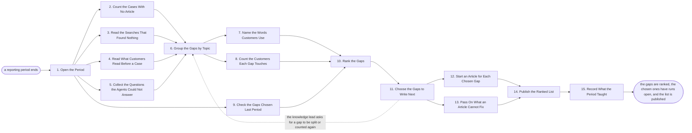

# Reference process: Find Gaps in the Help Center

`ref/sup/find-gaps-in-the-help-center v1`

**value stream:** [The help center](../../streams/customer-support/the-help-center.md)
A reporting period ends, and the help center's gaps have to be found where
customers met them. The knowledge-keeper agent opens the period. The
analytics agent counts the cases closed with no article behind them and
reads which articles customers read before opening a case on the same
topic anyway, the search-optimizer agent reads the searches in the help
center that found nothing, and the knowledge-keeper agent collects the
questions the agents could not answer from approved content. The
knowledge-keeper agent groups the four sources into one gap for each
topic, in the customers' own words, the search-optimizer agent names the
words each gap's article must answer to, and the analytics agent counts
the customers each gap touches and checks whether the gaps chosen last
period have closed. The knowledge-keeper agent ranks the gaps by how many
customers each touches, with the evidence beside each, and the knowledge
lead chooses which are written next. Each chosen gap starts a run at
`ref/sup/write-a-help-article`, a gap that is really a problem with the
product is passed on, and the ranked list is published. The run closes
when every gap is ranked with its evidence, the chosen gaps have their
runs open, and the list has reached the knowledge lead, the head of
support and the report of what customers say.

**delivers:** shortlist, the help center gaps to write next

**starts:** on a schedule, a reporting period ends

## The goals

- Publish the ranked gaps within [5 working days] of each period's end
- Cut help center searches that find nothing by [20%] each quarter
- Have [80%] of the gaps chosen written before the next period ends
- Choose gaps that together touch [60%] of the customers who met a gap

## The activities

| # | Activity | What happens | Agents |
|---|---|---|---|
| 1 | Open the Period | the dates, the sources to read and last period's list | [knowledge-keeper](../../agents/knowledge-keeper.md) |
| 2 | Count the Cases With No Article | cases closed without an article behind them, by topic | [analytics](../../agents/analytics.md) |
| 3 | Read the Searches That Found Nothing | what customers typed, with any personal data removed | [search-optimizer](../../agents/search-optimizer.md) |
| 4 | Read What Customers Read Before a Case | articles read before a case on the same topic | analytics |
| 5 | Collect the Questions the Agents Could Not Answer | handed to a person because no approved content answered | knowledge-keeper |
| 6 | Group the Gaps by Topic | one gap for each topic, in the customers' own words | knowledge-keeper |
| 7 | Name the Words Customers Use | the terms each gap's article must answer to | search-optimizer |
| 8 | Count the Customers Each Gap Touches | customers and accounts, with the source of each count | analytics |
| 9 | Check the Gaps Chosen Last Period | whether each article is live and its gap has closed | analytics |
| 10 | Rank the Gaps | by customers touched, with the evidence beside each | knowledge-keeper |
| 11 | Choose the Gaps to Write Next | the knowledge lead chooses, and says what waits | knowledge lead (person) |
| 12 | Start an Article for Each Chosen Gap | a run opened with the evidence and the customers' words | knowledge-keeper |
| 13 | Pass On What an Article Cannot Fix | a problem with the product, to the process that handles it | knowledge-keeper |
| 14 | Publish the Ranked List | to the knowledge lead, the head of support and the report | knowledge-keeper |
| 15 | Record What the Period Taught | which sources found what, and what to read next time | knowledge-keeper |

The questions the agents could not answer come from
`ref/sup/answer-a-routine-question`, which hands each one to a person, and
the cases come from `ref/sup/resolve-a-case`. Each gap the knowledge lead
chooses is written at `ref/sup/write-a-help-article`. A gap the cases
show is really a problem with the product goes to
`ref/sup/report-what-customers-say`, which brings it to
`<your product team>` with the rest of what customers say, and a fault
goes to a support specialist for `ref/sup/report-a-confirmed-bug`. An
article customers keep reading before they open a case anyway also goes
to `ref/sup/review-the-help-center` as an article to check.

## The graph



## The document, with the blanks marked

```
PROCESS: find gaps in the help center id: <team>/find-gaps-in-the-help-center   v1
from: ref/sup/find-gaps-in-the-help-center v1
owner: <who>                          effective: <date>
trigger: <your reporting calendar> reaches the end of a period for the
         help center
         watch: record=<reporting period> system=<your support system>
                change=<a period closes>
concurrency: one run at a time - one period is one run, a run still open
             when the next period ends finishes first, and a gap belongs
             to the period that counted it
goal: every gap the period's cases, searches and unanswered questions
      reveal grouped by topic in the customers' own words and ranked by
      how many customers each touches, with the evidence beside each, the
      gaps to write next chosen by the named knowledge lead, each chosen
      gap opened as a run at ref/sup/write-a-help-article, each problem
      with the product passed on, and the list published
phases:
  open-period        - system: the period opened with its dates, the
                       sources to read, and last period's list with the
                       gaps it chose
                       owner: knowledge-keeper   after: trigger
                       automation: <level>
  count-cases        - runs collect-and-report: the cases closed in the
                       period with no article cited, by topic, from <your
                       support system>, with the count and its source
                       owner: analytics
                       after: open-period         automation: <level>
  read-searches      - runs collect-and-report: the searches in the help
                       center that returned nothing or led to no article
                       being opened, in the words customers typed, with
                       any personal data removed before they are shown
                       owner: search-optimizer
                       after: open-period         automation: <level>
  read-before-case   - runs collect-and-report: the articles customers
                       read before opening a case on the same topic, with
                       how often, from the help center's reading record
                       and <your support system>
                       owner: analytics
                       after: open-period         automation: <level>
  collect-unanswered - runs collect-and-report: the questions handed to a
                       person at ref/sup/answer-a-routine-question because
                       no approved content answered them, in the
                       customers' own words
                       owner: knowledge-keeper
                       after: open-period         automation: <level>
  group-gaps         - runs assessment: the four sources joined into one
                       gap for each topic under <your topic list>, with
                       the customers' own words and any article that
                       should have answered it named
                       owner: knowledge-keeper
                       after: count-cases + read-searches +
                       read-before-case + collect-unanswered
                       automation: <level>
  name-terms         - runs assessment: the words customers use for each
                       gap, and the terms and questions its article must
                       answer to if anyone is to find it
                       owner: search-optimizer
                       after: group-gaps          automation: <level>
  count-customers    - runs collect-and-report: the customers and accounts
                       each gap touched in the period, counted once each,
                       with the source of every count
                       owner: analytics
                       after: group-gaps          automation: <level>
  check-last-chosen  - runs assessment: for each gap chosen last period,
                       whether its article is live and whether the cases
                       and the searches that found nothing on it have
                       fallen since
                       owner: analytics
                       after: open-period         automation: <level>
  rank-gaps          - runs assessment: the gaps ranked by how many
                       customers each touches, each with its evidence, its
                       terms, the writing time it needs and whether last
                       period's article closed it
                       owner: knowledge-keeper
                       after: name-terms + count-customers +
                       check-last-chosen          automation: <level>
  choose-gaps        - convenes decide-and-announce: <your knowledge lead
                       role> chooses which gaps are written next, within
                       the writing time the writers have, and records what
                       waits and why
                       owner: <your knowledge lead role>
                       after: rank-gaps           by: <days>
                       automation: never
  open-articles      - system: each chosen gap opens a request at
                       ref/sup/write-a-help-article with its evidence, its
                       terms and the customers' own words
                       owner: knowledge-keeper
                       after: choose-gaps         automation: <level>
  pass-on            - human: each gap that is a problem with the product
                       passed with its evidence to
                       ref/sup/report-what-customers-say, and each fault
                       sent to a support specialist for
                       ref/sup/report-a-confirmed-bug
                       owner: knowledge-keeper
                       after: choose-gaps         automation: <level>
  publish-list       - system: the ranked list with the knowledge lead's
                       choices sent to <your knowledge lead role>, <your
                       head of support role> and
                       ref/sup/report-what-customers-say
                       owner: knowledge-keeper
                       after: open-articles + pass-on
                       automation: <level>
  record-learning    - convenes debrief: which sources found which gaps,
                       which could not be read, which chosen gaps closed,
                       and what the next period reads differently
                       owner: knowledge-keeper
                       after: publish-list        automation: <level>
run-scoped:
  status   - runs roll-call                     owner: knowledge-keeper
             every: <cadence>
             from: open-period         until: choose-gaps
  evidence - runs collect-and-report            owner: analytics
             from: count-cases         until: rank-gaps
handoffs:
  open-period -> count-cases / read-searches / read-before-case /
    collect-unanswered / check-last-chosen [gap-period]: the period's
    dates, the sources and last period's list
  count-cases -> group-gaps [uncovered-cases]: the cases with no article,
    by topic, with the count and its source
  read-searches -> group-gaps [failed-searches]: the searches that found
    nothing, in customers' words, with personal data removed
  read-before-case -> group-gaps [articles-before-cases]: the articles
    read before a case on the same topic, and how often
  collect-unanswered -> group-gaps [unanswered-questions]: the questions
    no approved content answered, in customers' words
  group-gaps -> name-terms / count-customers [grouped-gaps]: one gap for
    each topic, with its words and its sources
  name-terms -> rank-gaps [gap-terms]: the terms each gap's article must
    answer to
  count-customers -> rank-gaps [gap-counts]: the customers and accounts
    each gap touched, with sources
  check-last-chosen -> rank-gaps [last-period-outcome]: each gap chosen
    last period, its article, and whether it closed
  rank-gaps -> choose-gaps [ranked-gaps]: the gaps in order, each with its
    evidence and the writing time it needs
  choose-gaps -> open-articles / pass-on [chosen-gaps]: the gaps chosen,
    the ones that wait and why, and the ones to pass on
  open-articles -> publish-list [article-requests]: each request opened at
    ref/sup/write-a-help-article
  pass-on -> publish-list [passed-on-gaps]: each problem with the product
    and each fault, and where it went
  publish-list -> record-learning [gap-list]: the ranked list with the
    choices, as sent
deviations:
  choose-gaps -> group-gaps [regroup-gaps]: the knowledge lead asks for a
    gap to be split, joined to another or counted again, so it is grouped
    and counted again before the choice is made
bindings:
  roster:  <who holds each role - agents claiming the abstract agents
           above, and named people for <your knowledge lead role> and
           <your head of support role>>
  systems: <your support system> (read), <your knowledge base> (read),
           the help center's search and reading record (read), the
           notification channel (write)
  data:    <your reporting calendar> <version>, <your topic list>
           <version>, <your jurisdiction's rules on customer data>
           <version>
policy:
  the gaps to write next are chosen by <your knowledge lead role>, and the
    agents rank the gaps by their evidence and choose none of them
  every count in the list names its source, and a source that could not
    be read is shown as unread and never estimated
  searches and questions are read in aggregate, and any personal data a
    customer typed is removed before a search is shown, under <your
    jurisdiction's rules on customer data>
  the list counts topics and customers, and it never counts, ranks or
    names a support specialist
  a gap a person must answer, such as a refund, a data request or closing
    an account, is written as an article that says how to ask and what
    happens next, and the agents still hand the case to a person
  a gap that is a problem with the product goes to <your product team>
    through ref/sup/report-what-customers-say, and nothing in the list
    promises a customer a change to the product
measures:
  cycle time: <days> from the period's end to the list published
  on time: <target> share of periods with the list published by <days>
  volume: <gaps per period>
  quality gate: every gap carries the customers' own words and a count
                with its source, and every chosen gap has a run open at
                ref/sup/write-a-help-article
```

## The failure edges

- **A source cannot be read for the period.** The list is published with
  that source shown as unread, and no count from it is estimated. The
  owner of the source is told, and the next period reads it again.
- **A gap is a problem with the product.** A feature customers cannot
  find or cannot work out is passed with its evidence to
  `ref/sup/report-what-customers-say`, and a fault goes to a support
  specialist for `ref/sup/report-a-confirmed-bug`. The knowledge lead
  decides whether an article explains the feature meanwhile.
- **A gap is a question a person must answer.** A refund, a data request,
  closing an account or a formal complaint is written as an article that
  says how to ask and what happens next, and the agents still hand the
  case to a person.
- **A search holds a customer's personal data.** People type email
  addresses, order numbers and names into a search box. These are removed
  before any search is shown in the list, and the searches are read in
  aggregate under `<your jurisdiction's rules on customer data>`.
- **The gaps chosen are more than the writers can finish.** The
  knowledge-keeper agent shows the writing time the choices need beside
  the time the writers have, and the knowledge lead decides what waits.
- **Last period's article did not close its gap.** The cases and searches
  still arriving on it go to `ref/sup/review-the-help-center` with the
  evidence, and the gap stays on the list.
- **The trigger fires while a run is in flight.** One period is one run.
  A run still open when the next period ends finishes first, and the new
  period's run starts from its list.
- **A run is abandoned.** The list is never published, for example when
  the knowledge lead is away and nobody holds the role. The gaps already
  chosen keep their runs at `ref/sup/write-a-help-article`, and the next
  period counts from where this one stopped.
