# Reference process: Flag an Account Signal

`ref/sup/flag-an-account-signal v1`

**value stream:** [Listening to customers](../../streams/customer-support/listening-to-customers.md)
A case shows that an account may be leaving, such as a customer who says
it is looking elsewhere or a champion who has left, or that it may buy
more, such as a team asking for what a larger plan includes. The support
specialist who holds the case marks the sign, the case-manager agent
writes it up with the customer's own words and the case behind it, and
the account-monitor agent reads the account's plan, its open cases, its
standing and who owns it. A sign of leaving goes through the risk-watcher
agent to the account owner at Work a Churn Risk, and a sign of buying more
goes through the expansion-spotter agent into Spot an Expansion, each
joining any risk or opening Sales already holds on the account. A request
to cancel runs at Close a Customer Account instead, which sends it to the
account owner the same day, and nothing here delays it or adds a
condition to it. The support specialist makes no offer and discusses no
price, and a customer who asks about either is told who will answer and
when. The run closes when the account owner has the signal with its
evidence, the case records where it went, and what Sales decided is on
the case for the next person who handles the account.

**delivers:** document, an account signal with its evidence

## The goals

- Pass each signal to the account owner within [1 working day]
- Have the account owner confirm [70%] of signals as real
- Flag a sign of leaving on [60%] of accounts before they leave
- Spend no more than [10 minutes] of a specialist's time on each signal

## The activities

| # | Activity | What happens | Agents |
|---|---|---|---|
| 1 | Notice the Signal in a Case | talk of leaving, a champion gone, or a team asking for more | support specialist (person) |
| 2 | Write Down the Customer's Own Words | the words, the case and the date, as the customer said them | [case-manager](../../agents/case-manager.md) |
| 3 | Read the Account's Standing | the plan, the open cases, the renewal position and the owner | [account-monitor](../../agents/account-monitor.md) |
| 4 | Sort the Signal | leaving or buying more, and any request to cancel sent on | case-manager · support specialist (person) |
| 5 | Check Whether Sales Already Holds It | an open churn risk or expansion opening on the account | case-manager · account-monitor |
| 6 | Hand a Sign of Leaving to Sales | taken in at Work a Churn Risk with its evidence | [risk-watcher](../../agents/risk-watcher.md) |
| 7 | Hand a Sign of Buying More to Sales | taken into Spot an Expansion with its evidence | [expansion-spotter](../../agents/expansion-spotter.md) |
| 8 | Answer What a Plan Includes | from approved content, and who will answer on price | support specialist (person) |
| 9 | Confirm the Account Owner Has It | the owner holds it, or the team lead hears it has not landed | case-manager · account owner (person) |
| 10 | Record Where the Signal Went | the reference in Sales and the date, on the case | case-manager |
| 11 | Take Back What Sales Decided | the outcome, and any fix a save plan names for support | case-manager · team lead (person) |
| 12 | Record What the Signal Taught | which signals held, which did not, and what to watch for | case-manager · team lead (person) |

A sign of leaving is worked at `ref/sls/work-a-churn-risk`, and support's
part in any save plan is the fixes the plan names for the support lead. A
sign of buying more is worked at `ref/sls/spot-an-expansion`, and any deal
that follows opens at `ref/sls/open-an-expansion-deal`. A request to
cancel runs at `ref/sup/close-a-customer-account`, which sends it to the
account owner the same day in the customer's own words. Signals arrive
from cases at `ref/sup/resolve-a-case`, from feature requests at
`ref/sup/log-a-feature-request`, from outages at
`ref/sup/follow-up-an-outage` and from survey comments at
`ref/sup/survey-customers-after-a-case`, and each period they are counted
by kind for `ref/sup/report-what-customers-say`.

## The graph

```mermaid
flowchart LR
  T([a case shows an account may leave or buy more]) --> A1[1. Notice the Signal in a Case]
  A1 --> A2[2. Write Down the Customer's Own Words]
  A2 --> A3[3. Read the Account's Standing]
  A2 --> A4[4. Sort the Signal]
  A3 --> A5[5. Check Whether Sales Already Holds It]
  A4 --> A5
  A4 -. the customer asked about a plan or a price .-> A8[8. Answer What a Plan Includes]
  A5 -. it is a sign of leaving .-> A6[6. Hand a Sign of Leaving to Sales]
  A5 -. it is a sign of buying more .-> A7[7. Hand a Sign of Buying More to Sales]
  A6 -. the sign does not describe an account leaving .-> A4
  A7 -. the sign is a renewal or a support need .-> A4
  A6 --> A9[9. Confirm the Account Owner Has It]
  A7 --> A9
  A8 --> A10[10. Record Where the Signal Went]
  A9 --> A10
  A10 --> A11[11. Take Back What Sales Decided]
  A11 --> A12[12. Record What the Signal Taught]
  A12 --> DONE([the account owner has the signal with its evidence, and the case records where it went and what Sales decided])
```



## The document, with the blanks marked

```
PROCESS: flag an account signal       id: <team>/flag-an-account-signal   v1
from: ref/sup/flag-an-account-signal v1
owner: <who>                          effective: <date>
trigger: a support specialist or a team lead marks a sign on a case in
         <your support system> that an account may leave or may buy more
         watch: record=<case> system=<your support system>
                change=<an account signal is marked on a case>
concurrency: runs may overlap freely - one signal on one account is one
             run, a second signal of the same kind on the same account
             joins the open run, and a sign of leaving and a sign of buying
             more on the same account are runs of their own
goal: each sign that an account may leave or buy more passed with the
      customer's own words, the case and the account's standing to the
      account owner through the Sales process that holds it, the account
      owner holding it by <hours>, no offer made and no price discussed by
      support, and the case recording where the signal went and what Sales
      decided
phases:
  notice-signal      - human: the support specialist marks the sign on the
                       case with the words that show it, such as a customer
                       looking elsewhere, a champion who has left or a
                       team asking for what a larger plan includes
                       owner: <your support specialist role>
                       after: trigger             automation: <level>
  write-up           - system: the signal written up with the customer's own
                       words, the case, the channel, the date and who said
                       it, and nothing the customer did not say
                       owner: case-manager        after: notice-signal
                       automation: <level>
  read-standing      - runs collect-and-report: the account's plan, its
                       entitlement, its open cases, where it stands in the
                       renewal cycle and who owns it, each with where it
                       was read
                       owner: account-monitor     after: write-up
                       automation: <level>
  sort-signal        - runs assessment: the signal sorted as a sign of
                       leaving or a sign of buying more under <your signal
                       rules>, with the support specialist confirming the
                       sort, and a request to cancel sent the same day to
                       ref/sup/close-a-customer-account
                       owner: case-manager        after: write-up
                       automation: <level>
  check-held         - runs assessment: whether Sales already holds an open
                       churn risk or an open expansion opening on the
                       account, so the signal joins it with its evidence
                       owner: case-manager
                       after: read-standing + sort-signal
                       automation: <level>
  hand-risk          - system: a sign of leaving taken in at
                       ref/sls/work-a-churn-risk as a risk a person raised,
                       with the words, the case and the standing, or added
                       to the risk already open there
                       owner: risk-watcher
                       after: check-held, when it is a sign of leaving
                       automation: <level>
  hand-expansion     - system: a sign of buying more taken into
                       ref/sls/spot-an-expansion as a support signal, with
                       the words, the case and the standing, or added to
                       the opening already open there
                       owner: expansion-spotter
                       after: check-held, when it is a sign of buying more
                       automation: <level>
  answer-in-scope    - human: what a plan includes answered from approved
                       content in <your knowledge base>, and a question on
                       a price, a discount or an offer answered only with
                       who will reply and when
                       owner: <your support specialist role>
                       after: sort-signal, when the customer asked about a
                       plan or a price            automation: <level>
  confirm-received   - runs roll-call: the account owner holds the signal
                       through the Sales process by <hours>, and a signal
                       not taken up by then is raised with <your team lead
                       role>
                       owner: case-manager
                       after: hand-risk or hand-expansion   by: <hours>
                       automation: <level>
  record-route       - system: where the signal went, the reference in
                       Sales and the date, recorded on the case and the
                       account for the next person who handles it
                       owner: case-manager
                       after: confirm-received, and answer-in-scope when it
                       ran                        automation: <level>
  take-back-outcome  - convenes debrief: what Sales decided, recorded on the
                       case, and any fix a save plan names for <your team
                       lead role> given an owner and a date on the case
                       owner: case-manager        after: record-route
                       by: <days>                 automation: <level>
  record-learning    - convenes debrief: which signals Sales confirmed and
                       which it did not, which words in cases proved
                       reliable, and what <your signal rules> should change
                       owner: case-manager        after: take-back-outcome
                       automation: <level>
run-scoped:
  status   - runs roll-call                   owner: case-manager
             every: <cadence>
             from: write-up            until: record-route
  standing - runs assessment                  owner: account-monitor
             from: read-standing       until: record-route
handoffs:
  notice-signal -> write-up [marked-signal]: the case, the sign the
    specialist saw and the words that show it
  write-up -> read-standing / sort-signal [written-signal]: the customer's
    own words, the case, the channel and the date
  read-standing -> check-held [account-standing]: the plan, the open
    cases, the renewal position and the account owner, with sources
  sort-signal -> check-held / answer-in-scope [sorted-signal]: the signal
    as a sign of leaving or a sign of buying more, as the specialist
    confirmed it
  check-held -> hand-risk / hand-expansion [signal-to-hand]: the signal
    with its evidence, and any risk or opening Sales already holds
  hand-risk -> confirm-received [risk-raised]: the reference at
    ref/sls/work-a-churn-risk, and whether it joined a risk already open
  hand-expansion -> confirm-received [signal-handed]: the reference at
    ref/sls/spot-an-expansion, and whether it joined an opening already
    open
  answer-in-scope -> record-route [in-scope-answer]: what the customer was
    told, and who will answer on price
  confirm-received -> record-route [owner-has-it]: the account owner's
    receipt, and the date
  record-route -> take-back-outcome [signal-route]: where the signal went,
    the reference and the date
  take-back-outcome -> record-learning [sales-outcome]: what Sales decided,
    and any fix named for support with its owner and its date
deviations:
  hand-risk -> sort-signal [not-a-risk]: the risk-watcher agent finds the
    sign does not describe an account leaving, so it is sorted again with
    the reason
  hand-expansion -> sort-signal [not-an-opening]: the expansion-spotter
    agent finds the sign is a renewal or a support need, so it is sorted
    again with the reason
bindings:
  roster:  <who holds each role - agents claiming the abstract agents
           above, and named people for each <your support specialist
           role>, each <your team lead role> and each account owner>
  systems: <your support system> (read, write), <your CRM> (read), the
           usage record (read), <your billing system> (read), <your
           knowledge base> (read), the notification channel (write)
  data:    <your signal rules> <version>, <your account coverage rule>
           <version>, <your reply rules> <version>
policy:
  each signal carries the customer's own words and the case behind it,
    and nothing the customer did not say
  support makes no offer, discusses no price or discount and runs no save,
    and each of these stays with the account owner in Sales' processes
  a request to cancel runs at ref/sup/close-a-customer-account, which
    sends it to the account owner the same day, and nothing in this
    process delays it or adds a condition to it
  a signal joins any churn risk or expansion opening Sales already holds
    on the account, so no account is approached twice for one signal
  a case with a signal is answered by the same rules as every other case,
    and no support specialist has a target for signals or for what Sales
    makes of them
  who controls an account changes only at
    ref/sup/recover-access-to-an-account after the identity checks, even
    when a signal says the person who held it has left
  support's part in a save plan is the fixes the plan names for <your team
    lead role>, each with an owner and a date on the case
measures:
  cycle time: <hours> from the signal marked to the account owner
              holding it
  on time: <target> share of signals held by the account owner within
           <hours>
  volume: <signals per period, by kind>
  quality gate: every signal carries the customer's own words, the case
                and the account's standing, and every case records where
                its signal went
```

## The failure edges

- **The customer asks to cancel.** The request runs at
  `ref/sup/close-a-customer-account`, which sends it to the account owner
  the same day in the customer's own words. The specialist tells the
  customer how it will be handled and when, and nothing here delays the
  cancellation or adds a condition to it, following
  `<your jurisdiction's rules on cancelling a subscription>`.
- **The customer asks for a discount or an offer to stay.** The
  specialist says the account owner will answer and by when, the request
  goes with the signal in the customer's own words, and the specialist
  promises nothing.
- **The account has no owner.** The signal goes to the person
  `<your account coverage rule>` names, and the team lead checks the next
  working day that someone holds it.
- **The account owner does not take it up in time.** The case-manager
  agent raises it with the team lead, who takes it to the person
  `<your account coverage rule>` names in Sales. The customer's case goes
  on by the same rules meanwhile.
- **The sign is that the person who held the account has left.** The
  account owner hears it with the evidence. Nobody changes who controls
  the account on the strength of the signal, because control changes only
  at `ref/sup/recover-access-to-an-account` after the identity checks.
- **Sales finds the signal does not hold.** The risk-watcher or
  expansion-spotter agent says why, the signal is sorted again or closed
  with the reason, and the reason reaches `<your signal rules>` at the
  next debrief.
- **The trigger fires while a run is in flight.** A second signal of the
  same kind on the same account joins the open run with its own words and
  case. A signal of the other kind is a run of its own, and Sales holds
  one risk or one opening on the account at a time.
- **A run is abandoned.** The specialist withdraws the signal as a
  misreading before it reaches Sales. The withdrawal is recorded with the
  reason, nothing is sent to Sales from an abandoned run, and the case
  goes on as it was.
