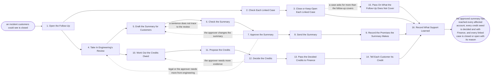

# Reference process: Follow Up an Outage

`ref/sup/follow-up-an-outage v1`

**value stream:** [Outages and incidents](../../streams/customer-support/outages-and-incidents.md)
An incident customers could see has closed, and the customers it touched
are owed an account of what happened, an answer on every case, and the
credits their agreements promise. The outage-coordinator agent opens the
follow-up with the record from Tell Affected Customers: the affected
accounts, the linked cases, the notices sent and every version of the
wording. The case-manager agent checks each linked case against the
customer's own account, and the case closes once the customer has the
fix or stays open with its reason and its named support specialist. When
engineering's review of the incident is ready, the outage-coordinator
agent drafts the summary for customers from that review alone: what
happened, when it began and ended, who was affected, and what the
company is changing and by when, as far as engineering has committed.
The reply-check agent reads the summary against the review and the reply
rules and holds it for a person, because it admits fault and promises
change, and the named statement approver reads it with the review beside
it and approves it, changes it or passes it to `<your legal team>`. Once
the approver says go, the outage-coordinator agent sends exactly that
version to the affected accounts and the linked cases, and the
case-manager agent records each change the summary promises with its
date. Beside this, the refund-coordinator agent works out from each
agreement and the downtime the review measured the credit each account is
owed, and proposes each one with its evidence. A named credit approver who
proposed none of them decides each credit within `<your refund limit>`,
and the person the delegation of authority names decides above it. The
refund-coordinator agent passes each decided credit to Finance, which
issues the credit note and books it, and a named support specialist tells
each customer its credit in a reply the reply-check agent held for a
person to send. The run closes when the approved summary has reached
every affected account, every linked case is closed or open with its
reason, every credit owed is decided and with Finance, and what support
learned is recorded.

**delivers:** document, an outage summary for customers

**starts:** on an event, an incident customers could see is closed

## The goals

- Send the approved summary to affected customers within [5 working days] of the incident closing
- Keep summaries later shown wrong at [zero]
- Decide every credit an agreement owes within [10 working days] of the incident closing
- Keep linked cases reopened after the follow-up under [5%]

## The activities

| # | Activity | What happens | Agents |
|---|---|---|---|
| 1 | Open the Follow-Up | the accounts, the cases, the notices and the wording sent | [outage-coordinator](../../agents/outage-coordinator.md) |
| 2 | Check Each Linked Case | whether the fix shows in the customer's own account | [case-manager](../../agents/case-manager.md) |
| 3 | Close or Keep Open Each Linked Case | closed with the fix, or open with its reason and its owner | case-manager · outage-coordinator |
| 4 | Take In Engineering's Review | what happened, the cause, the times and what changes | outage-coordinator · incident lead (person) |
| 5 | Draft the Summary for Customers | from the review alone, in plain words, at a version | outage-coordinator |
| 6 | Check the Summary | against the review and reply rules, and held for a person | [reply-check](../../agents/reply-check.md) |
| 7 | Approve the Summary | the named approver approves, changes or passes it to legal | statement approver (person) |
| 8 | Send the Summary | exactly the approved version to the affected accounts | outage-coordinator |
| 9 | Record the Promises the Summary Makes | each change promised, with its date and its owner | case-manager |
| 10 | Work Out the Credits Owed | each agreement's terms against the downtime measured | [refund-coordinator](../../agents/refund-coordinator.md) |
| 11 | Propose the Credits | each credit with its evidence and who may decide it | refund-coordinator |
| 12 | Decide the Credits | a named person who proposed none of them decides each | credit approver (person) |
| 13 | Pass the Decided Credits to Finance | each decision for Finance to issue the credit note | refund-coordinator |
| 14 | Tell Each Customer Its Credit | a reply held for a person, read and sent by a named person | case-manager · reply-check · support specialist (person) |
| 15 | Pass On What the Follow-Up Does Not Cover | goodwill past the agreement, signs of leaving, legal threats | case-manager · support specialist (person) |
| 16 | Record What Support Learned | each stage's timing, the threshold and articles to change | outage-coordinator · head of support (person) |

The record of who was told comes from `ref/sup/tell-affected-customers`,
and engineering's review of the incident comes from `<your engineering
team>`, which runs the incident itself. A credit decided here goes to
Finance, which issues the credit note and books it. A goodwill credit
beyond what an agreement owes is decided at
`ref/sup/offer-a-goodwill-credit`, a sign that an account may leave goes
to its account owner at `ref/sup/flag-an-account-signal`, which passes it
to Sales at `ref/sls/work-a-churn-risk`, and any other reply that admits
fault, promises a fix or a date or offers money is sent at
`ref/sup/approve-a-sensitive-reply`. When the incident reached the press,
Marketing's account of it at `ref/mkt/crisis-communication` and the
summary here say the same thing, and the same named person approves both.
An article or a saved reply the incident showed to be wrong goes to
`ref/sup/review-the-help-center`, and a change to the threshold that
raises a suspected outage goes back to `ref/sup/raise-a-suspected-outage`.

## The graph



## The document, with the blanks marked

```
PROCESS: follow up an outage          id: <team>/follow-up-an-outage   v1
from: ref/sup/follow-up-an-outage v1
owner: <who>                          effective: <date>
trigger: an incident customers could see is closed in <your incident
         record>, and its record of who was told is handed over from
         ref/sup/tell-affected-customers
         watch: record=<incident> system=<your incident record>
                change=<an incident customers could see is closed>
concurrency: runs may overlap across incidents - one closed incident is
             one run, a case linked to two incidents is followed up in the
             run of the later one, and an account owed credits for two
             incidents has each decided in its own run
goal: a summary of what happened and what changes, written from
      engineering's review and approved at its version by <your statement
      approver role> before any customer read it, sent to every affected
      account, every linked case closed with the fix or kept open with its
      reason and its owner, each change the summary promised recorded with
      its date, every credit the agreements owe proposed with its evidence
      and decided by a named person who proposed none of it, each decided
      credit passed to Finance, and what support learned recorded
phases:
  open-follow-up     - system: the follow-up opened with the affected
                       accounts, the linked cases, the notices sent and
                       every version of the wording from
                       ref/sup/tell-affected-customers
                       owner: outage-coordinator   after: trigger
                       automation: <level>
  check-cases        - runs assessment: each linked case read against the
                       customer's own account and what the customer last
                       said, to find whether the fix shows for them
                       owner: case-manager
                       after: open-follow-up      automation: <level>
  close-cases        - system: each case whose customer has the fix closed
                       with the resolved update, and each case still
                       broken for the customer kept open with its reason
                       and the named support specialist who holds it
                       owner: case-manager
                       after: check-cases         by: <days>
                       automation: <level>
  take-in-review     - convenes briefing: the incident lead gives
                       engineering's review of the incident, saying what
                       happened, the cause, the times, the accounts
                       affected, what engineering will change and which
                       parts may be shared with customers
                       owner: outage-coordinator
                       after: open-follow-up      by: <days>
                       automation: <level>
  draft-summary      - human: the summary drafted at a version from the
                       review alone, in plain words, saying what happened,
                       when it began and ended, who was affected, and what
                       the company is changing and by when, with each
                       sentence carrying the part of the review under it
                       owner: outage-coordinator
                       after: take-in-review      automation: <level>
  check-summary      - runs assessment: the summary read against the review
                       and <your reply rules> at their version, each
                       sentence that does not trace to the review named,
                       and the summary held for a named person because it
                       admits fault and promises a change
                       owner: reply-check
                       after: draft-summary       automation: <level>
  approve-summary    - convenes approval: <your statement approver role>
                       reads the summary with the review and the check
                       beside it, and approves it at its version, changes
                       it, or passes it to <your legal team> and waits for
                       them
                       owner: <your statement approver role>
                       after: check-summary       by: <days>
                       automation: never
  send-summary       - system: exactly the approved version sent, once the
                       approver says go, to the contacts on every affected
                       account and to every linked case, and posted on
                       <your status page> where <your incident policy>
                       calls for it
                       owner: outage-coordinator
                       after: approve-summary     automation: <level>
  record-promises    - system: each change and date the approved summary
                       promises recorded on the linked cases with its
                       owner in <your engineering team>, and raised before
                       its date passes
                       owner: case-manager
                       after: send-summary        automation: <level>
  work-out-credits   - runs assessment: each affected account's agreement
                       read for the credit it owes for an outage, set
                       against the downtime the review measured for that
                       account and any credit already given for it, under
                       <your refund policy>
                       owner: refund-coordinator
                       after: take-in-review      automation: <level>
  propose-credits    - human: each credit proposed at a version with the
                       agreement's clause, the downtime measured, the
                       amount and who may decide it under <your delegation
                       of authority>
                       owner: refund-coordinator
                       after: work-out-credits    automation: <level>
  decide-credits     - convenes decide-and-announce: <your credit approver
                       role>, who proposed none of the credits, decides
                       each within <your refund limit>, and the approver
                       <your delegation of authority> names decides each
                       above it, with the reason
                       owner: <your credit approver role>
                       after: propose-credits     by: <days>
                       automation: never
  pass-to-finance    - system: each decided credit passed to Finance with
                       the decision, the approver and the evidence, for
                       Finance to issue the credit note and book it
                       owner: refund-coordinator
                       after: decide-credits      automation: <level>
  tell-credit        - convenes approval: each customer's reply naming the
                       credit decided for its account, drafted from the
                       decision and held by the reply-check agent, read
                       and sent by a named support specialist
                       owner: <your support specialist role>
                       after: pass-to-finance     by: <days>
                       automation: never
  pass-on-requests   - human: a case that asks for a goodwill credit
                       beyond what the agreement owes passed to
                       ref/sup/offer-a-goodwill-credit, a sign that the
                       account may leave passed to
                       ref/sup/flag-an-account-signal, and a claim for loss
                       or a legal threat passed to <your legal team> the
                       same day
                       owner: case-manager
                       after: close-cases, when a case asks for more than
                       the follow-up covers       automation: <level>
  record-learning    - convenes debrief: the time from the first case to
                       the page, to the first update and to the summary,
                       the cadences missed, the notices sent late, the
                       cases reopened, the credits owed, the articles and
                       saved replies the incident showed were wrong, and
                       what <your head of support role> changes
                       owner: outage-coordinator
                       after: record-promises + tell-credit + close-cases,
                       and pass-on-requests when it ran
                       automation: <level>
run-scoped:
  status  - runs roll-call                      owner: outage-coordinator
            every: <cadence>
            from: open-follow-up      until: record-learning
  credits - runs allocate-and-reconcile         owner: refund-coordinator
            from: work-out-credits    until: pass-to-finance
handoffs:
  open-follow-up -> check-cases / take-in-review [follow-up-record]: the
    affected accounts, the linked cases, the notices and the wording sent
  check-cases -> close-cases [case-readings]: each linked case with
    whether the fix shows for the customer
  close-cases -> record-learning [cases-settled]: each case closed, and
    each case kept open with its reason and its owner
  close-cases -> pass-on-requests [requests-beyond]: each case that asks
    for more than the follow-up covers
  take-in-review -> draft-summary / work-out-credits [incident-review]:
    engineering's review, with the parts that may be shared with customers
  draft-summary -> check-summary [draft-summary]: the summary at a
    version, each sentence with the part of the review under it
  check-summary -> approve-summary [checked-summary]: the summary with
    each rule that holds it named, and each sentence that does not trace
  approve-summary -> send-summary [approved-summary]: the summary as
    approved, with the approver and the version. A change to any word
    voids the approval
  send-summary -> record-promises [summary-sent]: the summary as sent,
    with each account and case it reached
  record-promises -> record-learning [promises-recorded]: each change
    promised, with its date and its owner
  work-out-credits -> propose-credits [credits-owed]: each agreement's
    credit terms against the downtime measured
  propose-credits -> decide-credits [proposed-credits]: each credit at a
    version with its clause, its downtime, its amount and its approver
  decide-credits -> pass-to-finance [decided-credits]: each credit as
    decided, with the approver, the amount and the reason
  pass-to-finance -> tell-credit [credits-with-finance]: each credit as
    Finance received it
  tell-credit -> record-learning [credits-told]: each customer's reply as
    sent, with the person who sent it
  pass-on-requests -> record-learning [requests-passed]: each request
    passed on, and where it went
deviations:
  check-summary -> draft-summary [sentence-untraced]: a sentence in the
    summary does not trace to engineering's review, so it is drafted again
    from the review
  approve-summary -> draft-summary [approver-changes]: the approver changes
    the summary, so it is drafted again on the points named and checked
    again
  approve-summary -> take-in-review [needs-more-from-engineering]: <your
    legal team> or the approver needs more from engineering, so the
    incident lead is asked and the summary waits
  decide-credits -> work-out-credits [needs-more-evidence]: the credit
    approver cannot decide on the evidence in hand, so what the approver
    named is read and the credits are proposed again
  close-cases -> pass-on-requests [asks-for-more]: a case asks for a
    goodwill credit, shows a sign that the account may leave or carries a
    legal threat, so it goes to the process that holds that work
bindings:
  roster:  <who holds each role - agents claiming the abstract agents
           above, and named people for <your statement approver role>,
           <your credit approver role>, each approver <your delegation of
           authority> names above <your refund limit>, the support
           specialists, the incident lead and <your head of support role>>
  systems: <your support system> (write), <your incident record> (read),
           <your status page> (write), <your contract repository> (read),
           <your billing system> (read), <your CRM> (read), the outbound
           mail system (write), the notification channel (write)
  data:    <your incident policy> <version>, <your reply rules> <version>,
           <your refund policy> <version>, <your refund limit>, <your
           delegation of authority> <version>, the agreements at their
           versions, engineering's review at its version
policy:
  no customer reads the summary before <your statement approver role> has
    approved it at its version, and a change to any word voids the
    approval
  the summary is written from engineering's review alone, and every
    sentence in it traces to that review
  a summary that admits liability, and any reply that answers a claim for
    loss or a legal threat, goes to <your legal team>, and the reply waits
    for them
  whoever proposes a credit never decides it, and <your credit approver
    role> decides within <your refund limit> while the approver <your
    delegation of authority> names decides above it
  no agent moves money, issues a credit note or changes a bill, and
    Finance issues and books every credit a named person decided
  every reply that offers a credit is read and sent by a named person
  a goodwill credit beyond what an agreement owes is decided at
    ref/sup/offer-a-goodwill-credit, and support never ties a credit to a
    renewal, which stays with the account owner in Sales
  each change the summary promises is recorded with its date and its
    owner, and a date about to pass is raised before it passes
  the follow-up records are kept for the period <your jurisdiction's rule
    on keeping customer records> sets
measures:
  cycle time: <days> from the incident closed to the summary sent
  on time: <target> share of credits decided within <days>
  volume: <affected accounts per incident>
  quality gate: every summary traces to engineering's review and a named
                approver, and every credit names its clause, its proposer
                and a different person who decided it
```

## The failure edges

- **Engineering's review is late.** The linked cases are settled on their
  own schedule, the incident lead is asked on the cadence the run sets,
  and the head of support is told once the review is `<days>` late. No
  summary is drafted from guesswork, and the customers already know from
  the approved resolved update that a summary will follow.
- **A sentence does not trace to the review.** The reply-check agent names
  it, and the summary is drafted again from the review. A fact the
  summary needs that the review lacks goes back to the incident lead, and
  the summary waits for the answer.
- **The approver changes the summary or passes it to legal.** Only the
  points named reopen, the summary is checked again, and nothing is sent
  while `<your legal team>` holds it. A summary that admits liability
  goes to them every time.
- **An agreement's credit terms can be read two ways.** The
  refund-coordinator agent sets out the clause and both readings with the
  amount each gives, and the credit approver decides. A reading that would
  change what the agreement says goes to `<your legal team>` first.
- **A credit is above the refund limit.** The refund-coordinator agent
  names the approver `<your delegation of authority>` sets for the amount,
  and that person decides it. The customer hears nothing about a credit
  that has not been decided.
- **A customer asks for more than the agreement owes.** The request goes
  to `ref/sup/offer-a-goodwill-credit`, where a named person who did not
  propose it decides, and the support specialist makes no offer on the
  case. A customer who says it will leave is passed to its account owner
  at `ref/sup/flag-an-account-signal`, and support runs no save.
- **A customer still has the fault after the incident closed.** The case
  stays open with its reason and a named support specialist, and a fault
  that turns out to be a bug of its own goes to
  `ref/sup/report-a-confirmed-bug`.
- **The trigger fires while a run is in flight.** One closed incident is
  one run. A case linked to two incidents is followed up in the run of the
  later one, and an account owed credits for both has each decided in its
  own run, so no credit is counted twice.
- **A run is abandoned.** The incident is reopened before the summary goes
  out. The follow-up stops, the cases checked and the credits worked out
  so far are kept, and a new follow-up starts from the same record once
  the incident closes again. A summary that has not been approved is
  never sent from an abandoned run, and no credit is decided on downtime
  that is still running.
