# Reference process: Forecast Support Volume

`ref/sup/forecast-support-volume v1`

**value stream:** [Running the support desk](../../streams/customer-support/running-the-support-desk.md)
Each period the support operations lead needs to know how many requests
each channel will receive in each interval of the coming weeks, and how
many people each interval needs to answer them inside the service levels,
early enough to build the schedule and to raise a gap before it opens.
The staffing-planner agent opens the period's forecast from the last
version. The analytics agent reads the history of requests by channel,
topic and interval with the source of each figure, and marks the days the
history has to be read with care, such as an outage, a holiday or a
channel opened partway through the window. The forecaster agent gathers
the releases, campaigns and other events already set for the weeks
ahead, sets last period's forecast beside what actually arrived, models
the requests ahead for each channel and interval with each assumption
beside the number it produced, and names any assumption that would
change the answer on its own. The analytics agent reads how long each
kind of case takes to handle, and the staffing-planner agent turns the
requests into the people each interval needs to meet the service levels
in force, adds the time people spend away from cases, sets the need
beside the people the team has, and sets out the options for each gap.
The support operations lead reviews the forecast, the head of support
decides on any gap, and the forecast is published at a version. The
forecast counts hours for the team as a whole and names no person. The
run closes when the forecast is published to the schedule and the team
leads, and every gap has a decision from a named person.

**delivers:** report, a support volume forecast

## The goals

- Keep each week's forecast within [10%] of the requests that arrived
- Publish the forecast at least [3 weeks] before the schedule it feeds begins
- Plan no more than [5%] more hours than the service levels need
- Raise each staffing gap at least [8 weeks] before it opens

## The activities

| # | Activity | What happens | Agents |
|---|---|---|---|
| 1 | Open the Period's Forecast | the horizon, channels and intervals, from the last version | [staffing-planner](../../agents/staffing-planner.md) |
| 2 | Read the History of Requests | requests by channel, topic and interval, with each source | [analytics](../../agents/analytics.md) |
| 3 | Mark the Unusual Days | outages, holidays and gaps in the history, with each reason | analytics |
| 4 | Gather the Events Ahead | releases, campaigns, price changes and the known season | [forecaster](../../agents/forecaster.md) |
| 5 | Compare the Last Forecast with What Arrived | the forecast against what came, and the reason for each miss | forecaster |
| 6 | Model the Requests Ahead | requests by channel and interval, assumptions beside numbers | forecaster |
| 7 | Name the Assumptions That Decide the Answer | any one assumption that would change the forecast on its own | forecaster |
| 8 | Read the Time Each Case Takes | handling time by channel and topic, from the cases closed | analytics |
| 9 | Turn the Requests into People Needed | the people each channel and interval needs for its level | staffing-planner |
| 10 | Add the Time Away from Cases | training, coaching, meetings and usual absence, by interval | staffing-planner |
| 11 | Set the Need Beside the Team | the people needed against the team's hours, by interval | staffing-planner |
| 12 | Set Out the Options for a Gap | each option with its effect on service levels and its cost | staffing-planner |
| 13 | Review the Forecast | the support operations lead reviews assumptions and gaps | support operations lead (person) |
| 14 | Decide on a Gap | the head of support chooses an option or asks for another | head of support (person) |
| 15 | Publish the Forecast | forecast and need at a version, for the schedule and leads | staffing-planner |
| 16 | Record What the Forecast Taught | which assumptions missed, and what the next period changes | forecaster · staffing-planner |

The service levels the forecast plans for are set at
`ref/sup/set-a-service-level-policy`, and the forecast feeds the schedule
built at `ref/sup/build-the-support-schedule` and the after-hours rota
that `ref/sup/cover-after-hours-requests` runs on. The releases come from
`<your product team>` and from Marketing's `ref/mkt/feature-release` and
`ref/mkt/product-launch`, and the outage days in the history are the
incidents raised at `ref/sup/raise-a-suspected-outage`. A gap that needs
more people than the team has goes to Human resources, where positions
are planned at `ref/hr/plan-the-workforce` and opened at
`ref/hr/open-a-position`, because support plans the hours and Human
resources hires. A gap the head of support would meet with a lower
service level goes to `ref/sup/set-a-service-level-policy` as a proposal,
and the levels in force stay until named people decide it there.

## The graph

```mermaid
flowchart LR
  T([the period's forecast falls due on the planning calendar]) --> A1[1. Open the Period's Forecast]
  A1 --> A2[2. Read the History of Requests]
  A1 --> A4[4. Gather the Events Ahead]
  A1 --> A8[8. Read the Time Each Case Takes]
  A2 --> A3[3. Mark the Unusual Days]
  A3 -. too much of the window is unusual to learn from .-> A2
  A3 --> A5[5. Compare the Last Forecast with What Arrived]
  A3 --> A6[6. Model the Requests Ahead]
  A4 --> A6
  A5 --> A6
  A6 --> A7[7. Name the Assumptions That Decide the Answer]
  A7 -. an assumption nobody can source decides the answer .-> A4
  A7 --> A9[9. Turn the Requests into People Needed]
  A8 --> A9
  A9 --> A10[10. Add the Time Away from Cases]
  A10 --> A11[11. Set the Need Beside the Team]
  A11 -. an interval needs more people than the team has .-> A12[12. Set Out the Options for a Gap]
  A11 --> A13[13. Review the Forecast]
  A12 --> A13
  A13 -. the lead does not accept an assumption .-> A6
  A13 -. a gap needs a decision .-> A14[14. Decide on a Gap]
  A13 --> A15[15. Publish the Forecast]
  A14 -. the head of support asks for another option .-> A12
  A14 --> A15
  A15 --> A16[16. Record What the Forecast Taught]
  A16 --> DONE([the forecast is published and every gap has a decision])
```



## The document, with the blanks marked

```
PROCESS: forecast support volume      id: <team>/forecast-support-volume   v1
from: ref/sup/forecast-support-volume v1
owner: <who>                          effective: <date>
trigger: the period's forecast falls due on <your planning calendar>, or
         <your support operations lead role> calls a forecast out of
         cycle after an event that moves volume, such as a release date
         that moved or a campaign added
         watch: record=<volume forecast> system=<your scheduling system>
                change=<the forecast date comes up, or a forecast is
                called out of cycle>
concurrency: one forecast is open at a time for each support team - a
             forecast called out of cycle replaces the period's run and
             starts from the last published version, and the day's
             queues keep running beside it
goal: a forecast of requests for each channel by <interval> for <weeks>,
      published at a version by <the day>, with each assumption beside
      the number it produced, last period's forecast set beside what
      arrived, the people each interval needs to meet the service levels
      in force, and every gap decided by a named person
phases:
  open-forecast      - system: the period's forecast opened from the last
                       published version, with the horizon, the channels,
                       the intervals and the service levels in force at
                       their version
                       owner: staffing-planner    after: trigger
                       automation: <level>
  read-history       - runs collect-and-report: the requests that arrived
                       on each channel by topic and interval over <your
                       history window>, from <your support system>, <your
                       phone system> and <your chat tool>, each figure with
                       its source
                       owner: analytics           after: open-forecast
                       automation: <level>
  mark-unusual-days  - runs assessment: each day the history has to be
                       read with care, such as an outage, a holiday, a
                       channel opened partway through or a gap in the
                       record, marked with its reason so the model can
                       leave it out or weigh it
                       owner: analytics           after: read-history
                       automation: <level>
  gather-events      - runs collect-and-report: the releases on <your
                       release calendar>, the campaigns on Marketing's
                       calendar, the price changes, the renewal dates that
                       bunch and the season, each with its date and where
                       it was read
                       owner: forecaster          after: open-forecast
                       automation: <level>
  compare-last       - runs assessment: last period's forecast set beside
                       the requests that arrived on each channel and in
                       each interval, with the reason for each miss above
                       <threshold>
                       owner: forecaster          after: mark-unusual-days
                       automation: <level>
  model-requests     - system: the requests ahead modelled for each
                       channel by interval from the history, the season
                       and the events already known, with each assumption
                       written beside the number it produced
                       owner: forecaster
                       after: mark-unusual-days + gather-events +
                       compare-last               automation: <level>
  name-assumptions   - runs assessment: each assumption that would change
                       the forecast on its own, and each rate nobody can
                       source, reported as unsourced with no figure
                       supplied in its place
                       owner: forecaster          after: model-requests
                       automation: <level>
  read-handle-time   - runs collect-and-report: how long each kind of case
                       takes to handle on each channel, and how many
                       contacts a case needs before it closes, from the
                       cases closed in the window
                       owner: analytics           after: open-forecast
                       automation: <level>
  people-needed      - runs assessment: the requests turned into the
                       people each channel and interval needs to meet the
                       service level it promises, with the method and
                       every input written down
                       owner: staffing-planner
                       after: name-assumptions + read-handle-time
                       automation: <level>
  add-time-away      - system: the hours spent away from cases added by
                       interval, such as training, coaching, meetings and
                       the usual absence, read from the last periods for
                       the team as a whole
                       owner: staffing-planner    after: people-needed
                       automation: <level>
  set-against-team   - runs assessment: the people needed set beside the
                       hours the team has in each interval, from <your
                       scheduling system>, with each gap named by channel,
                       interval and date
                       owner: staffing-planner    after: add-time-away
                       automation: <level>
  set-out-options    - runs assessment: each way to meet a gap, such as
                       moving hours between channels, cover from the
                       provider the roster names, extra hours inside <your
                       working time policy>, positions asked of Human
                       resources or a service level proposed for change,
                       with what each gives and what it costs
                       owner: staffing-planner
                       after: set-against-team, when an interval is short,
                       and decide-gap when the head of support asks for
                       another                    automation: <level>
  review-forecast    - convenes approval: <your support operations lead
                       role> reviews the assumptions, the misses and the
                       gaps, and accepts the forecast or names the lines
                       to model again
                       owner: <your support operations lead role>
                       after: set-against-team, and set-out-options when
                       it ran                     by: <days>
                       automation: never
  decide-gap         - convenes decide-and-announce: <your head of support
                       role> chooses how each gap is met, or asks for
                       another option, and each choice then runs through
                       its own process with its own approvals
                       owner: <your head of support role>
                       after: review-forecast, when a gap is open
                       by: <days>                 automation: never
  publish-forecast   - system: the forecast and the people needed
                       published at a version to <your support operations
                       lead role>, the team leads and the schedule, with
                       every gap and the decision on it
                       owner: staffing-planner
                       after: review-forecast, and decide-gap when it ran
                       by: <the day>              automation: <level>
  record-learning    - convenes debrief: which assumptions missed and by
                       how much, which events came late or were missed,
                       and what the next period's forecast does
                       differently
                       owner: forecaster          after: publish-forecast
                       automation: <level>
run-scoped:
  inputs   - runs roll-call                     owner: staffing-planner
             every: <cadence>
             from: open-forecast       until: model-requests
handoffs:
  open-forecast -> read-history / gather-events / read-handle-time
    [forecast-frame]: the horizon, the channels, the intervals and the
    service levels at their version
  read-history -> mark-unusual-days [request-history]: the requests by
    channel, topic and interval, each figure with its source
  mark-unusual-days -> compare-last / model-requests [marked-history]: the
    history with each unusual day marked and its reason
  gather-events -> model-requests [events-ahead]: each release, campaign,
    price change and season with its date and source
  compare-last -> model-requests [forecast-misses]: last period's forecast
    beside what arrived, with the reason for each miss
  model-requests -> name-assumptions [request-forecast]: the requests by
    channel and interval, each assumption beside its number
  name-assumptions -> people-needed [tested-forecast]: the forecast with
    each deciding assumption and each unsourced rate named
  read-handle-time -> people-needed [handling-times]: the handling time by
    channel and topic, and the contacts each case needs
  people-needed -> add-time-away [people-per-interval]: the people each
    channel and interval needs, with the method and its inputs
  add-time-away -> set-against-team [hours-needed]: the hours needed by
    interval with the time away from cases added
  set-against-team -> review-forecast / set-out-options [need-against-team]:
    the need beside the hours the team has, and each gap by date
  set-out-options -> review-forecast [gap-options]: each option with what
    it gives the service levels and what it costs
  review-forecast -> decide-gap / publish-forecast [reviewed-forecast]:
    the forecast as the lead accepted it, with each open gap
  decide-gap -> publish-forecast [gap-decision]: the option chosen for
    each gap, by whom, and the process it now runs through
  publish-forecast -> record-learning [published-forecast]: the forecast at
    its version, and who it went to
deviations:
  mark-unusual-days -> read-history [window-too-unusual]: too much of the
    window is unusual to learn from, so a longer window is read and the
    forecaster agent says before modelling that the data is thin
  name-assumptions -> gather-events [unsourced-assumption-decides]: an
    assumption nobody can source decides the answer, so the event behind
    it is asked of its owner and the assumption goes to the review marked
    as unsourced if no answer comes
  set-against-team -> set-out-options [interval-short]: an interval needs
    more people than the team has, so the options for meeting it are set
    out before the review
  review-forecast -> model-requests [assumption-rejected]: the support
    operations lead does not accept an assumption, so the lines it
    touches are modelled again on the assumption the lead names, and both
    versions are kept
  decide-gap -> set-out-options [another-option]: the head of support asks
    for another option, so the options are set out again with the one
    asked for
bindings:
  roster:  <who holds each role - agents claiming the abstract agents
           above, and named people for the support operations lead and
           the head of support>
  systems: <your support system> (read), <your phone system> (read),
           <your chat tool> (read), <your scheduling system> (write),
           <your release calendar> (read), the notification channel
           (write)
  data:    <your service level policy> <version>, <your planning
           calendar> <version>, <your working time policy> <version>,
           <your history window>, Marketing's campaign calendar
           <version>
policy:
  the forecast starts from the requests that actually arrived, and every
    number beyond them names its source and the assumption behind it
  a rate nobody can source is reported as unsourced, and no agent
    supplies a figure of its own in its place
  the people needed are worked out against the service levels in force
    at their version, and a forecast never lowers a service level by
    planning fewer people than it needs
  the forecast counts hours for the team as a whole, and it names no
    person and reports no named person's time
  the choice of how to meet a gap is a human decision, and extra hours,
    outside cover, new positions and a service level change each run
    through their own process with their own approvals
  a gap reaches <your head of support role> in the period it first
    shows, with the options and what each would cost
measures:
  cycle time: <days> from the forecast date to the forecast published
  on time: <target> share of forecasts published by <the day>
  volume: <channels> and <intervals per week>
  quality gate: every number in the forecast names its source, and last
                period's forecast sits beside what arrived with every miss
                above <threshold> explained
```

## The failure edges

- **The history is too thin or too unusual.** A channel opened recently,
  or a window full of outages, gives the model little to learn from. The
  forecaster agent says so before the model is built, a longer window is
  read where one exists, and the forecast for that channel is marked as
  resting on thin data so the support operations lead plans with a
  margin.
- **An event lands after the forecast is published.** A release date
  moves or a campaign is added. The support operations lead calls a
  forecast out of cycle, it starts from the last published version, and
  only the weeks the event touches are modelled again.
- **Last period's forecast missed by more than the threshold.** The
  reason is recorded, and the assumption that missed is changed for the
  coming weeks once the support operations lead accepts it. A miss that
  traces to an outage goes to the outage record at
  `ref/sup/raise-a-suspected-outage`, and a miss that traces to a
  routing change goes to the rule's owner at
  `ref/sup/change-a-routing-rule`.
- **A gap opens that the team cannot fill.** The options reach the head
  of support in the period the gap first shows. Positions are asked of
  Human resources at `ref/hr/plan-the-workforce`, extra hours stay inside
  `<your working time policy>` and `<your jurisdiction's working time
  rules>`, and a lower service level is proposed at
  `ref/sup/set-a-service-level-policy`. No agent decides which service
  level gives way.
- **Someone asks for a forecast by person.** The forecast counts hours
  for the team as a whole. A request to forecast or report one named
  person's time is refused, and anything about a person's work goes to
  their team lead and, for anything about their job, to Human resources.
- **The trigger fires while a run is in flight.** One forecast is open at
  a time for each support team. A forecast called out of cycle replaces
  the period's run and starts from the last published version.
- **A run is abandoned.** The forecast cannot be built, for example when
  the history cannot be read. The last published forecast stays in force
  with a note that it was not refreshed, the support operations lead
  tells the head of support, and the next run starts from it.
