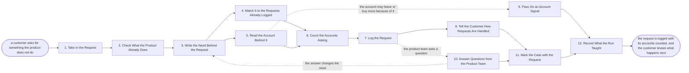

# Reference process: Log a Feature Request

`ref/sup/log-a-feature-request v1`

**value stream:** [Escalations and bug reports](../../streams/customer-support/escalations-and-bug-reports.md)
A customer asks for something the product does not do, in a case, on a
call or in a question sent on from the community. The feedback-keeper
agent takes in the ask in the customer's own words, with what the customer
is trying to get done and what they do today instead, and the support
specialist who holds the case confirms that the product does not already
do it and that nothing is broken. The feedback-keeper agent writes the
need behind the ask without inventing a solution, keeping any solution the
customer suggests beside it, and matches it to the requests already
logged in `<your issue tracker>`. The account-monitor agent reads the
account behind it: its plan, what it pays, its standing and its owner.
The feedback-keeper agent counts the accounts asking with what each pays,
logs a new request for `<your product team>` or joins the one already
logged with the customer's words added, and tells the customer how
requests are handled, with no promise that it will be built and no date. A
customer who says it may leave without the feature, or who asks for what a
larger plan includes, is passed on by the specialist to
`ref/sup/flag-an-account-signal`. When the product team asks a question
about the request, the customer is asked it. The run closes when the
request is logged or joined with its accounts counted, the customer has
been told how requests are handled, and the case carries the request so
that a later release reaches the customer.

**delivers:** document, a logged feature request

## The goals

- Log each request within [2 working days] of the customer asking
- Keep requests logged more than once under [5%]
- Keep replies that promise a request will be built at [zero]
- Have [75%] of customers who asked say they understood what happens next

## The activities

| # | Activity | What happens | Agents |
|---|---|---|---|
| 1 | Take In the Request | the customer's words and what they are trying to get done | [feedback-keeper](../../agents/feedback-keeper.md) |
| 2 | Check What the Product Already Does | a feature that exists, or a fault, goes its own way | feedback-keeper · support specialist (person) |
| 3 | Write the Need Behind the Request | the problem in the customer's words, no solution invented | feedback-keeper |
| 4 | Match It to the Requests Already Logged | the same need logged under other words | feedback-keeper |
| 5 | Read the Account Behind It | the plan, what it pays, its standing and its owner | [account-monitor](../../agents/account-monitor.md) |
| 6 | Count the Accounts Asking | each account and what it pays, added to the request | feedback-keeper |
| 7 | Log the Request | new or joined, sent to the product team in the issue tracker | feedback-keeper |
| 8 | Tell the Customer How Requests Are Handled | the approved wording, with no promise and no date | feedback-keeper |
| 9 | Pass On an Account Signal | a customer who may leave or buy more because of it | support specialist (person) |
| 10 | Answer Questions from the Product Team | what the product team asks, put to the customer | feedback-keeper · support specialist (person) · product manager (person) |
| 11 | Mark the Case with the Request | so a later release reaches this customer | feedback-keeper |
| 12 | Record What the Run Taught | requests logged twice, asks that were faults, the time taken | feedback-keeper |

A request reaches this process from a case at `ref/sup/resolve-a-case`,
from `ref/sup/escalate-a-case-to-a-specialist`, or from a fault
engineering said is how the product is meant to work at
`ref/sup/report-a-confirmed-bug`. What the product team builds is its own
decision, and support only counts and carries what customers ask. The
requests, counted by the accounts asking, reach the product team and the
leaders each period at `ref/sup/report-what-customers-say`. When a
requested feature is released, `ref/sup/tell-customers-about-a-fix` tells
every customer whose case carries the request, and Marketing announces it
in public at `ref/mkt/feature-release`. A customer who may leave or buy
more because of a request reaches the account owner through
`ref/sup/flag-an-account-signal`, which hands it to Sales.

## The graph



## The document, with the blanks marked

```
PROCESS: log a feature request        id: <team>/log-a-feature-request   v1
from: ref/sup/log-a-feature-request v1
owner: <who>                          effective: <date>
trigger: a case in <your support system> is marked as a request for
         something the product does not do
         watch: record=<support case> system=<your support system>
                change=<a case is marked as a feature request>
concurrency: runs may overlap freely - one customer's ask is one run, a
             second ask from the same account for the same thing joins the
             run that is open, and asks from one account for different
             things are runs of their own
goal: the ask written in the customer's own words with the need behind it,
      logged in <your issue tracker> for <your product team> or joined to
      the request already logged, counted with every account asking and
      what each pays, the customer told how requests are handled with no
      promise that it will be built and no date, and the case marked with
      the request so that a later release reaches the customer
phases:
  take-in-request    - system: the customer's ask lands in their own
                       words, with what they are trying to get done, what
                       they do today instead, and the case and the account
                       it came from
                       owner: feedback-keeper   after: trigger
                       automation: <level>
  check-product      - runs assessment: whether the product already does
                       what is asked, under another name or on another
                       plan, or whether something is broken, with the
                       support specialist who holds the case confirming
                       the answer
                       owner: feedback-keeper
                       after: take-in-request     automation: <level>
  write-need         - human: the need written as the problem the customer
                       has and what it costs them, in their own words,
                       with no solution invented and any solution the
                       customer suggests kept beside the need
                       owner: feedback-keeper
                       after: check-product       automation: <level>
  match-requests     - runs assessment: the requests already logged in
                       <your issue tracker> searched for the same need
                       under other words, with each likely match and why
                       owner: feedback-keeper
                       after: write-need          automation: <level>
  read-account       - runs collect-and-report: the account's plan, what
                       it pays, its standing and its owner, each with the
                       system it was read from and when
                       owner: account-monitor
                       after: write-need          automation: <level>
  count-accounts     - system: the account added to the count on the
                       request with its plan and what it pays, so the
                       request shows every account asking and their total
                       owner: feedback-keeper
                       after: match-requests + read-account
                       automation: <level>
  log-request        - system: the request logged in <your issue tracker>
                       for <your product team> as a new request, or joined
                       to the one already logged with the customer's words
                       added
                       owner: feedback-keeper
                       after: count-accounts      automation: <level>
  tell-customer      - human: the customer told in the approved wording of
                       <your feature request policy> how requests are
                       handled and where to follow the request, with no
                       promise that it will be built and no date, in a
                       reply that says it comes from an agent and offers a
                       person
                       owner: feedback-keeper
                       after: log-request         by: <days>
                       automation: <level>
  pass-signal        - human: a customer who says it may leave without the
                       feature, or who asks for what a larger plan
                       includes, passed in their own words to
                       ref/sup/flag-an-account-signal, with no offer made
                       and no price discussed
                       owner: <your support specialist role>
                       after: read-account, when the account may leave or
                       buy more because of the request
                       automation: never
  answer-questions   - convenes briefing: a question <your product manager
                       role> asks about the request put to the customer by
                       the specialist who holds the case, and the answer
                       added to the request in the customer's own words
                       owner: feedback-keeper
                       after: log-request, when the product team asks
                       by: <days>                 automation: <level>
  mark-case          - system: the case marked in <your support system>
                       with the request's reference, so the customer is
                       reached at ref/sup/tell-customers-about-a-fix when
                       the request is released
                       owner: feedback-keeper
                       after: tell-customer, and answer-questions when it
                       ran                        automation: <level>
  record-learning    - convenes debrief: which requests were logged twice,
                       which asks turned out to be faults or features the
                       product already had, and how long each took to log
                       owner: feedback-keeper
                       after: mark-case, and pass-signal when it ran
                       automation: <level>
run-scoped:
  clock - runs roll-call                        owner: feedback-keeper
          every: <cadence>
          from: take-in-request        until: tell-customer
handoffs:
  take-in-request -> check-product [customer-ask]: the ask in the
    customer's own words, with what they are trying to get done
  check-product -> write-need [confirmed-ask]: the ask, confirmed as
    something the product does not do and nothing broken
  write-need -> match-requests / read-account [written-need]: the need in
    the customer's words, with any suggested solution beside it
  match-requests -> count-accounts [match-result]: each likely match and
    why, or none
  read-account -> count-accounts [account-standing]: the plan, what the
    account pays, its standing and its owner
  count-accounts -> log-request [counted-request]: the request with every
    account asking and their total
  log-request -> tell-customer [logged-request]: the request's reference,
    new or joined
  read-account -> pass-signal [account-signal]: the customer's own words
    about leaving or about a larger plan, with the account's standing
  log-request -> answer-questions [product-question]: the product team's
    question, and who asked it
  tell-customer -> mark-case [customer-told]: the reply as sent, and when
  answer-questions -> mark-case [question-answered]: the customer's answer
    as added to the request
  pass-signal -> record-learning [signal-passed]: the signal as passed, and
    to whom
  mark-case -> record-learning [case-marked]: the case with the request's
    reference
deviations:
  read-account -> pass-signal [account-signal]: the customer says it may
    leave without the feature or asks for what a larger plan includes, so
    the specialist passes it to ref/sup/flag-an-account-signal
  log-request -> answer-questions [product-team-asks]: the product team
    asks a question about the request, so the customer is asked it
  answer-questions -> write-need [need-changes]: the customer's answer
    changes the need, so it is written again and matched again
bindings:
  roster:  <who holds each role - agents claiming the abstract agents
           above, and named people for the support specialists and <your
           product manager role> in <your product team>>
  systems: <your support system> (write), <your issue tracker> (write),
           <your CRM> (read), <your billing system> (read), the
           notification channel (write)
  data:    <your feature request policy> <version>, <your reply rules>
           <version>
policy:
  each request is written in the customer's own words, and the need is
    kept apart from any solution the customer suggests
  every ask is matched to the requests already logged before a new one is
    logged
  every account asking is counted with what it pays, and what is built is
    decided by <your product team>
  no reply promises that a request will be built or gives a date, and a
    date the product team publishes reaches a customer only through
    ref/sup/approve-a-sensitive-reply
  every reply an agent sends says it comes from an agent and offers a
    person
  a sign that the account may leave or buy more goes to
    ref/sup/flag-an-account-signal, and support makes no offer and
    discusses no price
  an ask that turns out to be a fault goes to
    ref/sup/report-a-confirmed-bug once a specialist has reproduced it
measures:
  cycle time: <days> from the customer's ask to the request logged
  on time: <target> share of customers told how requests are handled
           within <days>
  volume: <requests per period, new and joined>
  quality gate: every request carries the customer's own words and every
                account asking with what it pays, and no reply promised
                that it will be built
```

## The failure edges

- **The product already does it.** The customer is pointed to the article
  that answers it through `ref/sup/answer-a-routine-question`, the run
  closes with the reason, and an ask that came because nobody could find
  the answer goes to `ref/sup/find-gaps-in-the-help-center`.
- **Something is broken.** The ask leaves for
  `ref/sup/report-a-confirmed-bug` once the specialist has reproduced the
  fault, and nothing is logged as a request.
- **The customer asks when it will be built.** The customer is told how
  requests are handled and where to follow this one. No date is given,
  and a date the product team has published reaches the customer only
  through `ref/sup/approve-a-sensitive-reply`.
- **The feature is on a larger plan.** The customer is told which plans
  include it, and any interest in moving to one goes to the account owner
  through `ref/sup/flag-an-account-signal`. Support quotes no price.
- **The customer says it will leave without the feature.** The specialist
  passes the customer's words to `ref/sup/flag-an-account-signal` and
  makes no offer, and the request is logged like any other.
- **Two different needs were matched as one.** The product team splits
  the request, and the feedback-keeper agent moves each account and its
  words to the request that fits.
- **The trigger fires while a run is in flight.** One ask is one run. A
  second ask from the same account for the same thing joins it, and the
  account is counted once.
- **A run is abandoned.** The customer withdraws the ask. The withdrawal
  is recorded in the customer's own words, the account comes off the
  count, and a request no other account asked for is closed in
  `<your issue tracker>` with the reason.
