# Reference process: Offer a Goodwill Credit

`ref/sup/offer-a-goodwill-credit v1`

**value stream:** [Account and billing requests](../../streams/customer-support/account-and-billing-requests.md)
A customer has borne a failure it should not have had to bear, such as an
outage, a broken promise or a long wait, and someone in the company, such
as the support specialist on the case, a team lead or the account owner,
asks for a goodwill credit to make it good. The refund-coordinator agent
takes in the request with the case and the account, sets out what
happened, when and what the customer bore, and reads what the agreement
already owes, such as a service credit for an outage, with the refunds and
credits the account already received. The account owner says what they
know of the account, and a credit asked for to keep an account that is
leaving belongs to the save plan in Sales. The refund-coordinator agent
proposes an amount under the goodwill part of `<your refund policy>`, with
the evidence and what the agreement already owes beside it, and whoever
asked for the credit counts among those who proposed it. The
delegation-keeper agent names who may decide it: a named credit approver
within `<your refund limit>`, and above it the person the delegation of
authority names, never anyone who proposed it. That person grants the
credit, changes it or refuses it, with the reason, and the
delegation-keeper agent checks the decision before it counts. The
billing-administrator agent drafts the credit note for exactly what was
decided, the decider approves it at its version, and the
billing-administrator agent issues it on the account. A support
specialist then offers the credit to the customer with what happened, in
a reply a named person sends. The run closes when the credit note is
issued and the customer has the offer, or when the credit is refused and
the person who asked knows why, and the record shows who asked, who
proposed and who decided.

**delivers:** statement, a goodwill credit note

**starts:** by hand, someone asks for a goodwill credit after a failure the customer bore

## The goals

- Offer each credit within [2 working days] of the failure being known
- Keep goodwill credits under [0.5%] of the amount billed
- Give the same credit for the same failure in [90%] of cases
- Have fewer than [10%] of customers raise the same failure again after a credit

## The activities

| # | Activity | What happens | Agents |
|---|---|---|---|
| 1 | Take In the Request for a Credit | who asks, the account, the case and the failure | [refund-coordinator](../../agents/refund-coordinator.md) |
| 2 | Set Out What Happened | the failure, its dates and what the customer bore | refund-coordinator |
| 3 | Read What the Agreement Already Owes | any service credit owed, and earlier credits and refunds | refund-coordinator |
| 4 | Hear the Account Owner | what the owner knows, and whether a save plan is open | refund-coordinator · account owner (person) |
| 5 | Propose the Credit | an amount under the goodwill policy, with the evidence | refund-coordinator |
| 6 | Name Who May Decide | the decider for the amount, who proposed none of it | [delegation-keeper](../../agents/delegation-keeper.md) |
| 7 | Decide the Credit | granted, changed or refused, with the reason | credit approver (person) |
| 8 | Check the Decision Counts | the right person, inside the limit, who proposed none of it | delegation-keeper |
| 9 | Draft the Credit Note | for exactly what was decided, naming the account | [billing-administrator](../../agents/billing-administrator.md) |
| 10 | Approve the Credit Note | the decider confirms it carries what was decided | credit approver (person) |
| 11 | Issue the Credit Note | numbered, dated and placed on the account | billing-administrator |
| 12 | Offer the Credit to the Customer | what happened, the credit and where it will show | support specialist (person) |
| 13 | Record the Credit | who asked, who proposed, who decided and the credit note | refund-coordinator |
| 14 | Record What the Credit Taught | the failures behind credits, sent to the people who own them | refund-coordinator |

A request for a credit comes from a case at `ref/sup/resolve-a-case`,
from a promise to a customer that was raised there as broken, or from a
team lead reviewing a long wait. The credits an agreement owes for an outage are
decided at `ref/sup/follow-up-an-outage`, and this process adds only a
gesture beyond them. A credit offered to keep an account that may leave
is a save cost, which the account owner takes to
`ref/sls/work-a-churn-risk`, where a person signs what the save may cost.
A customer who asks for money back instead of a credit has a refund
request, which runs at `ref/sup/decide-a-refund-request`. Finance books
each credit note through its receivables, and the credit is taken off the
customer's next invoice at `ref/fin/issue-a-customer-invoice`.

## The graph

```mermaid
flowchart LR
  T([someone asks for a goodwill credit after a failure the customer bore]) --> A1[1. Take In the Request for a Credit]
  A1 --> A2[2. Set Out What Happened]
  A1 --> A3[3. Read What the Agreement Already Owes]
  A1 --> A4[4. Hear the Account Owner]
  A2 --> A5[5. Propose the Credit]
  A3 --> A5
  A4 --> A5
  A5 --> A6[6. Name Who May Decide]
  A6 --> A7[7. Decide the Credit]
  A7 -. the decider needs more on what happened .-> A2
  A7 --> A8[8. Check the Decision Counts]
  A8 -. the decision was made by someone the delegation does not name for it .-> A6
  A8 --> A9[9. Draft the Credit Note]
  A8 -. the credit is refused .-> A13[13. Record the Credit]
  A9 --> A10[10. Approve the Credit Note]
  A10 -. the credit note does not carry what was decided .-> A9
  A10 --> A11[11. Issue the Credit Note]
  A11 --> A12[12. Offer the Credit to the Customer]
  A12 --> A13
  A13 --> A14[14. Record What the Credit Taught]
  A14 --> DONE([the credit note is issued and offered, or the credit is refused with its reason])
```



## The document, with the blanks marked

```
PROCESS: offer a goodwill credit      id: <team>/offer-a-goodwill-credit   v1
from: ref/sup/offer-a-goodwill-credit v1
owner: <who>                          effective: <date>
trigger: a support specialist, a team lead or the account owner asks in
         <your support system> for a goodwill credit for a customer after
         a failure the customer bore, such as an outage, a broken promise
         or a long wait
         watch: record=<credit request> system=<your support system>
                change=<a goodwill credit is asked for on a case>
concurrency: runs may overlap freely - one failure for one account is one
             run, a second request for the same failure joins it, and a
             credit for another failure on the same account is a run of
             its own held by the same person
goal: the credit granted, changed or refused with its reason by a named
      person whom <your delegation of authority> names for the amount and
      who proposed none of it, within <your refund limit> or by the person
      the delegation names above it, beside what the agreement already
      owes, any credit note drafted for exactly what was decided, approved
      by the decider and issued on the account, and the credit offered to
      the customer in a reply a named person sends
phases:
  take-in-request    - system: the request logged with who asked, the
                       account, the case and the failure it names, and the
                       person who asked recorded as a proposer
                       owner: refund-coordinator   after: trigger
                       automation: <level>
  set-out-failure    - runs collect-and-report: what failed, when it began
                       and ended, the cases it touched, the promise broken
                       or the wait, and what the customer bore, each with
                       where it was read
                       owner: refund-coordinator
                       after: take-in-request     automation: <level>
  read-owed          - runs collect-and-report: any service credit the
                       agreement owes for the failure, as decided at
                       ref/sup/follow-up-an-outage, and the refunds,
                       credits and goodwill the account already received
                       owner: refund-coordinator
                       after: take-in-request     automation: <level>
  hear-owner         - convenes briefing: the account owner says what they
                       know of the account and whether a save plan is open
                       at ref/sls/work-a-churn-risk, and decides nothing
                       about the credit
                       owner: refund-coordinator
                       after: take-in-request     by: <days>
                       automation: <level>
  propose-credit     - runs assessment: an amount proposed at a version
                       under the goodwill part of <your refund policy>,
                       with the failure, the evidence, what the agreement
                       already owes and the names of everyone who proposed
                       it
                       owner: refund-coordinator
                       after: set-out-failure + read-owed + hear-owner
                       automation: <level>
  name-decider       - runs assessment: who may decide this amount under
                       <your delegation of authority> at its version, the
                       named credit approver within <your refund limit> and
                       the person the delegation names above it, with each
                       stand-in, leaving out everyone who proposed it
                       owner: delegation-keeper
                       after: propose-credit      automation: <level>
  decide-credit      - convenes decide-and-announce: <your credit approver
                       role>, or the person the delegation names for the
                       amount, grants the credit, changes it or refuses it,
                       from the proposal and its evidence, with the reason
                       owner: <your credit approver role>
                       after: name-decider        by: <days>
                       automation: never
  check-decision     - runs assessment: the decision checked before it
                       counts, made by someone the version in force names
                       for the amount, inside their limit, and by nobody
                       who proposed the credit
                       owner: delegation-keeper
                       after: decide-credit       automation: <level>
  draft-credit       - human: the credit note drafted at a version for
                       exactly what was decided, naming the account and
                       the failure, and treating the tax as <your
                       jurisdiction's indirect tax rules> require
                       owner: billing-administrator
                       after: check-decision, when the credit is granted
                       automation: <level>
  approve-credit     - convenes approval: the person who decided the credit
                       reads the credit note at its version against the
                       decision and approves it before it is issued
                       owner: <your credit approver role>
                       after: draft-credit        by: <days>
                       automation: never
  issue-credit       - system: the credit note given its number and date in
                       <your billing system>, placed on the account against
                       the next invoice, and passed to <your receivables
                       ledger>
                       owner: billing-administrator
                       after: approve-credit      automation: <level>
  offer-credit       - human: <your support specialist role> writes what
                       happened, the credit, and where and when it will
                       show, and the reply is sent by a named person
                       through ref/sup/approve-a-sensitive-reply, with a
                       copy to the account owner
                       owner: <your support specialist role>
                       after: issue-credit        by: <days>
                       automation: never
  record-credit      - system: the request, the failure, who asked, who
                       proposed, who decided, the version of the
                       delegation, the credit note and the reply as sent,
                       or the refusal and its reason told to the person who
                       asked
                       owner: refund-coordinator
                       after: offer-credit, or check-decision when the
                       credit is refused          automation: <level>
  record-learning    - convenes debrief: the failures behind the credits,
                       how often each came back and what they cost, sent to
                       the people who own them
                       owner: refund-coordinator
                       after: record-credit       automation: <level>
run-scoped:
  clock    - runs roll-call                     owner: refund-coordinator
             every: <cadence>
             from: take-in-request    until: offer-credit
  proposer - runs assessment                    owner: delegation-keeper
             from: take-in-request    until: approve-credit
handoffs:
  take-in-request -> set-out-failure / read-owed / hear-owner
    [credit-request]: who asked, the account, the case and the failure
  set-out-failure -> propose-credit [failure-account]: what failed, when,
    the cases it touched and what the customer bore
  read-owed -> propose-credit [already-owed]: the service credit the
    agreement owes and what the account already received
  hear-owner -> propose-credit [owner-account]: what the account owner
    knows, and whether a save plan is open
  propose-credit -> name-decider [proposed-credit]: the amount, the
    evidence, what is already owed and everyone who proposed it, at a
    version
  name-decider -> decide-credit [named-decider]: the decider and the
    stand-ins for the amount, from the version in force
  decide-credit -> check-decision [credit-decision]: granted, changed or
    refused, with the reason and the amount
  check-decision -> draft-credit / record-credit [counted-decision]: the
    decision as checked against the version in force
  draft-credit -> approve-credit [draft-credit-note]: the credit note at a
    version, naming the account and the failure
  approve-credit -> issue-credit [approved-credit-note]: the credit note as
    approved, with the approver and the version. A change to it voids the
    approval
  issue-credit -> offer-credit [issued-credit-note]: the credit note with
    its number and date, and the invoice it will reduce
  offer-credit -> record-credit [offer-sent]: the reply as sent, by whom
    and when
  record-credit -> record-learning [credit-record]: who asked, who
    proposed, who decided and what was issued or refused
deviations:
  decide-credit -> set-out-failure [needs-more-evidence]: the decider needs
    more on what happened, so it is gathered and the credit is proposed
    again
  check-decision -> name-decider [decision-does-not-count]: the decision
    was made by someone the version does not name for the amount, past
    their limit, or by someone who proposed it, so it is decided again by
    the person the version names
  check-decision -> record-credit [credit-refused]: the credit is refused,
    so no credit note is drafted and the person who asked is told the
    reason
  approve-credit -> draft-credit [credit-does-not-match]: the credit note
    does not carry exactly what was decided, so it is drafted again
bindings:
  roster:  <who holds each role - agents claiming the abstract agents
           above, and named people for <your credit approver role>, each
           decider <your delegation of authority> names above <your refund
           limit>, <your support specialist role>, the account owner and
           the named approvers at ref/sup/approve-a-sensitive-reply>
  systems: <your support system> (write), <your billing system> (read,
           and write by billing-administrator for credit notes only),
           <your CRM> (read), <your contract repository> (read), <your
           refund register> (write), <your receivables ledger> (write), the
           notification channel (write)
  data:    <your refund policy> <version>, <your refund limit>, <your
           delegation of authority> <version>, <your jurisdiction's
           indirect tax rules> <version>, the agreement at its version
policy:
  every goodwill credit is decided by a named person, <your credit
    approver role> within <your refund limit> and the person <your
    delegation of authority> names above it, and never by an agent
  whoever asks for or proposes a credit never decides it, and the
    delegation-keeper agent checks every decision before it counts
  a credit is proposed beside what the agreement already owes, so the
    customer receives each amount once
  a credit offered to keep an account that may leave is a save cost and
    goes to the account owner at ref/sls/work-a-churn-risk, and support
    offers no credit to win a sale or keep an account
  a credit note carries exactly what was decided and is issued only once
    the decider has approved it at its version, and an issued invoice is
    never edited
  the offer is written by a support specialist and sent by a named person
    through ref/sup/approve-a-sensitive-reply, and the customer hears
    nothing about a credit that has not been issued
  no agent moves money, approves a credit or changes a bill
measures:
  cycle time: <days> from the request to the offer sent
  on time: <target> share of credits offered within <days> of the failure
           being known
  volume: <credits per period>, and <the amount credited per period>
  quality gate: every credit traces to a failure set out with its
                evidence, a decider the delegation names who proposed none
                of it, a credit note the decider approved and a reply a
                named person sent
```

## The failure edges

- **A save plan is open on the account.** The account owner says the
  account may be leaving. The request goes to the account owner for
  `ref/sls/work-a-churn-risk`, where a person signs what the save may
  cost, and this run closes with that reason. Support offers no credit to
  keep an account.
- **The agreement already owes a credit for the failure.** The service
  credit is decided at `ref/sup/follow-up-an-outage`, and this run
  proposes only what goes beyond it, so the customer is not credited
  twice for the same hours.
- **The decision does not count.** It was made by someone the version in
  force does not name for the amount, by someone past their limit, or by
  someone who asked for the credit. It is decided again by the person the
  version names, and the customer hears nothing until it counts.
- **The account has no invoice left to reduce.** The account is closing or
  billed for the last time. The decider chooses whether the credit is
  paid back as money, and that runs as a refund at
  `ref/sup/decide-a-refund-request`.
- **The customer asks for money instead of the credit.** That is a refund
  request, and it runs at `ref/sup/decide-a-refund-request`, with this
  credit and its reason shown beside it.
- **The same failure keeps coming back.** The debrief shows the failure
  with how often it returned and what the credits cost, and it goes to
  the person who owns the cause, such as `<your engineering team>` through
  `<your issue tracker>`.
- **The trigger fires while a run is in flight.** One failure for one
  account is one run, and a second request for the same failure joins
  it. A credit for another failure on the same account is a run of its
  own, held by the same person.
- **A run is abandoned.** The person who asked withdraws the request
  before it is decided. The withdrawal is recorded, no credit note is
  issued, and the customer hears nothing about a credit that was never
  decided.
