# Reference process: Post a Status Update

`ref/sup/post-a-status-update v1`

**value stream:** [Outages and incidents](../../streams/customer-support/outages-and-incidents.md)
An incident customers can see has been confirmed, whether support raised
it at Raise a Suspected Outage or `<your engineering team>` declared it
first. The outage-coordinator agent opens the incident's status record
with the cadence and the approver `<your incident policy>` names for its
severity, takes in what the incident lead has confirmed, and drafts the
first update from those facts only: what customers will notice, who is
affected, what they can do meanwhile and when the next update will come,
with no cause and no date the incident lead has not confirmed. When the
incident has reached the press, the agent sets the draft beside the
statement Marketing issued at `ref/mkt/crisis-communication`, so both say
the same thing. The named statement approver reads the draft with the
confirmed facts beside it and approves it, changes it or holds it, and
that decision stays with a person. The outage-coordinator agent posts
exactly the approved version on `<your status page>`, the
in-product-producer agent shows the approved notice inside the product to
the accounts the incident affects once the approver says go, and the
approved wording goes to the support team and to Tell Affected Customers
as the only words anyone in support uses about the incident. Each time
the cadence comes round, and sooner whenever a confirmed fact changes, the
next update is drafted and approved the same way, even when nothing has
changed. An update later shown wrong is corrected in a new version, and
the earlier one stays posted with the correction beside it. Once the
incident lead confirms that the fix is holding, the resolved update is
drafted, approved and posted, and the in-product notice comes down. The
run closes when the resolved update is posted, the notice is down, and
every update is recorded with its version, its approver and the time it
went up.

**delivers:** page, the status updates for an incident

**starts:** on an event, an incident customers can see is confirmed

## The goals

- Post the first approved update within [20 minutes] of the incident being confirmed
- Post [95%] of later updates on or before the time the last one promised
- Keep the updates later corrected under [5%] of those posted
- Cut new cases on the symptom by [50%] in the hour after the first update

## The activities

| # | Activity | What happens | Agents |
|---|---|---|---|
| 1 | Open the Status Record | the incident, its severity, its cadence and its approver | [outage-coordinator](../../agents/outage-coordinator.md) |
| 2 | Take In What the Incident Lead Confirmed | what is known, what is not, and when each was confirmed | outage-coordinator · incident lead (person) |
| 3 | Draft the Update | what customers see, who is affected and the next update time | outage-coordinator |
| 4 | Set the Draft Beside Marketing's Statement | the same facts in the same words, once the press has it | outage-coordinator |
| 5 | Approve the Update | the named approver approves, changes or holds the words | statement approver (person) |
| 6 | Post the Update | exactly the approved version on the status page | outage-coordinator |
| 7 | Show the Notice Inside the Product | the approved notice to the accounts the incident affects | [in-product-producer](../../agents/in-product-producer.md) |
| 8 | Pass the Wording to the Support Team | the approved words to the specialists and customers' cases | outage-coordinator |
| 9 | Keep the Cadence | the next update on time, or sooner when a fact changes | outage-coordinator |
| 10 | Draft a Correction | a new version saying what changed, beside the old one | outage-coordinator |
| 11 | Confirm the Fix Is Holding | the incident lead says customers are no longer affected | incident lead (person) |
| 12 | Draft the Resolved Update | when service returned, and what customers should do now | outage-coordinator |
| 13 | Approve the Resolved Update | the named approver approves or changes the last update | statement approver (person) |
| 14 | Post the Resolved Update | the resolved update on the status page and to the team | outage-coordinator |
| 15 | Take Down the In-Product Notice | the notice down, and the accounts that saw it counted | in-product-producer |
| 16 | Record What the Run Taught | the first update's time, missed cadences and corrections | outage-coordinator · head of support (person) |

The incident is confirmed at `ref/sup/raise-a-suspected-outage`, or
`<your engineering team>` declares it first and support hears it from
the incident lead. Engineering runs the incident itself, and until the
catalog has an engineering department the incident lead is a person in
`<your engineering team>`. Each approved update goes to
`ref/sup/tell-affected-customers`, which sends it to every linked case and
every contact an agreement names, and the resolved update leads to
`ref/sup/follow-up-an-outage` once the incident closes. When the incident
reaches the press, Marketing issues the company's statement at
`ref/mkt/crisis-communication`, the updates here say the same thing, and
the same named person approves both. An incident that may have exposed a
customer's data goes to `<your security team>` through
`ref/sup/escalate-a-security-or-safety-report` before the next update.

## The graph

```mermaid
flowchart LR
  T([an incident customers can see is confirmed]) --> A1[1. Open the Status Record]
  A1 --> A2[2. Take In What the Incident Lead Confirmed]
  A2 --> A3[3. Draft the Update]
  A3 -. the incident has reached the press .-> A4[4. Set the Draft Beside Marketing's Statement]
  A3 --> A5[5. Approve the Update]
  A4 --> A5
  A5 -. the approver changes or holds the draft .-> A3
  A5 --> A6[6. Post the Update]
  A5 --> A7[7. Show the Notice Inside the Product]
  A6 --> A8[8. Pass the Wording to the Support Team]
  A7 --> A8
  A8 --> A9[9. Keep the Cadence]
  A9 -. the cadence comes round or a confirmed fact changes .-> A2
  A9 -. a posted update proves wrong .-> A10[10. Draft a Correction]
  A10 -. the correction goes to the approver .-> A5
  A9 --> A11[11. Confirm the Fix Is Holding]
  A11 --> A12[12. Draft the Resolved Update]
  A12 --> A13[13. Approve the Resolved Update]
  A13 -. the approver changes the resolved update .-> A12
  A13 --> A14[14. Post the Resolved Update]
  A13 --> A15[15. Take Down the In-Product Notice]
  A14 --> A16[16. Record What the Run Taught]
  A15 --> A16
  A16 --> DONE([the resolved update is posted, the notice is down, and every update is recorded with its approver])
```



## The document, with the blanks marked

```
PROCESS: post a status update         id: <team>/post-a-status-update   v1
from: ref/sup/post-a-status-update v1
owner: <who>                          effective: <date>
trigger: an incident customers can see is confirmed in <your incident
         record>, at ref/sup/raise-a-suspected-outage or by <your
         engineering team> first
         watch: record=<incident> system=<your incident record>
                change=<an incident is confirmed as one customers can see>
concurrency: runs may overlap across incidents - one incident is one run,
             each incident keeps its own cadence and its own updates, and
             two incidents the incident lead joins into one share one run
             from then on
goal: every update on <your status page> and inside the product drawn
      only from what the incident lead confirmed, approved at its version
      by <your statement approver role> before it was posted, posted on
      the cadence <your incident policy> sets for the incident's severity
      even when nothing had changed, saying the same thing as any
      statement issued at ref/mkt/crisis-communication, and the resolved
      update posted once the incident lead confirmed the fix was holding
phases:
  open-status-record - system: the status record opened for the incident
                       with its severity, the features and regions it
                       touches, and the cadence and the approver <your
                       incident policy> names for that severity
                       owner: outage-coordinator   after: trigger
                       automation: <level>
  take-in-facts      - convenes briefing: the incident lead says what is
                       confirmed, what is not yet known and what customers
                       can do meanwhile, with the time each fact was
                       confirmed
                       owner: outage-coordinator
                       after: open-status-record, or keep-cadence when the
                       next update is due         automation: <level>
  draft-update       - human: the update drafted at a version in plain
                       words from the confirmed facts only, saying what
                       customers will notice, who is affected, what they
                       can do meanwhile and when the next update will
                       come, with no cause and no date the incident lead
                       has not confirmed
                       owner: outage-coordinator
                       after: take-in-facts       automation: <level>
  match-marketing    - runs assessment: the draft set line by line beside
                       the statement issued at
                       ref/mkt/crisis-communication, and every place where
                       the two differ named for the approver
                       owner: outage-coordinator
                       after: draft-update, when the incident has reached
                       the press                  automation: <level>
  approve-update     - convenes approval: <your statement approver role>
                       reads the draft with the confirmed facts beside it,
                       approves it at its version, changes it or holds it,
                       and says go for the notice inside the product
                       owner: <your statement approver role>
                       after: draft-update, match-marketing when it ran,
                       or draft-correction        by: <minutes>
                       automation: never
  post-update        - system: exactly the approved version posted on
                       <your status page> with the time it went up and the
                       time of the next update
                       owner: outage-coordinator
                       after: approve-update      automation: <level>
  show-in-product    - system: the approved notice shown inside the
                       product to the accounts on the features and regions
                       the incident lead confirmed, or changed to the new
                       approved version, once the approver has said go
                       owner: in-product-producer
                       after: approve-update      automation: <level>
  pass-to-support    - system: the approved wording at its version sent to
                       the support specialists and to
                       ref/sup/tell-affected-customers, as the only words
                       anyone in support uses about the incident
                       owner: outage-coordinator
                       after: post-update + show-in-product
                       automation: <level>
  keep-cadence       - runs roll-call: the time of the next update held
                       against the cadence, the incident lead asked what
                       has changed, and the next update started on time
                       even when nothing has changed
                       owner: outage-coordinator
                       after: pass-to-support     every: <minutes>
                       automation: <level>
  draft-correction   - human: a posted fact that proved wrong corrected in
                       a new version that says what changed, with the
                       earlier version left posted beside it
                       owner: outage-coordinator
                       after: keep-cadence, when a posted update proves
                       wrong                      automation: <level>
  confirm-fix        - convenes decide-and-announce: the incident lead
                       confirms that the fix is holding and customers are
                       no longer affected, with the time service returned
                       owner: <your incident lead role>
                       after: keep-cadence        automation: never
  draft-resolved     - human: the resolved update drafted at a version,
                       saying when service returned, what customers should
                       do now if anything, and that a summary will follow
                       when <your incident policy> calls for one
                       owner: outage-coordinator
                       after: confirm-fix         automation: <level>
  approve-resolved   - convenes approval: <your statement approver role>
                       approves the resolved update at its version, or
                       changes it
                       owner: <your statement approver role>
                       after: draft-resolved      by: <minutes>
                       automation: never
  post-resolved      - system: exactly the approved resolved update posted
                       on <your status page> and sent to the support
                       specialists and to ref/sup/tell-affected-customers
                       owner: outage-coordinator
                       after: approve-resolved    automation: <level>
  take-down-notice   - system: the notice taken down inside the product,
                       with the count of accounts that saw it
                       owner: in-product-producer
                       after: approve-resolved    automation: <level>
  record-learning    - convenes debrief: the time from the incident
                       confirmed to the first update posted, each cadence
                       missed and why, each correction and what caused it,
                       and any place the updates and Marketing's statement
                       differed
                       owner: outage-coordinator
                       after: post-resolved + take-down-notice
                       automation: <level>
run-scoped:
  status   - runs roll-call                     owner: outage-coordinator
             every: <minutes>
             from: open-status-record  until: post-resolved
  timeline - runs collect-and-report            owner: outage-coordinator
             from: open-status-record  until: record-learning
handoffs:
  open-status-record -> take-in-facts [status-record]: the incident, its
    severity, its cadence and its named approver
  take-in-facts -> draft-update [confirmed-facts]: each confirmed fact
    with the time it was confirmed, and what is not yet known
  draft-update -> match-marketing / approve-update [draft-update]: the
    update at a version, each sentence with the fact under it
  match-marketing -> approve-update [statement-comparison]: the draft
    beside Marketing's statement, with every difference named
  approve-update -> post-update / show-in-product [approved-update]: the
    update as approved, with the approver, the version and the time. A
    change to any word voids the approval
  post-update -> pass-to-support [posted-update]: the update as posted,
    with the time it went up and the time of the next update
  show-in-product -> pass-to-support [in-product-notice]: the notice as
    shown, with the accounts it reaches
  pass-to-support -> keep-cadence [support-wording]: the approved wording
    as the support team and the customers' cases received it
  keep-cadence -> take-in-facts [update-due]: the next update due, and
    what the incident lead says has changed
  keep-cadence -> draft-correction [update-wrong]: the posted fact that
    proved wrong, and the confirmed fact that replaces it
  draft-correction -> approve-update [draft-correction]: the correction at
    a new version, with the version it corrects
  keep-cadence -> confirm-fix [fix-reported]: the incident lead's word
    that a fix is in place
  confirm-fix -> draft-resolved [fix-confirmed]: the time service
    returned, and the confirmation that the fix is holding
  draft-resolved -> approve-resolved [draft-resolved]: the resolved
    update at a version
  approve-resolved -> post-resolved / take-down-notice
    [approved-resolved]: the resolved update as approved, with the
    approver and the version
  post-resolved -> record-learning [resolved-posted]: the resolved update
    as posted, and the time it went up
  take-down-notice -> record-learning [notice-down]: the notice taken
    down, with the count of accounts that saw it
deviations:
  draft-update -> match-marketing [incident-in-press]: the incident has
    reached the press, so the draft is set beside Marketing's statement
    before the approver reads it
  approve-update -> draft-update [approver-changes]: the approver changes
    or holds the draft, so it is drafted again on the points named, and
    nothing is posted meanwhile
  keep-cadence -> take-in-facts [next-update-due]: the cadence comes round
    or a confirmed fact changes, so the next update is drafted from what
    the incident lead confirms now
  keep-cadence -> draft-correction [posted-update-wrong]: a posted update
    proves wrong, so a correction is drafted at a new version
  draft-correction -> approve-update [correction-to-approve]: the
    correction goes to the approver like any other update
  approve-resolved -> draft-resolved [resolved-changes]: the approver
    changes the resolved update, so it is drafted again on the points
    named
bindings:
  roster:  <who holds each role - agents claiming the abstract agents
           above, and named people for <your statement approver role> and
           its deputy, <your incident lead role> and <your head of support
           role>>
  systems: <your status page> (write), <your incident record> (read), the
           product's messaging system (write), <your support system>
           (write), the statement record at ref/mkt/crisis-communication
           (read), the notification channel (write)
  data:    <your incident policy> <version>, <your reply rules> <version>,
           the incident's severity and cadence, the confirmed facts at
           their versions
policy:
  nothing is posted on <your status page> or shown inside the product
    before <your statement approver role> has approved it at its version,
    and a change to any word after approval voids the approval
  the approval is never delegated to an agent, and when the approver
    cannot be reached by <minutes> the deputy <your incident policy> names
    approves in their place
  every update is drawn only from what the incident lead confirmed, and
    it names no cause, admits no fault and gives no date for a fix that
    the incident lead has not confirmed and the approver has not approved
  an update is posted on the cadence <your incident policy> sets even when
    nothing has changed, and it says when the next one will come
  what the updates say matches the statement issued at
    ref/mkt/crisis-communication, and the same named person approves both
  an update that proves wrong is corrected in a new version, and the
    earlier version stays posted with the correction beside it
  the support team uses only the approved wording about the incident
  an incident that may have exposed a customer's data goes to <your
    security team> and <your legal team> before the next update, and what
    the updates say about it follows <your jurisdiction's rules on telling
    people about a data breach> as they decide
measures:
  cycle time: <minutes> from the incident confirmed to the first update
              posted
  on time: <target> share of updates posted by the time the last one gave
  volume: <updates per incident>
  quality gate: every update traces to confirmed facts, a named approver
                and the time it went up, and every correction names the
                version it corrects
```

## The failure edges

- **The approver cannot be reached.** Nothing is posted unapproved. The
  deputy `<your incident policy>` names approves in the approver's place,
  and an update that goes up late is posted with the time it went up and
  recorded as late, because customers can see when the last update said
  the next one would come.
- **Nothing has changed when an update is due.** The update still goes,
  saying that the work goes on and when the next update will come, and it
  is approved like any other. Customers read a silent status page as
  nobody working on the problem.
- **The incident lead will not give a date for the fix.** The update
  gives no date, and it says when the next update will come. A date
  appears only once the incident lead has confirmed it and the approver
  has approved it.
- **A posted update proves wrong.** A correction is drafted at a new
  version saying what changed, it is approved like any other update, and
  the earlier version stays posted with the correction beside it. Nothing
  already posted is edited or deleted.
- **The incident reaches the press.** Marketing issues the company's
  statement at `ref/mkt/crisis-communication`, each update is set beside
  it before it is approved, and the same named person approves both, so
  customers and reporters read the same facts.
- **The incident gets worse.** Engineering confirms that more features,
  regions or customers are affected, or raises its severity. The next
  update goes sooner, the cadence for the new severity applies from then
  on, and the in-product notice widens to the accounts newly affected.
- **The incident may have exposed a customer's data.** It goes to `<your
  security team>` and `<your legal team>` before the next update through
  `ref/sup/escalate-a-security-or-safety-report`, and what the updates say
  about it follows `<your jurisdiction's rules on telling people about a
  data breach>` as they decide.
- **The trigger fires while a run is in flight.** One incident is one run,
  with its own cadence and its own updates. Two incidents the incident
  lead joins into one share one run from then on, and the updates already
  posted for each stay where they are.
- **A run is abandoned.** Engineering finds, before any update is posted,
  that customers could not see the incident after all. The status record
  closes with the reason and nothing is posted. Once an update is up, the
  run never stops quietly: it closes only with an approved resolved update.
