# Reference process: Prepare Support for a Release

`ref/sup/prepare-support-for-a-release v1`

**value stream:** [The help center](../../streams/customer-support/the-help-center.md)
A release that customers will see has a date from `<your product team>`,
and support has to be ready before it reaches them. The knowledge-keeper
agent takes in what changes, for which plans and accounts, and when,
along with Marketing's briefing on what the company will say, and lists
every article, saved reply and piece of approved content the release
changes or makes wrong. The article-writer agent tries each changed step
in `<your test environment>` before the release ships, and updates the
articles through `ref/sup/write-a-help-article` and the saved replies
through `ref/sup/publish-a-saved-reply`, each approved by its owner and
held unpublished until the release reaches customers. The
curriculum-manager agent reads the handover against the questions
customers will ask, names the gaps before anybody is taught the old
answer, and builds a short briefing that every support specialist on the
queues the release reaches takes before it ships, and each team lead
confirms that each of their own specialists is ready. A few days before
the date the knowledge-keeper agent checks what is ready, and anything
that will not be goes to the head of support, who decides what customers
are told meanwhile. As the release reaches each account, the updated
content goes live and the content it replaces comes off the list the
agents answer from, and the knowledge-keeper agent watches the first days
for questions no article answers. The run closes when every article and
answer the release touches matches what shipped, every specialist on its
queues was briefed, and what the release taught is recorded.

**delivers:** status board, support's readiness for a release

## The goals

- Have [100%] of the articles a release touches updated on the day it reaches customers
- Brief [95%] of support specialists before a release reaches customers
- Answer [90%] of questions about a release on the first contact
- Keep the time a release takes from the queues under [1 hour] for each specialist

## The activities

| # | Activity | What happens | Agents |
|---|---|---|---|
| 1 | Take In the Release | what changes, for which plans and accounts, and when | [knowledge-keeper](../../agents/knowledge-keeper.md) · product team (person) |
| 2 | Take In the Marketing Briefing | what Marketing will say, and the answers it gives | knowledge-keeper |
| 3 | Find What the Release Touches | the articles, saved replies and approved content it changes | knowledge-keeper |
| 4 | Try the Change Before It Ships | each changed step walked in the test environment | [article-writer](../../agents/article-writer.md) |
| 5 | Update the Articles | each change written and approved, held until the release | article-writer |
| 6 | Update the Saved Replies | each change written and approved, held until the release | article-writer |
| 7 | Check the Handover Against What Customers Ask | the gaps named before anyone is taught the old answer | [curriculum-manager](../../agents/curriculum-manager.md) |
| 8 | Build the Release Briefing | what changes, what it does not do, and the answers | curriculum-manager |
| 9 | Brief the Support Specialists | everyone on the queues the release reaches, by name | curriculum-manager · team lead (person) |
| 10 | Confirm Each Specialist Is Ready | each team lead confirms their own specialists | team lead (person) |
| 11 | Check What Is Ready by the Date | each article, reply and briefing ready or not | knowledge-keeper |
| 12 | Decide What Customers Are Told Meanwhile | for anything that will not be ready on the day | head of support (person) |
| 13 | Switch the Content Live | as the release reaches each account, old content retired | knowledge-keeper |
| 14 | Watch the First Days | questions no article answers, and the cases on the release | knowledge-keeper |
| 15 | Record What the Release Taught | what was late, what was missed, and what customers asked | knowledge-keeper |

A release reaches support from `<your product team>`, and Marketing's
account of it comes from `ref/mkt/feature-release` or
`ref/mkt/product-launch`, where the product pages and the announcement
stay. Each article the release changes is written at
`ref/sup/write-a-help-article` and each saved reply at
`ref/sup/publish-a-saved-reply`, so the same owners, checks and approvals
apply as for any other change. The briefing joins the course a new
specialist takes at `ref/sup/ramp-a-new-support-person`, so nobody who
joins later is taught the old answer. A change that reaches customers
without a run here, such as a small fix, is caught at
`ref/sup/review-the-help-center`, and a fault found while trying the
change goes to `<your engineering team>` through `<your issue tracker>`.

## The graph

```mermaid
flowchart LR
  T([a release customers will see has a date]) --> A1[1. Take In the Release]
  A1 --> A2[2. Take In the Marketing Briefing]
  A1 --> A3[3. Find What the Release Touches]
  A3 --> A4[4. Try the Change Before It Ships]
  A4 -. the change does not behave as the product team described .-> A1
  A4 --> A5[5. Update the Articles]
  A4 --> A6[6. Update the Saved Replies]
  A2 --> A7[7. Check the Handover Against What Customers Ask]
  A3 --> A7
  A7 -. a customer question the handover does not answer .-> A1
  A7 --> A8[8. Build the Release Briefing]
  A8 --> A9[9. Brief the Support Specialists]
  A9 --> A10[10. Confirm Each Specialist Is Ready]
  A10 -. a specialist is not ready .-> A9
  A5 --> A11[11. Check What Is Ready by the Date]
  A6 --> A11
  A10 --> A11
  A11 -. something will not be ready by the date .-> A12[12. Decide What Customers Are Told Meanwhile]
  A11 --> A13[13. Switch the Content Live]
  A12 --> A13
  A13 --> A14[14. Watch the First Days]
  A14 -. customers ask what no article answers .-> A5
  A14 --> A15[15. Record What the Release Taught]
  A15 --> DONE([every article and answer the release touches matches what shipped])
```



## The document, with the blanks marked

```
PROCESS: prepare support for a release  id: <team>/prepare-support-for-a-release   v1
from: ref/sup/prepare-support-for-a-release v1
owner: <who>                          effective: <date>
trigger: <your product team> sets a date in <your release calendar> for a
         release that customers will see
         watch: record=<release> system=<your release calendar>
                change=<a release customers will see is given a date>
concurrency: runs may overlap - one release is one run, a moved date
             moves the run, and two releases that touch the same article
             are held by the same knowledge-keeper so the article changes
             once for both, in the order they ship
goal: every article, saved reply and piece of approved content the
      release touches updated from the product as it will ship, approved
      by its owner and live as the release reaches each account, every
      support specialist on the queues it reaches briefed before it does
      and confirmed ready by their own team lead, anything not ready
      decided by the named head of support with what customers are told
      meanwhile, and the first days watched for questions no article
      answers
phases:
  take-in-release   - runs collect-and-report: what the release changes,
                      for which plans, platforms and accounts, on which
                      date and in what order it reaches them, from <your
                      product team> and <your release calendar>
                      owner: knowledge-keeper   after: trigger
                      automation: <level>
  take-in-briefing  - system: Marketing's briefing from
                      ref/mkt/feature-release or ref/mkt/product-launch
                      taken in as soon as a draft exists, with what the
                      company will say in public and the answers it gives
                      owner: knowledge-keeper   after: trigger
                      automation: <level>
  find-touched      - runs assessment: every article, saved reply and
                      piece of approved content the release changes or
                      makes wrong, and each new article it needs, with
                      their owners
                      owner: knowledge-keeper
                      after: take-in-release    automation: <level>
  try-change        - runs assessment: each changed step walked in <your
                      test environment> before the release ships, on each
                      plan and platform it reaches, with each difference
                      from what <your product team> described named
                      owner: article-writer
                      after: find-touched       automation: <level>
  update-articles   - human: each article the release changes and each new
                      one it needs written at ref/sup/write-a-help-article
                      from what was tried, approved by its owner and held
                      unpublished until the release reaches customers
                      owner: article-writer
                      after: try-change         by: <days before the
                      release>                  automation: <level>
  update-replies    - human: each saved reply the release changes written
                      at ref/sup/publish-a-saved-reply, approved by its
                      owner and held unpublished until the release
                      reaches customers
                      owner: article-writer
                      after: try-change         by: <days before the
                      release>                  automation: <level>
  check-handover    - runs assessment: the product team's account and
                      Marketing's briefing read against the questions
                      customers will ask, from the cases on the feature so
                      far, with each question nobody has answered named
                      before anybody is taught
                      owner: curriculum-manager
                      after: take-in-briefing + find-touched
                      automation: <level>
  build-briefing    - human: a short briefing at a version on what
                      changes, what it does not do, who has it and when,
                      the answers to the questions it will raise, which of
                      them a person must answer, and where a fault goes,
                      with the questions a specialist answers to show they
                      are ready
                      owner: curriculum-manager
                      after: check-handover     automation: <level>
  brief-specialists - convenes briefing: every support specialist on the
                      queues the release reaches takes the briefing before
                      the release reaches customers, with a record of who
                      took it and when
                      owner: curriculum-manager
                      after: build-briefing     by: <days before the
                      release>                  automation: <level>
  confirm-ready     - convenes approval: each <your team lead role>
                      confirms that each of their own specialists can
                      answer the release's questions, and the confirmation
                      stays between the team lead and the specialist
                      owner: <your team lead role>
                      after: brief-specialists  by: <days>
                      automation: never
  check-readiness   - runs assessment: <days> before the release date, each
                      article, saved reply and briefing checked ready or
                      not, and the number of specialists confirmed ready
                      on each queue, with what is missing and who holds it
                      owner: knowledge-keeper
                      after: update-articles + update-replies +
                      confirm-ready             automation: <level>
  decide-meanwhile  - convenes decide-and-announce: <your head of support
                      role> decides what customers are told meanwhile
                      about anything that will not be ready, and records
                      why
                      owner: <your head of support role>
                      after: check-readiness, when something will not be
                      ready          by: <hours>  automation: never
  switch-live       - system: the approved articles and saved replies
                      published as the release reaches each account, and
                      the content they replace taken off the list the
                      agents answer from at the same moment
                      owner: knowledge-keeper
                      after: check-readiness, or decide-meanwhile when it
                      ran                       automation: <level>
  watch-first-days  - runs collect-and-report: for <days> after the
                      release, the questions the agents could not answer,
                      the cases on the release and what customers said the
                      articles got wrong
                      owner: knowledge-keeper
                      after: switch-live        automation: <level>
  record-learning   - convenes debrief: what was late, what the briefing
                      missed, what customers asked that nobody expected,
                      and what the next release prepares differently
                      owner: knowledge-keeper
                      after: watch-first-days   automation: <level>
run-scoped:
  status  - runs roll-call                      owner: knowledge-keeper
            every: <cadence>
            from: take-in-release     until: switch-live
  held    - runs assessment                     owner: knowledge-keeper
            from: update-articles     until: switch-live
handoffs:
  take-in-release -> find-touched [release-account]: what changes, for
    which plans and accounts, and when
  take-in-briefing -> check-handover [marketing-briefing]: what Marketing
    will say and the answers it gives, at its version
  find-touched -> try-change / check-handover [touched-content]: each
    article, saved reply and piece of approved content the release
    changes, and each new article it needs, with their owners
  try-change -> update-articles / update-replies [tried-change]: each
    changed step as the product behaves before release, and each
    difference from what was described
  update-articles -> check-readiness [held-articles]: each article
    approved and held for the release, at its version
  update-replies -> check-readiness [held-replies]: each saved reply
    approved and held for the release, at its version
  check-handover -> build-briefing [handover-gaps]: the questions
    customers will ask, and each one nobody has answered
  build-briefing -> brief-specialists [release-briefing]: the briefing at
    a version, with its questions
  brief-specialists -> confirm-ready [briefing-record]: who took the
    briefing and when
  confirm-ready -> check-readiness [ready-count]: the number of
    specialists confirmed ready on each queue
  check-readiness -> switch-live [readiness-check]: each item ready, and
    the order the release reaches each account
  check-readiness -> decide-meanwhile [not-ready]: what will not be ready,
    who holds it and when it will be
  decide-meanwhile -> switch-live [meanwhile-decision]: what customers are
    told meanwhile, as the head of support decided it
  switch-live -> watch-first-days [live-content]: the versions live for
    each account, and the content taken off the list
  watch-first-days -> record-learning [first-days]: the questions no
    article answered, the cases, and what customers said
deviations:
  try-change -> take-in-release [change-differs]: the change does not
    behave as the product team described, so <your product team> is asked
    once to confirm what will ship before anything is written for it
  check-handover -> take-in-release [question-unanswered]: the handover
    leaves a question customers will ask unanswered, so <your product
    team> is asked for the answer before anybody is taught
  confirm-ready -> brief-specialists [specialist-not-ready]: a team lead
    finds a specialist not ready, so the specialist takes the briefing
    again and the team lead confirms again
  check-readiness -> decide-meanwhile [not-ready-by-date]: something will
    not be ready by the release date, so the head of support decides what
    customers are told meanwhile
  watch-first-days -> update-articles [unanswered-after-release]:
    customers ask what no article answers, so the article is written or
    changed at ref/sup/write-a-help-article and the briefing gains the
    answer
bindings:
  roster:  <who holds each role - agents claiming the abstract agents
           above, and named people for <your head of support role>, each
           <your team lead role>, <your knowledge lead role>, each <your
           article owner role> and the contacts in <your product team>>
  systems: <your release calendar> (read), <your issue tracker> (read),
           <your test environment> (read), <your knowledge base> (write),
           <your support system> (read), <your learning system> (write),
           the notification channel (write)
  data:    <your release calendar> <version>, the release notes at their
           version, Marketing's briefing at its version, <your article
           ownership list> <version>
policy:
  support content for a release is written from the product as it will
    ship, tried in <your test environment>, and approved by its owners
    through ref/sup/write-a-help-article and ref/sup/publish-a-saved-reply
  nothing held for a release is published before the release reaches the
    customers it describes, and the content it replaces stays approved
    for the accounts that do not have the change yet
  no article, saved reply or briefing promises a date, a fix or a feature
    beyond what <your product team> has confirmed will ship, and a date
    reaches a customer only once a named person has approved it
  what support says about a release says the same thing as Marketing's
    briefing, and a difference is settled by <your product team> and
    Marketing before any article says it
  each team lead confirms their own specialists are ready, the agents
    score no specialist, and readiness for a release reaches no
    performance review unless the team lead, as a person, brings it there
  what customers are told about anything not ready is decided by <your
    head of support role>
  the agents approve nothing and publish only what an owner approved
measures:
  cycle time: <days> from the release date set to support ready
  on time: <target> share of releases with every touched article live on
           the day
  volume: <releases per period>
  quality gate: every article and saved reply the release touches matches
                what shipped on the day it reaches customers, and every
                specialist on the queues it reaches was briefed before it
                did
```

## The failure edges

- **The release date moves.** The run moves with it, and nothing held for
  the release is published early. A date brought forward that support
  cannot meet goes to the head of support at once, who decides what
  customers are told meanwhile.
- **The release reaches some accounts first.** The updated content says
  which plans or accounts have the change, the earlier content stays
  approved for the rest, and the agents answer each customer from the
  version that matches their account.
- **The change does not behave as the product team described.** The
  article-writer agent sets out what it saw in `<your test environment>`,
  and `<your product team>` is asked once to confirm what will ship. A
  fault goes to `<your engineering team>` through `<your issue tracker>`,
  and the articles are written for what ships.
- **Marketing's briefing arrives late or says something different.**
  Support goes ahead on the product team's account, and when the briefing
  arrives the knowledge-keeper agent checks it against the articles. A
  difference goes to `<your product team>` and Marketing to settle before
  any article says it.
- **Something will not be ready by the date.** The head of support
  decides what customers are told meanwhile, such as an article that says
  the change is reaching their account and where to ask, and the missing
  work stays open in this run until it is done.
- **A specialist is not ready.** The team lead briefs them again, and
  until then the questions on the release that reach them go to a
  specialist who is ready. Nothing about readiness for a release reaches
  a performance review unless the team lead, as a person, brings it
  there.
- **A question arrives before the briefing.** It goes to a briefed
  specialist or, when none is ready yet, to `<your product team>`, and the
  answer goes into the briefing and the articles the same day.
- **The trigger fires while a run is in flight.** One release is one run.
  Two releases that touch the same article are held by the same
  knowledge-keeper, so the article changes once for both, in the order
  they ship.
- **A run is abandoned.** The release is cancelled. Nothing held for it is
  published, the drafts are kept with the reason, the specialists are told
  the briefing is withdrawn, and the content the agents answer from stays
  as it was.
