# Reference process: Publish a Saved Reply

`ref/sup/publish-a-saved-reply v1`

**value stream:** [Running the support desk](../../streams/customer-support/running-the-support-desk.md)
The support team needs a new saved reply or a change to one, because
specialists keep writing the same answer by hand, a team lead has found a
reply that no longer fits, or the content a reply rests on has changed.
The knowledge-keeper agent takes in the request, reads the saved replies
already in `<your support system>` on the same question, and finds the
approved content in `<your knowledge base>` the reply will rest on, at
its version. The knowledge lead names the reply's owner. The
article-writer agent drafts the reply in plain words from the approved
content only, and marks the blanks the specialist fills in for the
customer's own details. The reply-check agent checks every statement
against the content it cites, and checks the reply against
`<your reply rules>` at their version, and a reply that admits fault,
promises a fix or a date, offers money or a change to the contract, or
answers a formal complaint, a legal threat, a security or safety report,
a regulator, the press or a request about a person's own data is marked
to go through Approve a Sensitive Reply every time it is used. The
article-writer agent revises to exactly what the checks and the owner
asked for, and the owner approves the reply at a version. The
knowledge-keeper agent publishes it with its owner and its review date,
marks whether the agents may send it or only a person may, takes the
version it replaces out of use, and tells the team what changed. The run
closes when the reply is published at its version, marked for who may
send it, and the old version is kept with the dates it was in use.

**delivers:** document, a saved reply

## The goals

- Publish each approved reply within [3 working days] of the request
- Have [70%] of replies sent from a saved reply go out with no edits
- Keep [one] saved reply for each question, with no duplicates
- Review every saved reply at least every [6 months]

## The activities

| # | Activity | What happens | Agents |
|---|---|---|---|
| 1 | Take In the Request for a Reply | what the reply is for, who asks, and the cases behind it | [knowledge-keeper](../../agents/knowledge-keeper.md) |
| 2 | Read the Replies Already Saved | any reply on the same question, and how often each is used | knowledge-keeper |
| 3 | Find the Approved Content Behind It | the articles and answers it rests on, at their versions | knowledge-keeper |
| 4 | Name the Reply's Owner | the person who answers for the reply and approves it | knowledge lead (person) |
| 5 | Draft the Reply | the reply in plain words from the approved content only | [article-writer](../../agents/article-writer.md) |
| 6 | Mark What the Specialist Fills In | the blanks for the customer's own details, and nothing else | article-writer |
| 7 | Check the Reply Against Its Content | every statement traced to the content it cites | [reply-check](../../agents/reply-check.md) |
| 8 | Check the Reply Against the Reply Rules | fault, a date, money, the contract or a person-only category | reply-check |
| 9 | Mark It for Approval Each Time It Is Used | a held-category reply marked for Approve a Sensitive Reply | reply-check · knowledge-keeper |
| 10 | Revise the Reply | exactly the changes the checks and the owner asked for | article-writer |
| 11 | Approve the Reply | the owner approves it at a version | reply owner (person) |
| 12 | Publish the Reply at a Version | the reply in the support system, with owner and review date | knowledge-keeper |
| 13 | Mark Who May Send It | whether the agents may send it, or only a person | knowledge-keeper |
| 14 | Retire the Version It Replaces | the old version taken out of use and kept with its dates | knowledge-keeper |
| 15 | Tell the Team What Changed | what the reply is for, and when to use it | knowledge-keeper |
| 16 | Record the Publication | what changed, who approved it, and when it is reviewed next | knowledge-keeper |

The content a saved reply rests on is written and approved at
`ref/sup/write-a-help-article` and reviewed at
`ref/sup/review-the-help-center`, and a release that touches a reply
reaches it from `ref/sup/prepare-support-for-a-release`. Saved replies
are used at `ref/sup/answer-a-routine-question` and
`ref/sup/resolve-a-case`, and every reply marked for approval goes
through `ref/sup/approve-a-sensitive-reply` each time it is sent. The
wording of a notice of a longer wait that a team lead switches on at
`ref/sup/run-the-days-queue` is published here like any other reply. An
amount, a date or a change to a contract enters a saved reply only as a
blank, filled in by the named person who decided it, such as a refund
decided at `ref/sup/decide-a-refund-request`.

## The graph

```mermaid
flowchart LR
  T([someone asks for a new or changed saved reply]) --> A1[1. Take In the Request for a Reply]
  A1 --> A2[2. Read the Replies Already Saved]
  A1 --> A3[3. Find the Approved Content Behind It]
  A3 -. no approved content covers the reply .-> A1
  A2 --> A4[4. Name the Reply's Owner]
  A3 --> A4
  A4 --> A5[5. Draft the Reply]
  A5 --> A6[6. Mark What the Specialist Fills In]
  A6 --> A7[7. Check the Reply Against Its Content]
  A7 -. a statement has no approved source .-> A10[10. Revise the Reply]
  A7 --> A8[8. Check the Reply Against the Reply Rules]
  A8 -. the reply falls in a category a person must send .-> A9[9. Mark It for Approval Each Time It Is Used]
  A8 --> A11[11. Approve the Reply]
  A9 --> A11
  A10 --> A7
  A11 -. the owner asks for changes .-> A10
  A11 --> A12[12. Publish the Reply at a Version]
  A12 --> A13[13. Mark Who May Send It]
  A12 --> A14[14. Retire the Version It Replaces]
  A13 --> A15[15. Tell the Team What Changed]
  A14 --> A15
  A15 --> A16[16. Record the Publication]
  A16 --> DONE([the reply is published at its version and marked for who may send it])
```



## The document, with the blanks marked

```
PROCESS: publish a saved reply        id: <team>/publish-a-saved-reply   v1
from: ref/sup/publish-a-saved-reply v1
owner: <who>                          effective: <date>
trigger: a support specialist, a team lead or <your knowledge lead role>
         asks for a new or changed saved reply, the content behind a
         saved reply changes or is taken down, or a saved reply reaches
         its review date
         watch: record=<saved reply request> system=<your support system>
                change=<a request is logged, the content behind a reply
                changes, or a review date arrives>
concurrency: runs may overlap across replies - one reply is one run, a
             second request for the same reply joins the open run before
             approval, and a change to the content behind it reopens the
             run
goal: a saved reply resting only on approved content at its version,
      checked against <your reply rules>, marked to go through
      ref/sup/approve-a-sensitive-reply each time it is used when it
      falls in a category a person must send, approved by its named owner
      at a version, published in <your support system> with its owner and
      review date, and the version it replaces taken out of use
phases:
  take-in-request    - system: the request logged with what the reply is
                       for, who asks, and the cases where the answer was
                       written by hand
                       owner: knowledge-keeper    after: trigger
                       automation: <level>
  read-saved         - runs collect-and-report: every saved reply in
                       <your support system> on the same question, its
                       version, its owner and how often it is used and
                       edited
                       owner: knowledge-keeper    after: take-in-request
                       automation: <level>
  find-content       - runs collect-and-report: the articles and approved
                       answers in <your knowledge base> the reply will
                       rest on, each at its version and marked as content
                       the agents may answer from
                       owner: knowledge-keeper    after: take-in-request
                       automation: <level>
  name-owner         - convenes decide-and-announce: <your knowledge lead
                       role> names the reply's owner, the person who
                       answers for what it says and approves it
                       owner: <your knowledge lead role>
                       after: read-saved + find-content
                       by: <days>                 automation: never
  draft-reply        - human: the reply drafted in plain words from the
                       approved content only, with the agent statement
                       <your jurisdiction's rules on telling a customer
                       they are dealing with an agent> require
                       owner: article-writer      after: name-owner
                       by: <days>                 automation: <level>
  mark-blanks        - human: the blanks the specialist fills in for the
                       customer's own details marked, and any amount, date
                       or contract term left as a blank for the person who
                       decided it
                       owner: article-writer      after: draft-reply
                       automation: <level>
  check-content      - runs assessment: every statement in the reply
                       checked against the approved content it cites at
                       its version, and each statement with no approved
                       source named
                       owner: reply-check
                       after: mark-blanks, and revise-reply each time it
                       runs                       automation: <level>
  check-rules        - runs assessment: the reply checked against <your
                       reply rules> at their version for fault, a fix or
                       a date, money, a change to the contract, and each
                       category a person must answer, naming the rule
                       owner: reply-check         after: check-content
                       automation: <level>
  mark-for-approval  - system: a reply in a held category marked in <your
                       support system> to go through
                       ref/sup/approve-a-sensitive-reply each time it is
                       used, with the rule and the person who must send it
                       owner: reply-check
                       after: check-rules, when the reply falls in a held
                       category                   automation: <level>
  revise-reply       - human: the reply revised to exactly what the checks
                       and the owner asked for, at a new draft version
                       owner: article-writer
                       after: check-content or approve-reply, when they
                       send it back               automation: <level>
  approve-reply      - convenes approval: <your reply owner role> approves
                       the reply at its version with the content checks,
                       the rule checks and any approval mark beside it
                       owner: <your reply owner role>
                       after: check-rules, and mark-for-approval when it
                       ran                        by: <days>
                       automation: never
  publish-reply      - system: the approved reply published in <your
                       support system> at its version with its owner, the
                       content it rests on and its review date
                       owner: knowledge-keeper    after: approve-reply
                       automation: <level>
  mark-agent-use     - system: the reply marked as one the agents may send
                       from approved content, or as one only a person may
                       send, and a reply in a held category is never
                       marked for the agents
                       owner: knowledge-keeper    after: publish-reply
                       automation: <level>
  retire-old         - system: the version it replaces taken out of use,
                       and kept with the dates it was in use and the
                       content it rested on
                       owner: knowledge-keeper    after: publish-reply
                       automation: <level>
  tell-team          - convenes briefing: the support specialists told
                       what the reply is for, when to use it, what they
                       fill in and whether it must go through approval
                       owner: knowledge-keeper
                       after: mark-agent-use + retire-old
                       automation: <level>
  record-publication - system: what changed, who approved it, which
                       content it rests on, whether it is held for
                       approval, and the date it is reviewed next
                       owner: knowledge-keeper    after: tell-team
                       automation: <level>
run-scoped:
  content - runs assessment                     owner: knowledge-keeper
            from: find-content        until: publish-reply
handoffs:
  take-in-request -> read-saved / find-content [reply-request]: what the
    reply is for, who asks, and the cases behind it
  read-saved -> name-owner [saved-replies]: each saved reply on the same
    question, with its use and its edits
  find-content -> name-owner [approved-content]: the content the reply
    rests on, each at its version
  name-owner -> draft-reply [reply-owner]: the named owner, and the
    content and replies the draft starts from
  draft-reply -> mark-blanks [draft-reply]: the reply at a draft version
  mark-blanks -> check-content [reply-with-blanks]: the reply with each
    blank marked and what fills it
  check-content -> check-rules [sourced-reply]: the reply with every
    statement traced to its content
  check-content -> revise-reply [unsourced-statements]: each statement
    with no approved source
  check-rules -> mark-for-approval / approve-reply [rule-check]: the
    reply with each rule it meets named, and the person who must send it
  mark-for-approval -> approve-reply [approval-mark]: the mark, the rule
    behind it and the person who must send it each time
  revise-reply -> check-content [revised-reply]: the reply at its new
    draft version
  approve-reply -> publish-reply [approved-reply]: the reply as approved,
    with the owner and the version. A change to it voids the approval
  publish-reply -> mark-agent-use / retire-old [published-reply]: the
    reply live at its version
  mark-agent-use -> tell-team [send-rights]: whether the agents may send
    it, or only a person
  retire-old -> tell-team [retired-version]: the old version out of use,
    with its dates
  tell-team -> record-publication [team-told]: who was told, and when
deviations:
  find-content -> take-in-request [no-approved-content]: no approved
    content covers what the reply would say, so the gap goes to
    ref/sup/write-a-help-article and the request waits for the content
  check-content -> revise-reply [statement-without-source]: a statement
    has no approved source, so it is taken out or the content is found
    before the reply goes on
  check-rules -> mark-for-approval [held-category]: the reply falls in a
    category a person must send, so it is marked to go through
    ref/sup/approve-a-sensitive-reply each time it is used
  approve-reply -> revise-reply [owner-asks-for-changes]: the owner asks
    for changes, and the revised reply is checked again before it returns
bindings:
  roster:  <who holds each role - agents claiming the abstract agents
           above, and named people for the knowledge lead and each
           reply's owner>
  systems: <your support system> (write), <your knowledge base> (read),
           the notification channel (write)
  data:    <your reply rules> <version>, the approved content at its
           version, <your jurisdiction's rules on telling a customer they
           are dealing with an agent> <version>
policy:
  a saved reply says only what approved content in <your knowledge base>
    and the customer's own records support, and every statement in it
    traces to the content it rests on
  a saved reply that admits fault, promises a fix or a date, offers
    money or a change to what the contract says, or answers a formal
    complaint, a legal threat, a security or safety report, a regulator,
    the press or a request about a person's own data goes through
    ref/sup/approve-a-sensitive-reply each time it is used, and no agent
    sends it
  an amount, a date or a contract term enters a saved reply only as a
    blank the named person who decided it fills in
  a reply the agents may send says that it comes from an agent and how
    to reach a person
  a reply is published only once its owner has approved it at its
    version, and a change after approval voids the approval
  when the content a reply rests on changes or is taken down, the reply
    is taken out of use the same day until it is checked again
  the old version is kept with the dates it was in use, so any reply a
    customer received can be read as it stood
measures:
  cycle time: <days> from the request to the reply published
  on time: <target> share of saved replies reviewed by their review date
  volume: <replies published per period>
  quality gate: every statement traces to approved content at its
                version, every reply in a held category is marked for
                approval, and every reply names its owner and review date
```

## The failure edges

- **No approved content covers the reply.** The request waits, and the
  gap goes to `ref/sup/write-a-help-article` with the cases behind it. A
  saved reply is never written from general knowledge to fill the gap.
- **A statement has no approved source.** It is taken out, or the content
  behind it is found and cited, before the reply goes on to the rules.
- **The reply falls in a category a person must send.** It is published
  marked to go through `ref/sup/approve-a-sensitive-reply` each time it
  is used, and it is never marked as one the agents may send. A reply
  written to avoid the mark, such as one that hints at a refund without
  offering one, is held all the same.
- **The content behind a reply changes or is taken down.** The
  knowledge-keeper agent takes the reply out of use the same day, the
  owner is told, and the reply comes back only through a new run.
- **A specialist edits a saved reply in a case.** A reply changed beyond
  its blanks is a drafted reply like any other, and it goes through the
  reply-check agent at `ref/sup/resolve-a-case` before it is sent. A
  reply edited the same way many times comes back here as a request.
- **Two saved replies answer the same question.** The owner chooses one,
  the other is retired with its dates, and the specialists are told
  which to use.
- **The trigger fires while a run is in flight.** One reply is one run. A
  second request for the same reply joins the open run before approval,
  and a change to its content after approval reopens the run.
- **A run is abandoned.** The request is withdrawn or the reply is no
  longer needed. The version in use stays in use unless its content has
  changed, nothing half revised is published, and the person who asked
  is told.
