# Reference process: Raise a Suspected Outage

`ref/sup/raise-a-suspected-outage v1`

**value stream:** [Outages and incidents](../../streams/customer-support/outages-and-incidents.md)
Requests on one symptom start arriving faster than `<your threshold>`, or
customers start saying in public that something in the product is broken.
The request-sorter agent sees the rise in the requests it sorts, the
coverage-monitor agent sees the public posts, and each tells the
outage-coordinator agent, which opens one suspected outage for the
symptom. The outage-coordinator agent reads whether `<your engineering
team>` already has an incident open on it, and whether planned
maintenance, a release that just went out or a known bug matches it, and
keeps each match as a lead for the engineer, who alone rules on it. The
request-sorter agent gathers every case that describes the symptom, and
the outage-coordinator agent groups them, sets out the symptom in the
customers' own words with the time it was first seen, and lists the
accounts reporting it. It pages the engineer on call under `<your on-call
rota>` at once with that evidence and tells the head of support. While the
engineer looks, the request-sorter agent joins each new request on the
symptom to the suspected outage, and the support specialists tell each
customer who asks that the report has reached the right people, with no
cause, no fault and no date. Nothing is said in public until a named
person approves the words at Post a Status Update. The engineer on call
confirms or rules out an incident, and that call stays with a person. A
confirmed incident goes on at once to Post a Status Update and Tell
Affected Customers, and a ruled-out alarm sends its cases back to their
queues with the engineer's reason. The run closes when the engineer on
call has confirmed or ruled out an incident, every request on the symptom
is linked to that answer, and the time from the first case to the page is
recorded.

**delivers:** verdict, a suspected outage confirmed or ruled out

**starts:** on an event, requests on one symptom pass the threshold, or customers say in public that something is broken

## The goals

- Page the engineer on call within [10 minutes] of a symptom passing the threshold
- Send [95%] of pages with the symptom, the time it began and the accounts reporting it
- Keep the alarms the engineer on call rules out under [25%] of those raised

## The activities

| # | Activity | What happens | Agents |
|---|---|---|---|
| 1 | Notice a Rise on One Symptom | requests on one symptom arriving faster than the threshold | [request-sorter](../../agents/request-sorter.md) |
| 2 | Notice Customers Saying It in Public | public posts that something in the product is broken | [coverage-monitor](../../agents/coverage-monitor.md) |
| 3 | Open the Suspected Outage | one record for the symptom, and the signal that raised it | [outage-coordinator](../../agents/outage-coordinator.md) |
| 4 | Check for an Incident Already Open | an incident engineering already has open on the symptom | outage-coordinator |
| 5 | Check for a Known Cause | planned maintenance, a release just out or a known bug | outage-coordinator |
| 6 | Gather the Cases on the Symptom | every open case and new request that describes it | request-sorter |
| 7 | Group the Cases | the cases joined under the suspected outage | outage-coordinator |
| 8 | Set Out the Symptom | what customers see in their words, and when it began | outage-coordinator |
| 9 | List the Accounts Reporting It | the accounts behind the cases, with their plans | outage-coordinator |
| 10 | Page the Engineer on Call | the evidence sent at once, and the head of support told | outage-coordinator · head of support (person) |
| 11 | Hold New Requests on the Symptom | each new request joined, and the customer told it is in hand | request-sorter · support specialist (person) |
| 12 | Confirm or Rule Out an Incident | the engineer on call decides, with the reason | engineer on call (person) |
| 13 | Hand On a Confirmed Incident | the incident passed to the status updates and the customers | outage-coordinator |
| 14 | Send Back a Ruled-Out Alarm | the cases return to their queues with the engineer's reason | outage-coordinator · request-sorter |
| 15 | Record What the Run Taught | the time to the page, and whether the threshold was right | outage-coordinator · head of support (person) |

The requests are counted as they arrive at `ref/sup/take-in-a-request`,
and outside the team's hours the support person on call is paged at
`ref/sup/cover-after-hours-requests` in place of the head of support.
Engineering runs the incident itself, and until the catalog has an
engineering department the engineer on call and the incident lead are
people in `<your engineering team>`. A confirmed incident goes on to
`ref/sup/post-a-status-update` and `ref/sup/tell-affected-customers`, and
after it closes to `ref/sup/follow-up-an-outage`. A symptom the engineer
traces to a known bug is joined to that bug at
`ref/sup/report-a-confirmed-bug`, and a report that touches a customer's
data or somebody's safety goes to
`ref/sup/escalate-a-security-or-safety-report` beside the page. Public
posts are read and recorded here and never answered, and a story that
reaches the press goes to Marketing's `ref/mkt/crisis-communication`.

## The graph

```mermaid
flowchart LR
  T([requests on one symptom pass the threshold, or customers say in public that something is broken]) --> A1[1. Notice a Rise on One Symptom]
  T --> A2[2. Notice Customers Saying It in Public]
  A1 --> A3[3. Open the Suspected Outage]
  A2 --> A3
  A3 --> A4[4. Check for an Incident Already Open]
  A4 -. engineering already has an incident open on it .-> A13[13. Hand On a Confirmed Incident]
  A4 --> A5[5. Check for a Known Cause]
  A5 --> A6[6. Gather the Cases on the Symptom]
  A6 --> A7[7. Group the Cases]
  A7 --> A8[8. Set Out the Symptom]
  A7 --> A9[9. List the Accounts Reporting It]
  A8 --> A10[10. Page the Engineer on Call]
  A9 --> A10
  A10 --> A11[11. Hold New Requests on the Symptom]
  A10 --> A12[12. Confirm or Rule Out an Incident]
  A12 -. the engineer needs more detail .-> A8
  A12 -. no answer by the time the rota sets .-> A10
  A12 --> A13
  A12 -. the engineer rules it out .-> A14[14. Send Back a Ruled-Out Alarm]
  A14 -. requests keep passing the threshold after the ruling .-> A7
  A11 --> A13
  A11 --> A14
  A13 --> A15[15. Record What the Run Taught]
  A14 --> A15
  A15 --> DONE([the engineer on call has confirmed or ruled out an incident, and every request on the symptom is linked to the answer])
```



## The document, with the blanks marked

```
PROCESS: raise a suspected outage     id: <team>/raise-a-suspected-outage   v1
from: ref/sup/raise-a-suspected-outage v1
owner: <who>                          effective: <date>
trigger: requests on one symptom in <your support system> arrive faster
         than <your threshold>, or the coverage-monitor agent reports
         customers saying in public that something is broken
         watch: record=<support case> system=<your support system>
                change=<the requests on one symptom pass the threshold>
concurrency: runs may overlap across symptoms - one symptom is one run, a
             request on a symptom already raised joins that run, and two
             runs the engineer on call finds share one cause are joined
             into one
goal: the suspected outage raised with the engineer on call under <your
      on-call rota> within <minutes> of the threshold being passed, with
      the symptom in the customers' own words, the time it was first seen
      and the accounts reporting it, an incident confirmed or ruled out
      by the engineer on call with the reason, every request on the
      symptom linked to that answer, and nothing said in public about it
      before ref/sup/post-a-status-update
phases:
  notice-case-rise   - runs assessment: the requests sorted in <your
                       support system> counted by symptom and topic, and a
                       symptom that passes <your threshold> in <your
                       interval> named with the requests behind it
                       owner: request-sorter      after: trigger
                       automation: <level>
  notice-public      - runs collect-and-report: the public posts and
                       reviews that say something in the product is
                       broken, each quoted with where and when it appeared
                       owner: coverage-monitor    after: trigger
                       automation: <level>
  open-suspected     - system: one suspected outage opened for the symptom
                       in <your support system>, with the time it was
                       first seen and the signal that raised it
                       owner: outage-coordinator
                       after: notice-case-rise or notice-public, whichever
                       comes first                automation: <level>
  check-incident     - runs assessment: <your incident record> read for an
                       incident engineering already has open on the same
                       feature, region or symptom
                       owner: outage-coordinator
                       after: open-suspected      automation: <level>
  check-known-cause  - runs assessment: the planned maintenance on <your
                       status page>, the releases of the last <hours> and
                       the known bugs in <your issue tracker> read for
                       anything that matches the symptom, each match kept
                       as a lead for the engineer on call, who alone rules
                       on it
                       owner: outage-coordinator
                       after: check-incident, when no incident is open
                       automation: <level>
  gather-cases       - runs collect-and-report: every open case and new
                       request on every channel that describes the
                       symptom, found by its words and its topic
                       owner: request-sorter
                       after: check-known-cause   automation: <level>
  group-cases        - system: the cases joined under the suspected outage
                       in <your support system>, each with its channel,
                       its account and the time it arrived
                       owner: outage-coordinator
                       after: gather-cases        automation: <level>
  set-out-symptom    - human: what customers see, in their own words, the
                       time it was first seen, the features, regions and
                       channels it touches, and the leads from
                       check-known-cause
                       owner: outage-coordinator
                       after: group-cases         automation: <level>
  list-accounts      - runs collect-and-report: the accounts behind the
                       grouped cases, each with its plan and how many of
                       its people reported the symptom
                       owner: outage-coordinator
                       after: group-cases         automation: <level>
  page-engineer      - human: the engineer on call under <your on-call
                       rota> paged at once with the symptom, the time it
                       began, the cases and the accounts, and <your head
                       of support role> told the same minute
                       owner: outage-coordinator
                       after: set-out-symptom + list-accounts
                       by: <minutes>              automation: <level>
  hold-new-requests  - system: each new request on the symptom joined to
                       the suspected outage and marked for the support
                       specialist who answers it, who tells the customer
                       the report has reached the right people, with no
                       cause, no fault and no date
                       owner: request-sorter
                       after: page-engineer       automation: <level>
  confirm-incident   - convenes decide-and-announce: the engineer on call
                       confirms an incident customers can see or rules it
                       out, with the reason and the evidence read
                       owner: <your engineer on call role>
                       after: page-engineer       by: <minutes>
                       automation: never
  hand-on-incident   - system: the confirmed incident, its record in <your
                       incident record>, the grouped cases and the
                       accounts passed to ref/sup/post-a-status-update and
                       ref/sup/tell-affected-customers, and the support
                       specialists told which cases are linked
                       owner: outage-coordinator
                       after: confirm-incident, when an incident is
                       confirmed, or check-incident when one is already
                       open                       automation: <level>
  send-back-alarm    - system: the grouped cases released to their queues
                       with the engineer's reason on each, and any known
                       bug the engineer named joined to the cases through
                       ref/sup/report-a-confirmed-bug
                       owner: outage-coordinator
                       after: confirm-incident, when it is ruled out
                       automation: <level>
  record-learning    - convenes debrief: the time from the first case to
                       the page and from the page to the answer, whether
                       the threshold fired too early or too late, which
                       signal came first, and what <your head of support
                       role> changes in the threshold
                       owner: outage-coordinator
                       after: hand-on-incident or send-back-alarm
                       automation: <level>
run-scoped:
  status - runs roll-call                       owner: outage-coordinator
           every: <minutes>
           from: open-suspected      until: confirm-incident
  rate   - runs collect-and-report              owner: request-sorter
           every: <minutes>
           from: page-engineer       until: confirm-incident
handoffs:
  notice-case-rise -> open-suspected [case-rise]: the symptom, the count
    in the interval and the requests behind it
  notice-public -> open-suspected [public-reports]: each public post,
    quoted, with where and when it appeared
  open-suspected -> check-incident [suspected-outage]: the symptom, the
    time it was first seen and the signal that raised it
  check-incident -> check-known-cause [no-open-incident]: the incident
    record as read, with no incident open on the symptom
  check-incident -> hand-on-incident [open-incident]: the incident
    already open, and the incident lead told what support is seeing
  check-known-cause -> gather-cases [known-cause-leads]: each match found
    in the maintenance, the releases and the known bugs, as a lead
  gather-cases -> group-cases [symptom-cases]: every case and request
    that describes the symptom
  group-cases -> set-out-symptom / list-accounts [grouped-cases]: the
    cases under one suspected outage, each with its channel, its account
    and its time
  set-out-symptom -> page-engineer [symptom-summary]: the symptom in the
    customers' words, when it began and what it touches
  list-accounts -> page-engineer [reporting-accounts]: the accounts with
    their plans and how many of their people reported it
  page-engineer -> hold-new-requests / confirm-incident [outage-page]: the
    page as sent, with the time and the engineer paged
  hold-new-requests -> hand-on-incident / send-back-alarm
    [requests-held]: every request joined while the engineer looked
  confirm-incident -> hand-on-incident [incident-confirmed]: the incident
    with its record, the reason and the time it was confirmed
  confirm-incident -> send-back-alarm [incident-ruled-out]: the reason it
    was ruled out and the evidence the engineer read
  hand-on-incident -> record-learning [incident-handed-on]: the incident
    as passed on, and to which processes
  send-back-alarm -> record-learning [alarm-sent-back]: the cases
    released, with the reason on each
deviations:
  check-incident -> hand-on-incident [incident-already-open]: engineering
    already has an incident open on the symptom, so the cases are joined
    to it once the incident lead confirms they belong there, and no
    second page is sent
  confirm-incident -> set-out-symptom [needs-more-detail]: the engineer on
    call cannot decide on what was sent, so what the engineer asked for
    is gathered and the symptom is set out again
  confirm-incident -> page-engineer [no-answer]: the engineer on call does
    not answer by the time <your on-call rota> sets, so the next person on
    the rota is paged and the head of support is told
  confirm-incident -> send-back-alarm [ruled-out]: the engineer on call
    rules out an incident, so the cases go back to their queues with the
    reason
  send-back-alarm -> group-cases [requests-keep-rising]: requests on the
    symptom keep passing the threshold after the ruling, so they are
    grouped and raised again with the earlier ruling beside them
bindings:
  roster:  <who holds each role - agents claiming the abstract agents
           above, and named people for <your head of support role>, the
           support specialists and each engineer on <your on-call rota>>
  systems: <your support system> (write), <your incident record> (read),
           <your status page> (read), <your issue tracker> (read), <your
           CRM> (read), the coverage record (read), <your paging system>
           (write), the notification channel (write)
  data:    <your threshold> <version>, <your incident policy> <version>,
           <your on-call rota> <version>, <your routing rules> <version>
policy:
  no agent rules out an incident, so every symptom that passes <your
    threshold> goes to the engineer on call, even when a known cause
    seems to explain it
  the engineer on call confirms or rules out an incident, and the call is
    never delegated to an agent
  nothing is said in public about a suspected outage before a named
    person approves the words at ref/sup/post-a-status-update
  no reply on a suspected outage names a cause, admits fault or gives a
    date, and each customer who asks is told only that the report has
    reached the right people
  the page names the symptom in the customers' own words, the time it was
    first seen and the accounts reporting it, and it goes at once without
    waiting for more cases
  a public post is read and recorded, and no agent replies to it
  a symptom that touches a customer's data or somebody's safety goes to
    <your security team> the same hour through
    ref/sup/escalate-a-security-or-safety-report, beside the page
measures:
  cycle time: <minutes> from the threshold passed to the engineer paged
  on time: <target> share of pages answered by the time the rota sets
  volume: <suspected outages per period>
  quality gate: every page carries the symptom, the time it began and the
                accounts reporting it, and every ruling names the engineer
                and the reason
```

## The failure edges

- **Engineering already has an incident open on the symptom.** The cases
  are joined to it, the incident lead is told what support is seeing and
  confirms that the cases belong to it, and the run hands on without a
  second page. A symptom the incident lead says belongs to something else
  goes back to the page like any other.
- **A known cause seems to explain it.** Planned maintenance, a release
  that just went out or a known bug matches the symptom. The
  outage-coordinator agent sends the match to the engineer as a lead and
  still pages, because a maintenance window can hide a real failure, and
  only the engineer on call rules out an incident.
- **The engineer on call does not answer.** The next person on `<your
  on-call rota>` is paged at the time the rota sets, and the head of
  support is told. The cases keep being joined to the suspected outage,
  and nothing is said in public while no one has confirmed it.
- **The engineer needs more detail.** What the engineer asked for, such as
  an example account, the exact error or the time a customer first saw
  it, is gathered from the cases, and the symptom is set out again. The
  page is never held back while the detail is gathered.
- **The symptom touches a customer's data or somebody's safety.** It goes
  to `<your security team>` the same hour through
  `ref/sup/escalate-a-security-or-safety-report`, beside the page, and
  nothing about it is discussed in a public channel.
- **Requests keep rising after a ruling.** A symptom the engineer ruled
  out passes the threshold again, so it is grouped and raised again with
  the earlier ruling beside it. Two rulings on one symptom go to the head
  of support, who agrees with `<your engineering team>` whether the
  threshold is right.
- **It happens after hours.** The engineer is paged the same way, the
  support person on call under `<your after-hours rota>` is told in place
  of the head of support, and the morning team receives the cases with
  the answer at `ref/sup/cover-after-hours-requests`.
- **The trigger fires while a run is in flight.** One symptom is one run.
  A request on a symptom already raised joins that run, and two runs the
  engineer on call finds share one cause are joined into one, with both
  sets of cases.
- **A run is abandoned.** A support specialist finds, before the engineer
  answers, that the cases share a cause on the customers' side, such as
  one setting in one account. The engineer on call is told the page is
  withdrawn and why, the cases go back to their queues with the reason,
  nothing was said in public, and the withdrawal is recorded with its
  time so the debrief can see it.
