# Reference process: Ramp a New Support Person

`ref/sup/ramp-a-new-support-person v1`

**value stream:** [Quality and coaching](../../streams/customer-support/quality-and-coaching.md)
A new support specialist has had their first day, and Human resources
hands them on from `ref/hr/prepare-for-a-new-hire`. The
onboarding-manager agent takes in the job, the team lead, the start date
and the topics and channels the specialist will take, confirms with the
team lead the order in which the topics are learned and who mentors, and
orders access to `<your support system>` and `<your knowledge base>`
with replies held to a practice area until a topic is signed. The
specialist signs into each system to show it opened. The
curriculum-manager agent builds the plan of what is learned in which
week, and teaches the product, the desk and the reply rules: what an
agent may answer, which replies a named person must send, and how a
customer's identity is checked. The specialist sits beside a named
mentor on live cases. For each topic, the certification-check agent runs
a sitting on practice cases with an assessor who is neither the
specialist's team lead nor their mentor, scores each case against the
written pass line with the assessor, and the team lead signs the pass or
a retake. On a signed topic the specialist answers real cases with each
reply read by the mentor before it goes, and once the team lead signs
the step the specialist answers that topic alone, while any reply in a
category a person must send still goes through
`ref/sup/approve-a-sensitive-reply`. The run closes when every topic in
the plan is signed for replies of the specialist's own and the ramp has
been reported to the specialist and their team lead.

**delivers:** status board, a ramped support specialist

**starts:** on an event, a new support specialist is handed on from Human resources after the first day

## The goals

- Answer the first topic alone within [3 weeks] of the first day
- Pass [85%] of topic sittings at the first attempt
- Have [90%] of the cases new specialists answer alone in their first month meet the rubric
- Keep team lead and mentor time under [20 hours] for each new specialist

## The activities

| # | Activity | What happens | Agents |
|---|---|---|---|
| 1 | Take In the New Specialist | the job, team lead, start date, topics and channels | [onboarding-manager](../../agents/onboarding-manager.md) |
| 2 | Confirm the Ramp With the Team Lead | the topics in order, the dates and the mentor | onboarding-manager · team lead (person) |
| 3 | Order Access to the Desk | the desk and the knowledge base, replies held while learning | onboarding-manager · support operations lead (person) |
| 4 | Check the Access Landed | each system signed into by the specialist | onboarding-manager · new support specialist (person) |
| 5 | Build the Ramp Plan | what is learned in which week, topic by topic | [curriculum-manager](../../agents/curriculum-manager.md) · onboarding-manager |
| 6 | Teach the Product | what each topic covers and what customers ask about it | curriculum-manager |
| 7 | Teach the Desk | queues, routing, service levels and saved replies | curriculum-manager · team lead (person) |
| 8 | Teach the Reply Rules | what an agent may say, what a person sends, identity checks | curriculum-manager |
| 9 | Sit Beside a Mentor | live cases watched, with the mentor explaining each step | onboarding-manager · mentor (person) |
| 10 | Name the Assessor | who scores the sitting, and who may not | [certification-check](../../agents/certification-check.md) · team lead (person) |
| 11 | Run the Topic Sitting | practice cases answered unaided in the practice area | certification-check · new support specialist (person) · assessor (person) |
| 12 | Score the Practice Cases | each case scored against the pass line, with the evidence | certification-check · assessor (person) |
| 13 | Sign the Topic Pass | the team lead signs a pass or a retake | team lead (person) |
| 14 | Teach a Gap Again | the parts a sitting or a reviewed reply showed, nothing else | curriculum-manager |
| 15 | Answer Real Cases With Replies Read | each reply read by the mentor before it goes | new support specialist (person) · mentor (person) · onboarding-manager |
| 16 | Sign the Step to Replies of Their Own | the team lead signs the topic, and reply rights widen | team lead (person) · onboarding-manager |
| 17 | Report the Ramp | where the specialist stands against the plan, to the two | onboarding-manager |
| 18 | Record What the Ramp Taught | what the course lacked and what the next ramp changes | onboarding-manager · curriculum-manager |

The hire, the first day and orientation run in Human resources at
`ref/hr/prepare-for-a-new-hire` and `ref/hr/run-new-hire-orientation`,
and the plan for the first months and any probation run beside this
process at `ref/hr/run-a-new-hires-first-months`, which the ramp record
reaches only when the team lead, as the manager, brings it there.
Activities 13 and 16 are gates: a specialist answers live cases on a
topic only after a signed pass, and alone only after a signed step. The
course is kept current for each release at
`ref/sup/prepare-support-for-a-release`, and the first cases a new
specialist answers alone are drawn into `ref/sup/review-support-cases`
like anyone's.

## The graph

```mermaid
flowchart LR
  T([a new support specialist is handed on from Human resources after the first day]) --> A1[1. Take In the New Specialist]
  A1 --> A2[2. Confirm the Ramp With the Team Lead]
  A2 --> A3[3. Order Access to the Desk]
  A3 --> A4[4. Check the Access Landed]
  A4 -. a system never opened .-> A3
  A2 --> A5[5. Build the Ramp Plan]
  A5 --> A6[6. Teach the Product]
  A5 --> A7[7. Teach the Desk]
  A5 --> A8[8. Teach the Reply Rules]
  A4 --> A9[9. Sit Beside a Mentor]
  A6 --> A10[10. Name the Assessor]
  A7 --> A10
  A8 --> A10
  A9 --> A10
  A10 --> A11[11. Run the Topic Sitting]
  A11 --> A12[12. Score the Practice Cases]
  A12 --> A13[13. Sign the Topic Pass]
  A13 -. the topic is not passed .-> A14[14. Teach a Gap Again]
  A14 -. a retake is booked .-> A11
  A13 --> A15[15. Answer Real Cases With Replies Read]
  A15 -. a reviewed reply shows a gap .-> A14
  A14 -. the gap came from live replies .-> A15
  A15 --> A16[16. Sign the Step to Replies of Their Own]
  A16 -. another topic is next in the plan .-> A6
  A16 --> A17[17. Report the Ramp]
  A17 --> A18[18. Record What the Ramp Taught]
  A18 --> DONE([every topic in the plan is signed for replies of the specialist's own, and the ramp is reported])
```



## The document, with the blanks marked

```
PROCESS: ramp a new support person    id: <team>/ramp-a-new-support-person   v1
from: ref/sup/ramp-a-new-support-person v1
owner: <who>                          effective: <date>
trigger: a new support specialist is handed on from
         ref/hr/prepare-for-a-new-hire on the first day, in <your HR
         system>
         watch: record=<employee record> system=<your HR system>
                change=<a new hire into a support job is handed on>
concurrency: runs may overlap freely - one new specialist is one run,
             several new specialists may share sessions and a sitting,
             and a specialist who moves to another support team keeps
             the same run with the new team lead
goal: the new specialist given access to the desk with replies held to
      practice, taught the product, the desk and the reply rules on a
      plan at a version, certified on each topic by a sitting scored
      against the written pass line and signed by <your team lead role>,
      moved on each topic from replies read before they go to replies of
      their own as the team lead signs each step, and the ramp reported
      to the specialist and the team lead
phases:
  take-in-specialist - system: the job, the team lead, the start date,
                       the location, the hours, and the topics and
                       channels the specialist will take, from the hand-on
                       at ref/hr/prepare-for-a-new-hire
                       owner: onboarding-manager   after: trigger
                       automation: <level>
  confirm-ramp       - convenes briefing: <your team lead role> states the
                       topics in the order they are learned, the date each
                       should be taken alone, the named mentor and what
                       ready looks like on each topic
                       owner: onboarding-manager
                       after: take-in-specialist  by: <days>
                       automation: <level>
  order-access       - human: access to <your support system>, <your
                       knowledge base> and the practice area ordered at
                       the job's access list, with replies to customers
                       held to the practice area until a topic is signed,
                       and granted by <your support operations lead role>
                       owner: onboarding-manager
                       after: confirm-ramp, and check-access when a
                       system never opened        automation: <level>
  check-access       - runs assessment: each system on the list signed
                       into by the specialist, with the date, and any
                       system that did not open sent back with its ticket
                       owner: onboarding-manager
                       after: order-access        automation: <level>
  build-plan         - runs build-by-talent: the ramp plan at a version,
                       with each topic, the week it is taught, who teaches
                       it, the date of its sitting and the date it should
                       be taken alone
                       owner: curriculum-manager
                       after: confirm-ramp        automation: <level>
  teach-product      - convenes briefing: what each topic in the plan
                       covers in the product, how customers use it and
                       what they ask about it, taught from the approved
                       content in <your knowledge base> at its version
                       owner: curriculum-manager
                       after: build-plan, and sign-step when another topic
                       is next                    automation: <level>
  teach-desk         - convenes briefing: the queues, the routing, the
                       service levels, the saved replies and how a case is
                       held from assignment to close at
                       ref/sup/resolve-a-case
                       owner: curriculum-manager
                       after: build-plan          automation: <level>
  teach-reply-rules  - convenes briefing: what an agent may answer and how
                       it says it is an agent, which replies a named
                       person must send at ref/sup/approve-a-sensitive-reply,
                       how a customer's identity is checked at
                       ref/sup/verify-a-customers-identity, and <your
                       reply rules> at their version
                       owner: curriculum-manager
                       after: build-plan          automation: <level>
  sit-beside         - convenes briefing: the specialist watches live
                       cases with <your mentor role>, who explains each
                       step, for the hours the plan sets, and opens
                       nothing in an account the mentor's case does not
                       need
                       owner: onboarding-manager
                       after: check-access        automation: <level>
  name-assessor      - runs assessment: the assessor for the sitting
                       chosen from <your assessor pool>, who is neither
                       the specialist's team lead nor their mentor, with
                       any conflict recorded and ruled out
                       owner: certification-check
                       after: teach-product + teach-desk +
                       teach-reply-rules + sit-beside
                       automation: <level>
  run-sitting        - convenes assessment: the specialist answers the
                       practice cases for the topic unaided in the
                       practice area, with the assessor watching, and
                       what the specialist may use, such as <your
                       knowledge base>, set out beforehand
                       owner: certification-check
                       after: name-assessor, and teach-gap when a retake
                       is booked                  by: <days>
                       automation: <level>
  score-sitting      - runs assessment: each practice case scored against
                       the written pass line for the topic, with the
                       evidence behind each score and the assessor who
                       gave it, and a score set aside for a conflict kept
                       marked as such
                       owner: certification-check
                       after: run-sitting         automation: <level>
  sign-pass          - convenes approval: <your team lead role> signs a
                       pass, a pass with a condition or a retake for the
                       topic, with the scores and the evidence beside it
                       owner: <your team lead role>
                       after: score-sitting       by: <days>
                       automation: never
  teach-gap          - convenes briefing: the parts a sitting failed, or
                       a reviewed reply showed, taught again and nothing
                       else, before a retake is booked or the replies
                       resume
                       owner: curriculum-manager
                       after: sign-pass, when the topic is not passed, or
                       answer-reviewed when a reviewed reply shows a gap
                       automation: <level>
  answer-reviewed    - human: on a signed topic the specialist answers
                       real cases, and <your mentor role> reads each reply
                       before it goes, with any change and its reason kept
                       for the specialist
                       owner: <your mentor role>
                       after: sign-pass, and teach-gap when the gap came
                       from live replies          automation: never
  sign-step          - convenes approval: <your team lead role> signs the
                       step to replies of the specialist's own on the
                       topic, from the reviewed replies, and the
                       onboarding-manager agent orders the reply rights
                       for that topic, granted by <your support operations
                       lead role>
                       owner: <your team lead role>
                       after: answer-reviewed     by: <days>
                       automation: never
  report-ramp        - runs collect-and-report: where the specialist
                       stands against the plan, topic by topic, with each
                       pass, each retake and each step signed, sent to the
                       specialist and their team lead only
                       owner: onboarding-manager
                       after: sign-step, when every topic in the plan is
                       signed                     automation: <level>
  record-learning    - convenes debrief: what the course lacked, which
                       sittings failed on the same parts, which questions
                       the mentor heard the specialist ask, and what the
                       next ramp changes, with no specialist named
                       owner: onboarding-manager
                       after: report-ramp         automation: <level>
run-scoped:
  status - runs roll-call                       owner: onboarding-manager
           every: <cadence>
           from: confirm-ramp        until: report-ramp
  access - runs assessment                      owner: onboarding-manager
           from: order-access        until: run close
handoffs:
  take-in-specialist -> confirm-ramp [new-specialist]: the job, the team
    lead, the start date, the hours, the topics and the channels
  confirm-ramp -> order-access / build-plan [confirmed-ramp]: the topics
    in order, the dates, the mentor and what ready looks like
  order-access -> check-access [access-ordered]: each system with its
    ticket and the date it was raised
  check-access -> sit-beside [access-landed]: each system signed into,
    with the date
  build-plan -> teach-product / teach-desk / teach-reply-rules
    [ramp-plan]: the plan at a version, topic by topic
  teach-product / teach-desk / teach-reply-rules -> name-assessor
    [taught-topic]: who attended each session, and the questions the
    material did not answer
  sit-beside -> name-assessor [mentor-hours]: the hours beside the mentor
    and the cases watched
  name-assessor -> run-sitting [assessor-named]: the assessor, the
    conflicts ruled out and the date of the sitting
  run-sitting -> score-sitting [sitting-answers]: each practice case as
    the specialist answered it
  score-sitting -> sign-pass [sitting-scores]: each case scored against
    the pass line, with the evidence and the assessor
  sign-pass -> answer-reviewed / teach-gap [topic-result]: the pass, the
    condition or the retake, with who signed it and the standard version
  teach-gap -> run-sitting / answer-reviewed [gap-taught]: the gap named
    and the date it was taught again
  answer-reviewed -> sign-step [reviewed-replies]: the replies the mentor
    read, with each change and its reason
  sign-step -> teach-product / report-ramp [signed-step]: the topic
    signed for replies of the specialist's own, with the reply rights
    granted and the date
  report-ramp -> record-learning [ramp-report]: where the specialist
    stands, as sent to the two of them
deviations:
  check-access -> order-access [system-not-open]: a system never opened,
    so it is ordered again with the first ticket attached and the run is
    held at that system
  sign-pass -> teach-gap [topic-not-passed]: the topic is not passed, so
    the parts that failed are taught again before a retake
  teach-gap -> run-sitting [retake-booked]: the gap is taught, so the
    retake is booked with a fresh set of practice cases
  answer-reviewed -> teach-gap [reply-shows-gap]: a reviewed reply shows
    a gap, so the part is taught again and the replies on that topic go on
    being read before they go
  teach-gap -> answer-reviewed [replies-resume]: the gap came from live
    replies, so the specialist goes back to replies read by the mentor
  sign-step -> teach-product [next-topic]: another topic is next in the
    plan, so it is taught and sat the same way
bindings:
  roster:  <who holds each role - agents claiming the abstract agents
           above, and named people for the team lead, the mentor, each
           assessor, the support operations lead and the new specialist>
  systems: <your support system> (read, and write in the practice area),
           <your knowledge base> (read), <your identity system> (read),
           <your learning system> (write), the certification record
           (write), <your HR system> (read), the calendar (write), the
           notification channel (write)
  data:    the ramp plan <version>, the support course <version>, the
           pass line for each topic <version>, <your reply rules>
           <version>, <your identity policy> <version>, the job's access
           list <version>
policy:
  a new specialist answers a customer on a topic only after <your team
    lead role> has signed the pass, and alone only after the team lead
    has signed the step
  any reply in a category a person must send goes through
    ref/sup/approve-a-sensitive-reply at every stage of the ramp and
    after it
  the agents never grant a pass or a step, never grant access, and never
    widen the specialist's reply rights themselves
  the assessor is neither the specialist's team lead nor their mentor,
    and a score given by an assessor with a conflict is set aside and
    kept marked as such
  a sitting uses practice cases, and no live customer is ever part of
    one
  a pass line is written before the sitting, and it is never lowered or
    moved after one
  the specialist's scores and results go only to the specialist and
    their team lead, and the ramp record reaches the probation at
    ref/hr/run-a-new-hires-first-months only when the team lead, as the
    manager, brings it there
  agents never weigh a protected characteristic in anything they do
    about a new specialist
measures:
  cycle time: <days> from the first day to the first topic answered
              alone
  on time: <target> share of topics signed by the date in the plan
  volume: <new specialists in their ramp per period>
  quality gate: every reply a new specialist sent alone sits on a topic
                with a signed pass and a signed step, and every pass
                names its assessor, its signer and its standard version
```

## The failure edges

- **A system never opened.** The onboarding-manager agent orders it
  again with the first ticket attached and tells the support operations
  lead. The run is held at that system, and the specialist never answers
  a customer through a borrowed sign-in.
- **The topic is not passed.** The curriculum-manager agent teaches the
  parts that failed again and nothing else, and the retake uses a fresh
  set of practice cases. A topic not passed twice goes to the team lead
  with the scores, who decides with the specialist whether the plan for
  that topic changes.
- **A reviewed reply shows a gap.** The mentor holds the reply, the part
  is taught again, and the replies on that topic go on being read before
  they go. A reply in a category a person must send that reached a
  customer without its approval goes to the team lead the same day.
- **Everybody fails the same part.** The curriculum-manager agent takes
  it to the quality lead as a sign about the course or the practice
  cases, and the pass line is changed only at a new version before the
  next sitting.
- **The mentor is away.** The team lead names another mentor for the
  days away, and the replies on that topic wait for a reader. No reply
  goes unread because the reader is missing.
- **The specialist's job or start changes.** Human resources changes it
  at `ref/hr/change-an-employee-record`, the onboarding-manager agent
  takes in the change, and the plan is built again from the topics
  already signed.
- **The trigger fires while a run is in flight.** A new specialist has
  one ramp open at a time. A move to another support team keeps the run,
  and the new team lead confirms the topics still to come.
- **A run is abandoned.** The specialist leaves during the ramp. The
  leaving runs at `ref/hr/offboard-a-leaver`, the support operations lead
  removes the access to the desk the same day, the plan is closed with
  the reason, and the record is kept only as the retention schedule
  allows.
