# Reference process: Recover Access to an Account

`ref/sup/recover-access-to-an-account v1`

**value stream:** [Account and billing requests](../../streams/customer-support/account-and-billing-requests.md)
A customer cannot sign in because a password, a device or an email
address is lost, or a person asks for control of a business account
because whoever held it has left the customer's organization, and a false
request of this kind is a common way to take over an account. The
account-request-coordinator agent takes in the request as it arrived,
keeps it unchanged as evidence, and holds the account as it stands, so no
sign-in detail, email address or phone number changes while the request
is open. The identity-check agent reads the request for the signs of a
takeover, such as urgency, pressure to skip a check or new contact details
offered in the request, and checks the person under
`<your identity policy>` with the checks it sets for the highest risk,
against what `<your identity system>` and the account already hold and
never against details the request supplied. For a business account it
also checks the authority the person claims against the contract and the
administrators on file, and the account-request-coordinator agent asks
the signatory or another administrator to confirm it through details
already on file. The account's existing contacts are told through those
same details and given `<your objection window>` to say no. A request
that fails a check, pushes to skip one or draws an objection goes to the
named access approver as a possible takeover. Once every check has
passed, the named access approver hands over access or control using only
details the company already held, and the holder and the existing
contacts are told. The run closes when the rightful holder is back in, or
when the request is refused and reported to `<your security team>`, and
the record shows who asked, how each check was made and who handed over.

**delivers:** status board, an account back with its rightful holder

**starts:** on an event, a customer cannot sign in, or someone asks for control of a business account

## The goals

- Give a genuine holder access back within [1 working day] of the request
- Hand [zero] accounts to someone who was not entitled to them
- Ask a genuine holder for proof no more than [twice]
- Hold fewer than [5%] of genuine requests as possible takeovers

## The activities

| # | Activity | What happens | Agents |
|---|---|---|---|
| 1 | Take In the Request | the request, its channel, the account and who is asking | [account-request-coordinator](../../agents/account-request-coordinator.md) |
| 2 | Keep the Request as Evidence | the message and anything attached kept unchanged on the case | account-request-coordinator |
| 3 | Hold the Account as It Stands | no sign-in, email or phone change while the request is open | account-request-coordinator |
| 4 | Read the Request for Signs of Takeover | urgency, pressure to skip a check, new contact details | [identity-check](../../agents/identity-check.md) |
| 5 | Find the Contacts on File | the holder and administrators on file before the request | account-request-coordinator |
| 6 | Check the Person at the Highest Risk | the identity policy's strongest checks against what is held | identity-check |
| 7 | Check the Authority to Take Control | for a business account, against contract and administrators | identity-check |
| 8 | Confirm with a Contact on File | the signatory or another administrator confirms the holder | account-request-coordinator · signatory on file (person) |
| 9 | Tell the Existing Contacts | a notice through details on file, with time to object | account-request-coordinator |
| 10 | Prepare the Handover | the checks, confirmation and any objection, for the approver | account-request-coordinator |
| 11 | Decide a Possible Takeover | refused and reported, or sent back for further checks | access approver (person) · security team (person) |
| 12 | Hand Over Access or Control | a named person, using only details the company already held | access approver (person) |
| 13 | Tell the Holder and the Contacts | access restored or control moved, through details on file | account-request-coordinator |
| 14 | Confirm the Holder Is Back In | the first sign-in seen and the old sessions closed | account-request-coordinator |
| 15 | Close the Request on the Record | who asked, each check, who confirmed and who handed over | account-request-coordinator |
| 16 | Record What the Request Taught | the signs of takeover seen and how long the checks took | account-request-coordinator · identity-check |

A request reaches this process from `ref/sup/take-in-a-request`, or from
`ref/sup/verify-a-customers-identity` when a customer who cannot sign in
asks for help on another matter. A request to change the email address or
phone number on an account while the holder can still sign in is checked
at `ref/sup/verify-a-customers-identity` with the same rule, and one that
arrives with urgency or pressure is sent here. A refused request is a
security report, so it reaches `<your security team>` the same day, and
any reply to the person who reported a takeover is sent through
`ref/sup/approve-a-sensitive-reply`. The same rule that a request is never
confirmed through the details it supplies protects suppliers' bank
details at `ref/fin/change-a-suppliers-bank-details`.

## The graph

```mermaid
flowchart LR
  T([a customer cannot sign in, or someone asks for control of a business account]) --> A1[1. Take In the Request]
  A1 --> A2[2. Keep the Request as Evidence]
  A1 --> A3[3. Hold the Account as It Stands]
  A2 --> A4[4. Read the Request for Signs of Takeover]
  A3 --> A4
  A4 --> A5[5. Find the Contacts on File]
  A5 --> A6[6. Check the Person at the Highest Risk]
  A6 -. the person fails a check or pushes to skip one .-> A11[11. Decide a Possible Takeover]
  A6 -. the person asks for control of a business account .-> A7[7. Check the Authority to Take Control]
  A7 --> A8[8. Confirm with a Contact on File]
  A8 -. the contact on file does not confirm the new holder .-> A11
  A6 --> A9[9. Tell the Existing Contacts]
  A8 --> A9
  A9 -. an existing contact objects .-> A11
  A9 --> A10[10. Prepare the Handover]
  A11 -. the approver sends the request back for further checks .-> A6
  A10 --> A12[12. Hand Over Access or Control]
  A12 -. the approver finds a check incomplete .-> A6
  A12 --> A13[13. Tell the Holder and the Contacts]
  A13 --> A14[14. Confirm the Holder Is Back In]
  A14 -. the holder still cannot sign in .-> A12
  A11 --> A15[15. Close the Request on the Record]
  A14 --> A15
  A15 --> A16[16. Record What the Request Taught]
  A16 --> DONE([the rightful holder is back in, or the request is refused and reported])
```



## The document, with the blanks marked

```
PROCESS: recover access to an account  id: <team>/recover-access-to-an-account   v1
from: ref/sup/recover-access-to-an-account v1
owner: <who>                          effective: <date>
trigger: a customer who cannot sign in asks for access back, or a person
         asks for control of a business account because whoever held it
         has left, by any channel, and the request is logged against the
         account in <your support system>
         watch: record=<access request> system=<your support system>
                change=<a request to recover access or take control is logged>
concurrency: runs may overlap across accounts - one account has one
             request open at a time, a second request for the same account
             while one is open joins it and is treated as suspect, and the
             run stays open until the holder is confirmed back in
goal: access to the account given back, or control of it handed over, by
      <your access approver role> using only details the company held
      before the request, once the person has passed every check <your
      identity policy> sets for the highest risk and the account's
      existing contacts were told through details on file without
      objecting, or the request refused and reported to <your security
      team> the same day
phases:
  take-in-request    - system: the request logged as it arrived, with its
                       channel, the account it names, who asks, what they
                       ask for, and any contact details it offers
                       owner: account-request-coordinator   after: trigger
                       automation: <level>
  keep-evidence      - system: the message, its headers and anything
                       attached kept unchanged on the case as evidence,
                       and no contact detail in it used to reply with a
                       confirmation
                       owner: account-request-coordinator
                       after: take-in-request     automation: <level>
  hold-account       - system: an open request marked on the account in
                       <your support system>, so a request by any route to
                       change a sign-in detail, the email address or the
                       phone number joins this run and waits
                       owner: account-request-coordinator
                       after: take-in-request     automation: <level>
  read-request       - runs assessment: the channel, the timing, any
                       urgency or pressure to skip a check, contact details
                       the request offers, recent changes on the account
                       and every other sign of takeover <your identity
                       policy> names, with the request treated as suspect
                       until the checks pass
                       owner: identity-check
                       after: keep-evidence + hold-account
                       automation: <level>
  find-contacts      - runs assessment: the holder's, the administrators'
                       and the contract signatory's contact details as the
                       account and <your CRM> held them before the request
                       arrived, with the date each was put there, and no
                       detail taken from the request
                       owner: account-request-coordinator
                       after: read-request        automation: <level>
  check-identity     - runs assessment: the person checked under <your
                       identity policy> at its version with the checks it
                       sets for the highest risk, against what <your
                       identity system> and the account already hold,
                       asking once for anything missing
                       owner: identity-check
                       after: find-contacts       automation: <level>
  check-authority    - runs assessment: the claim to take control checked
                       against the contract signatory, the administrators
                       and the users already on the account, with the new
                       holder named only from people already on it or by
                       a contact on file
                       owner: identity-check
                       after: check-identity, when the request asks for
                       control of a business account
                       automation: <level>
  confirm-on-file    - human: the signatory or another administrator asked
                       through details already on file to confirm that the
                       new holder may take control, with who confirmed, by
                       which route and when recorded
                       owner: account-request-coordinator
                       after: check-authority     by: <days>
                       automation: <level>
  tell-contacts      - system: the account's existing contacts told
                       through details already on file that access or
                       control was asked for, by whom and when, and that
                       they have <your objection window> to say no
                       owner: account-request-coordinator
                       after: check-identity, and confirm-on-file when it
                       ran                        automation: <level>
  prepare-handover   - runs collect-and-report: each check and how it was
                       made, the confirmation, the notice to the contacts,
                       any objection, and exactly what the handover will
                       change, set out for the approver
                       owner: account-request-coordinator
                       after: tell-contacts, once <your objection window>
                       has passed with no objection
                       automation: <level>
  decide-takeover    - convenes decide-and-announce: <your access approver
                       role> reads the request, its evidence and the failed
                       check, the missing confirmation or the objection,
                       and refuses the request and reports it to <your
                       security team> the same day, or sends it back for
                       further checks
                       owner: <your access approver role>
                       after: check-identity, confirm-on-file or
                       tell-contacts, when a check fails, a contact does
                       not confirm or a contact objects
                       by: <hours>                automation: never
  hand-over          - convenes approval: <your access approver role>
                       reads the prepared handover and, once every check
                       has passed, restores access or moves control in
                       <your identity system>, sends any reset only to
                       details the company held before the request, and
                       closes the sessions and devices the account had
                       owner: <your access approver role>
                       after: prepare-handover    by: <hours>
                       automation: never
  tell-holder        - system: the holder and the existing contacts told
                       through details on file that access was restored or
                       control moved, when, and how to say so if they did
                       not ask for it
                       owner: account-request-coordinator
                       after: hand-over           automation: <level>
  confirm-signed-in  - runs collect-and-report: the holder's first sign-in
                       after the handover read from <your identity system>,
                       and the sessions the approver closed confirmed
                       closed
                       owner: account-request-coordinator
                       after: tell-holder         by: <days>
                       automation: <level>
  close-request      - system: the request closed on the record with who
                       asked, each check and how it was made, who
                       confirmed, who decided and what changed, or the
                       refusal and the report
                       owner: account-request-coordinator
                       after: confirm-signed-in, or decide-takeover when
                       the request was refused    automation: <level>
  record-learning    - convenes debrief: the signs of takeover seen, how
                       long the checks took, how many genuine holders were
                       held, and what the owner of <your identity policy>
                       should consider changing
                       owner: account-request-coordinator
                       after: close-request       automation: <level>
run-scoped:
  hold       - runs roll-call                   owner: account-request-coordinator
               every: <cadence>
               from: hold-account        until: hand-over
  objections - runs assessment                  owner: account-request-coordinator
               from: tell-contacts       until: prepare-handover
handoffs:
  take-in-request -> keep-evidence / hold-account [access-request]: the
    request as it arrived, its channel, the account, who asks and what
    they ask for
  keep-evidence -> read-request [kept-request]: the message and anything
    attached, unchanged, with where they are kept
  hold-account -> read-request [held-account]: the account marked with an
    open request, and any other change request that joined it
  read-request -> find-contacts [takeover-signs]: each sign of takeover
    found, and the risk the checks must meet
  find-contacts -> check-identity [contacts-on-file]: the contact details
    held before the request, with the date each was put there
  check-identity -> check-authority / tell-contacts [identity-checked]: the
    checks made, how each was made and the result
  check-authority -> confirm-on-file [authority-checked]: the claim set
    against the signatory, the administrators and the users on file
  confirm-on-file -> tell-contacts [holder-confirmed]: who confirmed the
    new holder, by which route and when
  tell-contacts -> prepare-handover [contacts-told]: the notice as sent,
    to whom, and the end of the objection window
  prepare-handover -> hand-over [prepared-handover]: every check, the
    confirmation, the notice and exactly what will change
  check-identity / confirm-on-file / tell-contacts -> decide-takeover
    [possible-takeover]: the request, its evidence and the check, the
    confirmation or the objection that stopped it
  hand-over -> tell-holder [handover-made]: what the approver changed, the
    details the reset went to, and the sessions closed
  tell-holder -> confirm-signed-in [holder-told]: the notices sent through
    details on file, and when
  confirm-signed-in -> close-request [holder-back-in]: the first sign-in
    and the sessions confirmed closed
  decide-takeover -> close-request [takeover-decision]: the refusal, the
    report to the security team and who was told
  close-request -> record-learning [closed-request]: who asked, each
    check, who confirmed, who decided and what changed
deviations:
  check-identity -> decide-takeover [check-failed]: the person fails a
    check or pushes to skip one, so the request is held as a possible
    takeover for the access approver
  confirm-on-file -> decide-takeover [holder-not-confirmed]: the contact on
    file does not confirm the new holder, so the request is held as a
    possible takeover
  tell-contacts -> decide-takeover [contact-objects]: an existing contact
    says they did not ask for this, so the handover stops and the
    approver decides
  decide-takeover -> check-identity [further-checks]: the approver sends
    the request back for the checks the approver names, and nothing
    changes on the account meanwhile
  hand-over -> check-identity [check-incomplete]: the approver finds a
    check missing or made against details the request supplied, so the
    check is made again
  confirm-signed-in -> hand-over [still-locked-out]: the holder still
    cannot sign in, so the approver looks again at what the handover
    changed, using only details held before the request
bindings:
  roster:  <who holds each role - agents claiming the abstract agents
           above, and named people for <your access approver role> and the
           contacts at <your security team>>
  systems: <your support system> (write), <your identity system> (read,
           and write by <your access approver role> only), <your CRM>
           (read), <your contract repository> (read), the notification
           channel (write)
  data:    <your identity policy> <version>, <your account recovery
           procedure> <version>, <your objection window>, the agreement at
           its version
policy:
  access to an account or control of it is handed over only by <your
    access approver role>, once every check <your identity policy> sets
    for the highest risk has passed
  the request, and any contact detail in it, is never used to confirm it,
    and a reset goes only to details the company held before the request
    arrived
  a request that arrives with urgency or pressure, or asks to skip a
    check, is treated as a possible takeover until the checks pass
  control of a business account goes only to a person already on the
    account or named by its signatory or another administrator through
    details already on file
  the account's existing contacts are told through details on file before
    the handover, and an objection stops it until the approver decides
  while a request is open, no sign-in detail, email address or phone
    number on the account changes by any route
  the agents grant no access, change no sign-in detail and hand over no
    account
  a refused request is reported to <your security team> the same day
  the person is asked once for anything missing, and only for what the
    checks need
measures:
  cycle time: <hours> from the request to access restored or refused
  held: <target> share of genuine requests held as possible takeovers
  volume: <requests per period>, by kind
  quality gate: every handover traces to checks passed at the highest
                risk, a notice to the contacts on file and a named
                approver, and uses only details held before the request
```

## The failure edges

- **The request arrives with urgency or pressure.** The person says the
  matter cannot wait, names a senior person, or asks for a check to be
  skipped. The request is treated as a possible takeover until every
  check has passed, however genuine it sounds, and the pressure itself is
  recorded as one of the signs.
- **The person has lost everything on file.** The email address and the
  phone number on the account are both gone. The identity-check agent
  applies the fallback checks `<your identity policy>` names, and the
  access approver decides from that evidence. A reset never goes to a new
  email address or phone number that only the request supplied.
- **Nobody else on a business account is on file.** The holder has left
  and no other administrator exists. The signatory of the agreement is
  reached through the contact in the contract, and a request with no
  contact on file who can confirm it goes to the access approver, who
  asks for what `<your account recovery procedure>` accepts.
- **An existing contact objects.** The handover stops and the request goes
  to the access approver, who hears the person who objected through the
  details on file before deciding. Two people at the customer who both
  claim control are a matter for the customer's own signatory, and
  anything that turns into a legal claim goes to `<your legal team>` the
  same day.
- **A takeover is found after the handover.** The access approver locks
  the account, puts back the contact details that were on file before the
  request, closes every session, and tells `<your security team>` the same
  hour. The holder hears of it through the details on file, and any reply
  about it is sent by a named person through
  `ref/sup/approve-a-sensitive-reply`.
- **The checks pass, but the holder still cannot sign in.** The approver
  looks again at what the handover changed, and nothing is sent to any
  detail the company did not already hold.
- **The trigger fires while a run is in flight.** One account has one
  request open at a time. A second request for the same account joins it
  and is treated as suspect, and a request for another account is a run
  of its own.
- **A run is abandoned.** The person withdraws the request or stops
  answering after the days the procedure sets. Nothing changes on the
  account, the hold is lifted, the existing contacts are told through the
  details on file that the request was closed, and the record shows why.
