# Reference process: Report a Confirmed Bug

`ref/sup/report-a-confirmed-bug v1`

**value stream:** [Escalations and bug reports](../../streams/customer-support/escalations-and-bug-reports.md)
A support specialist has reproduced a fault in a customer's case: the
product does something it should not, and the steps show it happening
again. The escalation-coordinator agent takes in the steps, what happens,
what should happen, the version, the setting and the evidence, checks that
the report is complete, and removes from the evidence any customer data
that `<your engineering team>` does not need to see the fault. It searches
the bugs already filed in `<your issue tracker>`, and the account-monitor
agent lists every account the fault affects with its plan, its
entitlement and its owner. A fault already filed is joined to its bug with
the account and any new evidence added. A new fault is filed with the
severity the coordinator proposes under `<your bug severity rules>`, and
the engineering triage lead confirms the bug and sets its severity, or
asks for what is missing. The case-manager agent links every case on the
fault to the bug and keeps each one open with its next update promised,
and the specialist who holds each case tells the customer what is known
and any workaround. A customer hears a date for a fix only once the named
fix date approver has approved it. The escalation-coordinator agent
follows the bug up with engineering on the cadence its severity sets, and
when more accounts join or a workaround fails, engineering decides a new
severity. The run closes when engineering marks the bug fixed and it goes
to `ref/sup/tell-customers-about-a-fix`, or engineering decides it will
not be fixed and every linked customer has been told so by a named
person.

**delivers:** document, a filed bug report

## The goals

- File each reproduced fault within [1 working day]
- Have [90%] of bugs accepted by engineering without being sent back for more detail
- Keep bugs filed more than once under [5%]
- Update each linked customer at least every [5 working days] while its bug is open

## The activities

| # | Activity | What happens | Agents |
|---|---|---|---|
| 1 | Take In the Reproduced Fault | the steps, what happens, what should happen and the evidence | [escalation-coordinator](../../agents/escalation-coordinator.md) |
| 2 | Check the Report Is Complete | steps that repeat, the version, the setting and the evidence | escalation-coordinator |
| 3 | Remove Customer Data from the Evidence | only what engineering needs to see the fault | escalation-coordinator |
| 4 | Search the Bugs Already Filed | the same fault filed under other words | escalation-coordinator |
| 5 | List the Accounts Affected | each account with its plan, its entitlement and its owner | [account-monitor](../../agents/account-monitor.md) |
| 6 | Join the Case to the Bug Already Filed | the account and any new evidence added to it | escalation-coordinator |
| 7 | Propose the Severity | from the harm, the accounts affected and any workaround | escalation-coordinator |
| 8 | File the Bug | in the issue tracker with steps, evidence and accounts | escalation-coordinator |
| 9 | Confirm the Bug and Set Its Severity | engineering accepts it, or asks for what is missing | engineering triage lead (person) |
| 10 | Link Each Case to the Bug | every case on the fault held open with its next update | [case-manager](../../agents/case-manager.md) |
| 11 | Tell Each Linked Customer What Is Known | confirmed, filed, any workaround, and no date | support specialist (person) · case-manager |
| 12 | Follow the Bug Up | engineering asked on the cadence its severity sets | escalation-coordinator |
| 13 | Approve a Date to Share | customers hear a fix date only once a named person approves | fix date approver (person) |
| 14 | Keep the Linked Customers Updated | each promised update sent before its date | case-manager · support specialist (person) |
| 15 | Decide a New Severity | more accounts, a failed workaround or data at risk | escalation-coordinator · engineering triage lead (person) |
| 16 | Hand Over the Fixed Bug | the fix and its linked cases sent on to tell the customers | escalation-coordinator |
| 17 | Tell Customers It Will Not Be Fixed | engineering's decision, sent in wording a team lead approved | support specialist (person) · team lead (person) |
| 18 | Record What the Run Taught | each step's time, what came back, what was filed twice | escalation-coordinator |

A fault reaches this process from `ref/sup/resolve-a-case` or from
`ref/sup/escalate-a-case-to-a-specialist` once a specialist has
reproduced it. When many accounts report the same symptom at once, or the
product stops working for them, the cases go to
`ref/sup/raise-a-suspected-outage` and the engineer on call decides
whether it is an incident. A fault that exposes customers' data or could
cause harm leaves for `ref/sup/escalate-a-security-or-safety-report` the
same hour. A fault engineering says is how the product is meant to work
becomes a request at `ref/sup/log-a-feature-request` when the customer
wants it changed. A bug that puts an account at risk of leaving reaches
its owner through `ref/sup/flag-an-account-signal`, and a credit a
customer may be owed for the harm is decided at
`ref/sup/offer-a-goodwill-credit`. Once the bug is fixed,
`ref/sup/tell-customers-about-a-fix` tells every customer linked to it,
and the bugs by topic reach `ref/sup/report-what-customers-say` each
period.

## The graph

```mermaid
flowchart LR
  T([a support specialist reproduces a fault in a case]) --> A1[1. Take In the Reproduced Fault]
  A1 --> A2[2. Check the Report Is Complete]
  A2 -. the steps do not repeat or the evidence is missing .-> A1
  A2 --> A3[3. Remove Customer Data from the Evidence]
  A3 --> A4[4. Search the Bugs Already Filed]
  A4 --> A5[5. List the Accounts Affected]
  A5 --> A6[6. Join the Case to the Bug Already Filed]
  A5 --> A7[7. Propose the Severity]
  A7 --> A8[8. File the Bug]
  A8 --> A9[9. Confirm the Bug and Set Its Severity]
  A9 -. engineering asks for what is missing .-> A2
  A9 --> A10[10. Link Each Case to the Bug]
  A6 --> A10
  A10 --> A11[11. Tell Each Linked Customer What Is Known]
  A11 --> A12[12. Follow the Bug Up]
  A12 -. engineering gives a date for the fix .-> A13[13. Approve a Date to Share]
  A13 --> A14[14. Keep the Linked Customers Updated]
  A12 --> A14
  A14 -. the bug is still open .-> A12
  A12 -. more accounts join or a workaround fails .-> A15[15. Decide a New Severity]
  A15 -. the new severity sets a new cadence .-> A12
  A12 --> A16[16. Hand Over the Fixed Bug]
  A12 --> A17[17. Tell Customers It Will Not Be Fixed]
  A16 --> A18[18. Record What the Run Taught]
  A17 --> A18
  A18 --> DONE([the bug is fixed and handed on, or every linked customer knows it will not be fixed])
```



## The document, with the blanks marked

```
PROCESS: report a confirmed bug       id: <team>/report-a-confirmed-bug   v1
from: ref/sup/report-a-confirmed-bug v1
owner: <who>                          effective: <date>
trigger: a support specialist marks a fault on a case in <your support
         system> as reproduced, with steps that show it happening again
         watch: record=<support case> system=<your support system>
                change=<a fault is marked reproduced>
concurrency: runs may overlap freely - one reproduced fault is one run, a
             second case on the same fault joins the run that is open, and
             a fault already filed joins its bug in <your issue tracker>
goal: the fault filed once in <your issue tracker> with steps that repeat,
      the evidence with customer data removed and every account it
      affects, or joined to the bug already filed, its severity set by
      <your engineering triage role>, every linked case kept open with its
      next update promised, each linked customer told what is known with
      any date approved by <your fix date approver role>, the bug followed
      up on the cadence its severity sets, and the bug handed to
      ref/sup/tell-customers-about-a-fix once it is fixed, or every linked
      customer told by a named person that it will not be fixed
phases:
  take-in-fault      - system: the reproduced fault lands with the steps
                       that show it, what happens, what should happen, the
                       version and the setting it happened in, the
                       evidence, and the case and the account it came from
                       owner: escalation-coordinator   after: trigger
                       automation: <level>
  check-report       - runs assessment: the steps checked to repeat as
                       written, and the version, the setting and the
                       evidence checked present, with anything missing
                       named for the specialist
                       owner: escalation-coordinator
                       after: take-in-fault       automation: <level>
  mask-evidence      - system: customer data in the screenshots, the logs
                       and the records removed or masked to what <your
                       engineering team> needs to see the fault, under
                       <your data handling policy>
                       owner: escalation-coordinator
                       after: check-report        automation: <level>
  search-filed       - runs assessment: the bugs already filed in <your
                       issue tracker> searched for the same fault under
                       other words, with each likely match and why
                       owner: escalation-coordinator
                       after: mask-evidence       automation: <level>
  list-accounts      - runs collect-and-report: every account the fault
                       affects, from the cases on it and from what
                       engineering can tell, each with its plan, its
                       entitlement and its owner
                       owner: account-monitor
                       after: search-filed        automation: <level>
  join-bug           - system: the case, its account and any new evidence
                       added to the bug already filed
                       owner: escalation-coordinator
                       after: list-accounts, when the fault is already
                       filed                      automation: <level>
  propose-severity   - runs assessment: a severity proposed under <your
                       bug severity rules> from the harm the fault does,
                       the accounts it affects, whether a workaround
                       exists and whether data is at risk
                       owner: escalation-coordinator
                       after: list-accounts, when the fault is new
                       automation: <level>
  file-bug           - system: the bug filed in <your issue tracker> for
                       <your engineering team> with the steps, the masked
                       evidence, the accounts affected and the severity
                       proposed
                       owner: escalation-coordinator
                       after: propose-severity    automation: <level>
  confirm-bug        - convenes decide-and-announce: <your engineering
                       triage role> accepts the bug and sets its severity,
                       or names what is missing
                       owner: <your engineering triage role>
                       after: file-bug            by: <hours>
                       automation: never
  link-cases         - system: every case on the fault linked to the bug
                       in <your support system>, held open with its state
                       set to waiting on a fix, and its next update
                       promised with a date
                       owner: case-manager
                       after: confirm-bug, or join-bug when the fault was
                       already filed               automation: <level>
  tell-customers     - human: each linked customer told by the support
                       specialist who holds the case that the fault is
                       confirmed and filed, what is known and any
                       workaround, with no date for a fix unless one was
                       approved at approve-date
                       owner: <your support specialist role>
                       after: link-cases          by: <hours>
                       automation: never
  follow-up          - runs roll-call: <your engineering team> asked for
                       the bug's status on the cadence its severity sets
                       under <your bug severity rules>, and each answer
                       recorded on the bug and on the linked cases
                       owner: escalation-coordinator
                       after: tell-customers      automation: <level>
  approve-date       - convenes approval: <your fix date approver role>
                       approves a date engineering gave before any
                       customer hears it, and each reply that carries it
                       goes through ref/sup/approve-a-sensitive-reply
                       owner: <your fix date approver role>
                       after: follow-up, when engineering gives a date for
                       the fix                    automation: never
  keep-updated       - system: each promised update raised to the
                       specialist who holds the case before its date, and
                       the update the specialist sends, with what changed
                       or that nothing has, recorded with the next date
                       owner: case-manager
                       after: follow-up, and approve-date when it ran
                       automation: <level>
  revise-severity    - convenes decide-and-announce: a new severity the
                       escalation-coordinator agent proposes when more
                       accounts join, a workaround fails or data turns out
                       to be at risk, decided by <your engineering triage
                       role>
                       owner: <your engineering triage role>
                       after: follow-up, when the picture changes
                       by: <hours>                automation: never
  hand-over-fix      - system: the bug marked fixed and released, with the
                       version it shipped in and the cases linked to it,
                       handed to ref/sup/tell-customers-about-a-fix
                       owner: escalation-coordinator
                       after: follow-up, when engineering marks the bug
                       fixed                      automation: <level>
  tell-will-not-fix  - human: each linked customer told by the specialist
                       who holds the case, in wording <your team lead
                       role> approved, that engineering decided not to fix
                       the fault, with the reason it may share, any
                       workaround, and how to ask for a change at
                       ref/sup/log-a-feature-request
                       owner: <your team lead role>
                       after: follow-up, when engineering decides not to
                       fix it        by: <days>   automation: never
  record-learning    - convenes debrief: how long each step took, what
                       engineering sent back and why, which faults were
                       filed twice, and which workarounds failed
                       owner: escalation-coordinator
                       after: hand-over-fix, or tell-will-not-fix
                       automation: <level>
run-scoped:
  clock    - runs roll-call                     owner: case-manager
             every: <cadence>
             from: link-cases          until: hand-over-fix
  accounts - runs collect-and-report            owner: account-monitor
             from: list-accounts       until: hand-over-fix
handoffs:
  take-in-fault -> check-report [reproduced-fault]: the steps, what
    happens and what should, the version, the setting and the evidence
  check-report -> mask-evidence [complete-report]: the report with every
    part present
  mask-evidence -> search-filed [masked-report]: the report with customer
    data removed to what engineering needs
  search-filed -> list-accounts [search-result]: each likely match and
    why, or none
  list-accounts -> join-bug / propose-severity [affected-accounts]: each
    account with its plan, its entitlement and its owner
  join-bug -> link-cases [joined-bug]: the bug the case joined, with what
    was added to it
  propose-severity -> file-bug [proposed-severity]: the severity and the
    reasons for it
  file-bug -> confirm-bug [filed-bug]: the bug as filed, with its
    reference
  confirm-bug -> link-cases [confirmed-bug]: the bug as accepted, with its
    severity
  link-cases -> tell-customers [linked-cases]: each case linked, with its
    owner and its next date
  tell-customers -> follow-up [customers-told]: what each customer was
    told, and when
  follow-up -> approve-date [proposed-date]: the date engineering gave,
    and how firm engineering says it is
  approve-date -> keep-updated [approved-date]: the date as approved, with
    the approver
  follow-up -> keep-updated [bug-status]: what engineering said, and when
  follow-up -> revise-severity [changed-picture]: the accounts that
    joined, the workaround that failed or the data at risk
  follow-up -> hand-over-fix [fixed-bug]: the bug marked fixed, with the
    version it shipped in
  follow-up -> tell-will-not-fix [will-not-fix]: engineering's decision
    and the reason it may share
  hand-over-fix -> record-learning [fix-handed-over]: the bug and its
    cases as handed to ref/sup/tell-customers-about-a-fix
  tell-will-not-fix -> record-learning [customers-told-no-fix]: what each
    customer was told, and when
deviations:
  check-report -> take-in-fault [report-incomplete]: the steps do not
    repeat or the evidence is missing, so the specialist is asked for
    what is missing before anything is filed
  confirm-bug -> check-report [engineering-asks-for-more]: engineering
    cannot confirm the bug on what it was given, so what it named is
    gathered and the report is checked again
  follow-up -> approve-date [fix-date-given]: engineering gives a date for
    the fix, so a named person decides whether customers may hear it
  keep-updated -> follow-up [bug-still-open]: the bug is still open, so it
    is followed up again on its cadence
  follow-up -> revise-severity [severity-changes]: more accounts join, a
    workaround fails or data turns out to be at risk, so engineering
    decides a new severity
  revise-severity -> follow-up [new-cadence]: the new severity sets a new
    cadence for the follow-up and the updates
bindings:
  roster:  <who holds each role - agents claiming the abstract agents
           above, and named people for the support specialists, <your
           engineering triage role>, <your fix date approver role> and
           the team leads>
  systems: <your support system> (write), <your issue tracker> (write),
           <your CRM> (read), the usage record (read), the notification
           channel (write)
  data:    <your bug severity rules> <version>, <your data handling
           policy> <version>, <your reply rules> <version>, <your service
           level policy> <version>
policy:
  a bug is filed only once a support specialist has reproduced the fault
    with steps that repeat
  customer data in the evidence is removed or masked to what <your
    engineering team> needs before the bug is filed
  every fault is checked against the bugs already filed, and a fault
    already filed is joined to its bug with the account added
  the severity is set by <your engineering triage role>, and the agents
    only propose it from the harm, the accounts and any workaround
  no customer hears a date for a fix until <your fix date approver role>
    has approved it, and each reply that carries it goes through
    ref/sup/approve-a-sensitive-reply
  every linked case stays open with its next update promised, and every
    promised update is sent before its date, even when nothing has
    changed
  a fault that exposes data or could cause harm leaves for
    ref/sup/escalate-a-security-or-safety-report the same hour
  the agents promise no fix and no date, and decide nothing about the bug
measures:
  cycle time: <hours> from the fault reproduced to the bug filed or joined
  on time: <target> share of promised updates sent by their date
  volume: <bugs filed per period, by severity and topic>
  quality gate: every bug carries steps that repeat, masked evidence and
                every account it affects, and every date a customer heard
                names the person who approved it
```

## The failure edges

- **The steps do not repeat.** The specialist is asked for what is
  missing, such as the version, the setting or the exact data. A fault
  nobody can make happen again stays on its case at
  `ref/sup/resolve-a-case` with what was tried, and it is filed if it
  happens again.
- **Engineering asks for more.** What engineering named is gathered, from
  the case first and from the customer only for what only the customer
  can give, and the customer is asked once.
- **Engineering says the product works as designed.** The specialist
  tells the customer in wording a team lead approved. When the customer
  wants the product to work another way, the ask goes to
  `ref/sup/log-a-feature-request`.
- **Many accounts report the same fault at once.** The cases go to
  `ref/sup/raise-a-suspected-outage`, and the engineer on call decides
  whether it is an incident. The bug stays filed, and its cases join the
  incident while it is open.
- **The fault exposes data or could cause harm.** The report leaves for
  `ref/sup/escalate-a-security-or-safety-report` the same hour, and
  nothing about it goes in a shared queue or a public channel.
- **A date slips.** Every customer who heard the date is told before it
  passes, with a new date only if the fix date approver has approved one.
- **A customer asks for money for the harm the bug did.** The specialist
  promises nothing, and the request goes to
  `ref/sup/offer-a-goodwill-credit` or `ref/sup/decide-a-refund-request`,
  where a named person who did not propose it decides.
- **The trigger fires while a run is in flight.** One fault is one run. A
  second case on the same fault joins the run that is open, and the
  account-monitor agent adds its account to the list.
- **A run is abandoned.** Engineering closes the bug as the same as
  another one. The linked cases move to that bug with their promises, and
  the customers hear nothing until there is something new to say.
