# Reference process: Report the Service Levels

`ref/sup/report-the-service-levels v1`

**value stream:** [Running the support desk](../../streams/customer-support/running-the-support-desk.md)
The reporting period closes, and the head of support needs to see every
queue's result beside the service level it promised, with the misses
explained well enough to act on. The reporting-manager agent opens the
period's report with the queues and the service levels in force at their
version. The response-clock-monitor agent names what starts, stops and
pauses each clock, and with the analytics agent checks that the stamps
behind each clock can be trusted, so a clock whose stamps cannot be
trusted is shown as unmeasured. The analytics agent pulls every case that
sat under a clock in the period, and the response-clock-monitor agent
marks each one met, missed or still open past its due time. A case the
clock never fit is set aside only with a written reason that the support
operations lead agrees by name. The analytics agent breaks the misses
down by channel, topic, plan and hour of arrival, the
response-clock-monitor agent finds the cause the breakdown points to,
such as a routing rule, a short interval in the schedule or a release,
and the analytics agent compares each queue with the period before. The
reporting-manager agent writes one report with every figure traced to
the query in `<your support system>` it came from, the support
operations lead checks the figures, and the report goes to the head of
support. Each team lead is taken through their own queues, and the head
of support decides the work the report calls for, each piece with a
named owner. The report shows queues, and it shows no named person's
results. The run closes when the report is sent, the work it calls for
is opened with its owners, and the period is kept so its figures replay.

**delivers:** report, a service level report

## The goals

- Send the report within [2 working days] of the period's close
- Correct [no] figure after the report is sent
- Keep cases set aside from their clock under [2%]
- Trace every queue that missed its level by more than [5%] to a cause

## The activities

| # | Activity | What happens | Agents |
|---|---|---|---|
| 1 | Open the Period's Report | the period, queues and levels in force at their version | [reporting-manager](../../agents/reporting-manager.md) |
| 2 | Name What Each Clock Covers | what starts, stops and pauses each clock in the period | [response-clock-monitor](../../agents/response-clock-monitor.md) |
| 3 | Check the Stamps Hold Up | missing stops, back-dated stamps and gaps in each clock | response-clock-monitor · [analytics](../../agents/analytics.md) |
| 4 | Pull the Cases in the Period | every case that sat under a clock, with its stamps | analytics |
| 5 | Measure Each Case Against Its Clock | met, missed, or still open past its due time | response-clock-monitor |
| 6 | Set Aside What the Clock Does Not Cover | cases a person agrees the clock never fit, with the reason | response-clock-monitor · support operations lead (person) |
| 7 | Break the Misses Down | by channel, topic, plan and hour of arrival | analytics · response-clock-monitor |
| 8 | Find the Cause Behind the Misses | the pattern shown, such as a rule, a shift or a release | response-clock-monitor · analytics |
| 9 | Compare with the Period Before | which way each queue moved, and by how much | analytics |
| 10 | Write the Report | each queue's result beside its level, and what moved it | reporting-manager · response-clock-monitor |
| 11 | Have the Figures Checked | each figure checked against the query it came from | support operations lead (person) · reporting-manager |
| 12 | Send the Report to the Head of Support | one report with every figure traced to the support system | reporting-manager |
| 13 | Take Each Team Lead Through Their Queues | each team lead hears their own queues' results and causes | response-clock-monitor · team lead (person) |
| 14 | Decide What the Report Calls For | the head of support opens the work, each with a named owner | head of support (person) |
| 15 | Keep the Period | the figures and queries as sent, kept so they replay | reporting-manager |

Activity 6 is where this process is most often bent. A case set aside is
a case that does not count, so the reason is written down, a person
agrees to it by name, and the count set aside is shown beside the
result. The levels measured here are set at
`ref/sup/set-a-service-level-policy`, and the work the report calls for
runs through its own process: a routing change at
`ref/sup/change-a-routing-rule`, a gap in the schedule at
`ref/sup/build-the-support-schedule`, a forecast that missed at
`ref/sup/forecast-support-volume`, a level the desk cannot meet at
`ref/sup/set-a-service-level-policy`, and a topic the help center does
not answer at `ref/sup/find-gaps-in-the-help-center`. The report shows
queues, channels, topics, plans and hours, and no named support
specialist's results. A specialist's case scores go only to that
specialist and their team lead at `ref/sup/review-support-cases`, and
nothing from this report reaches a performance review at
`ref/hr/run-the-performance-review` unless the team lead, as a person,
brings it there. What customers say about their cases is reported at
`ref/sup/report-what-customers-say`.

## The graph

```mermaid
flowchart LR
  T([the reporting period closes]) --> A1[1. Open the Period's Report]
  A1 --> A2[2. Name What Each Clock Covers]
  A2 --> A3[3. Check the Stamps Hold Up]
  A3 -. a clock has no stamp anyone can trust .-> A2
  A3 --> A4[4. Pull the Cases in the Period]
  A4 --> A5[5. Measure Each Case Against Its Clock]
  A5 -. cases arrive with no stop stamp .-> A3
  A5 --> A6[6. Set Aside What the Clock Does Not Cover]
  A6 --> A7[7. Break the Misses Down]
  A6 --> A9[9. Compare with the Period Before]
  A7 --> A8[8. Find the Cause Behind the Misses]
  A8 -. the pattern is a measurement problem .-> A3
  A8 --> A10[10. Write the Report]
  A9 --> A10
  A10 --> A11[11. Have the Figures Checked]
  A11 -. a figure does not hold .-> A10
  A11 --> A12[12. Send the Report to the Head of Support]
  A12 --> A13[13. Take Each Team Lead Through Their Queues]
  A13 --> A14[14. Decide What the Report Calls For]
  A14 --> A15[15. Keep the Period]
  A15 --> DONE([every queue's result is sent beside its level, and the work it calls for has owners])
```



## The document, with the blanks marked

```
PROCESS: report the service levels    id: <team>/report-the-service-levels   v1
from: ref/sup/report-the-service-levels v1
owner: <who>                          effective: <date>
trigger: the reporting period closes on <your reporting calendar>
         watch: record=<service level report> system=<your support system>
                change=<the reporting period closes>
concurrency: one run per period - the next period's run opens when this
             one has sent its report, and a corrected report is a new run
             against the same period
goal: one report for the period to <your head of support role> within
      <days> of its close, with every queue's result set beside its level
      at its version, every figure traced to the query in <your support
      system> it came from, the misses broken down until they show a
      cause, every unmeasured clock shown with its reason, every case set
      aside named with a reason and the person who agreed, and the work
      the report calls for opened with a named owner
phases:
  open-report        - system: the period's report opened with the period,
                       the queues, and <your service level policy> in
                       force at its version for each part of the period
                       owner: reporting-manager   after: trigger
                       automation: <level>
  name-clocks        - runs collect-and-report: each clock in force in the
                       period, with the event that starts it, the event
                       that stops it and the states that pause it, as the
                       policy wrote them
                       owner: response-clock-monitor
                       after: open-report         automation: <level>
  check-stamps       - runs assessment: the stamps behind each clock in
                       <your support system>, <your phone system> and
                       <your chat tool> checked for missing stops,
                       back-dated stamps and gaps, and each clock that
                       cannot be trusted marked as unmeasured with the
                       reason
                       owner: response-clock-monitor
                       after: name-clocks         automation: <level>
  pull-cases         - runs collect-and-report: every case that sat under
                       a clock in the period, with its queue, channel,
                       topic, plan, urgency and stamps, and the query
                       that pulled it
                       owner: analytics           after: check-stamps
                       automation: <level>
  measure-cases      - runs assessment: each case marked met, missed or
                       still open past its due time against the level in
                       force when it arrived, with its elapsed time
                       owner: response-clock-monitor
                       after: pull-cases          automation: <level>
  set-aside          - convenes approval: <your support operations lead
                       role> agrees by name each case the clock never fit,
                       such as a duplicate or a request sent to the wrong
                       company, each with its written reason
                       owner: <your support operations lead role>
                       after: measure-cases       by: <days>
                       automation: never
  break-down         - runs assessment: the misses cut by channel, topic,
                       plan, urgency and hour of arrival, with the count
                       in every cut, for queues and teams, and no cut
                       names a person
                       owner: analytics           after: set-aside
                       automation: <level>
  find-cause         - runs assessment: the pattern the cuts point to,
                       such as a routing rule, a short interval in the
                       schedule, a release or an outage, and what the
                       evidence does not support saying
                       owner: response-clock-monitor
                       after: break-down          automation: <level>
  compare-before     - runs collect-and-report: each queue's result set
                       beside the period before and the same period a
                       year earlier, with the direction and the size of
                       each change
                       owner: analytics           after: set-aside
                       automation: <level>
  write-report       - human: one report with each queue's result beside
                       its level, the count set aside, each unmeasured
                       clock, the causes found and the comparison, every
                       figure naming its query
                       owner: reporting-manager
                       after: find-cause + compare-before
                       automation: <level>
  check-figures      - convenes approval: <your support operations lead
                       role> checks each figure against the query it came
                       from and that each query reproduces it, before the
                       report goes out
                       owner: <your support operations lead role>
                       after: write-report        by: <days>
                       automation: never
  send-report        - system: the report sent to <your head of support
                       role> and the team leads it names, whether the
                       figures are good or bad
                       owner: reporting-manager   after: check-figures
                       by: <days after close>     automation: <level>
  brief-leads        - convenes briefing: each team lead taken through
                       their own queues' results and causes, and each
                       lead's view of what to change recorded
                       owner: response-clock-monitor
                       after: send-report         by: <days>
                       automation: <level>
  decide-work        - convenes decide-and-announce: <your head of support
                       role> decides the work the report calls for, such
                       as a routing change, a schedule change, a forecast
                       fix, a service level change or a help center gap,
                       each with a named owner and a date
                       owner: <your head of support role>
                       after: brief-leads         by: <days>
                       automation: never
  keep-period        - system: the report as sent, every figure with its
                       query and the cases set aside with their reasons,
                       kept so the period replays
                       owner: reporting-manager   after: decide-work
                       automation: <level>
run-scoped:
  status - runs roll-call                       owner: reporting-manager
           every: <cadence>
           from: open-report         until: send-report
handoffs:
  open-report -> name-clocks [report-frame]: the period, the queues and
    the levels in force at their version
  name-clocks -> check-stamps [clock-definitions]: what starts, stops and
    pauses each clock
  check-stamps -> pull-cases [stamp-check]: each clock that can be
    trusted, and each marked unmeasured with its reason
  pull-cases -> measure-cases [period-cases]: every case under a clock,
    with its stamps and the query that pulled it
  measure-cases -> set-aside [measured-cases]: each case met, missed or
    open past its due time
  set-aside -> break-down / compare-before [counted-cases]: the cases
    that count, and each set aside with its reason and who agreed
  break-down -> find-cause [miss-breakdown]: the misses by channel, topic,
    plan, urgency and hour, with the count in each cut
  find-cause -> write-report [miss-causes]: the cause each pattern points
    to, and what the evidence does not support
  compare-before -> write-report [period-comparison]: each queue against
    the period before and the year before
  write-report -> check-figures [draft-report]: the report at a draft
    version, every figure with its query
  check-figures -> send-report [checked-report]: the report as checked,
    with who checked it
  send-report -> brief-leads [sent-report]: the report as sent, to whom
    and when
  brief-leads -> decide-work [lead-views]: what each team lead said about
    their queues
  decide-work -> keep-period [report-work]: each piece of work, its owner,
    its date and the process it runs through
deviations:
  check-stamps -> name-clocks [no-reliable-stamp]: nothing reliably
    stamps a clock's start or stop, so the clock is named again against a
    stamp that holds or shown as unmeasured for the period
  measure-cases -> check-stamps [cases-without-stop]: cases arrive with
    no stop stamp, so the stamps are checked again before they are
    counted
  find-cause -> check-stamps [measurement-problem]: the pattern turns out
    to come from how the cases were stamped, so the stamps are checked
    again before any work is opened against the queue
  check-figures -> write-report [figure-does-not-hold]: a figure's query
    does not reproduce it, so the figure is taken out of the report and
    the report says it was withdrawn
bindings:
  roster:  <who holds each role - agents claiming the abstract agents
           above, and named people for the head of support, the support
           operations lead and each team lead>
  systems: <your support system> (read), <your phone system> (read),
           <your chat tool> (read), the reporting store (write), the
           notification channel (write)
  data:    <your service level policy> <version>, <your reporting
           calendar> <version>, the queue list <version>, the report of
           the period before
policy:
  the clock starts when the request arrives and stops when the policy
    says, and a case is never closed and reopened to shorten its time
  a case is set aside only with a written reason and a named person who
    agreed, and the count set aside is shown beside the result
  a clock whose stamps could not be trusted in the period is shown as
    unmeasured with the reason
  a figure that cannot name the query behind it in <your support system>
    stays out of the report
  the report goes out whether the figures are good or bad, and each queue
    is shown with its own result beside its own level
  the report shows queues, channels, topics, plans and hours, and shows
    no named support specialist's results
  a sent report is corrected only by a new run against the same period,
    and the report as sent is kept
  the work the report calls for is decided by <your head of support
    role>, and each piece has a named owner and a date
measures:
  cycle time: <days> from the period's close to the report sent
  on time: <target> share of reports sent by <days after close>
  volume: <queues reported per period>, <cases measured per period>
  quality gate: every figure names its query, every case set aside names
                the person who agreed, and every queue that missed its
                level carries a cause or says why none was found
```

## The failure edges

- **A clock has no stamp anyone can trust.** The stamp check finds that
  nothing records the start or the stop. The clock is shown as
  unmeasured for the period with the reason, and fixing the stamp
  becomes work the report opens. It is never shown as met because no
  miss was visible.
- **Cases arrive with no stop.** A case still open past its due time is
  counted as open and stays in the count. A case open long enough to be
  abandoned is counted as a miss, and the report says how many misses
  were of that kind.
- **The set-aside list grows.** When more cases are set aside than are
  missed, the report leads with the count set aside, and the head of
  support reads the reasons.
- **A team lead disputes their queue's result.** The cases in question
  are named and read against the reasons for setting a case aside.
  Either they are set aside with a reason and a person who agreed in a
  new run against the same period, or the result stands. A sent report
  is never edited in place.
- **Someone asks for a named specialist's results.** The report shows
  queues and teams. The request is refused, and a specialist's work is
  read only by that specialist and their team lead at
  `ref/sup/review-support-cases`.
- **The pattern is a measurement problem.** The run goes back to the
  stamp check before any staffing or routing work is opened against a
  queue that was never slow.
- **The report is sent and nothing is opened.** A queue that missed its
  level with no work opened is recorded as such in the kept period, and
  the head of support sees it in the next report.
- **The trigger fires while a run is in flight.** The next period waits
  for this period's report to be sent, because two open periods on the
  same clocks give two sets of figures nobody can reconcile.
- **A run is abandoned.** The period goes unreported, it is recorded as
  unreported, and its cases are kept out of the next period's figures.
  The stamps stay as
  they are, the cases already measured keep their measurements, and the
  team leads are told no report is coming for that period.
