# Reference process: Report What Customers Say

`ref/sup/report-what-customers-say v1`

**value stream:** [Listening to customers](../../streams/customer-support/listening-to-customers.md)
A reporting period ends, and the product team, the account owners and the
company's leaders need one account of what customers said during it. The
reporting-manager agent owns the report and its date. The analytics agent
reads the period's cases from `<your support system>` by topic, channel
and account, with the trends against earlier periods and the formal
complaints by class and outcome, each figure with its source. The
satisfaction-surveyor agent brings the after-case survey scores with their
counts and which changes are larger than the noise, by team and with no
named support specialist. The feedback-keeper agent brings the feature
requests counted by the accounts asking and what they pay, places
everything customers said under one set of topics, and puts the cases and
the customers' own words under each finding. The reporting-manager agent
writes the account of the period, and the head of support reads it and
releases it. The product team, the account owners and the leaders each
decide what to do about the findings that are theirs, and each decision is
recorded with its owner for the next report. The run closes when every
reader holds the report on its date, each finding has the evidence under
it, and each decision a reader took is recorded with its owner and its
date.

**delivers:** report, a report of what customers say

## The goals

- Deliver the report within [5 working days] of the period's end
- Place [90%] of the period's cases under a named topic
- Keep each reader's part to [2 pages]
- Record a decision on [80%] of findings by the next report

## The activities

| # | Activity | What happens | Agents |
|---|---|---|---|
| 1 | Open the Period's Report | what it covers, when it is due and who receives it | [reporting-manager](../../agents/reporting-manager.md) |
| 2 | Read the Cases by Topic | the cases by topic, channel and account, with their sources | [analytics](../../agents/analytics.md) |
| 3 | Read the Trends | each topic set beside the earlier periods | analytics |
| 4 | Count the Complaints and Their Outcomes | formal complaints by class, outcome and time to answer | analytics |
| 5 | Take In the Survey Results | the scores with their counts, by team, topic and channel | [satisfaction-surveyor](../../agents/satisfaction-surveyor.md) |
| 6 | Count the Feature Requests | each request with the accounts asking and what they pay | [feedback-keeper](../../agents/feedback-keeper.md) |
| 7 | Group What Customers Said into Topics | cases, comments, complaints and requests under shared topics | feedback-keeper |
| 8 | Put the Evidence under Each Finding | the cases, the counts and the customers' own words | feedback-keeper · analytics |
| 9 | Check Every Figure against Its Source | each figure traced to the system it was read from | analytics |
| 10 | Write the Account of the Period | what customers raised most, what changed, and the evidence | reporting-manager |
| 11 | Release the Report | the head of support reads it and releases it | head of support (person) |
| 12 | Deliver the Report | each reader gets it on its date, with their own part first | reporting-manager |
| 13 | Answer the Readers' Questions | each question answered from the report and its sources | reporting-manager · analytics |
| 14 | Decide What to Do about Each Finding | each reader decides on the findings that are theirs | product team (person) · account owner (person) · leader (person) |
| 15 | Record Each Decision | the decision, its owner and its date, for the next report | reporting-manager · feedback-keeper |
| 16 | Record What the Period Taught | late sources, corrections, and what the next report changes | reporting-manager |

The cases come from `<your support system>` as the Answering customers
stream left them, the survey results from
`ref/sup/survey-customers-after-a-case`, the complaints from
`ref/sup/answer-a-formal-complaint` and the feature requests from
`ref/sup/log-a-feature-request`. The service levels are reported
separately at `ref/sup/report-the-service-levels`, and the gaps in the
help center are found at `ref/sup/find-gaps-in-the-help-center`. A finding
that shows one account may leave or buy more goes to
`ref/sup/flag-an-account-signal`, and the account owner acts on it through
Sales' own processes. A decision on a feature request is the product
team's, and the customers who asked for it hear that it has shipped at
`ref/sup/tell-customers-about-a-fix`.

## The graph

```mermaid
flowchart LR
  T([a reporting period ends]) --> A1[1. Open the Period's Report]
  A1 --> A2[2. Read the Cases by Topic]
  A1 --> A4[4. Count the Complaints and Their Outcomes]
  A1 --> A5[5. Take In the Survey Results]
  A1 --> A6[6. Count the Feature Requests]
  A2 --> A3[3. Read the Trends]
  A3 --> A7[7. Group What Customers Said into Topics]
  A4 --> A7
  A5 --> A7
  A6 --> A7
  A7 --> A8[8. Put the Evidence under Each Finding]
  A8 --> A9[9. Check Every Figure against Its Source]
  A9 -. a figure does not trace to its source .-> A2
  A9 --> A10[10. Write the Account of the Period]
  A10 --> A11[11. Release the Report]
  A11 -. the head of support finds a finding the evidence does not carry .-> A8
  A11 --> A12[12. Deliver the Report]
  A12 --> A13[13. Answer the Readers' Questions]
  A12 --> A14[14. Decide What to Do about Each Finding]
  A13 -. a question shows a figure is wrong .-> A10
  A14 --> A15[15. Record Each Decision]
  A13 --> A16[16. Record What the Period Taught]
  A15 --> A16
  A16 --> DONE([every reader holds the report, each finding has its evidence, and each decision is recorded])
```



## The document, with the blanks marked

```
PROCESS: report what customers say    id: <team>/report-what-customers-say   v1
from: ref/sup/report-what-customers-say v1
owner: <who>                          effective: <date>
trigger: <your reporting calendar> reaches the end of a reporting period
         for the support team
         watch: record=<reporting calendar> system=<your support system>
                change=<a reporting period ends>
concurrency: one run per reporting period - the next period's run opens on
             its own date, and a report corrected after release is a new
             version within the run that delivered it
goal: one report of what customers said in the period, with the topics
      they raised most, the trends in cases, the survey results, the
      formal complaints and the feature requests counted by the accounts
      asking, each finding with the evidence under it and every figure
      traced to its source, released by <your head of support role> and
      delivered on its date to <your product team>, the account owners and
      the leaders, with each decision they took recorded with its owner
phases:
  open-report        - system: the report opened with the period it covers,
                       its due date, its readers and the topics carried
                       forward from the last report at their version
                       owner: reporting-manager   after: trigger
                       automation: <level>
  read-cases         - runs collect-and-report: the period's cases by topic,
                       channel, plan and account from <your support
                       system>, each count with where it was read and when
                       owner: analytics           after: open-report
                       automation: <level>
  read-trends        - runs assessment: each topic's count set beside the
                       earlier periods, with the change and the volume it
                       rests on
                       owner: analytics           after: read-cases
                       automation: <level>
  count-complaints   - runs collect-and-report: the formal complaints by
                       class, outcome and time to answer from <your
                       complaints register>, and how many customers took
                       their complaint further
                       owner: analytics           after: open-report
                       automation: <level>
  take-in-survey     - runs collect-and-report: the period's scores from
                       ref/sup/survey-customers-after-a-case with their
                       counts and which changes are larger than the noise,
                       by team, topic and channel, with no score for a
                       named support specialist
                       owner: satisfaction-surveyor
                       after: open-report         automation: <level>
  count-requests     - runs collect-and-report: each feature request logged
                       in the period and each still open, with the
                       accounts asking and what they pay, from <your issue
                       tracker> and <your CRM>
                       owner: feedback-keeper     after: open-report
                       automation: <level>
  group-topics       - runs assessment: the cases, the survey comments, the
                       complaints and the requests placed under one set of
                       topics at a version, with any new topic named and
                       any case that fits none counted as such
                       owner: feedback-keeper
                       after: read-trends + count-complaints +
                       take-in-survey + count-requests
                       automation: <level>
  attach-evidence    - runs collect-and-report: under each finding, the
                       cases it rests on, the counts, and the customers'
                       own words quoted with the case reference and the
                       account, carrying no individual's contact details
                       owner: feedback-keeper     after: group-topics
                       automation: <level>
  check-sources      - runs assessment: every figure in the findings traced
                       to the system and the date it was read from, and any
                       figure that does not trace marked and read again
                       owner: analytics           after: attach-evidence
                       automation: <level>
  write-account      - human: the account of the period, with what
                       customers raised most, what changed since the last
                       period and what each finding rests on, and a part
                       for each reader with the findings that are theirs
                       owner: reporting-manager   after: check-sources
                       automation: <level>
  release-report     - convenes approval: <your head of support role> reads
                       the report with its evidence and releases it at its
                       version
                       owner: <your head of support role>
                       after: write-account       by: <days>
                       automation: never
  deliver-report     - system: the report sent on its date to <your product
                       team>, the account owners and the leaders, each
                       with their own part first
                       owner: reporting-manager   after: release-report
                       by: <the due date>         automation: <level>
  answer-questions   - human: each question a reader asks answered from the
                       report and its sources, and any correction released
                       again by <your head of support role>
                       owner: reporting-manager   after: deliver-report
                       automation: <level>
  decide-actions     - convenes decide-and-announce: <your product team>,
                       each account owner and each leader decides what to
                       do about the findings that are theirs, with one
                       owner and one date for each action, or records that
                       nothing will be done and why
                       owner: <your head of support role>
                       after: deliver-report      by: <days>
                       automation: never
  record-decisions   - system: each decision recorded with its owner, its
                       date and the finding it answers, each decision on a
                       feature request recorded in <your issue tracker>,
                       and all of them carried into the next report
                       owner: reporting-manager   after: decide-actions
                       automation: <level>
  record-learning    - convenes debrief: which sources were late, which
                       figures were corrected, which topics no reader used,
                       and what the next report changes
                       owner: reporting-manager
                       after: answer-questions + record-decisions
                       automation: <level>
run-scoped:
  due-date - runs roll-call                   owner: reporting-manager
             every: <cadence>
             from: open-report         until: deliver-report
  sources  - runs assessment                  owner: analytics
             from: read-cases          until: release-report
handoffs:
  open-report -> read-cases / count-complaints / take-in-survey /
    count-requests [report-scope]: the period, the due date, the readers
    and the topics carried forward
  read-cases -> read-trends [period-cases]: the period's cases by topic,
    channel, plan and account, with sources
  read-trends -> group-topics [case-trends]: each topic beside the earlier
    periods, with the volume each change rests on
  count-complaints -> group-topics [complaint-counts]: the complaints by
    class, outcome and time to answer
  take-in-survey -> group-topics [survey-results]: the scores with their
    counts and the changes larger than the noise
  count-requests -> group-topics [request-counts]: each request with the
    accounts asking and what they pay
  group-topics -> attach-evidence [topics]: everything customers said,
    under one set of topics at a version
  attach-evidence -> check-sources [draft-findings]: each finding with its
    cases, counts and quotes
  check-sources -> write-account [checked-findings]: the findings with
    every figure traced to its source
  write-account -> release-report [draft-report]: the account of the
    period at a version, with a part for each reader
  release-report -> deliver-report [released-report]: the report as
    released, with the version and the date
  deliver-report -> answer-questions / decide-actions [delivered-report]:
    the report as each reader received it
  decide-actions -> record-decisions [reader-decisions]: each decision with
    its owner, its date and the finding it answers
  answer-questions -> record-learning [answered-questions]: each question,
    its answer and any correction
  record-decisions -> record-learning [recorded-decisions]: the decisions
    as recorded and carried forward
deviations:
  check-sources -> read-cases [figure-does-not-trace]: a figure does not
    trace to the system it came from, so it is read again before the
    account is written
  release-report -> attach-evidence [finding-not-carried]: the head of
    support finds a finding the evidence does not carry, so the evidence is
    gathered again or the finding comes out
  answer-questions -> write-account [figure-wrong]: a reader's question
    shows a figure is wrong, so the account is corrected and released
    again with what changed
bindings:
  roster:  <who holds each role - agents claiming the abstract agents
           above, and named people for <your head of support role>, <your
           product team>, each account owner and each leader who reads the
           report>
  systems: <your support system> (read), <your complaints register>
           (read), <your survey tool> (read), <your issue tracker> (read,
           write), <your CRM> (read), the report library (write), the
           notification channel (write)
  data:    the topic list <version>, <your reporting calendar>, the last
           period's report <version>, <your privacy policy> <version>
policy:
  every finding carries the cases, the counts and the customers' own words
    it rests on, and every figure traces to the system it was read from
  the report names no support specialist, shows survey scores only for
    groups at or above the minimum count, and leaves each specialist's own
    results with that specialist and their team lead
  a quote carries the case reference and the account and no individual's
    contact details, and nothing is quoted from a case about a person's
    own data, a security report or a legal matter
  feature requests are counted by the accounts asking and what they pay,
    and the report promises no customer that anything will be built
  the report is released by <your head of support role> and delivered on
    its date whether or not every source answered, and a missing source is
    named in the report
  what to do about a finding is decided by the reader it belongs to, and
    the agents decide nothing about what is built, sold or changed
  a correction after release is released again by <your head of support
    role> with what changed, and every reader receives it
measures:
  cycle time: <days> from the period's end to the report delivered
  on time: <target> share of reports delivered on their date
  volume: <cases, comments, complaints and requests per period>
  quality gate: every finding has its evidence, every figure traces to its
                source, and every decision a reader took has an owner and
                a date
```

## The failure edges

- **A source is late.** The report goes on its date with the late source
  named as missing. The part it would fill is added when it arrives, and
  the head of support releases the report again.
- **A figure does not trace to its source.** The analytics agent reads it
  again before the account is written. A system that gives two counts for
  the same cases is itself a finding, and it goes to the support
  operations lead.
- **A topic has too few cases to read.** It is shown as a count with no
  trend, and the report says why.
- **A finding points at a named support specialist.** It is written at
  the level of the team, the specialist's cases go to their team lead for
  `ref/sup/review-support-cases` or `ref/sup/coach-a-support-person`, and
  nothing in the report reaches a performance review.
- **A finding shows one account may leave or buy more.** It goes to
  `ref/sup/flag-an-account-signal` for that account, and the report itself
  carries no offer and no price.
- **A reader wants to tell customers what will change.** What customers
  hear about a fix goes through `ref/sup/tell-customers-about-a-fix` once
  it ships, and any promise of a date goes through
  `ref/sup/approve-a-sensitive-reply` first. The report itself is never
  sent to customers.
- **A reader takes no decision.** The finding is carried into the next
  report with the reader named and the date it was first raised, so a
  finding nobody answers stays in sight.
- **The trigger fires while a run is in flight.** One reporting period is
  one run. A report still answering questions when the next period ends
  keeps running, and the next run opens on its own date with the decisions
  recorded so far.
- **A run is abandoned.** The support system cannot be read, for example.
  The readers are told the report is late and why, no report goes out
  before the head of support has released it, and the run starts again
  from the sources as they stand.
