# Reference process: Resolve a Case

`ref/sup/resolve-a-case v1`

**value stream:** [Answering customers](../../streams/customer-support/answering-customers.md)
A case needs a person, because the request-sorter agent marked it so,
because no approved answer fitted, or because the customer asked for one.
The case-manager agent gives it one named support specialist, one state
and one clock, gathers the customer's records, the past cases and what the
customer has said, and has the identity check run before anything in the
account is read out or changed. The specialist works out what is wrong.
The customer-question-responder agent drafts each reply from approved
content and the facts of the case for the specialist to edit, and the
reply-check agent reads every draft against the content it cites, the
facts in the case and `<your reply rules>` before it goes. A reply that
admits fault, promises a fix or a date, offers money or any change to the
contract, or answers a formal complaint, a legal threat, a security or
safety report, a regulator, the press or a request about a person's own
data is held for the named person who must send it, and the specialist
sends every other reply. The case-manager agent records each promise made
to the customer with its date and raises it before the date passes, and it
passes on what belongs to another process, such as a confirmed bug, a
billing dispute, a refund, a security report, or a sign that the account
may leave or buy more. The case closes once the customer has the answer or
the fix and every promise on it is kept or handed on, and it reopens with
the same specialist if the customer says it did not work. The run closes
when the case is closed, the survey has been started, and the record shows
each reply, each promise and who sent each one.

**delivers:** status board, a support case worked to a close

**starts:** on an event, a case needs a person

## The goals

- Resolve [90%] of cases inside the service level their plan sets
- Keep cases reopened after closing under [8%]
- Keep [98%] of the promises made to customers on their date
- Hold the handling time per case under [40 minutes]

## The activities

| # | Activity | What happens | Agents |
|---|---|---|---|
| 1 | Assign the Case to One Specialist | one named owner, one state and one clock | [case-manager](../../agents/case-manager.md) |
| 2 | Gather the Customer's Records | the account, its history, past cases, the customer's words | case-manager |
| 3 | Confirm the Person Where the Case Needs It | the identity check before anything in the account is touched | case-manager |
| 4 | Work Out What Is Wrong | the cause or the answer, from the case and the records | support specialist (person) |
| 5 | Draft the Reply | from approved content and facts, for the specialist to edit | [customer-question-responder](../../agents/customer-question-responder.md) · support specialist (person) |
| 6 | Check the Reply Before It Goes | against its content, the facts and the reply rules | [reply-check](../../agents/reply-check.md) |
| 7 | Hold a Sensitive Reply | the rule that held it and the person who must send it | reply-check |
| 8 | Send the Reply | the specialist sends it under their own name | support specialist (person) |
| 9 | Record Each Promise with Its Date | what the customer was promised, by whom and by when | case-manager |
| 10 | Raise a Promise Before Its Date | the specialist reminded while there is time to keep it | case-manager · support specialist (person) |
| 11 | Hand On What Belongs Elsewhere | a bug, dispute, refund, security report or account signal | case-manager · support specialist (person) |
| 12 | Confirm the Fix with the Customer | the customer says whether it worked | support specialist (person) |
| 13 | Close the Case | the answer or fix given, every promise kept or handed on | case-manager |
| 14 | Reopen a Case That Did Not Work | the same specialist, the same case and its history | case-manager |
| 15 | Start the Survey | the closed case passed on for the customer to be asked | case-manager |
| 16 | Record What the Case Taught | the cause, the content missing and the time it took | case-manager · support specialist (person) |

A case arrives from `ref/sup/take-in-a-request`, from
`ref/sup/answer-a-routine-question` when a person must take it, or from
the morning queue of `ref/sup/cover-after-hours-requests`. A held reply is
decided at `ref/sup/approve-a-sensitive-reply`. A case the specialist
cannot resolve goes to `ref/sup/escalate-a-case-to-a-specialist`, a fault
the specialist has reproduced to `ref/sup/report-a-confirmed-bug`, and a
request for something the product does not do to
`ref/sup/log-a-feature-request`. A question about a bill goes to
`ref/sup/answer-a-billing-question`, which hands a claim that an invoice
is wrong to Finance's `ref/fin/resolve-a-billing-dispute`. A request for
money back goes to `ref/sup/decide-a-refund-request`, a failure the
customer should not have borne to `ref/sup/offer-a-goodwill-credit`, a
security or safety report to
`ref/sup/escalate-a-security-or-safety-report`, a formal complaint to
`ref/sup/answer-a-formal-complaint`, a request about a person's own data
to `ref/sup/answer-a-data-request`, and a request to close the account to
`ref/sup/close-a-customer-account`. A sign that the account may leave or
buy more goes to the account owner at `ref/sup/flag-an-account-signal`,
and Sales decides what to do with it. When the case closes,
`ref/sup/survey-customers-after-a-case` asks the customer how it went.

## The graph

```mermaid
flowchart LR
  T([a case needs a person]) --> A1[1. Assign the Case to One Specialist]
  A1 --> A2[2. Gather the Customer's Records]
  A2 --> A3[3. Confirm the Person Where the Case Needs It]
  A3 --> A4[4. Work Out What Is Wrong]
  A4 -. the case belongs to another process .-> A11[11. Hand On What Belongs Elsewhere]
  A4 --> A5[5. Draft the Reply]
  A5 --> A6[6. Check the Reply Before It Goes]
  A6 -. the reply does not match its content or the facts .-> A5
  A6 -. the reply falls in a category a person must send .-> A7[7. Hold a Sensitive Reply]
  A6 --> A8[8. Send the Reply]
  A7 --> A9[9. Record Each Promise with Its Date]
  A8 --> A9
  A9 -. a promise comes due .-> A10[10. Raise a Promise Before Its Date]
  A10 -. the promise needs a new reply .-> A5
  A9 --> A12[12. Confirm the Fix with the Customer]
  A11 --> A12
  A12 -. the customer has more to say .-> A4
  A12 --> A13[13. Close the Case]
  A13 -. the customer says it did not work .-> A14[14. Reopen a Case That Did Not Work]
  A14 -. the same specialist works the case again .-> A4
  A13 --> A15[15. Start the Survey]
  A15 --> A16[16. Record What the Case Taught]
  A16 --> DONE([the customer has the answer or the fix, every promise is kept or handed on, and the case is closed])
```



## The document, with the blanks marked

```
PROCESS: resolve a case               id: <team>/resolve-a-case   v1
from: ref/sup/resolve-a-case v1
owner: <who>                          effective: <date>
trigger: a case enters a queue that support specialists work in <your
         support system>, whether placed there at intake, handed on by
         an agent or asked for by the customer
         watch: record=<support case> system=<your support system>
                change=<a case enters a queue a person works>
concurrency: runs may overlap freely - one case is one run, a new contact
             on the same matter joins it, and a case reopened within
             <days> continues the same run with the same specialist
goal: the case held by one named support specialist from assignment to
      close, every reply drafted from approved content and the facts of
      the case and checked before it went, every sensitive reply sent by
      its named person, every promise kept on its date or handed on, and
      the case closed once the customer has the answer or the fix
phases:
  assign-case        - system: the case given one named support specialist
                       from the queue under <your routing rules>, with one
                       state and the clock the service level set
                       owner: case-manager        after: trigger
                       automation: <level>
  gather-records     - runs collect-and-report: the account, its plan and
                       standing, the case's history, the customer's past
                       cases and what the customer has said, each with
                       where it was read
                       owner: case-manager
                       after: assign-case         automation: <level>
  confirm-identity   - system: the case sent to
                       ref/sup/verify-a-customers-identity before anything
                       in the account is read out, changed or done, and
                       the work on the account held until the check passes
                       owner: case-manager
                       after: gather-records      automation: <level>
  work-out-cause     - human: the specialist reads the case and the
                       records, reproduces the problem where it can be
                       reproduced, and finds the answer, the cause or the
                       process the case belongs to
                       owner: <your support specialist role>
                       after: confirm-identity    automation: never
  draft-reply        - runs build-by-talent: the reply drafted from the
                       approved content in <your knowledge base> and the
                       facts of the case for the specialist to edit, with
                       the content and the facts it rests on named
                       owner: customer-question-responder
                       after: work-out-cause      automation: <level>
  check-reply        - runs assessment: the reply read against the content
                       it cites, the facts in the case and <your reply
                       rules> at their version, and any sentence that
                       admits fault, promises a fix or a date, offers money
                       or a change to the contract, or answers a category
                       a person must send named with its rule
                       owner: reply-check
                       after: draft-reply         automation: <level>
  hold-reply         - system: a reply in a category a named person must
                       send held for ref/sup/approve-a-sensitive-reply,
                       naming the rule and the person who must send it,
                       and the specialist told
                       owner: reply-check
                       after: check-reply, when the reply falls in a
                       category a person must send
                       automation: <level>
  send-reply         - human: the checked reply sent by the specialist
                       under their own name in the channel the customer
                       used
                       owner: <your support specialist role>
                       after: check-reply         by: <hours>
                       automation: never
  record-promises    - system: each promise the reply made, such as a
                       call back, an update or a step the company will
                       take, recorded on the case with who made it and its
                       date
                       owner: case-manager
                       after: send-reply, or hold-reply once the approved
                       reply is sent             automation: <level>
  raise-promise      - human: the specialist told of each promise coming
                       due while there is time to keep it, and the team
                       lead told when one has passed
                       owner: case-manager
                       after: record-promises, when a promise comes due
                       by: <hours>                automation: <level>
  hand-on            - system: what belongs to another process opened
                       there with the case and the customer's own words,
                       such as a case beyond the specialist at
                       ref/sup/escalate-a-case-to-a-specialist, a
                       reproduced fault at ref/sup/report-a-confirmed-bug,
                       a refund at ref/sup/decide-a-refund-request, a
                       billing claim at ref/sup/answer-a-billing-question,
                       a security or safety report at
                       ref/sup/escalate-a-security-or-safety-report, or an
                       account signal at ref/sup/flag-an-account-signal
                       owner: case-manager
                       after: work-out-cause, when the case belongs to
                       another process            automation: <level>
  confirm-fix        - human: the customer asked whether the answer or the
                       fix worked, and any reply read as more to work on
                       owner: <your support specialist role>
                       after: record-promises, or hand-on once the other
                       process has answered       by: <days>
                       automation: never
  close-case         - system: the case closed in <your support system>
                       once the customer has the answer or the fix and
                       every promise on it is kept or handed on, with the
                       outcome recorded
                       owner: case-manager
                       after: confirm-fix         automation: <level>
  reopen-case        - system: a case the customer says did not work
                       reopened within <days> with the same specialist,
                       the same history and the clock the service level
                       sets for a reopened case
                       owner: case-manager
                       after: close-case, when the customer says it did
                       not work                   automation: <level>
  start-survey       - system: the closed case passed to
                       ref/sup/survey-customers-after-a-case with its
                       channel and its outcome
                       owner: case-manager
                       after: close-case          automation: <level>
  record-learning    - runs collect-and-report: the cause, the content
                       that was missing or wrong, the replies held and
                       why, the promises missed, the time the case took
                       and any rule that routed it wrongly, added to the
                       period's record for <your team lead role>
                       owner: case-manager
                       after: start-survey        automation: <level>
run-scoped:
  clock    - runs roll-call                     owner: case-manager
             every: <cadence>
             from: assign-case       until: close-case
  promises - runs roll-call                     owner: case-manager
             every: <cadence>
             from: record-promises   until: close-case
handoffs:
  assign-case -> gather-records [assigned-case]: the case with its named
    specialist, its state and its clock
  gather-records -> confirm-identity [case-records]: the account, the
    history, the past cases and the customer's words, each with its source
  confirm-identity -> work-out-cause [identity-result]: the pass and the
    actions it allows, or a note that the case touches nothing in the
    account
  work-out-cause -> draft-reply [case-finding]: the answer or the cause,
    and what the reply must say
  work-out-cause -> hand-on [other-process]: the process the case belongs
    to, and why
  draft-reply -> check-reply [draft-reply]: the reply, the content it
    rests on and the facts it uses
  check-reply -> send-reply [checked-reply]: the reply with every sentence
    traced and no category found that a person must send
  check-reply -> hold-reply [sensitive-reply]: the reply, the rule it
    meets and the person who must send it
  send-reply -> record-promises [sent-reply]: the reply as sent, by whom
    and when
  hold-reply -> record-promises [approved-reply]: the reply as the named
    person sent it, changed it or passed it on, from
    ref/sup/approve-a-sensitive-reply
  record-promises -> raise-promise [open-promises]: each promise with who
    made it and its date
  record-promises -> confirm-fix [replies-sent]: the replies on the case
    and the promises recorded
  hand-on -> confirm-fix [handed-on]: the process the case went to, who
    holds it there and what the customer was told
  confirm-fix -> close-case [fix-confirmed]: the customer's word that the
    answer or the fix worked, or the date the window to reply closed
  close-case -> start-survey [closed-case]: the case as closed, with its
    outcome
  close-case -> reopen-case [reopen-request]: the customer's words that
    it did not work
  start-survey -> record-learning [survey-started]: the case passed to the
    survey, with its channel
deviations:
  work-out-cause -> hand-on [belongs-elsewhere]: the case is a bug, a
    feature request, a billing claim, a refund, a security or safety
    report, a complaint, a data request, a request to close the account,
    a sign the account may leave or buy more, or beyond the specialist,
    so it is opened in that process and the case stays open until it
    answers
  check-reply -> draft-reply [reply-does-not-match]: a sentence rests on
    neither the content nor the facts, so the reply is drafted again
  check-reply -> hold-reply [needs-named-sender]: the reply falls in a
    category a named person must send, so it goes to
    ref/sup/approve-a-sensitive-reply and the specialist does not send it
  raise-promise -> draft-reply [promise-needs-reply]: a promise is coming
    due or will be missed, so the customer is written to before its date
    with what is known and a date the specialist can keep
  confirm-fix -> work-out-cause [more-to-work]: the customer has more to
    say, so the specialist works the case again
  close-case -> reopen-case [did-not-work]: the customer says the answer
    or the fix did not work, so the case reopens with the same specialist
  reopen-case -> work-out-cause [worked-again]: the reopened case is
    worked again from its history
bindings:
  roster:  <who holds each role - agents claiming the abstract agents
           above, and named people for the support specialists, <your
           team lead role> for each team, and the named approvers of
           sensitive replies in <your reply rules>>
  systems: <your support system> (write), <your knowledge base> (read),
           <your CRM> (read), <your billing system> (read), <your issue
           tracker> (write), the notification channel (write)
  data:    <your reply rules> <version>, <your service level policy>
           <version>, <your routing rules> <version>, <your
           jurisdiction's rules on cancelling a subscription> <version>
policy:
  every case has one named owner, one state and one clock at a time, and
    it moves to another owner only with its history and what the
    customer was told
  nothing in the account is read out, changed or done until
    ref/sup/verify-a-customers-identity has passed at the level the
    action needs
  every reply is checked by the reply-check agent before it reaches the
    customer, and a reply in a category <your reply rules> keep for a
    named person is sent only by that person at
    ref/sup/approve-a-sensitive-reply
  drafts rest only on approved content and the facts of the case, and no
    agent sends a reply on a case a person holds
  every promise is recorded with its owner and its date, and a promise
    that will be missed is told to the customer before its date with a
    new date the specialist can keep
  a refund, a credit or a goodwill gesture is decided only at
    ref/sup/decide-a-refund-request or ref/sup/offer-a-goodwill-credit by
    a named person who did not propose it, and nobody promises money
    before that decision
  a sign that the account may leave or buy more goes to the account owner
    through ref/sup/flag-an-account-signal, and the specialist makes no
    offer and discusses no price
  a customer who asks to cancel is told how, the request goes to the
    account owner the same day in the customer's own words, and the
    cancellation is never delayed or made to depend on anything, as <your
    jurisdiction's rules on cancelling a subscription> require where
    they apply
  a confirmed bug reaches <your engineering team> through
    ref/sup/report-a-confirmed-bug, and the customer is given a date for
    a fix only once a named person has approved one
  a case closes only once the customer has the answer or the fix, and it
    reopens with the same specialist when the customer says within
    <days> that it did not work
measures:
  cycle time: <hours> from the case's arrival to its close
  on time: <target> share of cases resolved inside the service level
  reopened: <target> share of cases reopened within <days>
  promises kept: <target> share of promises kept on their date
  volume: <cases per period, by topic and channel>
  quality gate: every reply on the case passed the reply check, every
                sensitive reply names the person who sent it, and every
                promise has a date and an outcome
```

## The failure edges

- **The case belongs to another process.** The case-manager agent opens
  it there with the case and the customer's own words, the customer is
  told who holds it now and when they will hear, and the case stays open
  with the same specialist until that process answers.
- **The reply-check agent holds a reply.** The reply goes to
  `ref/sup/approve-a-sensitive-reply` with the rule it meets, the
  specialist sends nothing on it, and the customer hears from the named
  person who must send it.
- **The reply does not match its content or the facts.** It is drafted
  again from the approved content and the facts alone. A specialist who
  believes the content itself is wrong tells its owner, and the case is
  answered from what is approved meanwhile.
- **A promise will be missed.** The case-manager agent raises it while
  there is still time, and the customer hears before the date passes,
  with what is known and a new date the specialist can keep.
- **The specialist cannot resolve the case.** It goes to
  `ref/sup/escalate-a-case-to-a-specialist` with its full history, what
  was tried and what the customer was told.
- **The customer says it did not work.** The case reopens with the same
  specialist and the same history. A case reopened twice goes to the team
  lead, who decides whether it is escalated.
- **The customer stops replying.** The specialist writes on the cadence
  `<your service level policy>` sets, the case closes with the reason
  after `<days>` without a reply, and it reopens if the customer writes
  again within `<days>`.
- **The specialist is away.** The team lead gives the case to another
  named specialist, who receives its history, its promises and what the
  customer was told, and the customer hears who holds it now.
- **The trigger fires while a run is in flight.** A new contact on the
  same matter joins the open case, and a new matter from the same
  customer is a case of its own that names this one.
- **A run is abandoned.** The customer withdraws the request. The case
  closes with the customer's own words as the reason, every promise on it
  is closed with that reason, and nothing handed to another process is
  withdrawn there without telling its owner.
