# Reference process: Review Support Cases

`ref/sup/review-support-cases v1`

**value stream:** [Quality and coaching](../../streams/customer-support/quality-and-coaching.md)
A review period closes, and the quality lead needs to know how the cases
closed in it were handled. The case-reviewer agent opens the period with
the teams, the channels and the version of `<your quality rubric>` in
force, and before any case is drawn the statistician agent sets the size
of the sample from how many cases closed and how small a change the
review must be able to show. The case-reviewer agent draws the cases at
random from every channel, topic and team, keeps the cases picked for a
reason, such as a formal complaint, a reopened case or a low survey
score, in a set of their own, and scores each case against the rubric
with the moment in the case behind each score. A case that shows a reply
sent without the approval it needed, a skipped identity check or a
possible exposure of a customer's data goes to the quality lead the same
day. A reviewer reads every score the agent marks as uncertain and every
failed part the rubric calls critical, and confirms or changes it. Each
specialist's results go only to that specialist and their team lead, and
a specialist who disagrees with a score has the case read again by a
reviewer who did not give it. The statistician agent says which results
are larger than the noise, and the quality lead signs a report for the
head of support that names no specialist. The run closes when every
sampled case is scored, every disputed score is settled, each
specialist's reviewed cases are ready for their next coaching session,
and each fault the cases show in an article, a saved reply or a routing
rule has gone to its owner.

**delivers:** report, the period's case quality review

## The goals

- Sign each period's review within [5 working days] of the period's close
- Have [90%] of scores stand when a specialist asks for a second reading
- Keep reviewer time under [15 minutes] per case
- Include [100%] of topics and channels in each period's sample

## The activities

| # | Activity | What happens | Agents |
|---|---|---|---|
| 1 | Open the Review Period | the period, the teams, the channels and the rubric version | [case-reviewer](../../agents/case-reviewer.md) |
| 2 | Set the Sample Size | before drawing, from cases closed and the change to detect | [statistician](../../agents/statistician.md) |
| 3 | Draw the Sample | cases drawn at random from every channel, topic and team | case-reviewer |
| 4 | Add the Cases Picked for a Reason | complaints, reopened cases and low scores, kept apart | case-reviewer |
| 5 | Score Each Case Against the Rubric | each part scored with the moment in the case behind it | case-reviewer |
| 6 | Raise What Cannot Wait | a missed approval, a skipped check or exposed data, today | case-reviewer · quality lead (person) |
| 7 | Check the Scores a Person Must Read | uncertain scores and failed key parts, confirmed or changed | reviewer (person) · case-reviewer |
| 8 | Send Each Specialist Their Results | to the specialist and their team lead, and nobody else | case-reviewer |
| 9 | Read a Disputed Score Again | a reviewer who did not give the score reads the case again | reviewer (person) · support specialist (person) |
| 10 | Say What the Sample Supports | which results by topic, channel and part beat the noise | statistician |
| 11 | Send Desk Faults to Their Owners | an article, a saved reply or a routing rule at fault | case-reviewer · knowledge lead (person) · support operations lead (person) |
| 12 | Sign the Period's Report | results by part, topic and channel, naming no specialist | quality lead (person) |
| 13 | Hand the Reviewed Cases to Coaching | each specialist's cases, ready for their next session | case-reviewer |
| 14 | Record What the Review Taught | the sample, the time spent, the disputes and what changes | case-reviewer |

The cases come from `ref/sup/resolve-a-case`,
`ref/sup/answer-a-routine-question` and the other processes of this
department, and the cases an agent answered are drawn and scored the same
way as the rest, with their results going to the knowledge lead and the
person who holds that agent in the roster. The rubric is calibrated at
`ref/sup/calibrate-case-reviews`, and a disputed score that shows two
readings of one part goes there as a case to calibrate. Each specialist's
reviewed cases go to `ref/sup/coach-a-support-person`. A fault in an
article goes to `ref/sup/review-the-help-center`, in a saved reply to
`ref/sup/publish-a-saved-reply` and in a routing rule to
`ref/sup/change-a-routing-rule`. Nothing from a review reaches
`ref/hr/run-the-performance-review` unless the team lead, as a person,
brings it there.

## The graph

```mermaid
flowchart LR
  T([a review period closes, or the quality lead calls a review]) --> A1[1. Open the Review Period]
  A1 --> A2[2. Set the Sample Size]
  A2 --> A3[3. Draw the Sample]
  A1 --> A4[4. Add the Cases Picked for a Reason]
  A3 --> A5[5. Score Each Case Against the Rubric]
  A4 --> A5
  A5 -. a case shows harm that cannot wait .-> A6[6. Raise What Cannot Wait]
  A5 --> A7[7. Check the Scores a Person Must Read]
  A7 --> A8[8. Send Each Specialist Their Results]
  A8 -. the specialist disputes a score .-> A9[9. Read a Disputed Score Again]
  A9 -. the second reading changes the score .-> A8
  A8 --> A10[10. Say What the Sample Supports]
  A9 --> A10
  A10 -. the sample cannot support a result .-> A2
  A7 --> A11[11. Send Desk Faults to Their Owners]
  A6 --> A12[12. Sign the Period's Report]
  A10 --> A12
  A11 --> A12
  A12 -. the quality lead questions a score .-> A7
  A8 --> A13[13. Hand the Reviewed Cases to Coaching]
  A9 --> A13
  A12 --> A14[14. Record What the Review Taught]
  A13 --> A14
  A14 --> DONE([every sampled case is scored, the report is signed, and each specialist's cases are ready for coaching])
```



## The document, with the blanks marked

```
PROCESS: review support cases         id: <team>/review-support-cases   v1
from: ref/sup/review-support-cases v1
owner: <who>                          effective: <date>
trigger: a review period on <your review calendar> closes in <your support
         system>, or <your quality lead role> calls a review of one topic,
         channel or team out of cycle after a complaint, a release or a
         change to a routing rule
         watch: record=<review period> system=<your support system>
                change=<a review period closes or a review is called>
concurrency: runs may overlap across teams - one review period for one
             team is one run, a case belongs to one review at a time, and
             a review called out of cycle is a run of its own with the
             same rubric and the same rules
goal: a sample of the period's closed cases, sized before any case was
      drawn, scored against <your quality rubric> at its version with the
      moment in the case behind each score, every uncertain score and
      every failed critical part read by a named reviewer, each
      specialist's results sent only to that specialist and their team
      lead, every disputed score read again by a reviewer who did not
      give it, and the period's report signed by <your quality lead role>
      with no specialist named
phases:
  open-period        - system: the period opened from <your support
                       system> with the cases closed in it by team,
                       channel and topic, the version of <your quality
                       rubric> in force, and the result of the last
                       period
                       owner: case-reviewer   after: trigger
                       automation: <level>
  size-sample        - runs assessment: the size of the sample set from
                       how many cases closed, how much the scores vary,
                       and how small a change the review must be able to
                       show for each team and channel, before any case is
                       drawn
                       owner: statistician
                       after: open-period         automation: <level>
  draw-sample        - system: the cases drawn at random from the whole
                       period at the size set, across every channel,
                       topic and team, the cases an agent answered among
                       them, with the population and the draw recorded so
                       anyone can draw it again
                       owner: case-reviewer
                       after: size-sample         automation: <level>
  add-picked-cases   - runs collect-and-report: each case the period's
                       formal complaints, reopened cases, low survey
                       scores and escalations point to, kept in a set of
                       their own and reported apart from the random
                       sample
                       owner: case-reviewer
                       after: open-period         automation: <level>
  score-cases        - runs assessment: each case scored on each part of
                       <your quality rubric> at its version, from the
                       case history, the replies, the call recordings
                       kept under <your jurisdiction's rule on recording
                       calls> and the approved content each reply cited,
                       with the moment in the case behind each score and
                       each score the agent is unsure of marked
                       owner: case-reviewer
                       after: draw-sample + add-picked-cases
                       automation: <level>
  raise-urgent       - convenes decide-and-announce: <your quality lead
                       role> decides the same day what happens to each
                       case that shows a reply sent without the approval
                       it needed, a skipped identity check, a possible
                       exposure of a customer's data or a customer given
                       a wrong answer, and sends each to the person who
                       acts on it
                       owner: <your quality lead role>
                       after: score-cases, when a case shows harm that
                       cannot wait                by: <hours>
                       automation: never
  check-scores       - convenes assessment: <your reviewer role> reads
                       each score marked uncertain and each failed part
                       the rubric calls critical with the case open
                       beside it, and confirms or changes it with the
                       reason
                       owner: <your reviewer role>
                       after: score-cases, and sign-report when the
                       quality lead questions a score
                       by: <days>                 automation: never
  send-results       - system: each specialist's scored cases, with the
                       moment behind each score, sent only to that
                       specialist and their team lead, and the cases an
                       agent answered sent to <your knowledge lead role>
                       and the person who holds that agent in the roster
                       owner: case-reviewer
                       after: check-scores        automation: <level>
  reread-score       - convenes decide-and-announce: a reviewer who did
                       not give the score reads the case again with the
                       specialist's comment beside it, and confirms or
                       changes the score with the reason, while the first
                       score stays on the record
                       owner: <your reviewer role>
                       after: send-results, when a specialist disputes a
                       score                      by: <days>
                       automation: never
  read-results       - runs assessment: which results by part of the
                       rubric, topic, channel and team are larger than
                       the noise in the sample, set against the last
                       period, with the cases picked for a reason read
                       apart from the random sample
                       owner: statistician
                       after: send-results, and reread-score when it ran
                       automation: <level>
  send-desk-faults   - runs collect-and-report: each score that traces to
                       an article, a saved reply, a routing rule or a
                       service level setting at fault, sent with its
                       cases to <your knowledge lead role> or <your
                       support operations lead role>, who own the fix
                       owner: case-reviewer
                       after: check-scores        automation: <level>
  sign-report        - convenes approval: <your quality lead role> signs
                       the period's report, with results by part of the
                       rubric, topic, channel and team, what the sample
                       supports, the cases picked for a reason read apart
                       and each urgent case raised, naming no specialist,
                       and sends it to <your head of support role>
                       owner: <your quality lead role>
                       after: read-results + send-desk-faults, and
                       raise-urgent when it ran    by: <days>
                       automation: never
  hand-to-coaching   - system: each specialist's reviewed cases, with
                       their final scores and any second reading, placed
                       ready for the next session at
                       ref/sup/coach-a-support-person in the record only
                       the specialist and their team lead can open
                       owner: case-reviewer
                       after: send-results, and reread-score when it ran
                       automation: <level>
  record-learning    - convenes debrief: the sample drawn and how far it
                       filled, the time each case took, which scores were
                       disputed and which changed, which parts of the
                       rubric were read two ways and went to
                       ref/sup/calibrate-case-reviews, and what the next
                       period does differently
                       owner: case-reviewer
                       after: sign-report + hand-to-coaching
                       automation: <level>
run-scoped:
  clock  - runs roll-call                       owner: case-reviewer
           every: <cadence>
           from: open-period         until: sign-report
  scores - runs collect-and-report              owner: case-reviewer
           from: score-cases         until: hand-to-coaching
handoffs:
  open-period -> size-sample / add-picked-cases [review-scope]: the
    period, the teams, the channels, the cases closed and the rubric
    version
  size-sample -> draw-sample [sample-size]: the size and the method of
    the draw, set before any case is drawn
  draw-sample -> score-cases [random-sample]: the cases drawn, with the
    population and the draw recorded
  add-picked-cases -> score-cases [picked-cases]: each case picked for a
    reason, with the reason
  score-cases -> check-scores / raise-urgent [scored-cases]: each case
    with a score on each part, the moment behind each score, and each
    uncertain score marked
  raise-urgent -> sign-report [urgent-cases]: each case raised, what was
    decided and who acts on it
  check-scores -> send-results / send-desk-faults [checked-scores]: each
    score confirmed or changed by a named reviewer, with the reason
  send-results -> reread-score [disputed-score]: the score, the case and
    the specialist's comment in their own words
  reread-score -> send-results / read-results / hand-to-coaching
    [second-reading]: the score confirmed or changed, with the reviewer
    and the reason, and the first score kept
  send-results -> read-results / hand-to-coaching [final-scores]: every
    case with its final score
  read-results -> sign-report [results-reading]: what the sample supports
    by part, topic, channel and team, with the method and the figures
  send-desk-faults -> sign-report [desk-faults]: each fault, its cases
    and the owner it went to
  sign-report -> record-learning [signed-report]: the report as signed,
    and the date it reached the head of support
  hand-to-coaching -> record-learning [coaching-cases]: each specialist's
    cases placed for coaching, with the date
deviations:
  score-cases -> raise-urgent [harm-found]: a case shows a reply sent
    without its approval, a skipped identity check, a possible exposure
    of data or a wrong answer, so it goes to the quality lead the same
    day
  send-results -> reread-score [score-disputed]: the specialist disputes
    a score, so a reviewer who did not give it reads the case again
  reread-score -> send-results [score-changed]: the second reading
    changes the score, so the specialist and their team lead receive the
    new score with the reason
  read-results -> size-sample [sample-too-small]: the sample cannot
    support a result for a team or a channel, so the statistician agent
    sets a larger sample and the new cases are drawn and scored the same
    way
  sign-report -> check-scores [score-questioned]: the quality lead
    questions a score, so a reviewer reads the case again before the
    report is signed
bindings:
  roster:  <who holds each role - agents claiming the abstract agents
           above, and named people for the quality lead, each reviewer,
           each team lead, the knowledge lead, the support operations
           lead, the privacy lead and the head of support>
  systems: <your support system> (read), <your phone system> (read),
           <your knowledge base> (read), <your survey tool> (read), the
           review record (write), the notification channel (write)
  data:    <your quality rubric> <version>, <your review calendar>
           <version>, <your reply rules> <version>, <your identity
           policy> <version>, <your jurisdiction's rule on recording
           calls> <version>, <your jurisdiction's rules on monitoring
           employees' work> <version>, <your jurisdiction's rule on
           keeping customer records> <version>
policy:
  the sample size is set before any case is drawn, and it is never
    changed after scoring starts to make a result come out one way
  the sample is drawn at random from the whole period, and the cases
    picked for a reason are scored and reported apart from it
  agents score cases, and no agent scores, ranks or rates a support
    specialist
  each specialist's results go only to that specialist and their team
    lead, and every report above the team names no specialist
  every score cites the moment in the case behind it and the rubric
    version, and a score with no moment is not counted
  a disputed score is read again by a reviewer who did not give it, and
    the first score stays on the record
  nothing from a case review reaches a performance review, a pay review
    or a disciplinary matter unless the team lead, as a person, brings it
    to Human resources
  the review reads customer records only for the cases in the sample,
    and keeps them only as <your jurisdiction's rule on keeping customer
    records> allows
  the review follows <your jurisdiction's rules on monitoring employees'
    work>, and support staff are told how their work is reviewed before
    the first period is scored
  a case that shows a possible exposure of a customer's data goes to
    <your privacy lead role> and <your security team> the same day
measures:
  cycle time: <days> from the period's close to the signed report
  on time: <target> share of periods with the report signed by <date>
  volume: <cases scored per period>
  quality gate: every score cites a moment in the case and the rubric
                version, every disputed score was read by a second
                reviewer, and no report above the team names a
                specialist
```

## The failure edges

- **The sample cannot support a result.** The statistician agent sets a
  larger sample for the team or the channel, and the new cases are drawn
  and scored the same way. The size is set again before the new cases
  are drawn, and the first sample stays in the record.
- **A case shows harm that cannot wait.** A reply sent without the
  approval it needed goes to the head of support and the named approver
  for its category, a skipped identity check goes to the quality lead
  with the account it touched, and a possible exposure of a customer's
  data goes to the privacy lead and `<your security team>` the same day.
  A customer given a wrong answer has the case reopened at
  `ref/sup/resolve-a-case` so a support specialist puts it right.
- **The agent is unsure of a score.** It marks the score as uncertain
  and says why, and a reviewer reads the case before the score counts.
  A part of the rubric the agent is often unsure of goes to
  `ref/sup/calibrate-case-reviews`.
- **A specialist disputes a score.** A reviewer who did not give the
  score reads the case again with the specialist's comment beside it.
  The first score stays on the record, and the specialist's words stay
  with the case whatever the second reading says.
- **A score traces to the desk itself.** A case scored low because an
  article was wrong, a saved reply was out of date or a routing rule
  sent it to the wrong queue goes to the owner of that article, reply or
  rule, and the score is marked so the specialist is coached on what was
  theirs to change.
- **Someone asks for a specialist's scores.** A request for a ranking of
  specialists, or for one person's scores for a performance review, a
  pay review or a disciplinary matter, is refused by the case-reviewer
  agent and goes to the head of support. Only the team lead, as a
  person, takes a specialist's work to Human resources.
- **The rubric changes during the period.** The cases are scored on the
  version in force when the period opened, and the new version applies
  from the next period. Results across two versions are compared only
  part by part, where the part did not change.
- **The trigger fires while a run is in flight.** A team has one review
  open for a period at a time. A review called out of cycle is a run of
  its own, and a case drawn into one review is left out of the other.
- **A run is abandoned.** The period cannot be scored, for example when
  the case history is missing from `<your support system>`. No partial
  result is sent to any specialist, the cases already scored are kept,
  and the period is scored when the history is back or marked as
  unreviewed in the next report.
