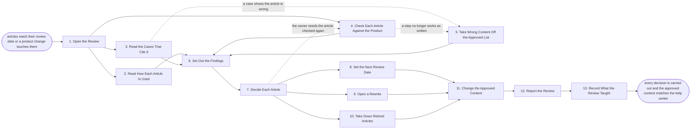

# Reference process: Review the Help Center

`ref/sup/review-the-help-center v1`

**value stream:** [The help center](../../streams/customer-support/the-help-center.md)
Articles reach their review date, or a change to the product reaches
customers and touches a feature the help center covers. The
knowledge-keeper agent opens the review with each article that is due or
tied to the change, and with its named owner. The analytics agent reads
how each article is used: how often it is read, the searches that lead to
it, and how often a customer still opened a case on the same topic after
reading it. The knowledge-keeper agent reads the cases that cite each
article for what customers said it got wrong or left out, and the
article-writer agent walks every step in the product as it behaves today.
An article found wrong comes off the content the agents answer from on
the same day, before anyone decides what happens to it. The
knowledge-keeper agent sets out the findings for each article with a
proposal, and its owner decides whether it is kept, rewritten or taken
down. A kept article gets its next review date, a rewrite opens a run at
`ref/sup/write-a-help-article`, a retired article comes down with every
link to it moved, and the content the agents answer from changes on the
day of each decision. The run closes when every article in the review has
its owner's decision carried out, the approved content matches what the
help center serves, and the knowledge lead has the review's report.

**delivers:** status board, a reviewed help center

## The goals

- Review [95%] of articles by their review date
- Keep articles that customers or cases find out of date under [2%]
- Take down articles that answered no question in [12 months]
- Keep each owner's review to [20 minutes] an article

## The activities

| # | Activity | What happens | Agents |
|---|---|---|---|
| 1 | Open the Review | the articles due or tied to the change, with their owners | [knowledge-keeper](../../agents/knowledge-keeper.md) |
| 2 | Read How Each Article Is Used | reads, searches that lead to it, cases opened after reading | [analytics](../../agents/analytics.md) |
| 3 | Read the Cases That Cite It | what customers said it got wrong or left out | knowledge-keeper |
| 4 | Check Each Article Against the Product | every step walked as the product behaves today | [article-writer](../../agents/article-writer.md) |
| 5 | Take Wrong Content Off the Approved List | the agents stop answering from it the same day | knowledge-keeper |
| 6 | Set Out the Findings | each article with what was found and a proposal | knowledge-keeper |
| 7 | Decide Each Article | kept, rewritten or taken down, with the reason | article owner (person) |
| 8 | Set the Next Review Date | each kept article confirmed at its version | knowledge-keeper |
| 9 | Open a Rewrite | each rewrite starts a run with the findings | knowledge-keeper |
| 10 | Take Down Retired Articles | removed, with every link and address moved | knowledge-keeper |
| 11 | Change the Approved Content | on the day of each decision | knowledge-keeper |
| 12 | Report the Review | reviewed, kept, rewritten, taken down and late | knowledge-keeper · analytics |
| 13 | Record What the Review Taught | what went out of date, and how it was found | knowledge-keeper |

A review comes due under `<your review schedule>`, which sets how often
each kind of article is read. A change that reaches customers without a
run at `ref/sup/prepare-support-for-a-release`, such as a fix or a small
change to a screen, opens a run here for the articles it touches. Each
rewrite runs at `ref/sup/write-a-help-article`, and an article being
rewritten because it is wrong today stays off the approved content until
the new version is published. A fault the review finds in the product
goes to a support specialist for `ref/sup/report-a-confirmed-bug`, and
the articles customers read before opening a case anyway are also
counted at `ref/sup/find-gaps-in-the-help-center`, where a question no
article answers well becomes a gap to write.

## The graph



## The document, with the blanks marked

```
PROCESS: review the help center       id: <team>/review-the-help-center   v1
from: ref/sup/review-the-help-center v1
owner: <who>                          effective: <date>
trigger: <your review schedule> in <your knowledge base> reaches the
         review date of one or more articles, or a change reaches
         customers in <your issue tracker> that touches a feature the
         help center covers
         watch: record=<article review date> system=<your knowledge base>
                change=<a review date arrives, or a feature an article
                covers changes>
concurrency: runs may overlap - a scheduled review is one run for every
             article due, a product change is a run of its own for the
             articles it touches, and an article belongs to one run at a
             time
goal: every article in the review read against the product, the cases
      that cite it and how often it answered the question, any article
      found wrong taken off the content the agents answer from on the day
      it was found, each article kept, rewritten or taken down by its
      named owner, the content the agents answer from changed on the day
      of each decision, and the review reported to <your knowledge lead
      role>
phases:
  open-review      - system: the review opened with each article due under
                     <your review schedule> or tied to the change, its
                     version, its owner and its review date
                     owner: knowledge-keeper   after: trigger
                     automation: <level>
  read-usage       - runs collect-and-report: for each article, how often
                     it was read, the searches that led to it, the cases
                     that cite it, and how often a customer opened a case
                     on the same topic after reading it, each with its
                     source
                     owner: analytics
                     after: open-review        automation: <level>
  read-cases       - runs assessment: the cases that cite each article
                     read for what customers said it got wrong, left out
                     or answered for a different question, in their own
                     words
                     owner: knowledge-keeper
                     after: open-review        automation: <level>
  check-product    - runs assessment: every step in each article walked in
                     the product as it behaves today, on each plan and
                     platform the article covers, with each step that no
                     longer works as written named
                     owner: article-writer
                     after: open-review        automation: <level>
  hold-wrong       - system: an article a case or the check shows is wrong
                     today taken off the content the agents answer from on
                     the day it is found, and its owner told
                     owner: knowledge-keeper
                     after: read-cases or check-product, when an article
                     is wrong today            automation: <level>
  set-findings     - runs assessment: each article with its use, what the
                     cases said, what the check found and a proposal to
                     keep it, rewrite it or take it down, with the reason
                     owner: knowledge-keeper
                     after: read-usage + read-cases + check-product, and
                     hold-wrong when it ran    automation: <level>
  decide-article   - convenes decide-and-announce: <your article owner
                     role> decides whether each article is kept, rewritten
                     or taken down, and records why
                     owner: <your article owner role>
                     after: set-findings       by: <days>
                     automation: never
  set-review-date  - system: each kept article confirmed at its version
                     with its next review date under <your review
                     schedule>
                     owner: knowledge-keeper
                     after: decide-article, for each article kept
                     automation: <level>
  open-rewrite     - system: each article to be rewritten opens a request
                     at ref/sup/write-a-help-article with the findings,
                     the cases and the steps that failed
                     owner: knowledge-keeper
                     after: decide-article, for each article rewritten
                     automation: <level>
  take-down        - system: each retired article removed from <your
                     knowledge base>, its address sent to the closest
                     article, and each saved reply and article that linked
                     to it moved
                     owner: knowledge-keeper
                     after: decide-article, for each article taken down
                     automation: <level>
  change-approved  - system: the content the agents answer from changed on
                     the day of each decision, so that it holds only the
                     published versions the owners kept
                     owner: knowledge-keeper
                     after: set-review-date + open-rewrite + take-down
                     automation: <level>
  report-review    - runs collect-and-report: the articles reviewed, kept,
                     rewritten and taken down, the ones found wrong and
                     how, and each owner past the decision date, sent to
                     <your knowledge lead role>
                     owner: knowledge-keeper
                     after: change-approved    automation: <level>
  record-learning  - convenes debrief: what went out of date, how it was
                     found, which kinds of article went wrong soonest,
                     and whether <your review schedule> should change
                     owner: knowledge-keeper
                     after: report-review      automation: <level>
run-scoped:
  status  - runs roll-call                      owner: knowledge-keeper
            every: <cadence>
            from: open-review         until: change-approved
  held    - runs assessment                     owner: knowledge-keeper
            from: hold-wrong          until: change-approved
handoffs:
  open-review -> read-usage / read-cases / check-product [review-list]:
    each article in the review, its version, its owner and its review date
  read-usage -> set-findings [article-usage]: the reads, the searches, the
    cases that cite it, and the cases opened after reading, with sources
  read-cases -> hold-wrong / set-findings [case-findings]: what customers
    said each article got wrong or left out
  check-product -> hold-wrong / set-findings [product-check]: each step
    that still works and each one that no longer does
  hold-wrong -> set-findings [held-articles]: each article taken off the
    approved content, when and why
  set-findings -> decide-article [review-findings]: each article with its
    findings and a proposal, with the reason
  decide-article -> set-review-date / open-rewrite / take-down
    [owner-decisions]: each article kept, rewritten or taken down, with
    the owner and the reason
  set-review-date -> change-approved [kept-articles]: each kept article
    with its version and next review date
  open-rewrite -> change-approved [rewrite-requests]: each request opened
    at ref/sup/write-a-help-article
  take-down -> change-approved [retired-articles]: each article removed,
    and where each link now points
  change-approved -> report-review [approved-content]: the content the
    agents answer from, as it stands after the review
  report-review -> record-learning [review-report]: the review's report,
    as sent
deviations:
  read-cases -> hold-wrong [case-shows-wrong]: a case shows the article
    is wrong today, so the agents stop answering from it the same day
  check-product -> hold-wrong [step-no-longer-works]: a step no longer
    works as written, so the agents stop answering from the article the
    same day
  decide-article -> check-product [owner-asks-for-check]: the owner needs
    the article checked again against the product before deciding, so it
    is walked again on the points the owner named
bindings:
  roster:  <who holds each role - agents claiming the abstract agents
           above, and named people for <your knowledge lead role> and each
           <your article owner role>>
  systems: <your knowledge base> (write), <your support system> (read),
           the help center's search and reading record (read), the product
           and <your test environment> (read), <your issue tracker>
           (read), the notification channel (write)
  data:    <your review schedule> <version>, <your article ownership
           list> <version>, the approved content list at its version
policy:
  an article found wrong today comes off the content the agents answer
    from on the day it is found, before its owner decides anything else
  each article is kept, rewritten or taken down by its named owner, and
    the knowledge-keeper agent's proposal decides nothing
  an article more than <days> past its review date comes off the content
    the agents answer from until its owner decides it
  the content the agents answer from changes on the day of each decision,
    and it holds only published versions an owner has kept or approved
  an article is taken down only once every link to it in another article
    or a saved reply has been moved
  every step is checked in the product as it behaves today, and a fault
    the check finds goes to ref/sup/report-a-confirmed-bug
measures:
  cycle time: <days> from a review opened to every decision carried out
  on time: <target> share of articles reviewed by their review date
  volume: <articles per review>
  quality gate: every article in the review has its owner's decision and
                its reason, and the approved content matches what the help
                center serves
```

## The failure edges

- **An article is wrong today.** The knowledge-keeper agent takes it off
  the content the agents answer from on the day it is found, before its
  owner decides anything, and tells the owner, who decides the same day
  whether the article stays in the help center with a note or comes down
  until it is rewritten.
- **An owner does not decide by the date.** The knowledge-keeper agent
  tells the knowledge lead, who decides or names a new owner. An article
  more than `<days>` past its review date comes off the content the
  agents answer from until someone decides it.
- **The owner has left the company or moved team.** The knowledge lead
  names a new owner before the article is decided.
- **Customers read the article and open a case anyway.** The analytics
  agent shows how often, and the cases show why. A finding that customers
  misread the article goes to the rewrite in their own words, and a
  finding that it answers a different question from the one customers
  ask goes to `ref/sup/find-gaps-in-the-help-center`.
- **An article to take down is linked from elsewhere.** Each link in
  another article or a saved reply is moved to the closest article before
  it comes down, and a link from inside the product goes to
  `<your product team>` to change.
- **The review finds a fault in the product.** It goes to a support
  specialist for `ref/sup/report-a-confirmed-bug`, and the article says
  what the product does today, with a workaround only where its owner
  approves one.
- **The trigger fires while a run is in flight.** An article belongs to
  one review at a time. A product change during a scheduled review adds
  the articles it touches to that review, and a review date that arrives
  during a rewrite moves to the date the new version is published.
- **A run is abandoned.** The review cannot finish, for example when
  `<your knowledge base>` cannot be read. The articles not yet decided go
  to the next run with their findings, and any article found wrong stays
  off the content the agents answer from.
