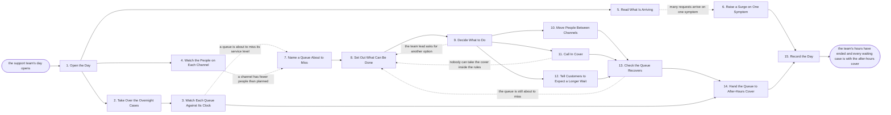

# Reference process: Run the Day's Queue

`ref/sup/run-the-days-queue v1`

**value stream:** [Running the support desk](../../streams/customer-support/running-the-support-desk.md)
The support team's day opens, and every queue has to be answered inside
its service level with the people the schedule put on it. The
staffing-planner agent opens the day from the published schedule with
the people planned on each channel by interval, and the request-sorter
agent hands the cases held overnight into their queues in order of
urgency. Through the day the response-clock-monitor agent measures each
queue against its service level, the staffing-planner agent watches the
people working each channel against the plan for the interval, and the
request-sorter agent reports what is arriving on each channel and sends a
surge of requests on one symptom to `ref/sup/raise-a-suspected-outage`.
When a queue is about to miss, the response-clock-monitor agent names it
with the cases at risk and the time each has left, and the
staffing-planner agent sets out what can be done, such as moving people
from another channel, calling in cover inside the working time rules or
telling customers to expect a longer wait, with what each would do to
the other queues. The team lead decides. The staffing-planner agent
writes each move into the day's schedule, the team lead asks for any
cover, and the team lead switches on any notice of a longer wait in the
approved wording. The response-clock-monitor agent checks that the queue
recovers. At the close of the team's hours the request-sorter agent hands
the cases still waiting to the person on call, and the staffing-planner
agent records the day's coverage by channel and interval. The agents
report coverage for the team and its channels, and no agent reports a
named person's time for discipline. The run closes when the team's hours have
ended, every queue that was about to miss has a decision from a team
lead, and every case still waiting is with the after-hours cover.

**delivers:** status board, the day's queue board

**starts:** on a schedule, the support team's day opens

## The goals

- Answer [90%] of requests inside their service level
- Call in extra cover on no more than [2] days a month
- Keep [90%] of scheduled hours on the channel they were planned for
- Hand fewer than [5%] of the day's requests to the after-hours cover

## The activities

| # | Activity | What happens | Agents |
|---|---|---|---|
| 1 | Open the Day | the schedule, the people on each channel, the service levels | [staffing-planner](../../agents/staffing-planner.md) |
| 2 | Take Over the Overnight Cases | the cases held after hours, placed in order of urgency | [request-sorter](../../agents/request-sorter.md) |
| 3 | Watch Each Queue Against Its Clock | each queue's waiting cases and the time each has left | [response-clock-monitor](../../agents/response-clock-monitor.md) |
| 4 | Watch the People on Each Channel | the people on each channel against the plan for the interval | staffing-planner |
| 5 | Read What Is Arriving | requests arriving on each channel, and urgent ones waiting | request-sorter |
| 6 | Raise a Surge on One Symptom | many requests on one symptom, sent to the outage process | request-sorter |
| 7 | Name a Queue About to Miss | the queue, the cases at risk and the time each has left | response-clock-monitor |
| 8 | Set Out What Can Be Done | move people, call in cover or warn of waits, and each effect | staffing-planner |
| 9 | Decide What to Do | the team lead chooses, and records why | team lead (person) |
| 10 | Move People Between Channels | the people moved, and the day's schedule updated | staffing-planner · team lead (person) |
| 11 | Call In Cover | cover from people off shift or the provider, within rules | team lead (person) · staffing-planner |
| 12 | Tell Customers to Expect a Longer Wait | the approved wait notice turned on for the queue, then off | team lead (person) |
| 13 | Check the Queue Recovers | the queue against its clock after the change | response-clock-monitor |
| 14 | Hand the Queue to After-Hours Cover | cases still waiting, by urgency, to the person on call | request-sorter |
| 15 | Record the Day | coverage and misses by channel and interval, each decision | staffing-planner |

The day works from the schedule published at
`ref/sup/build-the-support-schedule` and the service levels set at
`ref/sup/set-a-service-level-policy`, and the requests in each queue were
taken in at `ref/sup/take-in-a-request`. A surge on one symptom is raised
at `ref/sup/raise-a-suspected-outage`, and the outage's own words reach
customers only through `ref/sup/post-a-status-update` once a named person
approves them. The wording of a notice of a longer wait is approved at
`ref/sup/publish-a-saved-reply`. The cases still waiting at the close go
to the person on call at `ref/sup/cover-after-hours-requests`, and the
day's record feeds the next forecast at
`ref/sup/forecast-support-volume` and the period's report at
`ref/sup/report-the-service-levels`. Cover called in is paid through
`ref/hr/run-payroll` from the hours recorded in
`<your timekeeping system>`, and anything about a person's work goes to
their team lead and anything about their job to Human resources.

## The graph



## The document, with the blanks marked

```
PROCESS: run the day's queue          id: <team>/run-the-days-queue   v1
from: ref/sup/run-the-days-queue v1
owner: <who>                          effective: <date>
trigger: a support team's hours begin under <your support hours>
         watch: record=<support day> system=<your scheduling system>
                change=<the team's hours begin>
concurrency: one team's day is one run - teams in different time zones
             run their days side by side, and a queue shared between them
             is watched by the run of the team whose hours hold it
goal: every queue watched against its service level through the team's
      hours, every queue about to miss named with its cases at risk and
      decided on by a team lead, every change written into the day's
      schedule inside the working time rules, and every case still
      waiting at the close handed to the after-hours cover in order of
      urgency
phases:
  open-day           - system: the day opened from the schedule published
                       at ref/sup/build-the-support-schedule, with the
                       people planned on each channel by interval and the
                       service levels in force at their version
                       owner: staffing-planner    after: trigger
                       automation: <level>
  take-overnight     - system: the cases held overnight at
                       ref/sup/cover-after-hours-requests placed in their
                       queues in order of urgency, with the clock each
                       started with
                       owner: request-sorter      after: open-day
                       automation: <level>
  watch-clocks       - runs collect-and-report: each queue's waiting cases
                       and the time each has left against its service
                       level in <your support system>, with any clock
                       whose stamps cannot be trusted shown as unmeasured
                       owner: response-clock-monitor
                       after: take-overnight      automation: <level>
  watch-people       - runs collect-and-report: the people working each
                       channel set against the plan for the interval, for
                       the team and each channel as a whole
                       owner: staffing-planner    after: open-day
                       automation: <level>
  read-arrivals      - runs collect-and-report: the requests arriving on
                       each channel from <your support system>, <your
                       phone system> and <your chat tool>, and the urgent
                       ones waiting, such as a possible account takeover
                       or a safety report
                       owner: request-sorter      after: open-day
                       automation: <level>
  raise-surge        - system: the requests on one symptom grouped and
                       sent to ref/sup/raise-a-suspected-outage with the
                       symptom, the count and the time the first arrived,
                       and the cases left in their queues with their
                       clocks running
                       owner: request-sorter
                       after: read-arrivals, when requests on one symptom
                       pass <your threshold>      automation: <level>
  name-at-risk       - runs assessment: the queue about to miss its
                       service level, the cases at risk and the time each
                       has left, and the interval the miss would fall in
                       owner: response-clock-monitor
                       after: watch-clocks or watch-people, when a queue
                       would miss                 automation: <level>
  set-out-options    - runs assessment: each thing the team lead could do,
                       such as moving people from another channel, calling
                       in cover inside the working time rules or warning
                       customers of a longer wait, with what each would do
                       to the other queues
                       owner: staffing-planner
                       after: name-at-risk, and decide-action or
                       check-recovery when they send it back
                       automation: <level>
  decide-action      - convenes decide-and-announce: <your team lead role>
                       chooses what to do about the queue, or asks for
                       another option, and records why
                       owner: <your team lead role>
                       after: set-out-options     by: <minutes>
                       automation: never
  move-people        - system: the move the team lead decided written into
                       the day's schedule, with each person moved told
                       and the channel they now take
                       owner: staffing-planner
                       after: decide-action, when the lead moves people
                       automation: <level>
  call-in-cover      - human: cover asked of people off shift or of the
                       provider the roster names, each offer checked
                       against <your working time policy> and <your
                       jurisdiction's working time rules> before it is
                       taken, and the hours recorded in <your timekeeping
                       system>
                       owner: <your team lead role>
                       after: decide-action, when the lead calls in cover
                       by: <minutes>              automation: never
  post-wait-notice   - human: the notice of a longer wait switched on for
                       the queue in the wording approved at
                       ref/sup/publish-a-saved-reply, stating the wait the
                       queue shows, and switched off once the queue
                       recovers
                       owner: <your team lead role>
                       after: decide-action, when the lead warns of a
                       longer wait                automation: never
  check-recovery     - runs assessment: the queue measured against its
                       clock after the change, and whether the cases at
                       risk were answered in time
                       owner: response-clock-monitor
                       after: move-people, call-in-cover or
                       post-wait-notice           by: <minutes>
                       automation: <level>
  hand-to-rota       - system: the cases still waiting at the close handed
                       to the person on call under <your after-hours rota>
                       in order of urgency, each with its clock and what
                       was already done on it
                       owner: request-sorter
                       after: watch-clocks and check-recovery, when the
                       team's hours end           automation: <level>
  record-day         - convenes debrief: the day's coverage and misses by
                       channel and interval, each queue named at risk and
                       the decision on it, each surge raised, and what the
                       next forecast and schedule should know
                       owner: staffing-planner
                       after: hand-to-rota, and raise-surge when it ran
                       automation: <level>
run-scoped:
  clocks - runs roll-call                       owner: response-clock-monitor
           every: <cadence>
           from: watch-clocks        until: hand-to-rota
  people - runs roll-call                       owner: staffing-planner
           every: <cadence>
           from: watch-people        until: hand-to-rota
handoffs:
  open-day -> take-overnight / watch-people / read-arrivals [day-plan]:
    the people planned on each channel by interval, and the service
    levels at their version
  take-overnight -> watch-clocks [overnight-cases]: the cases held
    overnight, in order of urgency, each with its clock
  read-arrivals -> raise-surge [symptom-surge]: the requests on one
    symptom, the count and the time the first arrived
  watch-clocks -> name-at-risk [queue-clocks]: each queue's waiting cases
    and the time each has left
  watch-people -> name-at-risk [channel-coverage]: the people working each
    channel against the plan for the interval
  name-at-risk -> set-out-options [queue-at-risk]: the queue, the cases at
    risk and the time each has left
  set-out-options -> decide-action [queue-options]: each option with what
    it would do to the other queues
  decide-action -> move-people / call-in-cover / post-wait-notice
    [queue-decision]: the option the team lead chose, and why
  move-people -> check-recovery [people-moved]: who moved, from which
    channel to which, and when
  call-in-cover -> check-recovery [cover-called]: who took the cover, for
    which hours, checked against the rules
  post-wait-notice -> check-recovery [wait-notice]: the notice as
    switched on, for which queue, and when
  check-recovery -> hand-to-rota [queue-recovered]: the queue back inside
    its clock, or still at risk with the reason
  hand-to-rota -> record-day [overnight-handover]: the cases handed to
    the person on call, each with its clock
  raise-surge -> record-day [surge-raised]: each surge raised, and what
    the outage process said back
deviations:
  watch-clocks -> name-at-risk [queue-about-to-miss]: a queue is about to
    miss its service level, so it is named with its cases at risk
  watch-people -> name-at-risk [channel-short]: a channel has fewer people
    than planned for the interval, so the queue it serves is checked
    before it misses
  read-arrivals -> raise-surge [surge-on-one-symptom]: requests on one
    symptom pass <your threshold>, so they go to the outage process at
    once
  decide-action -> set-out-options [another-option]: the team lead asks
    for another option, so the options are set out again with the one
    asked for
  call-in-cover -> set-out-options [no-cover-inside-rules]: nobody can
    take the cover inside the working time rules, so the options are set
    out again without it
  check-recovery -> set-out-options [queue-still-at-risk]: the queue is
    still about to miss after the change, so the next options go to the
    team lead
bindings:
  roster:  <who holds each role - agents claiming the abstract agents
           above, and named people for each team lead and the person on
           call for each hour of the rota>
  systems: <your support system> (read), <your phone system> (read),
           <your chat tool> (read), <your scheduling system> (write),
           <your timekeeping system> (write), the wait notice in <your
           support system> (write, team lead only), the notification
           channel (write)
  data:    <your service level policy> <version>, <your working time
           policy> <version>, <your jurisdiction's working time rules>
           <version>, <your after-hours rota> <version>, the day's
           schedule at its version, <your threshold>
policy:
  each queue is measured against the service level in force at its
    version, and a clock whose stamps cannot be trusted is shown as
    unmeasured
  a case moved between queues keeps the clock it started with
  what to do about a queue about to miss is decided by a team lead, and
    no agent moves a person, calls in cover or tells customers about a
    wait
  cover is asked only inside <your working time policy> and <your
    jurisdiction's working time rules>, and the hours are recorded in
    <your timekeeping system> for pay
  a notice of a longer wait uses only wording approved at
    ref/sup/publish-a-saved-reply, states the wait the queue actually
    shows, and promises no time for a fix
  an urgent case, such as a possible account takeover, a security or
    safety report or a legal threat, keeps its place at the front of its
    queue whatever is decided about the rest
  the agents report coverage for the team and its channels, and no agent
    reports a named person's time, breaks or adherence for discipline
measures:
  cycle time: <minutes> from a queue named at risk to the team lead's
              decision
  on time: <target> share of requests answered inside their service
           level
  volume: <requests per day>, <queues watched>
  quality gate: every queue named at risk carries a team lead's decision
                with its reason, and every case still waiting at the close
                is with the after-hours cover
```

## The failure edges

- **A queue keeps missing after the change.** The next options go to the
  team lead with what the first change did. A queue that misses on most
  days in the same interval goes to the support operations lead for the
  next schedule at `ref/sup/build-the-support-schedule`, because a
  pattern is a planning problem.
- **Nobody can take the cover inside the rules.** The options are set out
  again without it. Cover is never asked of someone in a way that would
  break `<your working time policy>` or
  `<your jurisdiction's working time rules>`, and a team lead who cannot
  meet the service level records that the queue will miss and why.
- **Requests surge on one symptom.** The request-sorter agent sends them
  to `ref/sup/raise-a-suspected-outage` at once, and the cases stay in
  their queues with their clocks running. Customers hear about the
  outage only in words a named person approved at
  `ref/sup/post-a-status-update`.
- **The clock cannot be trusted.** A system that stamps the cases fails
  or stamps them wrong. The response-clock-monitor agent shows the queue
  as unmeasured for the hours affected, the support operations lead is
  told, and the team lead works the queue in order of urgency until the
  stamps are back.
- **A system the desk depends on fails.** The phone, the chat or the
  support system stops. The team lead decides how customers are told and
  where the requests go meanwhile, the failure goes to the owner of that
  system, and a failure customers can see is raised at
  `ref/sup/raise-a-suspected-outage`.
- **Someone asks for a named person's time for discipline.** The agents
  report coverage for the team and its channels. The request is refused,
  anything about a person's work goes to their team lead, and anything
  about their job goes to Human resources.
- **The trigger fires while a run is in flight.** One team's day is one
  run. A team whose hours overlap another's runs its own day, and a queue
  shared between them is watched by the run of the team whose hours hold
  it.
- **A run is abandoned.** The day cannot be run as planned, for example
  when the scheduling system fails. The team lead works the queues in
  order of urgency, the cases still waiting at the close go to the person
  on call all the same, and the day is recorded as unplanned.
