# Reference process: Set a Service Level Policy

`ref/sup/set-a-service-level-policy v1`

**value stream:** [Running the support desk](../../streams/customer-support/running-the-support-desk.md)
A service level has to be set or changed: the time to a first reply or
to resolution for a channel, a plan or an urgency. The head of support
proposes a change, a new channel or plan needs a level, a service level
report shows a level the desk cannot meet, or the policy reaches its
review date. The decision-coordinator agent opens the decision with what
it has to settle, who decides and by when. The policy-keeper agent reads
the service level policy in force at its version, and the
response-clock-monitor agent reads the levels customers are already
promised in their plans and agreements, reads each queue's results
against today's levels, and writes what starts, stops and pauses each
clock so two people read it the same way. The decision-coordinator agent
sets out two or three candidate sets of levels with the support
operations lead, the staffing-planner agent says what each would take in
people by interval, and the response-clock-monitor agent checks each
against what customers' agreements already promise. The team leads say
what each would mean for their queues, and the head of support and the
approvers the policy names decide one set and record why. The
policy-keeper agent drafts the policy on the current version, the
approvers approve the text, and the policy is published at a version
with its effective date. The policy-keeper agent marks the saved
replies, articles and pages that state the old times, the
tool-administrator agent builds the clocks into `<your support system>`,
and the response-clock-monitor agent checks a sample of cases against
the policy and measures every queue against the new levels from the day
they take effect. The run closes when the policy is in effect, built and
checked, the people it covers have been told, and the decision is
recorded with its review date.

**delivers:** document, a service level policy

## The goals

- Offer a first reply within [1 working hour] on the fastest channel
- Keep the hours the levels need within [the approved support budget]
- Meet each published level on [90%] of requests
- Change the levels no more than [twice] a year

## The activities

| # | Activity | What happens | Agents |
|---|---|---|---|
| 1 | Open the Decision | what the decision settles, who decides and by when | [decision-coordinator](../../agents/decision-coordinator.md) |
| 2 | Read the Policy in Force | each level, its version and the channel, plan and urgency | [policy-keeper](../../agents/policy-keeper.md) |
| 3 | Read What Customers Are Already Promised | the levels each plan and agreement carries today | [response-clock-monitor](../../agents/response-clock-monitor.md) |
| 4 | Read the Results Against Today's Levels | each queue's results against its level over the last periods | response-clock-monitor |
| 5 | Name What Each Clock Covers | what starts, stops and pauses each clock | response-clock-monitor · support operations lead (person) |
| 6 | Set Out the Candidate Levels | two or three sets of levels by channel, plan and urgency | decision-coordinator · support operations lead (person) |
| 7 | Say What Each Would Take in People | the hours and people each candidate needs, by interval | [staffing-planner](../../agents/staffing-planner.md) |
| 8 | Check Each Against What Is Promised | each candidate against the levels agreements already carry | response-clock-monitor |
| 9 | Hear the Team Leads | what each candidate would mean for their queues | decision-coordinator · team lead (person) |
| 10 | Decide the Levels | the named people choose one set, and record why | head of support (person) · service level approver (person) |
| 11 | Draft the Policy | the chosen levels written on the current version | policy-keeper |
| 12 | Approve the Policy Text | the approvers approve the text at its version | service level approver (person) |
| 13 | Publish the Policy at a Version | the policy with its effective date, and the old version kept | policy-keeper |
| 14 | Mark What Rests on the Old Levels | saved replies, articles and pages that state the old times | policy-keeper |
| 15 | Build the Clocks into the Support System | each clock configured as the policy says, at a version | [tool-administrator](../../agents/tool-administrator.md) |
| 16 | Check the Clocks Against the Policy | a sample of cases checked against what the policy says | response-clock-monitor |
| 17 | Tell the People It Covers | the support team, account owners and the help center owner | policy-keeper |
| 18 | Measure from the Day It Takes Effect | each queue against the new levels from its effective date | response-clock-monitor |
| 19 | Record the Decision | the levels, who decided, who disagreed and the review date | decision-coordinator |

A proposal often comes from a pattern found at
`ref/sup/report-the-service-levels` or a gap raised at
`ref/sup/forecast-support-volume`, and the levels decided here are what
the forecast, the schedule at `ref/sup/build-the-support-schedule` and the
day's queues at `ref/sup/run-the-days-queue` plan and watch against. A
level written into a customer's agreement is sold and changed by Sales,
at `ref/sls/negotiate-the-agreement` or `ref/sls/close-a-renewal`, and
this process reads it from the account's entitlement and never lowers it
for that account. The saved replies and articles that state a response
time are changed at `ref/sup/publish-a-saved-reply` and
`ref/sup/write-a-help-article` once they are marked here.

## The graph

```mermaid
flowchart LR
  T([a service level is proposed or reaches its review date]) --> A1[1. Open the Decision]
  A1 --> A2[2. Read the Policy in Force]
  A1 --> A3[3. Read What Customers Are Already Promised]
  A1 --> A4[4. Read the Results Against Today's Levels]
  A2 --> A5[5. Name What Each Clock Covers]
  A3 --> A6[6. Set Out the Candidate Levels]
  A4 --> A6
  A5 --> A6
  A6 --> A7[7. Say What Each Would Take in People]
  A6 --> A8[8. Check Each Against What Is Promised]
  A8 -. a candidate is slower than an agreement promises .-> A6
  A7 --> A9[9. Hear the Team Leads]
  A8 --> A9
  A9 --> A10[10. Decide the Levels]
  A10 -. the approvers ask for another candidate .-> A6
  A10 --> A11[11. Draft the Policy]
  A11 --> A12[12. Approve the Policy Text]
  A12 -. the text differs from the decision .-> A11
  A12 --> A13[13. Publish the Policy at a Version]
  A13 --> A14[14. Mark What Rests on the Old Levels]
  A13 --> A15[15. Build the Clocks into the Support System]
  A15 --> A16[16. Check the Clocks Against the Policy]
  A16 -. a clock is built differently from the policy .-> A15
  A14 --> A17[17. Tell the People It Covers]
  A16 --> A17
  A17 --> A18[18. Measure from the Day It Takes Effect]
  A18 --> A19[19. Record the Decision]
  A19 --> DONE([the policy is in effect, built, checked and recorded with its review date])
```



## The document, with the blanks marked

```
PROCESS: set a service level policy   id: <team>/set-a-service-level-policy   v1
from: ref/sup/set-a-service-level-policy v1
owner: <who>                          effective: <date>
trigger: <your head of support role>, <your support operations lead role>
         or a finding at ref/sup/report-the-service-levels proposes a
         change to a service level, a new channel or plan needs one, or
         <your service level policy> reaches its review date
         watch: record=<level proposal> system=<your policy library>
                change=<a proposal is logged or a review date arrives>
concurrency: one change to the service level policy is open at a time - a
             second proposal joins the open run before the decision, or
             waits until the first is published
goal: levels for the time to a first reply and to resolution for each
      channel, plan and urgency, decided by <your service level approver
      role> and <your head of support role> from candidates that each say
      what they take in people and how they stand against what customers'
      agreements already promise, published at a version with its
      effective date, built into <your support system>, checked, and
      measured from the day it takes effect
phases:
  open-decision      - system: the decision opened with what it settles,
                       the channels, plans and urgencies it touches, the
                       people who decide under <your service level
                       policy> and the date it is needed by
                       owner: decision-coordinator
                       after: trigger             automation: <level>
  read-policy        - runs collect-and-report: <your service level
                       policy> in force at its version, each level with
                       the channel, plan and urgency it covers, and the
                       dates it applied
                       owner: policy-keeper       after: open-decision
                       automation: <level>
  read-promised      - runs collect-and-report: the levels each plan and
                       each customer's agreement carries today, read from
                       the entitlement in <your CRM> and <your contract
                       repository>, with the count of accounts on each
                       owner: response-clock-monitor
                       after: open-decision       automation: <level>
  read-results       - runs collect-and-report: each queue's results
                       against its level over the last <periods>, with
                       any clock whose stamps could not be trusted shown
                       as unmeasured
                       owner: response-clock-monitor
                       after: open-decision       automation: <level>
  name-clocks        - convenes decide-and-announce: what starts, stops and
                       pauses each clock, written with <your support
                       operations lead role> so two people read it the
                       same way, and a clock pauses only while the case
                       waits on the customer
                       owner: response-clock-monitor
                       after: read-policy         automation: <level>
  set-candidates     - human: two or three candidate sets of levels for
                       each channel, plan and urgency, each saying what
                       it gives customers and what it gives up
                       owner: decision-coordinator
                       after: read-promised + read-results + name-clocks
                       by: <days>                 automation: <level>
  price-in-people    - runs assessment: the hours and people each candidate
                       needs by channel and interval, from the latest
                       forecast at ref/sup/forecast-support-volume, with
                       the method and its inputs
                       owner: staffing-planner    after: set-candidates
                       automation: <level>
  check-promised     - runs assessment: each candidate set against the
                       levels customers' agreements already carry, with
                       every account a candidate would serve slower than
                       its agreement named
                       owner: response-clock-monitor
                       after: set-candidates      automation: <level>
  hear-leads         - convenes briefing: the team leads say what each
                       candidate would mean for their queues and their
                       people, and each view is recorded
                       owner: decision-coordinator
                       after: price-in-people + check-promised
                       by: <days>                 automation: <level>
  decide-levels      - convenes decide-and-announce: <your head of support
                       role> and <your service level approver role>
                       choose one set of levels from the candidates, or
                       ask for another, and record why and who disagreed
                       owner: <your head of support role>
                       after: hear-leads          by: <days>
                       automation: never
  draft-policy       - human: the chosen levels and the clock definitions
                       written into <your service level policy> on the
                       current version, with the effective date
                       owner: policy-keeper       after: decide-levels
                       automation: <level>
  approve-policy     - convenes approval: <your service level approver
                       role> approves the text at its version with the
                       recorded decision beside it
                       owner: <your service level approver role>
                       after: draft-policy        by: <days>
                       automation: never
  publish-policy     - system: the policy published in <your policy
                       library> at its version with its effective date,
                       and the old version kept with the dates it applied
                       owner: policy-keeper       after: approve-policy
                       automation: <level>
  mark-old-levels    - runs assessment: every saved reply, help article,
                       page and plan description that states a time under
                       the old version, each marked for its owner with
                       the new time
                       owner: policy-keeper       after: publish-policy
                       automation: <level>
  build-clocks       - system: each clock configured in <your support
                       system> as the policy says, for each channel, plan
                       and urgency, at a version and set to start on the
                       effective date
                       owner: tool-administrator  after: publish-policy
                       by: <the effective date>   automation: <level>
  check-clocks       - runs assessment: a sample of <how many> cases run
                       through the clocks as built, each checked against
                       what the policy says its clock should show
                       owner: response-clock-monitor
                       after: build-clocks        automation: <level>
  tell-people        - convenes briefing: the support team, the account
                       owners and the owner of the help center told what
                       changes and from when, and what customers on each
                       plan are told
                       owner: policy-keeper
                       after: mark-old-levels + check-clocks
                       automation: <level>
  measure-from-start - runs collect-and-report: each queue measured
                       against the new levels from the effective date,
                       and each case against the level in force when it
                       arrived
                       owner: response-clock-monitor
                       after: tell-people, from the effective date
                       automation: <level>
  record-decision    - system: the levels, the candidates set aside, who
                       decided, who disagreed and why, and the date the
                       levels are reviewed again
                       owner: decision-coordinator
                       after: measure-from-start  automation: <level>
run-scoped:
  status - runs roll-call                       owner: decision-coordinator
           every: <cadence>
           from: open-decision       until: publish-policy
handoffs:
  open-decision -> read-policy / read-promised / read-results
    [service-level-question]: what the decision settles, who decides and
    by when
  read-policy -> name-clocks [policy-in-force]: the levels in force, each
    with what it covers and its dates
  read-promised -> set-candidates [levels-promised]: the levels each plan
    and agreement carries, with the count of accounts on each
  read-results -> set-candidates [results-against-levels]: each queue's
    results against its level, with any unmeasured clock named
  name-clocks -> set-candidates [clock-definitions]: what starts, stops
    and pauses each clock
  set-candidates -> price-in-people / check-promised [candidate-levels]:
    two or three sets of levels, each with what it gives and gives up
  price-in-people -> hear-leads [people-per-candidate]: the hours and
    people each candidate needs, by channel and interval
  check-promised -> hear-leads [candidates-against-agreements]: each
    candidate against what agreements carry, and every account it would
    serve slower
  hear-leads -> decide-levels [lead-views]: what each team lead said
    about each candidate
  decide-levels -> draft-policy [levels-decision]: the set chosen, by
    whom, why, and who disagreed
  draft-policy -> approve-policy [draft-policy]: the policy text at a
    draft version
  approve-policy -> publish-policy [approved-policy]: the text as
    approved, with the approver and the version. A change to it voids the
    approval
  publish-policy -> mark-old-levels / build-clocks [published-policy]: the
    policy at its version, with its effective date
  mark-old-levels -> tell-people [old-levels-marked]: each reply, article
    and page that states an old time, and its owner
  build-clocks -> check-clocks [built-clocks]: the clocks as configured,
    at their version
  check-clocks -> tell-people [checked-clocks]: the sample of cases and
    what each clock showed
  tell-people -> measure-from-start [people-told]: who was told, and when
  measure-from-start -> record-decision [first-measurement]: each queue
    against its new level from the effective date
deviations:
  check-promised -> set-candidates [below-agreement]: a candidate would
    serve some accounts slower than their agreements promise, so it is
    set again or those accounts keep their agreed level
  decide-levels -> set-candidates [another-candidate]: the people who
    decide ask for another candidate, so the candidates are set out again
    and priced again with the one asked for
  approve-policy -> draft-policy [text-differs]: the text differs from
    the recorded decision, so it is drafted again to match it
  check-clocks -> build-clocks [clock-built-wrong]: a clock as built shows
    something other than what the policy says, so it is configured again
    before the effective date
bindings:
  roster:  <who holds each role - agents claiming the abstract agents
           above, and named people for the head of support, each service
           level approver, the support operations lead and each team lead>
  systems: <your policy library> (write), <your support system> (write,
           through the tool-administrator agent), <your CRM> (read),
           <your contract repository> (read), the notification channel
           (write)
  data:    <your service level policy> <version>, the latest forecast at
           its version, the plans and their entitlements <version>,
           <your delegation of authority> <version>
policy:
  the levels are decided by <your head of support role> and <your
    service level approver role>, and no agent decides or approves one
  every candidate says what it would take in people by interval before
    it is decided, and how it stands against what customers' agreements
    already promise
  no account is served slower than its agreement promises, and a level
    written into an agreement changes only through Sales
  each clock names what starts, stops and pauses it, and a clock pauses
    only while the case waits on the customer
  the policy is published at a version with its effective date, the old
    version is kept with the dates it applied, and each case is measured
    against the level in force when it arrived
  the clocks are built into <your support system> and checked against a
    sample of cases before the effective date
  every saved reply, article and page that states a time under the old
    version is marked for its owner before the new levels take effect
measures:
  cycle time: <days> from the proposal to the policy in effect
  on time: <target> share of policies reviewed by their review date
  volume: <levels in the policy>, <changes per year>
  quality gate: every level names the channel, plan and urgency it covers,
                what starts, stops and pauses its clock, what it takes in
                people and who decided it
```

## The failure edges

- **A candidate would serve some accounts slower than they are
  promised.** The candidate is set again, or the accounts whose
  agreements promise more keep their agreed level and the policy says
  so. A level in an agreement is changed only by Sales through the
  agreement itself.
- **The levels cannot be met with the people the team has.** The
  staffing-planner agent says so for each candidate, and the people who
  decide choose knowing what it takes. A level the team cannot meet is
  never published on the hope that it will be met, and positions are
  asked of Human resources at `ref/hr/plan-the-workforce` when the head
  of support wants a level that needs more people.
- **The people who decide cannot agree.** The decision-coordinator agent
  puts the disagreement in front of them on the date the decision is
  due. The head of support decides or moves the date, and the levels in
  force stay until a set is decided.
- **The text differs from the decision.** The policy is drafted again to
  match the recorded decision, and the approval is given again.
- **A clock is built differently from the policy.** The clock is
  configured again before the effective date. When it cannot be fixed in
  time, the effective date moves for that clock and the people it covers
  are told.
- **A published time stays on a saved reply or a page.** The owner of
  each is told before the effective date, and a reply or page still
  stating the old time on that date is taken out of use until it is
  changed.
- **The trigger fires while a run is in flight.** One change to the
  service level policy is open at a time. A second proposal joins the
  open run before the decision, or waits until the first is published.
- **A run is abandoned.** The proposal is withdrawn or overtaken. The
  levels in force stay in force at their version, nothing half built is
  switched on, and the decision is recorded as not made with the reason.
