# Reference process: Survey Customers after a Case

`ref/sup/survey-customers-after-a-case v1`

**value stream:** [Listening to customers](../../streams/customer-support/listening-to-customers.md)
A survey period opens on the support team's calendar, and every case that
closes during it is a chance to ask the customer how it went. The
satisfaction-surveyor agent opens the period with the questions at their
version, and the statistician agent sets the count of answers below which
no score is shown for a team, a topic or a channel. As each case closes,
the consent-manager agent checks that the consent record lets the customer
be asked on that channel, and the satisfaction-surveyor agent holds back
any customer asked within `<your survey interval>` and any case of a kind
that is never surveyed, such as a formal complaint, a legal threat, a
security or safety report or a request about a person's own data. It sends
the survey once in `<your survey tool>`, saying it comes from an agent,
reads each answer, and sends each low score and each comment that names a
problem to the team lead, who follows it up with the customer personally.
When the period closes, the statistician agent works out each score with
its count and says which changes since the last period are larger than the
noise, and the satisfaction-surveyor agent reports them to the head of
support and the team leads. The run closes when every low score has been
followed up, or the customer recorded as unreachable, each support
specialist's own results have gone only to that specialist and their team
lead, and the period's scores are with Report What Customers Say.

**delivers:** report, the after-case survey results for a period

## The goals

- Hear back from [25%] of the customers asked
- Ask no customer more than once in [30 days]
- Follow up each low score within [2 working days]
- Keep the survey to [2 questions]

## The activities

| # | Activity | What happens | Agents |
|---|---|---|---|
| 1 | Open the Survey Period | the dates, queues covered and the questions at their version | [satisfaction-surveyor](../../agents/satisfaction-surveyor.md) |
| 2 | Approve Any Changed Question | a changed question approved, knowing it breaks comparison | head of support (person) |
| 3 | Set the Minimum Count to Show | the count of answers below which no score is shown | [statistician](../../agents/statistician.md) |
| 4 | Take In Each Closed Case | the case, its channel, its topic and who held it | satisfaction-surveyor |
| 5 | Check Who May Be Asked | the consent record for this customer on this channel | [consent-manager](../../agents/consent-manager.md) |
| 6 | Hold Back a Case Not to Survey | asked within the interval, or a kind that is never surveyed | satisfaction-surveyor |
| 7 | Send the Survey | once, in the survey tool, saying it comes from an agent | satisfaction-surveyor |
| 8 | Read Each Answer | the score and the comment, joined to the case | satisfaction-surveyor |
| 9 | Pass On What Needs a Person | low scores and comments naming a problem, to the team lead | satisfaction-surveyor |
| 10 | Follow Up with the Customer | the team lead hears what went wrong and what would help | team lead (person) |
| 11 | Carry Out an Opt-Out | anyone who asks not to be surveyed comes off every list | consent-manager |
| 12 | Close the Survey Period | the period ends on its date, and the counts are taken | satisfaction-surveyor |
| 13 | Work Out the Scores | each score and count, for groups at or above the minimum | statistician |
| 14 | Compare with the Last Period | which changes are larger than the noise | statistician · satisfaction-surveyor |
| 15 | Show Each Specialist Their Own Results | only to that specialist and their team lead | satisfaction-surveyor · team lead (person) |
| 16 | Report the Period's Scores | the scores, counts and follow-ups, to the support leaders | satisfaction-surveyor · head of support (person) |
| 17 | Record What the Period Taught | who answered, who was held back, and what to change | satisfaction-surveyor |

The cases close at `ref/sup/resolve-a-case` and
`ref/sup/answer-a-routine-question`. A comment that
`<your complaints policy>` treats as a formal complaint is passed by the
team lead to `ref/sup/answer-a-formal-complaint` the same day, a comment
that shows an account may leave or buy more goes to
`ref/sup/flag-an-account-signal`, and one that reports a security weakness
or a safety risk goes to `ref/sup/escalate-a-security-or-safety-report`
within the hour. The period's scores feed
`ref/sup/report-what-customers-say`, and a specialist's own results reach
`ref/sup/coach-a-support-person` only through their team lead. Asking
customers for reviews, references or research stays with Marketing at
`ref/mkt/customer-reviews`, `ref/mkt/customer-reference` and
`ref/mkt/customer-research`.

## The graph

```mermaid
flowchart LR
  T([a survey period opens on the support team's calendar]) --> A1[1. Open the Survey Period]
  A1 -. a question has changed since the last period .-> A2[2. Approve Any Changed Question]
  A2 -. the head of support will not approve the change .-> A1
  A1 --> A3[3. Set the Minimum Count to Show]
  A2 --> A3
  A3 --> A4[4. Take In Each Closed Case]
  A4 --> A5[5. Check Who May Be Asked]
  A5 --> A6[6. Hold Back a Case Not to Survey]
  A6 --> A7[7. Send the Survey]
  A7 --> A8[8. Read Each Answer]
  A8 --> A9[9. Pass On What Needs a Person]
  A8 -. the customer asks not to be surveyed again .-> A11[11. Carry Out an Opt-Out]
  A9 --> A10[10. Follow Up with the Customer]
  A4 --> A12[12. Close the Survey Period]
  A12 --> A13[13. Work Out the Scores]
  A13 --> A14[14. Compare with the Last Period]
  A14 --> A15[15. Show Each Specialist Their Own Results]
  A14 --> A16[16. Report the Period's Scores]
  A10 --> A16
  A16 -. the head of support finds a figure that does not hold .-> A13
  A11 --> A17[17. Record What the Period Taught]
  A15 --> A17
  A16 --> A17
  A17 --> DONE([every low score is followed up, each specialist has their own results, and the period's scores are reported])
```



## The document, with the blanks marked

```
PROCESS: survey customers after a case  id: <team>/survey-customers-after-a-case   v1
from: ref/sup/survey-customers-after-a-case v1
owner: <who>                          effective: <date>
trigger: <your survey calendar> opens a survey period for the cases that
         close in <your support system>
         watch: record=<survey period> system=<your survey tool>
                change=<a survey period opens>
concurrency: one survey period is one run - a case belongs to the period
             it closed in, the next period opens on its date while this
             one finishes its follow-ups and its report, and a customer
             asked in one period is held back in the next until <your
             survey interval> has passed
goal: every customer whose case closed in the period, and whom the consent
      record allows, asked once how it went, no customer asked within
      <your survey interval>, every low score and every comment that names
      a problem followed up by the team lead, each score reported with its
      count and whether a change is larger than the noise, and each
      support specialist's own results shown only to that specialist and
      their team lead
phases:
  open-period        - system: the survey period opened with its dates, the
                       queues and channels it covers, and the questions at
                       their version in <your survey tool>
                       owner: satisfaction-surveyor   after: trigger
                       automation: <level>
  approve-questions  - convenes approval: <your head of support role>
                       approves each question that changed since the last
                       period, with the statistician agent's word on what
                       the change does to the comparison
                       owner: <your head of support role>
                       after: open-period, when a question changed
                       by: <days>                 automation: never
  set-minimum        - runs assessment: the count of answers below which no
                       score is shown for a team, a topic or a channel, and
                       the groups the scores are reported for, each at or
                       above that count
                       owner: statistician
                       after: open-period, or approve-questions when it ran
                       automation: <level>
  take-in-case       - system: each case that closes in the period, with its
                       channel, its topic, its account, the support
                       specialist who held it and the team, read from
                       <your support system>
                       owner: satisfaction-surveyor
                       after: set-minimum, for each case that closes in the
                       period                     automation: <level>
  check-consent      - runs assessment: the consent record for the customer
                       on the channel the survey would use, and any
                       opt-out, applied before anything is sent
                       owner: consent-manager
                       after: take-in-case        automation: <level>
  hold-back          - runs assessment: each case held back with its reason
                       when the customer was asked within <your survey
                       interval>, or when the case is a formal complaint, a
                       legal threat, a security or safety report, a request
                       about a person's own data or a closed account
                       owner: satisfaction-surveyor
                       after: check-consent       automation: <level>
  send-survey        - system: the survey sent once in <your survey tool>
                       within <hours> of the case closing, saying it comes
                       from an agent and how to reach a person, with one
                       reminder at most
                       owner: satisfaction-surveyor
                       after: hold-back           automation: <level>
  read-answers       - runs collect-and-report: each answer's score and
                       comment joined to its case, and each comment read
                       for a problem it names
                       owner: satisfaction-surveyor
                       after: send-survey         automation: <level>
  pass-on            - system: each score below <your low score threshold>
                       and each comment that names a problem sent to the
                       team lead of the team that held the case, with the
                       case beside it
                       owner: satisfaction-surveyor
                       after: read-answers        automation: <level>
  follow-up          - human: the team lead contacts the customer, hears
                       what went wrong and what would help, reopens the
                       case at ref/sup/resolve-a-case when the problem is
                       not solved, and records the outcome
                       owner: <your team lead role>
                       after: pass-on             by: <days>
                       automation: never
  opt-out            - system: a customer who asks not to be surveyed again
                       taken off every survey list, and the withdrawal
                       confirmed in each system that keeps a copy of the
                       contact
                       owner: consent-manager
                       after: read-answers, when the customer asks not to
                       be surveyed again          automation: <level>
  close-period       - system: the period closed on its date, with the count
                       of cases closed, held back, surveyed and answered
                       owner: satisfaction-surveyor
                       after: take-in-case, on the period's end date
                       automation: <level>
  work-out-scores    - runs assessment: each score worked out with its count
                       for each group at or above the minimum, with the
                       method and the answers it rests on recorded, and no
                       score shown for a group below the minimum
                       owner: statistician
                       after: close-period        automation: <level>
  compare-periods    - runs assessment: each score set beside the last
                       period's, with which changes are larger than the
                       noise and which are not
                       owner: statistician
                       after: work-out-scores     automation: <level>
  show-own-results   - system: each support specialist's own scores and
                       comments shown only to that specialist and their
                       team lead
                       owner: satisfaction-surveyor
                       after: compare-periods     automation: <level>
  report-scores      - convenes briefing: the period's scores with their
                       counts, the changes larger than the noise, and the
                       low scores with how each was followed up, by team,
                       topic and channel, to <your head of support role>
                       and the team leads, and passed to
                       ref/sup/report-what-customers-say
                       owner: satisfaction-surveyor
                       after: compare-periods + follow-up
                       automation: <level>
  record-learning    - convenes debrief: how many answered, which customers
                       were held back and why, which questions told nobody
                       anything, and what the next period changes
                       owner: satisfaction-surveyor
                       after: show-own-results + report-scores, and opt-out
                       when it ran                automation: <level>
run-scoped:
  status     - runs roll-call                   owner: satisfaction-surveyor
               every: <cadence>
               from: open-period       until: close-period
  follow-ups - runs roll-call                   owner: satisfaction-surveyor
               every: <cadence>
               from: pass-on           until: report-scores
handoffs:
  open-period -> approve-questions / set-minimum [survey-period]: the
    dates, the queues covered and the questions at their version
  approve-questions -> set-minimum [approved-questions]: each changed
    question as approved, and what it does to the comparison
  set-minimum -> take-in-case [minimum-count]: the count below which no
    score is shown, and the groups to report
  take-in-case -> check-consent [closed-case]: the case, its channel, its
    topic, its account and who held it
  check-consent -> hold-back [consent-checked]: whether the record lets the
    customer be asked on that channel
  hold-back -> send-survey [cases-to-survey]: each case to survey, and each
    case held back with its reason
  send-survey -> read-answers [surveys-sent]: each survey sent, and when
  read-answers -> pass-on [answers]: each score and comment joined to its
    case
  read-answers -> opt-out [opt-out-request]: the customer's request not to
    be surveyed again, in their own words
  pass-on -> follow-up [low-scores]: each low score and each comment that
    names a problem, with the case beside it
  follow-up -> report-scores [follow-ups]: what each customer said and what
    happens next, or why the customer could not be reached
  take-in-case -> close-period [period-cases]: every case closed in the
    period, surveyed or held back
  close-period -> work-out-scores [period-counts]: the counts of cases
    closed, held back, surveyed and answered
  work-out-scores -> compare-periods [period-scores]: each score with its
    count and method, for groups at or above the minimum
  compare-periods -> show-own-results / report-scores [compared-scores]:
    the scores beside the last period's, with the changes larger than the
    noise
  show-own-results -> record-learning [own-results-shown]: each specialist
    shown their own results, and when
  report-scores -> record-learning [period-report]: the scores as reported,
    and who received them
  opt-out -> record-learning [opt-out-done]: each withdrawal, and the
    systems that confirmed it
deviations:
  approve-questions -> open-period [question-refused]: the head of support
    will not approve a changed question, so the period opens with the last
    period's question
  report-scores -> work-out-scores [figure-does-not-hold]: the head of
    support finds a figure that does not agree with the answers behind it,
    so the scores are worked out again before anyone else sees them
bindings:
  roster:  <who holds each role - agents claiming the abstract agents
           above, and named people for <your head of support role> and
           each <your team lead role>>
  systems: <your support system> (read), <your survey tool> (write), the
           consent record (read, write), <your CRM> (read), the
           notification channel (write)
  data:    the survey questions <version>, <your survey interval>, <your
           low score threshold>, <your consent policy> <version>, <your
           jurisdiction's rules on surveying customers>, <your
           jurisdiction's rule on keeping customer records>
policy:
  no survey is sent to a customer the consent record does not cover on
    that channel, or to one asked within <your survey interval>
  a case that is a formal complaint, a legal threat, a security or safety
    report, a request about a person's own data or a closed account is
    never surveyed
  each customer is asked once for each case, with one reminder at most,
    and the survey says it comes from an agent and how to reach a person
  the survey asks how the case went and nothing more: it asks for no
    public review, no reference and no purchase, which stay with
    Marketing's own processes
  every low score and every comment that names a problem goes to the team
    lead, and the team lead follows it up personally
  a follow-up that would offer money goes to
    ref/sup/decide-a-refund-request or ref/sup/offer-a-goodwill-credit,
    and the team lead promises nothing those processes have not decided
  a named support specialist's scores and comments go only to that
    specialist and their team lead, no report names a specialist, and no
    score reaches a performance review unless the team lead, as a person,
    brings it there through Human resources
  no score is shown for a group with fewer answers than the minimum count,
    and every change reported says whether it is larger than the noise
  a customer who asks not to be surveyed again is taken off every survey
    list the same day
  answers are kept as long as <your jurisdiction's rule on keeping
    customer records> allows and are then deleted
measures:
  cycle time: <hours> from a case closing to its survey sent
  on time: <target> share of low scores followed up within <days>
  volume: <cases closed, held back, surveyed and answered per period>
  quality gate: every survey sent traces to a consent record, every low
                score has a follow-up or a recorded reason, and every
                score shown has its count and its method
```

## The failure edges

- **The consent record does not cover the customer.** The case is held
  back with its reason and no survey goes, however the case went. A case
  that went badly is still the team lead's to follow up through the case
  itself at `ref/sup/resolve-a-case`.
- **A comment is a formal complaint or a legal threat.** The team lead
  passes it to `ref/sup/answer-a-formal-complaint` the same day, and a
  legal threat goes to `<your legal team>` the same day. The team lead's
  own follow-up waits for the complaint handler, so the customer hears one
  voice.
- **A comment reports a security weakness or a safety risk.** It goes to
  `ref/sup/escalate-a-security-or-safety-report` within the hour in the
  customer's own words, and no report of the period quotes it.
- **The follow-up finds the problem is not solved.** The team lead reopens
  the case at `ref/sup/resolve-a-case` with its owner, and the customer is
  not asked about it again until it closes again and
  `<your survey interval>` has passed.
- **The follow-up would offer money or promise a fix.** The team lead
  offers nothing during the follow-up. A refund or a credit is decided at
  `ref/sup/decide-a-refund-request` or `ref/sup/offer-a-goodwill-credit`,
  and a promise of a fix or a date goes through
  `ref/sup/approve-a-sensitive-reply` before the customer hears it.
- **The customer cannot be reached.** The team lead tries
  `<your number of attempts>` times on the channel the case used, then
  records why, and the low score still counts in the period's results.
- **A group has fewer answers than the minimum count.** No score is shown
  for it, the report says how many answered, and its answers count toward
  the next larger group they belong to.
- **Someone asks to see a specialist's scores.** Anyone other than that
  specialist and their team lead is refused, the request is recorded and
  goes to the head of support, and the scores stay where they are.
- **The trigger fires while a run is in flight.** One survey period is one
  run, and the next period opens on its date while this one finishes its
  follow-ups and its report. A case belongs to the period it closed in,
  and a case that reopens and closes again is surveyed again only once
  `<your survey interval>` has passed.
- **A run is abandoned.** The survey tool fails, or the consent record
  cannot be read. No survey goes out from a run whose consent check did
  not run, the cases closed meanwhile are recorded as not surveyed with
  the reason, and the period's report says how many were missed. Nothing
  is sent late in a batch to make up the count.
