# Reference process: Take In a Request

`ref/sup/take-in-a-request v1`

**value stream:** [Answering customers](../../streams/customer-support/answering-customers.md)
A customer asks for help by email, chat, phone, the web form or inside the
product, or the community-manager agent passes on a question from the
community or a social inbox. The request-sorter agent takes in the request
as it arrived, with the channel, the time and the customer's own words,
and matches the sender to one customer and one account, while the
account-monitor agent reads the account's plan, its entitlement, its open
cases and its standing. A match says which account the request is about
and proves nothing about who sent it, so nothing in the account is read
out or changed until the identity check has run. A second contact on a
matter already open joins that case. The request-sorter agent spots what
cannot wait, such as a security or safety report, a legal threat, a sign
that someone is trying to take over an account, or many requests on one
symptom, and sends each to its owner the same hour. It sorts every request
by urgency and topic under the routing rules at their version, sets the
service level the customer's plan carries, marks what a person must answer
and what needs an identity check, and places the case in the right queue
with what is already known about the account. It answers no customer and
changes no routing rule. The run closes when the case is in its queue
with its account, its service level and its urgency, or has joined the
case already open, and the record shows the rule behind each choice.

**delivers:** status board, a sorted case in its queue

## The goals

- Place each request in its queue within [5 minutes] of its arrival
- Route [97%] of requests to the right queue the first time
- Join [90%] of repeat contacts to the case already open on the same matter
- Keep requests sorted as urgent under [10%] of all requests

## The activities

| # | Activity | What happens | Agents |
|---|---|---|---|
| 1 | Take In the Request | the words, the channel, the time and any attachments | [request-sorter](../../agents/request-sorter.md) |
| 2 | Match the Sender to an Account | one customer and one account, from details on file | request-sorter · [account-monitor](../../agents/account-monitor.md) |
| 3 | Hold an Unmatched Request | no match or more than one, queued with no account attached | request-sorter |
| 4 | Read the Account's Standing | the plan, the entitlement, the open cases and the standing | account-monitor |
| 5 | Join a Case Already Open | a second contact on the same matter joins its case | request-sorter |
| 6 | Spot What Cannot Wait | a security or safety report, legal threat, takeover or surge | request-sorter |
| 7 | Send What Cannot Wait to Its Owner | the named owner told within the hour, with the request | request-sorter · team lead (person) |
| 8 | Sort by Urgency and Topic | under the routing rules at their version, the rule cited | request-sorter |
| 9 | Set the Service Level | the reply and resolution times the customer's plan carries | request-sorter |
| 10 | Mark What Needs a Person or a Check | a topic a person must answer, or an action on the account | request-sorter |
| 11 | Place the Case in Its Queue | the right queue, with what is known about the account | request-sorter |
| 12 | Move a Misrouted Case | a specialist says it is in the wrong queue, and why | request-sorter · support specialist (person) |
| 13 | Record What the Intake Taught | misroutes, unmatched senders and joins undone | request-sorter |

Requests come in on every channel the company offers, and a question from
the community or a social inbox arrives from the community-manager agent
at `ref/mkt/moderate-community`. A case sorted as a routine question goes
on to `ref/sup/answer-a-routine-question`, a case that needs a person to
`ref/sup/resolve-a-case`, and any action on the account waits for
`ref/sup/verify-a-customers-identity`. Outside the team's hours the same
intake runs inside `ref/sup/cover-after-hours-requests`. Many requests on
one symptom are raised at `ref/sup/raise-a-suspected-outage`, a security
or safety report goes on to `ref/sup/escalate-a-security-or-safety-report`,
and a legal threat goes to `<your legal team>` the same day. A request to
close an account goes on to `ref/sup/close-a-customer-account` like any
other request, and nothing in the intake holds it back. The routing rules
change only at `ref/sup/change-a-routing-rule`, and a field found wrong in
`<your CRM>` goes to its owner at `ref/rev/fix-a-data-quality-failure`.

## The graph

```mermaid
flowchart LR
  T([a request arrives on any channel]) --> A1[1. Take In the Request]
  A1 --> A2[2. Match the Sender to an Account]
  A2 -. the sender matches no account or more than one .-> A3[3. Hold an Unmatched Request]
  A2 --> A4[4. Read the Account's Standing]
  A4 --> A5[5. Join a Case Already Open]
  A3 --> A6[6. Spot What Cannot Wait]
  A5 --> A6
  A6 -. the request cannot wait .-> A7[7. Send What Cannot Wait to Its Owner]
  A6 --> A8[8. Sort by Urgency and Topic]
  A7 --> A8
  A8 --> A9[9. Set the Service Level]
  A9 --> A10[10. Mark What Needs a Person or a Check]
  A10 --> A11[11. Place the Case in Its Queue]
  A11 -. a specialist finds the case in the wrong queue .-> A12[12. Move a Misrouted Case]
  A12 -. the case is sorted again with the reason .-> A8
  A11 --> A13[13. Record What the Intake Taught]
  A13 --> DONE([the case is in its queue with its account, its service level and its urgency])
```



## The document, with the blanks marked

```
PROCESS: take in a request            id: <team>/take-in-a-request   v1
from: ref/sup/take-in-a-request v1
owner: <who>                          effective: <date>
trigger: a request reaches <your support system> by email, through <your
         chat tool>, through <your phone system>, from the web form or
         from inside the product, or the community-manager agent passes
         one on
         watch: record=<support request> system=<your support system>
                change=<a request arrives on any channel>
concurrency: runs may overlap freely - one request is one run, a second
             request on a matter already open joins that case, and a
             request the sorter cannot match is a run of its own
goal: every request matched to one customer and one account or marked as
      unmatched, joined to any case already open on the same matter,
      sorted by urgency and topic under <your routing rules> at their
      version, given the service level the customer's plan carries, and
      placed in the right queue with what is known about the account,
      with anything that cannot wait sent to its owner within the hour
phases:
  take-in-request    - system: the request as it arrived, with its
                       channel, the time, the sender's details, the
                       customer's own words and any attachments, and for a
                       call the notes, with any recording kept under <your
                       jurisdiction's rule on recording a call>
                       owner: request-sorter      after: trigger
                       automation: <level>
  match-sender       - runs assessment: the sender matched to one customer
                       and one account through the details already on file
                       in <your support system> and <your CRM>, and
                       recorded as a match that proves nothing about who
                       sent the request
                       owner: request-sorter
                       after: take-in-request     automation: <level>
  hold-unmatched     - system: a request that matches no account or more
                       than one placed in the general queue marked
                       unmatched, with no account's details attached
                       owner: request-sorter
                       after: match-sender, when the sender matches no
                       account or more than one   automation: <level>
  read-standing      - runs collect-and-report: the account's plan, its
                       entitlement and the service level it carries, its
                       open cases and its standing, each with where it was
                       read and when
                       owner: account-monitor
                       after: match-sender        automation: <level>
  join-open-case     - runs assessment: a request on a matter already open
                       for the account joined to that case with the new
                       contact added, and a request on a new matter given
                       a case of its own
                       owner: request-sorter
                       after: read-standing       automation: <level>
  spot-urgent        - runs assessment: the request read against <your
                       list of what cannot wait>, such as a security or
                       safety report, a legal threat, a regulator's
                       letter, a sign of an account takeover, or more
                       requests on one symptom than <your threshold>
                       owner: request-sorter
                       after: hold-unmatched or join-open-case
                       automation: <level>
  send-urgent        - human: each request that cannot wait sent to the
                       people or the process that take it, with a security
                       or safety report going to <your security team>, a
                       legal threat or a regulator's letter to <your legal
                       team>, a sign of a takeover to <your team lead
                       role>, and many requests on one symptom to
                       ref/sup/raise-a-suspected-outage
                       owner: request-sorter
                       after: spot-urgent, when the request cannot wait
                       by: <minutes>              automation: <level>
  sort-request       - runs assessment: the request sorted by urgency and
                       topic under <your routing rules> at their version,
                       with the rule behind each choice recorded
                       owner: request-sorter
                       after: spot-urgent, and send-urgent when it ran
                       automation: <level>
  set-service-level  - system: the times for a first reply and for
                       resolution that the customer's plan carries under
                       <your service level policy> at its version, set on
                       the case with the clock running from the time the
                       request arrived
                       owner: request-sorter
                       after: sort-request        automation: <level>
  mark-handling      - runs assessment: the case marked for a person when
                       its topic falls in a category <your reply rules>
                       keep for a person, and marked for an identity check
                       when it asks for anything in the account to be read
                       out, changed or done under <your identity policy>
                       owner: request-sorter
                       after: set-service-level   automation: <level>
  place-case         - system: the case placed in the queue its sorting
                       names in <your support system>, with the account's
                       standing, its open cases and the marks beside it
                       owner: request-sorter
                       after: mark-handling       automation: <level>
  move-misrouted     - runs assessment: a case a support specialist says
                       is in the wrong queue sorted again, with the
                       specialist's reason recorded against the rule that
                       sent it there
                       owner: request-sorter
                       after: place-case, when a specialist finds the case
                       in the wrong queue         automation: <level>
  record-learning    - runs collect-and-report: which cases were misrouted
                       and by which rule, which senders could not be
                       matched, which joins were undone, and which
                       requests that could not wait reached their owner
                       late, added to the period's record for <your
                       support operations lead role>
                       owner: request-sorter
                       after: place-case          automation: <level>
run-scoped:
  clock - runs roll-call                        owner: request-sorter
          every: <cadence>
          from: take-in-request     until: place-case
handoffs:
  take-in-request -> match-sender [support-request]: the request as it
    arrived, with its channel, the time and the sender's details
  match-sender -> read-standing [matched-request]: the request with the
    one customer and the one account it matches
  match-sender -> hold-unmatched [unmatched-request]: the request, and the
    accounts it matched if it matched more than one
  read-standing -> join-open-case [account-standing]: the plan, the
    entitlement, the open cases and the standing, each with its source
  join-open-case -> spot-urgent [case]: the case the request opened or
    joined
  hold-unmatched -> spot-urgent [unmatched-case]: the case in the general
    queue with no account attached
  spot-urgent -> sort-request [read-request]: the request with nothing
    found that cannot wait
  spot-urgent -> send-urgent [urgent-request]: the request, what marks it
    as one that cannot wait, and the owner it goes to
  send-urgent -> sort-request [owner-told]: who was told, when, and what
    they were sent
  sort-request -> set-service-level [sorted-case]: the urgency, the topic
    and the rule behind each
  set-service-level -> mark-handling [timed-case]: the case with its
    service level and its clock
  mark-handling -> place-case [marked-case]: the case with any mark for a
    person or for an identity check
  place-case -> move-misrouted [misrouted-case]: the case, the queue it is
    in and the specialist's reason
  move-misrouted -> sort-request [resorted-case]: the case to be sorted
    again, with the rule that misrouted it
  place-case -> record-learning [placed-case]: the case in its queue, with
    every choice and the rule behind it
deviations:
  match-sender -> hold-unmatched [sender-unmatched]: the sender matches no
    account or more than one, so the case goes to the general queue with
    no account attached and a support specialist asks the customer
  spot-urgent -> send-urgent [cannot-wait]: the request is a security or
    safety report, a legal threat, a sign of a takeover or one of many on
    one symptom, so its owner is told before the request is sorted
  place-case -> move-misrouted [misrouted]: a support specialist finds the
    case in the wrong queue, so it is moved with the reason
  move-misrouted -> sort-request [sorted-again]: the case is sorted again,
    and the clock keeps running from the time the request arrived
bindings:
  roster:  <who holds each role - agents claiming the abstract agents
           above, and named people for <your team lead role> on each
           shift, the support specialists in each queue and <your support
           operations lead role>>
  systems: <your support system> (write), <your chat tool> (read), <your
           phone system> (read), <your CRM> (read), the notification
           channel (write)
  data:    <your routing rules> <version>, <your service level policy>
           <version>, <your reply rules> <version>, <your identity
           policy> <version>, <your list of what cannot wait> <version>,
           <your jurisdiction's rule on recording a call> <version>
policy:
  a match to an account says which account a request is about and proves
    nothing about who sent it, so nothing in the account is read out,
    changed or done before ref/sup/verify-a-customers-identity has run
  every request is sorted under <your routing rules> at their version
    with the rule behind each choice on the record, and a rule changes
    only at ref/sup/change-a-routing-rule
  a security or safety report, a legal threat, a regulator's letter, a
    sign of a takeover and many requests on one symptom reach their owner
    within <minutes>, whatever queue they would otherwise join
  the service level comes from the customer's plan under <your service
    level policy> at its version, and its clock runs from the time the
    request arrived, including while a case is moved between queues
  the request-sorter agent answers no customer, and every reply comes
    from ref/sup/answer-a-routine-question or ref/sup/resolve-a-case
  the agents read only the parts of the account the sorting needs
  a request to close an account or cancel a subscription is placed like
    any other request, and it is never held back or slowed to make room
    for anyone to try to keep the customer
measures:
  cycle time: <minutes> from the request arriving to the case in its queue
  on time: <target> share of requests placed within the time set
  first route: <target> share of cases placed in the right queue the
               first time
  volume: <requests per period, by channel>
  quality gate: every case names its account or is marked unmatched, and
                carries its service level and the rule that sorted it
```

## The failure edges

- **The sender matches no account, or more than one.** The case goes to
  the general queue marked unmatched, with no account's details attached,
  and a support specialist asks the customer once for what identifies the
  account. Nothing about any account is said to the customer until the
  match holds and the identity check has run.
- **The request cannot wait.** A security or safety report, a legal threat
  or a regulator's letter, a sign that someone is trying to take over an
  account, or many requests on one symptom reach their owner within the
  time set, before the request is sorted, and the case is then sorted and
  placed like any other with the owner named on it.
- **The request joins the wrong case.** A support specialist splits the
  contact out into a case of its own, its clock runs from the time it
  arrived, and the join is recorded for the period's review of the
  routing rules.
- **A support specialist finds the case in the wrong queue.** The
  request-sorter agent sorts it again with the specialist's reason, the
  clock keeps running from the time the request arrived, and a rule that
  misroutes again and again goes to the support operations lead for
  `ref/sup/change-a-routing-rule`.
- **The account's plan cannot be read.** The case takes the service level
  `<your service level policy>` sets for an account whose plan is unknown,
  it is marked so, and the gap goes to the owner of the record at
  `ref/rev/fix-a-data-quality-failure`.
- **The trigger fires while a run is in flight.** A second request on a
  matter already open joins that case, and a request on a new matter from
  the same customer is a run of its own that names the other case.
- **A run is abandoned.** The customer withdraws the request before it is
  placed, or the request proves to be spam. The case closes with the
  reason, and a request marked as spam stays readable to a support
  specialist for `<days>` in case the mark was wrong.
