# Reference process: Tell Affected Customers

`ref/sup/tell-affected-customers v1`

**value stream:** [Outages and incidents](../../streams/customer-support/outages-and-incidents.md)
An incident customers can see has been confirmed, and every customer it
touches has to hear about it from the company. The account-monitor agent
lists the accounts the incident affects from what engineering confirmed
about the features, regions and plans involved, and the
outage-coordinator agent adds the accounts behind every case already
linked to the incident and names to the incident lead any account that
engineering's list missed. The account-monitor agent reads each affected
account's agreement for a notice it promises on an outage, with the
deadline, the route and the contact it names, and the outage-coordinator
agent sends each account owner the list of their accounts that are
affected. Each time Post a Status Update approves an update, the
outage-coordinator agent sends exactly that wording to every open case
linked to the incident, and the customer-question-responder agent sends
each notice an agreement names to the contact it names before its
deadline and tells the other affected accounts by the route `<your
incident policy>` sets. Every reply an agent sends says that it comes from
an agent and how to reach a person. The outage-coordinator agent joins
each new case on the symptom to the incident, the
customer-question-responder agent answers it from the latest approved
update, and a question the update does not answer goes to a support
specialist with the case as it stands. No reply promises a fix or a date,
admits fault or offers money unless a named person has approved it. The
run closes when the resolved update has reached every linked case and
every contact an agreement names, every notice owed has gone by its
deadline or is recorded late with its reason, every affected account has
been told by the route it is owed, and the record of who was told has
gone to Follow Up an Outage.

**delivers:** status board, the customers told about an incident

## The goals

- Send each approved update to every open linked case within [15 minutes] of its approval
- Reach [90%] of affected accounts before they open a case of their own
- Tell fewer than [2%] of accounts that the incident did not affect
- Keep the cases a support specialist must answer under [10%] of the cases on the incident

## The activities

| # | Activity | What happens | Agents |
|---|---|---|---|
| 1 | Open the Customer Side of the Incident | the incident, the approved wording so far, the linked cases | [outage-coordinator](../../agents/outage-coordinator.md) |
| 2 | List the Affected Accounts | accounts on the features and regions engineering confirmed | [account-monitor](../../agents/account-monitor.md) |
| 3 | Add the Accounts Behind Linked Cases | the accounts whose cases are linked, and any the list missed | outage-coordinator |
| 4 | Read What Each Agreement Promises | a notice on an outage, with its deadline, route and contact | account-monitor |
| 5 | Send the Account Owners Their Accounts | each owner sent the list of their accounts that are affected | outage-coordinator · account owner (person) |
| 6 | Send the Update to Each Open Case | the approved wording to every case linked to the incident | outage-coordinator |
| 7 | Send Each Notice an Agreement Names | to the named contact by the named route, before the deadline | [customer-question-responder](../../agents/customer-question-responder.md) |
| 8 | Tell the Other Affected Accounts | by the route the incident policy sets for the severity | customer-question-responder |
| 9 | Join Each New Case to the Incident | each new case on the symptom linked as it arrives | outage-coordinator |
| 10 | Answer a New Case from the Approved Update | the latest approved wording, from an agent offering a person | customer-question-responder |
| 11 | Pass What the Update Does Not Answer | a question for a person, with a draft and the case so far | customer-question-responder · support specialist (person) |
| 12 | Send Each Later Update | each new approved version to every linked case and contact | outage-coordinator · customer-question-responder |
| 13 | Send the Resolved Update | the resolved wording to every linked case and contact | outage-coordinator · customer-question-responder |
| 14 | Confirm Who Has Been Told | every affected account against the route it was owed | outage-coordinator · head of support (person) |
| 15 | Hand Over to the Follow-Up | the accounts, the cases, the notices and the wording sent | outage-coordinator |

The incident and its first linked cases come from
`ref/sup/raise-a-suspected-outage`, or from `<your engineering team>` when
it declares an incident first, and every word sent here was approved at
`ref/sup/post-a-status-update`. New requests arrive at
`ref/sup/take-in-a-request`, which places them in the incident's queue. A
case that asks for a refund or a credit waits for the credits an agreement
owes at `ref/sup/follow-up-an-outage`, or goes to
`ref/sup/offer-a-goodwill-credit` for anything beyond them. A case that
reports lost or exposed data goes to
`ref/sup/escalate-a-security-or-safety-report`, and a customer who says it
is looking elsewhere is passed to its account owner at
`ref/sup/flag-an-account-signal`. Any reply that admits fault, promises a
fix or a date or offers money is sent by a named person at
`ref/sup/approve-a-sensitive-reply`. Once the incident closes, the record
of who was told goes to `ref/sup/follow-up-an-outage`.

## The graph

```mermaid
flowchart LR
  T([an incident customers can see is confirmed]) --> A1[1. Open the Customer Side of the Incident]
  A1 --> A2[2. List the Affected Accounts]
  A1 --> A3[3. Add the Accounts Behind Linked Cases]
  A3 -. a linked account is missing from engineering's list .-> A2
  A2 --> A4[4. Read What Each Agreement Promises]
  A3 --> A4
  A2 --> A5[5. Send the Account Owners Their Accounts]
  A4 --> A6[6. Send the Update to Each Open Case]
  A4 --> A7[7. Send Each Notice an Agreement Names]
  A4 --> A8[8. Tell the Other Affected Accounts]
  A6 --> A9[9. Join Each New Case to the Incident]
  A9 --> A10[10. Answer a New Case from the Approved Update]
  A10 -. the update does not answer the question .-> A11[11. Pass What the Update Does Not Answer]
  A10 --> A12[12. Send Each Later Update]
  A11 --> A12
  A7 --> A12
  A8 --> A12
  A12 -. engineering widens the incident .-> A2
  A12 --> A13[13. Send the Resolved Update]
  A5 --> A14[14. Confirm Who Has Been Told]
  A13 --> A14
  A14 -. an account was owed a notice it did not receive .-> A7
  A14 --> A15[15. Hand Over to the Follow-Up]
  A15 --> DONE([every affected account has been told by the route it is owed, and every linked case has the resolved update])
```



## The document, with the blanks marked

```
PROCESS: tell affected customers      id: <team>/tell-affected-customers   v1
from: ref/sup/tell-affected-customers v1
owner: <who>                          effective: <date>
trigger: an incident customers can see is confirmed in <your incident
         record>, at ref/sup/raise-a-suspected-outage or by <your
         engineering team> first
         watch: record=<incident> system=<your incident record>
                change=<an incident is confirmed as one customers can see>
concurrency: runs may overlap across incidents - one incident is one run,
             a case belongs to one incident at a time, and an account two
             incidents affect is told about each in that incident's own
             approved words
goal: every account the incident affects listed from what engineering
      confirmed and the cases linked to it, every open linked case sent
      each update approved at ref/sup/post-a-status-update, every notice
      an agreement names for an outage sent to its named contact by its
      deadline, the other affected accounts told by the route <your
      incident policy> sets, each new case on the symptom joined to the
      incident and answered from the approved wording, and every linked
      case sent the resolved update
phases:
  open-customer-side - system: the customer side of the incident opened
                       in <your support system> with the incident's
                       record, the approved wording so far and the cases
                       already linked at ref/sup/raise-a-suspected-outage
                       owner: outage-coordinator   after: trigger
                       automation: <level>
  list-accounts      - runs collect-and-report: every account on the
                       features, regions and plans engineering confirmed
                       as affected, each with its owner and the system it
                       was read from
                       owner: account-monitor
                       after: open-customer-side  automation: <level>
  add-case-accounts  - runs assessment: the accounts behind every linked
                       case set against the list, and each account with a
                       linked case that the list missed added and named
                       to the incident lead
                       owner: outage-coordinator
                       after: open-customer-side  automation: <level>
  read-agreements    - runs collect-and-report: each affected account's
                       agreement read for a notice it promises on an
                       outage, with the deadline, the route and the
                       contact it names, and anything <your jurisdiction's
                       rules on notifying customers of an outage> add
                       owner: account-monitor
                       after: list-accounts + add-case-accounts
                       automation: <level>
  send-owner-lists   - human: each account owner sent the list of their
                       accounts the incident affects, what those accounts
                       have been told so far and which notices they are
                       owed
                       owner: outage-coordinator
                       after: list-accounts       automation: <level>
  send-to-cases      - system: the latest approved update sent in its
                       exact wording to every open case linked to the
                       incident, in a reply that says it comes from an
                       agent and how to reach a person
                       owner: outage-coordinator
                       after: read-agreements     automation: <level>
  send-notices       - system: each notice an agreement names sent to the
                       contact it names by the route it names before its
                       deadline, built from the approved wording, and a
                       notice that needs words beyond that wording held
                       until <your statement approver role> approves them
                       at ref/sup/post-a-status-update
                       owner: customer-question-responder
                       after: read-agreements     by: <the deadline>
                       automation: <level>
  tell-others        - system: the affected accounts with no open case and
                       no notice owed told by the route <your incident
                       policy> sets for the incident's severity, in the
                       approved wording
                       owner: customer-question-responder
                       after: read-agreements     automation: <level>
  join-new-cases     - system: each new case on the symptom joined to the
                       incident as it arrives, with its account added to
                       the list when it was missing
                       owner: outage-coordinator
                       after: send-to-cases       automation: <level>
  answer-new-cases   - system: each new linked case answered from the
                       latest approved update only, in a reply that says
                       it comes from an agent and how to reach a person
                       owner: customer-question-responder
                       after: join-new-cases      automation: <level>
  pass-to-person     - human: a question the approved update does not
                       answer, and any case that asks for money, reports
                       lost or exposed data, says the customer is looking
                       elsewhere or threatens legal action, passed to a
                       support specialist with a draft and the case as it
                       stands
                       owner: customer-question-responder
                       after: answer-new-cases, when the update does not
                       answer the question        automation: <level>
  send-later-updates - system: each new version approved at
                       ref/sup/post-a-status-update sent to every open
                       linked case, and to each contact an agreement names
                       when the agreement asks for updates
                       owner: outage-coordinator
                       after: answer-new-cases, and pass-to-person when it
                       ran, as each version is approved
                       automation: <level>
  send-resolved      - system: the approved resolved update sent to every
                       linked case and to each contact an agreement names,
                       and any case whose customer says it is still broken
                       kept open for a support specialist
                       owner: outage-coordinator
                       after: send-later-updates, once the resolved update
                       is approved               automation: <level>
  confirm-told       - runs assessment: every affected account set against
                       the route it was owed, each notice marked sent in
                       time or late with its reason, and each account
                       still untold named to <your head of support role>
                       owner: outage-coordinator
                       after: send-resolved + send-notices + tell-others +
                       send-owner-lists           automation: <level>
  hand-to-follow-up  - system: the affected accounts, the linked cases
                       with their states, the notices with their times and
                       every version of the wording sent, passed to
                       ref/sup/follow-up-an-outage
                       owner: outage-coordinator
                       after: confirm-told        automation: <level>
run-scoped:
  deadlines - runs roll-call                    owner: outage-coordinator
              every: <minutes>
              from: read-agreements     until: confirm-told
  told      - runs allocate-and-reconcile       owner: outage-coordinator
              from: list-accounts       until: confirm-told
handoffs:
  open-customer-side -> list-accounts / add-case-accounts
    [customer-side]: the incident, the approved wording so far and the
    cases already linked
  list-accounts -> read-agreements / send-owner-lists [affected-accounts]:
    each account engineering's confirmation covers, with its owner
  add-case-accounts -> read-agreements [case-accounts]: the accounts
    behind linked cases, and each one the list missed
  read-agreements -> send-to-cases / send-notices / tell-others
    [notice-terms]: every notice owed in deadline order, with its route
    and contact, and the accounts owed no notice
  send-owner-lists -> confirm-told [owners-told]: each account owner sent
    the list, and when
  send-to-cases -> join-new-cases [cases-updated]: every open linked case
    with the version it was sent
  send-notices -> confirm-told [notices-sent]: each notice as sent, with
    its time and its route
  tell-others -> confirm-told [others-told]: the accounts told by the
    policy's route, and when
  join-new-cases -> answer-new-cases [new-linked-case]: each new case
    joined, with its account
  answer-new-cases -> send-later-updates [new-cases-answered]: each new
    case answered, with the version used
  answer-new-cases -> pass-to-person [question-for-a-person]: the
    question, the draft and the case as it stands
  pass-to-person -> send-later-updates [case-with-a-person]: the case and
    the support specialist now holding it
  send-later-updates -> send-resolved [updates-sent]: every version sent,
    and to which cases and contacts
  send-resolved -> confirm-told [resolved-sent]: the resolved update as
    sent, and each case kept open with its reason
  confirm-told -> hand-to-follow-up [told-record]: every affected account
    with how and when it was told
deviations:
  add-case-accounts -> list-accounts [account-missed]: an account with a
    linked case is missing from engineering's list, so the incident lead
    is told and the accounts are listed again once engineering confirms
    the wider scope
  answer-new-cases -> pass-to-person [update-does-not-answer]: the approved
    update does not answer the customer's question, so a support
    specialist takes the case
  send-later-updates -> list-accounts [incident-widened]: engineering
    confirms that the incident touches more features, regions or plans,
    so the accounts are listed again and the new ones are told
  confirm-told -> send-notices [notice-missed]: an account was owed a
    notice it did not receive, so it is sent at once and recorded late
    with its reason
bindings:
  roster:  <who holds each role - agents claiming the abstract agents
           above, and named people for <your head of support role>, <your
           statement approver role>, the support specialists and each
           account owner>
  systems: <your support system> (write), <your incident record> (read),
           <your CRM> (read), <your contract repository> (read), the
           account and entitlement record (read), the outbound mail
           system (write), the notification channel (write)
  data:    <your incident policy> <version>, <your reply rules> <version>,
           the approved updates at their versions, the agreements at their
           versions, <your jurisdiction's rules on notifying customers of
           an outage> <version>
policy:
  every word sent to a customer about the incident is wording approved at
    ref/sup/post-a-status-update, and nothing beyond it goes out without
    a named person's approval
  every reply an agent sends says that it comes from an agent and how to
    reach a person
  no reply here promises a fix or a date, admits fault, offers money or
    changes what an agreement says, and a case that asks for any of these
    goes to a support specialist, with its reply sent through
    ref/sup/approve-a-sensitive-reply
  each notice an agreement names goes to the contact it names by the
    route it names before its deadline, and a notice at risk of missing
    its deadline goes to <your head of support role> before it is late
  the affected accounts are listed from what engineering confirmed, and an
    account joins or leaves the list only when engineering confirms it
  each account owner hears about the incident from support, and a
    renewal, a discount or a save is never discussed with the customer
    here, because those stay with the account owner in Sales
  a case that reports lost or exposed data goes to <your security team>
    the same hour through ref/sup/escalate-a-security-or-safety-report
  every message goes to contact details already on the account or named
    in the agreement, and contact details a new request supplies are not
    used
measures:
  cycle time: <minutes> from an update approved to every open linked case
              sent it
  on time: <target> share of owed notices sent by their deadline
  volume: <affected accounts per incident>
  quality gate: every message sent traces to an approved version, and
                every affected account shows how and when it was told
```

## The failure edges

- **An account with a linked case is not on engineering's list.** The
  outage-coordinator agent names it to the incident lead, because it may
  show that the incident is wider than engineering thinks. The case keeps
  receiving the approved updates meanwhile, and the account joins the
  list once engineering confirms it.
- **A notice will miss its deadline.** The deadlines roll-call raises it
  to the head of support before it is late. A notice that went late is
  sent at once, recorded late with its reason, and passed to the
  follow-up, because a late notice can change what the agreement owes.
- **An agreement asks for words the approved update does not have.** An
  agreement may ask for an estimated time to restore service, a cause or
  a named contact. The notice is held, and the extra words are drafted
  and approved by the statement approver at `ref/sup/post-a-status-update`
  like any other update before the notice goes. No agent sends words the
  approver has not read.
- **A customer asks for money or says it is looking elsewhere.** The case
  goes to a support specialist, who makes no offer and discusses no
  price. A request for a credit waits for the credits the agreement owes
  at the follow-up or goes to `ref/sup/offer-a-goodwill-credit`, and a
  sign that the account may leave goes to its owner at
  `ref/sup/flag-an-account-signal`.
- **A customer reports lost or exposed data.** The case goes to `<your
  security team>` the same hour through
  `ref/sup/escalate-a-security-or-safety-report`, and every reply to that
  customer is approved and sent by a named person.
- **Engineering widens or narrows the incident.** When it widens, the
  accounts are listed again and the new ones are told the same way. When
  engineering confirms that some accounts were never affected, those that
  were already told receive the approved word that the incident does not
  touch them, and nobody is taken off the list on a guess.
- **The trigger fires while a run is in flight.** One incident is one run,
  and a case belongs to one incident at a time. An account two incidents
  affect is told about each in that incident's own approved words, so no
  message mixes the two.
- **A run is abandoned.** Engineering finds, before any customer has been
  told, that the incident touched no customer after all, and the run
  closes with nothing sent and the reason recorded. Once any customer has
  been told, the run never stops quietly, and everyone told receives the
  approved word that closes it.
