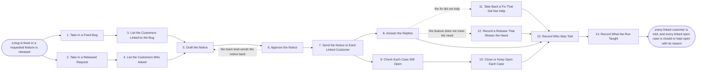

# Reference process: Tell Customers about a Fix

`ref/sup/tell-customers-about-a-fix v1`

**value stream:** [Escalations and bug reports](../../streams/customer-support/escalations-and-bug-reports.md)
`<your issue tracker>` shows that a bug filed at
`ref/sup/report-a-confirmed-bug` is fixed and released, or that a request
logged at `ref/sup/log-a-feature-request` has been released. For a bug,
the escalation-coordinator agent takes in the fix with the version it
shipped in and the plans it reached, and lists every customer and every
case linked to the bug with whether each customer has the fix yet. For a
request, the feedback-keeper agent takes in the release and lists every
account that asked, the case it asked in, and whether its plan includes
the feature. The customer-question-responder agent drafts one notice from
what engineering or the product team confirmed and the approved content
in `<your knowledge base>`, and a team lead approves it before any
customer reads it. The customer-question-responder agent sends the
approved notice to each linked customer once the change has reached them,
in a message that says it comes from an agent and offers a person, and
answers the routine replies from approved content. The support specialist
who holds each case still open on the fix reads it against what changed
and closes it, or keeps it open with its reason. A customer who replies
that the fix did not help is taken back as a case of its own, linked to
the bug, and a customer whose need the released feature does not meet has
their words recorded on the request. The run closes when every linked
customer has been told, every linked open case is closed or kept open with
its reason, and the record shows who was told and when.

**delivers:** statement, a notice that a fix has shipped

**starts:** on an event, a bug is fixed or a requested feature is released

## The goals

- Tell every linked customer within [2 working days] of the change reaching them
- Keep notices sent before the change has reached the customer at [zero]
- Close [80%] of the linked open cases on the notice
- Have fewer than [5%] of the cases closed on a fix reopened because it did not help

## The activities

| # | Activity | What happens | Agents |
|---|---|---|---|
| 1 | Take In a Fixed Bug | the bug marked fixed, the version and the plans it reached | [escalation-coordinator](../../agents/escalation-coordinator.md) |
| 2 | Take In a Released Request | the request marked released, the version and the plans | [feedback-keeper](../../agents/feedback-keeper.md) |
| 3 | List the Customers Linked to the Bug | every customer and case tied to it, and who has the fix | escalation-coordinator |
| 4 | List the Customers Who Asked | each account that asked, its case, and if its plan has it | feedback-keeper |
| 5 | Draft the Notice | what changed, what the customer does now, and the article | [customer-question-responder](../../agents/customer-question-responder.md) |
| 6 | Approve the Notice | a named person reads it before any customer does | team lead (person) |
| 7 | Send the Notice to Each Linked Customer | from an agent that says so, once the customer has the change | customer-question-responder |
| 8 | Answer the Replies | routine questions from approved content, others to a person | customer-question-responder |
| 9 | Check Each Case Still Open | the specialist reads each one against what changed | support specialist (person) |
| 10 | Close or Keep Open Each Case | closed, or kept open with its reason and its next date | support specialist (person) |
| 11 | Take Back a Fix That Did Not Help | the reply opened as a case of its own, linked to the bug | escalation-coordinator · support specialist (person) |
| 12 | Record a Release That Misses the Need | the customer's words on the request, logged again | feedback-keeper |
| 13 | Record Who Was Told | each customer, the notice version, the time sent, each reply | customer-question-responder |
| 14 | Record What the Run Taught | the time to tell, notices that bounced, cases reopened | customer-question-responder · escalation-coordinator · feedback-keeper |

A fixed bug arrives from `ref/sup/report-a-confirmed-bug` and a released
request from `ref/sup/log-a-feature-request`. The help center and the
saved replies a release touches are brought up to date before it reaches
customers at `ref/sup/prepare-support-for-a-release`, so the notice can
point to an article that is already right. What the company announces in
public about a release is decided by Marketing at
`ref/mkt/feature-release`, and this process tells only the customers
linked to the fix or the request. A customer whose plan does not include
a released feature and who wants it reaches the account owner through
`ref/sup/flag-an-account-signal`. A reply to the notice that admits fault,
promises a fix or a date, or offers money goes through
`ref/sup/approve-a-sensitive-reply`, and a customer the fix did not help
comes back through `ref/sup/take-in-a-request` and is resolved at
`ref/sup/resolve-a-case`.

## The graph



## The document, with the blanks marked

```
PROCESS: tell customers about a fix   id: <team>/tell-customers-about-a-fix   v1
from: ref/sup/tell-customers-about-a-fix v1
owner: <who>                          effective: <date>
trigger: <your issue tracker> marks a bug filed at
         ref/sup/report-a-confirmed-bug as fixed and released, or a
         request logged at ref/sup/log-a-feature-request as released
         watch: record=<bug or feature request> system=<your issue
                tracker> change=<marked fixed and released, or released>
concurrency: runs may overlap freely - one fixed bug or one released
             request is one run, a release that fixes several bugs or
             ships several requests opens one run for each, and a customer
             linked to several of them on the same day hears in one notice
goal: every customer linked to the fix or the release told in a notice
      <your team lead role> approved, only once the change has reached
      them, in a message that says it comes from an agent and offers a
      person, each case still open on it closed or kept open with its
      reason by the specialist who holds it, each customer the fix did not
      help taken back as a case of its own, and the record showing who was
      told and when
phases:
  take-in-fixed-bug  - system: the bug marked fixed lands with the version
                       the fix shipped in, the plans and the settings it
                       reached, and the date each customer has it, as
                       <your engineering team> confirmed
                       owner: escalation-coordinator
                       after: trigger, for a bug  automation: <level>
  take-in-release    - system: the request marked released lands with the
                       version, the plans that include it, and the date
                       each customer has it, as <your product team>
                       confirmed
                       owner: feedback-keeper
                       after: trigger, for a request
                       automation: <level>
  list-bug-cases     - runs collect-and-report: every customer and every
                       case linked to the bug, open or closed, each with
                       whether that customer has the fix yet
                       owner: escalation-coordinator
                       after: take-in-fixed-bug   automation: <level>
  list-requesters    - runs collect-and-report: every account that asked
                       for the feature, the case it asked in, and whether
                       its plan includes the feature
                       owner: feedback-keeper
                       after: take-in-release     automation: <level>
  draft-notice       - human: one notice written from what engineering or
                       the product team confirmed and the approved content
                       in <your knowledge base>: what changed, what the
                       customer does now and the article to read, and for
                       a customer whose plan lacks a released feature,
                       which plans include it, with no price
                       owner: customer-question-responder
                       after: list-bug-cases, or list-requesters
                       automation: <level>
  approve-notice     - convenes approval: <your team lead role> reads the
                       notice with the bug or the request beside it and
                       approves it at its version before any customer
                       reads it
                       owner: <your team lead role>
                       after: draft-notice        by: <hours>
                       automation: never
  send-notice        - system: the approved notice sent on each linked
                       customer's case once that customer has the change,
                       in a message that says it comes from an agent and
                       offers a person
                       owner: customer-question-responder
                       after: approve-notice      automation: <level>
  answer-replies     - human: each reply to the notice answered from
                       approved content when it is a routine question, and
                       handed with a draft to the specialist who holds the
                       case when it is not
                       owner: customer-question-responder
                       after: send-notice         automation: <level>
  check-open-cases   - human: each case still open on the fix read by the
                       support specialist who holds it against what the
                       customer asked and what changed
                       owner: <your support specialist role>
                       after: send-notice         automation: never
  close-or-keep      - convenes decide-and-announce: the specialist closes
                       each case the change resolves, or keeps it open
                       with its reason and its next date
                       owner: <your support specialist role>
                       after: check-open-cases    automation: never
  take-back-case     - system: a customer's reply that the fix did not
                       help sent to ref/sup/take-in-a-request as a case of
                       its own linked to the bug, and the bug reopened at
                       ref/sup/report-a-confirmed-bug once a specialist
                       has reproduced the fault again
                       owner: escalation-coordinator
                       after: answer-replies, when the fix did not help
                       automation: <level>
  record-unmet-need  - system: a customer's reply that the released
                       feature does not meet their need recorded on the
                       request in their own words, and logged again at
                       ref/sup/log-a-feature-request
                       owner: feedback-keeper
                       after: answer-replies, when the feature does not
                       meet the need              automation: <level>
  record-told        - system: each customer recorded on the bug or the
                       request and on their case, with the notice version,
                       when it was sent, and each reply
                       owner: customer-question-responder
                       after: answer-replies + close-or-keep, and
                       take-back-case or record-unmet-need when either
                       ran                        automation: <level>
  record-learning    - convenes debrief: how long the notice took after
                       the change reached customers, which notices
                       bounced, which cases reopened, and what the next
                       notice says differently
                       owner: customer-question-responder
                       after: record-told         automation: <level>
run-scoped:
  waiting - runs roll-call                owner: customer-question-responder
            every: <cadence>
            from: approve-notice       until: record-told
handoffs:
  take-in-fixed-bug -> list-bug-cases [fixed-bug]: the bug, the version
    the fix shipped in, and the plans and settings it reached
  take-in-release -> list-requesters [released-request]: the request, the
    version, and the plans that include it
  list-bug-cases -> draft-notice [bug-customers]: every customer and case
    linked to the bug, and who has the fix yet
  list-requesters -> draft-notice [requesting-customers]: every account
    that asked, its case, and whether its plan includes the feature
  draft-notice -> approve-notice [draft-notice]: the notice at a version,
    with what it was written from
  approve-notice -> send-notice [approved-notice]: the notice as
    approved, with the approver and the version. A change to it voids the
    approval
  send-notice -> answer-replies / check-open-cases [notices-sent]: each
    notice as sent, to whom and when
  check-open-cases -> close-or-keep [cases-read]: each open case with what
    the specialist found
  answer-replies -> take-back-case [fix-did-not-help]: the customer's
    reply in their own words, with the case and the bug
  answer-replies -> record-unmet-need [need-not-met]: the customer's reply
    in their own words, with the request
  answer-replies -> record-told [replies-answered]: each reply and how it
    was answered
  close-or-keep -> record-told [cases-decided]: each case closed, or kept
    open with its reason
  take-back-case -> record-told [case-taken-back]: the new case and the
    bug it is linked to
  record-unmet-need -> record-told [need-recorded]: the customer's words
    as recorded on the request
  record-told -> record-learning [told-record]: who was told, when, and
    what came back
deviations:
  approve-notice -> draft-notice [notice-sent-back]: the team lead will
    not approve the notice, so it is written again on the points the team
    lead named
  answer-replies -> take-back-case [fix-did-not-help]: a customer says the
    fix did not help, so the reply becomes a case of its own linked to the
    bug
  answer-replies -> record-unmet-need [need-not-met]: a customer says the
    released feature does not meet their need, so their words go on the
    request and it is logged again
bindings:
  roster:  <who holds each role - agents claiming the abstract agents
           above, and named people for <your team lead role> and the
           support specialists who hold the linked cases>
  systems: <your issue tracker> (write), <your support system> (write),
           <your knowledge base> (read), <your CRM> (read), the
           notification channel (write)
  data:    <your reply rules> <version>, the approved content in <your
           knowledge base> at its version, the release notes at their
           version
policy:
  no customer is told about a change before it has reached them
  every notice is approved at its version by <your team lead role> before
    any customer reads it, and a change to it voids the approval
  every notice and every answer an agent sends says it comes from an
    agent and offers a person, and the notice describes only what has
    shipped
  a customer whose plan does not include a released feature is told which
    plans include it, and support quotes no price and makes no offer
  each open case is closed or kept open by the specialist who holds it,
    and no case is closed on the notice alone
  a customer the fix did not help comes back as a case of its own, and
    the bug reopens only once a specialist has reproduced the fault again
  a reply to the notice that admits fault, promises a fix or a date, or
    offers money goes through ref/sup/approve-a-sensitive-reply
  what the company announces in public about a release is decided at
    ref/mkt/feature-release, and this process tells only the customers
    linked to the fix or the request
measures:
  cycle time: <days> from the change reaching customers to the last notice
              sent
  on time: <target> share of linked customers told within <days> of the
           change reaching them
  volume: <notices per period, by bug and by request>
  quality gate: every notice names its approver and went only to
                customers who had the change, and every linked open case
                shows closed or kept open with its reason
```

## The failure edges

- **A customer does not have the change yet.** The notice waits for that
  customer until their version or plan has it, and the waiting roll-call
  sends it the day it arrives. Nobody is told about something they cannot
  use yet.
- **The change reaches only some plans.** Customers whose plan includes
  it are told it is there. The others are told which plans include it in
  the approved wording, and any interest in moving to one goes to the
  account owner through `ref/sup/flag-an-account-signal`.
- **The team lead sends the notice back.** It is written again on the
  points the team lead named, and nothing reaches a customer until the
  new version is approved.
- **The fix did not help.** The customer's reply comes back through
  `ref/sup/take-in-a-request` as a case of its own linked to the bug, and
  the bug reopens at `ref/sup/report-a-confirmed-bug` once a specialist
  has reproduced the fault again.
- **The released feature does not meet the need.** The customer's words
  go on the request, and the need is logged again at
  `ref/sup/log-a-feature-request` for the product team to read.
- **The fix is taken back out.** Engineering rolls the change back. The
  notices not yet sent are stopped, the customers already told hear in
  wording a team lead approved, and the bug goes back to
  `ref/sup/report-a-confirmed-bug`.
- **The trigger fires while a run is in flight.** One fix or one release
  is one run. A customer linked to several fixes released on the same
  day hears in one notice, and each run records that customer as told.
- **A run is abandoned.** The release is withdrawn before any notice
  goes. Nothing is sent, and the bug or the request returns to its open
  state with the reason.
