# Reference process: Verify a Customer's Identity

`ref/sup/verify-a-customers-identity v1`

**value stream:** [Answering customers](../../streams/customer-support/answering-customers.md)
Someone is about to read out, change or act on anything in a customer's
account, whether a support specialist working a case, an agent answering
a question from the account's records, or a named person about to hand
over access. The case-manager agent takes in the action the case asks for
and the account it touches, and the identity-check agent sets the checks
that action's risk calls for under `<your identity policy>` at its
version, so reading out a renewal date needs fewer checks than changing
the email on the account. The identity-check agent reads what
`<your identity system>` and the account held before the request arrived,
looks for the signs of a takeover, such as urgency, pressure, a recent
change of contact details or a push to skip a check, and runs the checks,
such as a code sent to a contact already on file or a session the person
signed in to. Details the request itself supplies are never used to
confirm it. On a business account the agent also checks that the person
holds the authority they claim. A pass is recorded on the case with the
level reached and what may now be done, and it lapses when the case
closes. A request that fails a check, shows the signs of a takeover or
pushes to skip a check is held with nothing in the account read out or
changed, and a named team lead decides whether it is a takeover, warns the
account holder through details already on file and reports an attempt to
the security team. The run closes when the case carries a pass at the
level its action needs, or the request is held and a named person has
decided what happens to it.

**delivers:** verdict, an identity check result

**starts:** on an event, someone is about to read out, change or act on something in an account

## The goals

- Complete the checks within [3 minutes] for a routine action
- Pass [95%] of genuine customers on their first attempt
- Let [0] account takeovers through the checks
- Hold under [2%] of requests as a possible takeover

## The activities

| # | Activity | What happens | Agents |
|---|---|---|---|
| 1 | Take In the Action Asked For | what is to be read out, changed or done, in which account | [case-manager](../../agents/case-manager.md) |
| 2 | Set the Checks the Risk Calls For | the action's risk under the identity policy, and its checks | [identity-check](../../agents/identity-check.md) |
| 3 | Read What the Account Already Holds | the contacts, factors and sign-ins from before the request | identity-check |
| 4 | Look for Signs of a Takeover | urgency, pressure, a recent change or a push to skip a check | identity-check |
| 5 | Run the Checks | a code to a contact on file, a session or set questions | identity-check · customer (person) |
| 6 | Check the Authority Claimed | the person's standing against the account's named contacts | identity-check |
| 7 | Record the Result on the Case | the level reached, checks passed and what may now be done | case-manager |
| 8 | Hold a Possible Takeover | the case held with what was seen, and the account untouched | identity-check · case-manager |
| 9 | Review the Held Request | a named person decides whether it is a takeover | team lead (person) |
| 10 | Warn the Account Holder | a notice through details already on file | team lead (person) |
| 11 | Report the Attempt to Security | what was tried and when, the same day | team lead (person) · security team (person) |
| 12 | Tell the Person Asking | what they can do next, with no word on which check failed | support specialist (person) |
| 13 | Let the Result Lapse | the pass ends when the case closes or its window runs out | case-manager |
| 14 | Record What the Check Taught | takeover signs seen, and checks genuine customers failed | identity-check |

The check is asked for by `ref/sup/take-in-a-request` when a case is
marked for one, and by `ref/sup/answer-a-routine-question` and
`ref/sup/resolve-a-case` before anything in the account is read out or
changed. It runs at the highest level for
`ref/sup/recover-access-to-an-account`, `ref/sup/close-a-customer-account`
and `ref/sup/answer-a-data-request`, where a named person hands over
access, closes the account or releases data only after a pass. The
identity policy and the checks each level needs are the adopting
company's, held at a version and changed only by the people it names. The
rule that guards a supplier's bank details at
`ref/fin/change-a-suppliers-bank-details` holds here as well: the contact
used to confirm a request is one the company held before the request
arrived.

## The graph

```mermaid
flowchart LR
  T([someone is about to read out, change or act on something in an account]) --> A1[1. Take In the Action Asked For]
  A1 --> A2[2. Set the Checks the Risk Calls For]
  A2 --> A3[3. Read What the Account Already Holds]
  A3 --> A4[4. Look for Signs of a Takeover]
  A4 -. the request shows the signs of a takeover .-> A8[8. Hold a Possible Takeover]
  A4 --> A5[5. Run the Checks]
  A5 -. a check fails or the person pushes to skip one .-> A8
  A5 --> A6[6. Check the Authority Claimed]
  A6 -. the authority claimed is not on the account .-> A8
  A6 --> A7[7. Record the Result on the Case]
  A8 --> A9[9. Review the Held Request]
  A9 -. the team lead finds the person is the holder .-> A5
  A9 --> A10[10. Warn the Account Holder]
  A9 --> A11[11. Report the Attempt to Security]
  A10 --> A12[12. Tell the Person Asking]
  A11 --> A12
  A7 --> A13[13. Let the Result Lapse]
  A12 --> A14[14. Record What the Check Taught]
  A13 --> A14
  A14 --> DONE([the case carries a pass at the level its action needs, or a named person has decided the held request])
```



## The document, with the blanks marked

```
PROCESS: verify a customer's identity  id: <team>/verify-a-customers-identity   v1
from: ref/sup/verify-a-customers-identity v1
owner: <who>                          effective: <date>
trigger: a case in <your support system> asks for something in a
         customer's account to be read out, changed or done, and the
         action is one <your identity policy> lists as needing a check
         watch: record=<support case> system=<your support system>
                change=<an action on the account is asked for>
concurrency: runs may overlap freely - one action on one case is one run,
             a later action on the same case that needs a higher level
             runs again at that level, and requests on the same account
             from different people are runs of their own
goal: the person asking checked under <your identity policy> at its
      version with the checks the action's risk calls for, against what
      <your identity system> and the account held before the request
      arrived, and the case carrying either a pass at the level its
      action needs or a hold that a named person has decided, with the
      account holder warned and the security team told of any attempt
phases:
  take-in-action     - system: the action the case asks for, the account it
                       touches, who is asking and through which channel,
                       and the time the request arrived
                       owner: case-manager        after: trigger
                       automation: <level>
  set-checks         - runs assessment: the action's risk level under
                       <your identity policy> at its version, and the
                       checks that level calls for, with a change of email,
                       phone or sign-in method and any handover of control
                       always at the highest level
                       owner: identity-check
                       after: take-in-action      automation: <level>
  read-account       - runs collect-and-report: the contacts, the sign-in
                       methods, the recent sign-ins and any change of
                       contact details on the account, each from <your
                       identity system> or the account as it stood before
                       the request arrived
                       owner: identity-check
                       after: set-checks          automation: <level>
  look-for-takeover  - runs assessment: the request read for the signs of
                       a takeover under <your identity policy>, such as
                       urgency or pressure, a contact detail changed within
                       <days>, a sign-in from somewhere new, or a push to
                       skip or soften a check
                       owner: identity-check
                       after: read-account        automation: <level>
  run-checks         - runs assessment: each check the level calls for run
                       against details already on file, such as a code
                       sent to a contact on the account or a session the
                       person signed in to, and never against a detail the
                       request itself supplied
                       owner: identity-check
                       after: look-for-takeover   by: <minutes>
                       automation: <level>
  check-authority    - runs assessment: the person's standing on the
                       account read against its named contacts and the
                       authority each one holds, so a person on a business
                       account may do only what the account allows them
                       owner: identity-check
                       after: run-checks          automation: <level>
  record-result      - system: the pass recorded on the case with the
                       level reached, each check run and the details on
                       file it ran against, and the actions the pass
                       allows
                       owner: case-manager
                       after: check-authority     automation: <level>
  hold-request       - system: the case held with what was seen and the
                       check that failed, nothing in the account read out
                       or changed, and the hold sent to <your team lead
                       role> with the case beside it
                       owner: identity-check
                       after: look-for-takeover, run-checks or
                       check-authority, when a check fails or the signs of
                       a takeover show            automation: <level>
  review-hold        - convenes decide-and-announce: <your team lead role>
                       reads the held request with what the account holds
                       and decides whether it is a possible takeover, or
                       whether the checks run again at the highest level
                       owner: <your team lead role>
                       after: hold-request        by: <hours>
                       automation: never
  warn-holder        - human: the account holder told of the request
                       through a contact already on file, with what was
                       asked, when, and how to reach the company if it was
                       not them
                       owner: <your team lead role>
                       after: review-hold, when it is a possible takeover
                       by: <hours>                automation: never
  report-attempt     - human: the attempt reported to <your security team>
                       with what was asked, through which channel, when,
                       and the signs that marked it
                       owner: <your team lead role>
                       after: review-hold, when it is a possible takeover
                       by: <hours>                automation: never
  tell-asker         - human: the person asking told the request cannot go
                       ahead yet and what they can do next, such as signing
                       in or using ref/sup/recover-access-to-an-account,
                       with no word on which check failed
                       owner: <your support specialist role>
                       after: review-hold, and warn-holder +
                       report-attempt when they ran
                       automation: never
  lapse-result       - system: the pass ended on the case when the case
                       closes or <your verification window> passes,
                       whichever comes first, so a later request starts
                       from no pass
                       owner: case-manager
                       after: record-result       automation: <level>
  record-learning    - runs collect-and-report: the signs of a takeover
                       seen, the checks genuine customers failed and why,
                       the time the checks took, and any pass later found
                       to be wrong, added to the period's record for the
                       owner of <your identity policy>
                       owner: identity-check
                       after: tell-asker or lapse-result
                       automation: <level>
run-scoped:
  clock - runs roll-call                        owner: case-manager
          every: <cadence>
          from: take-in-action      until: record-result
  hold  - runs assessment                       owner: identity-check
          from: hold-request        until: review-hold
handoffs:
  take-in-action -> set-checks [account-action]: the action asked for, the
    account it touches and who is asking
  set-checks -> read-account [check-level]: the risk level and the checks
    it calls for, at the version of the policy
  read-account -> look-for-takeover [account-on-file]: the contacts, the
    sign-in methods and any recent change, each as it stood before the
    request arrived
  look-for-takeover -> run-checks [takeover-read]: the request with no
    sign of a takeover found
  run-checks -> check-authority [checks-passed]: each check run, the
    detail on file it ran against and the result
  check-authority -> record-result [authority-confirmed]: the person's
    standing on the account and what it allows them
  look-for-takeover / run-checks / check-authority -> hold-request
    [check-failed]: what was seen, the check that failed or was pushed
    aside, and the time
  hold-request -> review-hold [held-request]: the held case with what the
    account holds beside it
  review-hold -> warn-holder / report-attempt [takeover-decision]: the
    team lead's decision and the reason, with the date
  review-hold -> run-checks [hold-cleared]: the team lead's decision that
    the checks run again at the highest level
  warn-holder -> tell-asker [holder-warned]: the notice as sent, the
    contact on file it went to, and when
  report-attempt -> tell-asker [attempt-reported]: the report as sent to
    the security team, and when
  record-result -> lapse-result [pass]: the level reached and the actions
    it allows, with the time it was recorded
  tell-asker / lapse-result -> record-learning [check-closed]: the result,
    every check run, and who decided any hold
deviations:
  look-for-takeover -> hold-request [takeover-signs]: the request shows
    the signs of a takeover, so it is held before any check is run
  run-checks -> hold-request [check-failed]: a check fails or the person
    pushes to skip one, so the request is held and nothing in the account
    is read out or changed
  check-authority -> hold-request [authority-not-held]: the person does
    not hold the authority they claim on the account, so the request is
    held for the team lead
  review-hold -> run-checks [checks-again]: the team lead finds the person
    is most likely the holder, so the checks run again at the highest
    level and the request goes ahead only on a pass
bindings:
  roster:  <who holds each role - agents claiming the abstract agents
           above, and named people for <your team lead role> on each
           shift, the support specialists and the contact in <your
           security team>>
  systems: <your support system> (write), <your identity system> (read),
           <your CRM> (read), the notification channel (write)
  data:    <your identity policy> <version>, <your verification window>
           <version>, <your jurisdiction's rule on keeping customer
           records> <version>
policy:
  nothing in an account is read out, changed or done for anyone until the
    check that action's risk calls for under <your identity policy> has
    passed on the case
  the checks use only what <your identity system> and the account held
    before the request arrived, and a contact detail, a document or a
    name the request itself supplies is never used to confirm it
  a request that arrives with urgency or pressure, follows a recent
    change of contact details, or pushes to skip a check is treated as a
    possible takeover until the checks pass at the highest level
  a held request is decided by <your team lead role>, and no agent clears
    a hold
  the identity-check agent grants no access, hands over no account and
    changes nothing in the account, and a pass only allows the person who
    acts to go ahead
  a pass is good for one case and lapses when the case closes or <your
    verification window> passes, whichever comes first
  the person asking is never told which check failed
  the checks ask for no more than the level needs, and what a person gives
    to pass them is kept only as <your jurisdiction's rule on keeping
    customer records> allows
measures:
  cycle time: <minutes> from the action asked for to the result on the
              case
  first pass: <target> share of genuine customers who pass on their first
              attempt
  held: <target> share of requests held as a possible takeover
  volume: <checks per period, by level>
  quality gate: every pass names its level, the checks run and the details
                on file they ran against, and every hold names the person
                who decided it
```

## The failure edges

- **The person cannot complete the checks.** They have lost the phone or
  the email the account holds. Nothing in the account is read out or
  changed, and the person is pointed to
  `ref/sup/recover-access-to-an-account`, where the checks run at the
  highest level and a named person hands over access.
- **The request shows the signs of a takeover.** It is held before any
  check is run, and the team lead decides. The team lead warns the account
  holder through a contact already on file and reports the attempt to the
  security team the same day, and the person asking learns only that the
  request cannot go ahead yet.
- **The person pushes to skip a check.** They say it is urgent, that they
  are senior, or that they will complain. Pressure is itself a sign, so
  the request is held, and no specialist is ever expected to weigh a
  customer's anger against a check.
- **The person does not hold the authority they claim.** On a business
  account whose holder has left, a request for control goes to
  `ref/sup/recover-access-to-an-account`, where the existing contacts are
  told through details already on file before a named person decides.
- **A takeover is found after a pass.** The team lead reports it to the
  security team the same day, every change made under the pass is listed
  for a named person to reverse, the account holder is told through a
  contact on file, and the check that let it through goes to the owner of
  the identity policy.
- **The trigger fires while a run is in flight.** One action on one case
  is one run. A later action on the same case that needs a higher level
  runs the checks again at that level, and a pass already on the case
  covers only the actions it named.
- **A run is abandoned.** The person stops answering before the checks
  finish. The case records that no pass was reached, nothing in the
  account is read out or changed, and a later request starts from no
  pass.
