# Reference process: Write a Help Article

`ref/sup/write-a-help-article v1`

**value stream:** [The help center](../../streams/customer-support/the-help-center.md)
A question customers keep asking has no article, an owner has decided that
an article must be rewritten, or a release needs a new one. The
knowledge-keeper agent takes in the request and plans the article from the
questions customers ask: the question in their own words, the cases and
searches behind it, the plans and platforms it covers, and the named owner
the topic has. The researcher agent gathers how the feature works from the
product team, the release notes and the product itself, with the source of
every fact. The article-writer agent writes the steps for the task the
customer is trying to do, in plain words, and tests each step in the
product as it behaves today. The editor agent says what has to change for
the article to answer the question, the researcher agent checks each fact
against its source, and the accessibility-check agent scores the article
against `<your accessibility standard>`. The article's named owner
approves it, and the owner of the policy approves anything it says about
refunds, service levels, a person's data or the contract. The
knowledge-keeper agent publishes it in `<your knowledge base>` at a
version with its review date, takes down what it replaces, and only then
marks it as content the agents may answer from. The run closes when the
approved version is live, the agents answer from it, and nothing it
replaced is still served.

**delivers:** page, a help article

## The goals

- Publish each chosen article within [10 working days]
- Keep articles corrected in their first month under [5%]
- Cut new cases on each article's topic by [30%]
- Spend no more than [6 hours] of people's time on each article

## The activities

| # | Activity | What happens | Agents |
|---|---|---|---|
| 1 | Take In the Request | the question, where it came from, and any article it changes | [knowledge-keeper](../../agents/knowledge-keeper.md) |
| 2 | Plan the Article | the customers' words, readers, plans covered and the owner | knowledge-keeper |
| 3 | Gather How the Feature Works | from the product team, the release notes and the product | [researcher](../../agents/researcher.md) · product team (person) |
| 4 | Write the Draft | the steps for the customer's task, in plain words | [article-writer](../../agents/article-writer.md) |
| 5 | Test Each Step in the Product | every step walked as the product behaves today | article-writer |
| 6 | Edit the Draft | the structure, and whether it answers the question | [editor](../../agents/editor.md) |
| 7 | Check Each Fact Against Its Source | every claim read against where it came from | researcher · product team (person) |
| 8 | Check the Article for Accessibility | headings, alt text, contrast and keyboard use | [accessibility-check](../../agents/accessibility-check.md) |
| 9 | Approve the Article | the named owner, and the policy owner for any policy stated | article owner (person) · policy owner (person) |
| 10 | Publish at a Version | live with its owner, its version and its review date | knowledge-keeper |
| 11 | Take Down What It Replaces | the old version or overlapping article retired, links moved | knowledge-keeper |
| 12 | Mark It as Approved Content | the agents may now answer from this version only | knowledge-keeper |
| 13 | Record What the Run Taught | steps that failed, edits asked for, time taken | knowledge-keeper |

Requests come from this stream's other processes and from the desk. A gap
the knowledge lead chose at `ref/sup/find-gaps-in-the-help-center`, an
article an owner decided to rewrite at `ref/sup/review-the-help-center`
and a new or changed article a release needs at
`ref/sup/prepare-support-for-a-release` each start a run here, and so does
a support specialist's request from a case once the knowledge lead accepts
it. Once an article is approved content, the agents answer from it at
`ref/sup/answer-a-routine-question`, and a saved reply built on it is
published at `ref/sup/publish-a-saved-reply`. A step that fails because
the product is broken goes to a support specialist for
`ref/sup/report-a-confirmed-bug`. The product pages on the company's
website and the announcement of a release stay with Marketing at
`ref/mkt/website-content-update` and `ref/mkt/feature-release`.

## The graph

```mermaid
flowchart LR
  T([an article is requested for a question customers ask]) --> A1[1. Take In the Request]
  A1 --> A2[2. Plan the Article]
  A2 --> A3[3. Gather How the Feature Works]
  A3 --> A4[4. Write the Draft]
  A4 --> A5[5. Test Each Step in the Product]
  A5 -. a step does not work as written .-> A4
  A5 --> A6[6. Edit the Draft]
  A5 --> A7[7. Check Each Fact Against Its Source]
  A6 -. rewrite what the edit named .-> A4
  A7 -. a fact has no source .-> A3
  A6 --> A8[8. Check the Article for Accessibility]
  A7 --> A8
  A8 -. failures to fix .-> A4
  A8 --> A9[9. Approve the Article]
  A9 -. the owner asks for changes .-> A4
  A9 --> A10[10. Publish at a Version]
  A10 --> A11[11. Take Down What It Replaces]
  A10 --> A12[12. Mark It as Approved Content]
  A11 --> A13[13. Record What the Run Taught]
  A12 --> A13
  A13 --> DONE([the approved version is live and the agents answer from it])
```



## The document, with the blanks marked

```
PROCESS: write a help article         id: <team>/write-a-help-article   v1
from: ref/sup/write-a-help-article v1
owner: <who>                          effective: <date>
trigger: an article request is accepted in <your knowledge base>, from a
         gap chosen at ref/sup/find-gaps-in-the-help-center, a rewrite
         decided at ref/sup/review-the-help-center, a release at
         ref/sup/prepare-support-for-a-release, or a support specialist's
         request that <your knowledge lead role> accepts
         watch: record=<article request> system=<your knowledge base>
                change=<an article request is accepted>
concurrency: runs may overlap freely - one article is one run, a second
             request on the same article joins it, and the published
             version stays live and approved until the new one is
             published, unless it has been taken off the approved content
             because it is wrong today
goal: one article that answers a question customers ask, written from the
      product as it behaves with every step tested, edited, every fact
      checked against its source, scored against <your accessibility
      standard>, approved by its named owner and by the owner of any
      policy it states, published in <your knowledge base> at a version
      with its owner and its review date, and only then marked as content
      the agents may answer from
phases:
  take-in-request     - system: the request lands with the question in the
                        words customers used, where it came from, and any
                        article it changes or replaces
                        owner: knowledge-keeper   after: trigger
                        automation: <level>
  plan-article        - runs assessment: the question set out with the
                        cases and searches behind it, the readers, the
                        plans and platforms it covers, and the owner the
                        topic has in <your article ownership list>
                        owner: knowledge-keeper
                        after: take-in-request     automation: <level>
  gather-facts        - runs collect-and-report: how the feature works,
                        from <your product team>, the release notes and
                        the product itself, each fact with where it was
                        read or who said it
                        owner: researcher
                        after: plan-article        by: <days>
                        automation: <level>
  write-draft         - human: the article drafted at a version under
                        <your help article style guide>, as the steps for
                        the task the customer is trying to do, with no
                        customer's name or data in its examples or images
                        owner: article-writer
                        after: gather-facts        automation: <level>
  test-steps          - runs assessment: every step walked in the product
                        as it behaves today, on each plan and platform the
                        article covers, and each step that does not work
                        as written named with what the product did
                        owner: article-writer
                        after: write-draft         automation: <level>
  edit-draft          - runs assessment: the structure, and whether the
                        article answers the question it was planned for,
                        with each change the writer must make named
                        owner: editor
                        after: test-steps          automation: <level>
  check-facts         - runs assessment: every fact in the article read
                        against its source, and anything <your product
                        team> said confirmed with them
                        owner: researcher
                        after: test-steps          automation: <level>
  check-accessibility - runs assessment: the article scored against <your
                        accessibility standard> at its version, each
                        failure citing the rule it was scored against
                        owner: accessibility-check
                        after: edit-draft + check-facts
                        automation: <level>
  approve-article     - convenes approval: <your article owner role>
                        approves the article at its version, and <your
                        policy owner role> approves anything it says about
                        refunds, service levels, a person's data or the
                        contract, in the words the policy uses
                        owner: <your article owner role>
                        after: check-accessibility  by: <days>
                        automation: never
  publish-article     - system: the approved version published in <your
                        knowledge base> with its owner, its version and
                        its review date under <your review schedule>
                        owner: knowledge-keeper
                        after: approve-article     automation: <level>
  retire-replaced     - system: the version or the article it replaces
                        taken down, its address sent to the new article,
                        and each saved reply and article that linked to
                        it moved
                        owner: knowledge-keeper
                        after: publish-article     automation: <level>
  mark-approved       - system: the published version marked as content
                        the agents may answer from, and any earlier
                        version taken off that list at the same moment
                        owner: knowledge-keeper
                        after: publish-article     automation: <level>
  record-learning     - convenes debrief: which steps failed testing, what
                        the edit and the owner asked for, how long the run
                        took, and what the next article does differently
                        owner: knowledge-keeper
                        after: retire-replaced + mark-approved
                        automation: <level>
run-scoped:
  status  - runs roll-call                      owner: knowledge-keeper
            every: <cadence>
            from: take-in-request     until: publish-article
  sources - runs collect-and-report             owner: researcher
            from: gather-facts        until: approve-article
handoffs:
  take-in-request -> plan-article [article-request]: the question in the
    customers' words, where it came from, and any article it changes
  plan-article -> gather-facts [article-plan]: the question, the cases and
    searches behind it, the readers, the plans covered and the owner
  gather-facts -> write-draft [feature-facts]: how the feature works, each
    fact with its source
  write-draft -> test-steps [draft-article]: the article at a version
  test-steps -> edit-draft / check-facts [tested-draft]: the draft with
    every step tested on each plan and platform it covers
  edit-draft -> check-accessibility [edited-draft]: the draft with the
    editor's changes made
  check-facts -> check-accessibility [checked-facts]: every fact matched
    to its source
  check-accessibility -> approve-article [accessible-draft]: the draft
    with its accessibility score and no failure left open
  approve-article -> publish-article [approved-article]: the article as
    approved, with the owner, any policy owner and the version. A change
    to it voids the approval
  publish-article -> retire-replaced / mark-approved [published-article]:
    the article live at its version, with its review date
  retire-replaced -> record-learning [retired-content]: what was taken
    down, and where each link now points
  mark-approved -> record-learning [approved-content]: the version the
    agents now answer from, and the one taken off the list
deviations:
  test-steps -> write-draft [step-does-not-work]: a step does not work as
    written, so it is rewritten to what the product does, and a step that
    fails because the product is broken goes to a support specialist for
    ref/sup/report-a-confirmed-bug
  edit-draft -> write-draft [edit-asks-for-rewrite]: the editor names what
    has to change, so the writer makes exactly those changes and the steps
    changed are tested again
  check-facts -> gather-facts [fact-without-source]: a fact has no source
    or the product team does not confirm it, so it is gathered again
    before the draft goes on
  check-accessibility -> write-draft [accessibility-failures]: the article
    fails a rule, so the writer fixes it and it is scored again
  approve-article -> write-draft [owner-asks-for-changes]: the owner or
    the policy owner asks for changes, so the writer makes exactly those
    and what changed is edited, checked and scored again
bindings:
  roster:  <who holds each role - agents claiming the abstract agents
           above, and named people for <your knowledge lead role>, each
           <your article owner role>, each <your policy owner role> and
           the contacts in <your product team>>
  systems: <your knowledge base> (write), <your support system> (read),
           the product and <your test environment> (read), the release
           notes (read), the notification channel (write)
  data:    <your help article style guide> <version>, <your
           accessibility standard> <version>, <your article ownership
           list> <version>, <your review schedule> <version>, the support
           policies at their versions
policy:
  an article is published only once its named owner has approved it at
    its version, and a change after approval voids the approval
  every step is tested in the product as it behaves before the article
    goes for approval, on each plan and platform the article covers
  an article says what the product does today, and it never promises a
    fix, a date, a price or a feature that has not shipped
  anything an article says about refunds, service levels, a person's data
    or the contract is approved by the owner of that policy, in the words
    the policy uses, and follows <your jurisdiction's rules on what
    customers must be told> where they apply
  an article on a matter a person decides, such as a refund, a data
    request or closing an account, says how to ask and what happens next,
    and decides nothing for the customer
  the agents answer only from a version marked as approved content, and a
    version is marked only once it is published as approved
  no article shows a customer's name or data in its examples or images
  the agents approve no article and publish nothing an owner has not
    approved
measures:
  cycle time: <days> from the request accepted to the article published
  on time: <target> share of articles published by the date planned
  volume: <articles per period>
  quality gate: every published article names its owner, its version and
                its review date, every step in it was tested, and every
                fact traces to its source
```

## The failure edges

- **A step does not work as the article says.** The article-writer agent
  rewrites the step to what the product does today and tests it again.
  When the step fails because the product is broken, the step is held, a
  support specialist takes the fault to `ref/sup/report-a-confirmed-bug`,
  and a workaround is published only once the article's owner approves it
  as one.
- **The product team has not said how a feature works.** The researcher
  agent asks once, with the date the article needs the answer, and the
  article waits. Nobody writes a step from memory or from general
  knowledge, because the agents will answer customers from whatever the
  article says.
- **The topic has no owner.** The knowledge lead names one before the
  draft starts, because an article with no owner is never approved and
  never reviewed.
- **The article states a policy.** Anything it says about refunds, service
  levels, a person's data or the contract is approved by the owner of
  that policy as well, in the words the policy uses, and follows
  `<your jurisdiction's rules on what customers must be told>` where they
  apply. An article on a matter a person decides, such as a refund, a data
  request or closing an account, says how to ask and what happens next.
- **The feature differs by plan or platform.** The article says which
  plans and platforms each step applies to, each one is tested, and the
  agents answer from it only for the plans it covers.
- **The owner asks for changes.** The article-writer agent makes exactly
  the changes asked for, and what changed is edited, checked against its
  sources and scored again before the owner reads it a second time.
- **The trigger fires while a run is in flight.** One article is one run.
  A second request on the same article joins it, and the published
  version stays live and approved until the new version is published,
  unless it is wrong today, in which case it has already been taken off
  the content the agents answer from.
- **A run is abandoned.** The request is withdrawn, or the feature is
  removed before the article is published. Nothing unapproved is
  published, the draft is kept with the reason, and an open gap goes back
  to `ref/sup/find-gaps-in-the-help-center`.
