# Reference process: Account for a Lease

`ref/fin/account-for-a-lease v1`

**value stream:** [Closing the books](../../streams/finance/closing-the-books.md)
A lease has been signed or changed, such as one for an office, a vehicle
or equipment the company uses and does not own, and it has to be
accounted for under `<your accounting framework>`. The
asset-register-keeper agent takes in the signed lease from the contract
repository, reads its term, its payments and its options to extend, to
end early or to buy, and asks the lease owner how the business means to
use the asset and each option. It sets out each judgment the lease
raises, such as whether the contract holds a lease at all, whether an
option will be used, the discount rate and any exemption the framework
allows, with the effect of each, and the controller decides each one in
writing. The asset-register-keeper agent enters the lease in the register
with the decided judgments and works out the schedule of the liability,
the asset and each period's entries. The ledger-accountant agent prepares
the entry that brings the lease onto the books, or changes it, with the
schedule as its support, and checks it. A named approver who did not
prepare it approves it, and the ledger-accountant agent posts it. The run
closes when the lease is in the register with its decisions, the opening
entry is posted, and each later period's entries are set to post from the
register.

**delivers:** sheet, a lease schedule

## The goals

- Enter each lease within [10 working days] of its signature
- Hold [100%] of signed leases in the register
- Restate lease balances in [zero] closed periods
- Enter a standard lease in under [4 hours] of accountant time

## The activities

| # | Activity | What happens | Agents |
|---|---|---|---|
| 1 | Take In the Lease | the signed lease or change, with every document it names | [asset-register-keeper](../../agents/asset-register-keeper.md) |
| 2 | Read the Term and the Payments | the start, the end, fixed and variable payments, increases | asset-register-keeper |
| 3 | Read the Options | to extend, to end early or to buy, and what each costs | asset-register-keeper |
| 4 | Ask the Lease Owner | how the business means to use the asset and each option | lease owner (person) · asset-register-keeper |
| 5 | Set Out the Judgments | if it holds a lease, the term, the rate and any exemption | asset-register-keeper |
| 6 | Decide Each Judgment | in writing with the reason | controller (person) |
| 7 | Enter the Lease in the Register | the term, the payments, the rate and the decisions | asset-register-keeper |
| 8 | Work Out the Schedule | the liability, the asset and each period's entries | asset-register-keeper |
| 9 | Prepare the Opening Entry | the entry that books the lease, with its schedule | [ledger-accountant](../../agents/ledger-accountant.md) |
| 10 | Check the Opening Entry | its accounts, period and balance against the schedule | ledger-accountant |
| 11 | Approve the Opening Entry | a named approver who did not prepare it | journal approver (person) |
| 12 | Post the Opening Entry | posted in its period with its approval attached | ledger-accountant |
| 13 | Set the Period Entries to Post | each later period's interest, depreciation and payments | asset-register-keeper |
| 14 | Record What the Lease Taught | the judgments it raised and what the next lease needs | asset-register-keeper |

The signed lease comes from whoever negotiated it, such as the
facilities or the operations lead, and the purchase it supports runs
through `ref/fin/issue-a-purchase-order` and, above the budget, through
`ref/fin/approve-an-investment-case`. The opening entry is approved under
the same rules as `ref/fin/post-a-manual-journal-entry`, with the
approvers the delegation of authority names above `<your threshold>`.
Each later period's entries post from the register at the close, and the
lease accounts are reconciled to the register at
`ref/fin/reconcile-a-balance-sheet-account`. A change to a lease, such as
an extension, an early end or a new payment, starts a new run, and the
leases feed the lease note at `ref/fin/prepare-the-financial-statements`.

## The graph

```mermaid
flowchart LR
  T([a lease is signed or changed]) --> A1[1. Take In the Lease]
  A1 --> A2[2. Read the Term and the Payments]
  A1 --> A3[3. Read the Options]
  A2 --> A4[4. Ask the Lease Owner]
  A3 --> A4
  A4 --> A5[5. Set Out the Judgments]
  A5 --> A6[6. Decide Each Judgment]
  A6 -. the controller needs more of the lease read .-> A2
  A6 -. the contract holds no lease .-> A14[14. Record What the Lease Taught]
  A6 --> A7[7. Enter the Lease in the Register]
  A7 --> A8[8. Work Out the Schedule]
  A8 --> A9[9. Prepare the Opening Entry]
  A9 --> A10[10. Check the Opening Entry]
  A10 -. the entry does not balance or agree with the schedule .-> A9
  A10 --> A11[11. Approve the Opening Entry]
  A11 -. the approver finds the schedule wrong .-> A8
  A11 --> A12[12. Post the Opening Entry]
  A12 --> A13[13. Set the Period Entries to Post]
  A13 --> A14
  A14 --> DONE([the lease is in the register, the opening entry is posted, and each period's entries are set])
```



## The document, with the blanks marked

```
PROCESS: account for a lease          id: <team>/account-for-a-lease   v1
from: ref/fin/account-for-a-lease v1
owner: <who>                          effective: <date>
trigger: a lease is signed, extended, changed or ended early and filed in
         <your contract repository>
         watch: record=<lease agreement>
                system=<your contract repository>
                change=<a lease is signed or changed>
concurrency: runs may overlap freely - one lease signed or changed is one
             run, a lease has one run open at a time, and a second change
             to the same lease waits for the first to post
goal: the lease entered in the register under <your accounting framework>
      on judgments a named person decided, its opening entry approved and
      posted, and each later period's entries set to post, within <days>
      of the signature or the change
phases:
  take-in-lease        - system: the signed lease or change lands from
                         <your contract repository> with every schedule,
                         amendment and side letter it names
                         owner: asset-register-keeper
                         after: trigger             automation: <level>
  read-term            - runs assessment: the start, the end, the fixed and
                         the variable payments, the increases and any
                         payment made before the start, each with the
                         clause it came from
                         owner: asset-register-keeper
                         after: take-in-lease       automation: <level>
  read-options         - runs assessment: each option to extend, to end
                         early or to buy, with its dates, its notice and
                         what it costs, each with the clause it came from
                         owner: asset-register-keeper
                         after: take-in-lease       automation: <level>
  ask-lease-owner      - human: <your lease owner role> says how the
                         business means to use the asset and whether it
                         expects to use each option, with the reasons
                         owner: <your lease owner role>
                         after: read-term + read-options by: <days>
                         automation: never
  set-out-judgments    - runs assessment: each judgment the lease raises,
                         such as whether the contract holds a lease,
                         whether each option will be used, the discount
                         rate and any exemption <your accounting framework>
                         allows, set out with the effect of each
                         owner: asset-register-keeper
                         after: ask-lease-owner     automation: <level>
  decide-judgments     - convenes decide-and-announce: <your controller
                         role> decides each judgment in writing with the
                         reason
                         owner: <your controller role>
                         after: set-out-judgments   by: <days>
                         automation: never
  enter-lease          - system: the lease entered in <your lease
                         register> with its term, its payments, its rate
                         and the decided judgments, at a version
                         owner: asset-register-keeper
                         after: decide-judgments    automation: <level>
  work-out-schedule    - runs assessment: the liability, the asset and
                         each period's interest, depreciation and payment
                         entries worked out under <your accounting
                         framework>, or the change to them for a change
                         to the lease
                         owner: asset-register-keeper
                         after: enter-lease         automation: <level>
  prepare-opening      - human: the entry that brings the lease onto the
                         books, or changes it, drafted in <your general
                         ledger> with the schedule as its support
                         owner: ledger-accountant
                         after: work-out-schedule   automation: <level>
  check-opening        - runs assessment: the entry's accounts and period
                         read as open, and the entry read as balanced and
                         equal to the schedule
                         owner: ledger-accountant
                         after: prepare-opening     automation: <level>
  approve-opening      - convenes approval: <your journal approver role>,
                         who did not prepare the entry, approves it at its
                         version, with the approvers <your delegation of
                         authority> names above <your threshold>
                         owner: <your journal approver role>
                         after: check-opening       by: <hours>
                         automation: never
  post-opening         - system: the approved entry posted in its period
                         in <your general ledger> with its approval and
                         the schedule attached
                         owner: ledger-accountant
                         after: approve-opening     automation: <level>
  set-period-entries   - system: each later period's interest,
                         depreciation and payment entries set in the
                         register to post at each close until the lease
                         ends or changes
                         owner: asset-register-keeper
                         after: post-opening        automation: <level>
  record-learning      - convenes debrief: which judgments the lease
                         raised, what the lease owner could and could not
                         say, and what the next lease needs
                         owner: asset-register-keeper
                         after: set-period-entries, or decide-judgments
                         when the contract holds no lease
                         automation: <level>
run-scoped:
  status   - runs roll-call                     owner: asset-register-keeper
             every: <cadence>
             from: take-in-lease       until: post-opening
handoffs:
  take-in-lease -> read-term / read-options [signed-lease]: the lease or
    the change, with every document it names
  read-term -> ask-lease-owner [term-and-payments]: the term and every
    payment, each with its clause
  read-options -> ask-lease-owner [options]: each option with its dates,
    its notice and its cost
  ask-lease-owner -> set-out-judgments [owner-intent]: how the business
    means to use the asset and each option, with the reasons
  set-out-judgments -> decide-judgments [lease-judgments]: each judgment
    with its effect
  decide-judgments -> enter-lease / record-learning [decided-judgments]:
    each decision in writing, with who decided and why
  enter-lease -> work-out-schedule [register-entry]: the lease as entered,
    at its version
  work-out-schedule -> prepare-opening [lease-schedule]: the liability,
    the asset and each period's entries
  prepare-opening -> check-opening [draft-opening-entry]: the entry at a
    version, with the schedule attached
  check-opening -> approve-opening [checked-opening-entry]: the entry
    checked against the schedule
  approve-opening -> post-opening [approved-opening-entry]: the entry as
    approved. A change to any line voids the approval
  post-opening -> set-period-entries [posted-opening-entry]: the entry as
    posted, with its ledger reference
  set-period-entries -> record-learning [period-entries]: the entries set
    to post, with the first and the last period
deviations:
  decide-judgments -> read-term [more-reading-needed]: the controller
    needs more of the lease read, such as a schedule of payments or an
    amendment, before deciding
  decide-judgments -> record-learning [no-lease]: the controller decides
    the contract holds no lease, so it is recorded as a service contract
    and nothing enters the register
  check-opening -> prepare-opening [entry-does-not-agree]: the entry does
    not balance or agree with the schedule, so it is prepared again
  approve-opening -> work-out-schedule [schedule-wrong]: the approver
    finds the schedule wrong, so it is worked out again and the entry
    prepared again from it
bindings:
  roster:  <who holds each role - agents claiming the abstract agents
           above, and named people for each lease owner, the controller
           and the journal approvers>
  systems: the contract repository (read), the lease register (write),
           the general ledger (write), the notification channel (write)
  data:    <your accounting framework> <version>, <your lease policy>
           <version>, <your source of discount rates> <version>, <your
           delegation of authority> <version>
policy:
  every lease signed or changed is entered in the register, and a lease
    is left out only when <your controller role> decided in writing that
    the contract holds no lease or that an exemption applies
  every judgment is decided in writing by <your controller role>, and no
    agent decides one
  no opening entry posts before a named approver who did not prepare it
    has approved it, with the approvers <your delegation of authority>
    names above <your threshold>
  the lease is accounted for under <your accounting framework> at the
    version in force for the entity, and a change to the framework takes
    effect only once <your controller role> confirms it
  the lease owner is asked about each option before it is judged, and the
    answer is kept with the decision
  a change to a lease starts a new run, and a closed period changes only
    through a correction <your controller role> approves
measures:
  cycle time: <days> from the signature to the opening entry posted
  on time: <target> share of leases entered within <days> of signature
  volume: <leases signed or changed per period>
  quality gate: every lease in the register traces to its signed
                document, a decision by a named person on each judgment,
                and an approved opening entry
```

## The failure edges

- **A lease reaches finance late.** A lease signed without finance
  knowing is entered as soon as it is found, and the controller decides
  whether the periods it missed are corrected in the current period or
  restated. The person who signed it is told how leases reach finance.
- **The lease owner cannot say whether an option will be used.** The
  asset-register-keeper agent sets out both readings and their effect,
  and the controller decides with the reason. The decision is read again
  when the owner's plans change.
- **The controller needs more of the lease read.** The missing schedule,
  amendment or side letter is found and read before the controller
  decides, and the lease is entered only once every judgment is decided.
- **The contract holds no lease.** The controller records the decision
  with the reason, the contract is accounted for as a service, and
  nothing enters the register.
- **The opening entry does not agree with the schedule.** It is prepared
  again, and an approver who finds the schedule itself wrong sends it
  back to be worked out again before the entry is prepared from it.
- **The trigger fires while a run is in flight.** A lease has one run
  open at a time. A second change to the same lease waits for the first
  to post, and then starts from the register as the first left it.
- **A run is abandoned.** The lease is cancelled before it starts. The
  controller records the decision, any entry already posted is reversed
  through `ref/fin/post-a-manual-journal-entry`, and the register shows
  the lease as cancelled with the reason.
