# Reference process: Account for Fixed Assets

`ref/fin/account-for-fixed-assets v1`

**value stream:** [Closing the books](../../streams/finance/closing-the-books.md)
A period has ended, and the register of the company's fixed assets has to
show every asset it owns at the right value. The purchasing-coordinator
agent passes each purchase received in the period against an order coded
to an asset class. The asset-register-keeper agent checks each cost
against `<your capitalization policy>` and
`<your capitalization threshold>`, records each new asset with its class,
its cost, the date it went into service, its useful life, its location
and its owner, and asks each owner to confirm it. It takes in each asset
sold, scrapped, lost or moved, and on its schedule it checks the register
against what physically exists. It sets out each disposal and each sign
that an asset is worth less than its carrying value, with the evidence,
and the controller decides each one, with those above `<your threshold>`
going to the senior approvers the delegation of authority names. The
asset-register-keeper agent works out the period's depreciation, a named
reviewer who prepared none of the register's changes reviews them, and
the period's entries post from the register to the ledger. The run closes
when every addition, disposal and impairment of the period is in the
register with its decision, the depreciation is posted, and the register
is with the close.

**delivers:** sheet, the fixed asset register for the period

## The goals

- Post the period's depreciation within [2 working days] of the period end
- Record each new asset within [5 working days] of its receipt
- Find [98%] of assets at each check against what exists
- Spend under [1 day] a quarter on the check against what exists

## The activities

| # | Activity | What happens | Agents |
|---|---|---|---|
| 1 | Open the Period's Register | the register as last closed, and the period's dates | [asset-register-keeper](../../agents/asset-register-keeper.md) |
| 2 | Take In the Capital Purchases | each order and receipt coded to an asset class | [purchasing-coordinator](../../agents/purchasing-coordinator.md) |
| 3 | Check Each Cost Against the Policy | each cost read as an asset or an expense under the policy | asset-register-keeper |
| 4 | Record Each New Asset | class, cost, service date, useful life, location and owner | asset-register-keeper |
| 5 | Confirm Each Asset With Its Owner | in service, where it is, and who holds it | asset owner (person) · asset-register-keeper |
| 6 | Take In Disposals and Transfers | assets sold, scrapped, lost or moved, as their owners report | asset-register-keeper · asset owner (person) |
| 7 | Check the Register Against What Exists | on its schedule, each asset found, tagged and in use | asset-register-keeper · asset owner (person) |
| 8 | Set Out Each Disposal or Impairment | the carrying value, the proceeds or the loss, with evidence | asset-register-keeper |
| 9 | Decide Each Disposal or Impairment | the controller, and the senior approvers above the threshold | controller (person) · senior approver (person) |
| 10 | Work Out the Depreciation | each asset's depreciation for the period, from the register | asset-register-keeper |
| 11 | Review the Register | a named person reads additions, disposals and depreciation | register reviewer (person) |
| 12 | Post the Register to the Ledger | the additions, disposals, impairments and depreciation | asset-register-keeper |
| 13 | Hand the Register to the Close | the register and totals, to reconcile the asset accounts | asset-register-keeper |
| 14 | Record What the Period Taught | assets missed, lives changed and items not found | asset-register-keeper |

The purchases come from the orders and the receipts recorded at
`ref/fin/issue-a-purchase-order`, and a purchase of an asset above
`<your threshold>` was approved there, or at
`ref/fin/approve-an-investment-case` when it sat outside the budget. The
invoice behind each cost is matched at
`ref/fin/process-a-supplier-invoice`, and a cost that proves to be an
expense is moved by an entry through
`ref/fin/post-a-manual-journal-entry`. The register's totals are
reconciled to the asset accounts at
`ref/fin/reconcile-a-balance-sheet-account`. A leased asset is accounted
for at `ref/fin/account-for-a-lease`, and an asset held by a fund belongs
to Private capital.

## The graph

```mermaid
flowchart LR
  T([a period of an entity reaches its end]) --> A1[1. Open the Period's Register]
  A1 --> A2[2. Take In the Capital Purchases]
  A2 --> A3[3. Check Each Cost Against the Policy]
  A3 --> A4[4. Record Each New Asset]
  A4 --> A5[5. Confirm Each Asset With Its Owner]
  A5 -. the owner does not recognize the asset or its details .-> A4
  A1 --> A6[6. Take In Disposals and Transfers]
  A1 -. the check against what exists is due .-> A7[7. Check the Register Against What Exists]
  A6 --> A8[8. Set Out Each Disposal or Impairment]
  A7 --> A8
  A8 --> A9[9. Decide Each Disposal or Impairment]
  A9 -. the decider asks for more evidence .-> A8
  A5 --> A10[10. Work Out the Depreciation]
  A9 --> A10
  A10 --> A11[11. Review the Register]
  A11 -. the reviewer finds an asset recorded wrongly .-> A4
  A11 -. the reviewer finds the depreciation wrong .-> A10
  A11 --> A12[12. Post the Register to the Ledger]
  A12 --> A13[13. Hand the Register to the Close]
  A13 --> A14[14. Record What the Period Taught]
  A14 --> DONE([the period's additions, disposals and depreciation are in the register and posted])
```



## The document, with the blanks marked

```
PROCESS: account for fixed assets     id: <team>/account-for-fixed-assets   v1
from: ref/fin/account-for-fixed-assets v1
owner: <who>                          effective: <date>
trigger: a period of an entity reaches its end on <your close calendar>
         watch: record=<accounting period> system=<your general ledger>
                change=<the period end passes>
concurrency: runs may overlap across entities - one period of one entity
             is one run, an entity has one run open at a time, and an
             asset received after the period end belongs to the next run
goal: every asset received in <the period> recorded with its cost, life
      and owner, every disposal and impairment decided by a named person,
      the depreciation posted, and the register's entries in the ledger
      within <days> of the period end
phases:
  open-register        - system: the period opened with its dates and the
                         register as it stood at the last close
                         owner: asset-register-keeper
                         after: trigger             automation: <level>
  take-in-purchases    - system: each receipt in the period against an
                         order line coded to an asset class in <your ERP>,
                         with the order, the receipt and the invoice
                         behind it
                         owner: purchasing-coordinator
                         after: open-register       automation: <level>
  check-costs          - runs assessment: each cost read against <your
                         capitalization policy> and <your capitalization
                         threshold> as part of an asset or as an expense,
                         with the reason
                         owner: asset-register-keeper
                         after: take-in-purchases   automation: <level>
  record-assets        - system: each new asset recorded in <your asset
                         register> with its class, its cost, the date it
                         went into service, the useful life its class sets
                         under the policy, its location and its owner
                         owner: asset-register-keeper
                         after: check-costs         automation: <level>
  confirm-with-owner   - human: <your asset owner role> confirms that each
                         new asset is in service, where it is, and who
                         holds it
                         owner: <your asset owner role>
                         after: record-assets       by: <days>
                         automation: never
  take-in-disposals    - runs collect-and-report: each asset sold,
                         scrapped, lost, given away or moved between
                         entities or places in the period, as its owner
                         reports it, with the evidence
                         owner: asset-register-keeper
                         after: open-register       automation: <level>
  check-what-exists    - runs assessment: on <your schedule for the
                         check>, each asset in the register looked for
                         with its owner, and marked found, missing, idle
                         or damaged
                         owner: asset-register-keeper
                         after: open-register, when the check is due
                         automation: <level>
  set-out-disposals    - runs assessment: each disposal and each sign that
                         an asset is worth less than its carrying value,
                         such as damage, idleness or a missing item, set
                         out with its carrying value, any proceeds and the
                         effect under <your accounting framework>
                         owner: asset-register-keeper
                         after: take-in-disposals, and check-what-exists
                         when it ran                automation: <level>
  decide-disposals     - convenes decide-and-announce: <your controller
                         role> decides each disposal and impairment in
                         writing, and each one above <your threshold> goes
                         to the senior approvers <your delegation of
                         authority> names
                         owner: <your controller role>
                         after: set-out-disposals   by: <days>
                         automation: never
  depreciate-assets    - runs assessment: each asset's depreciation for
                         the period worked out from its cost, its life and
                         its method in the register, with the decided
                         disposals and impairments taken in
                         owner: asset-register-keeper
                         after: confirm-with-owner, and decide-disposals
                         when it ran                automation: <level>
  review-register      - convenes approval: <your register reviewer role>,
                         who prepared none of the period's changes, reads
                         the additions, the disposals, the impairments and
                         the depreciation and approves them at their
                         version
                         owner: <your register reviewer role>
                         after: depreciate-assets   by: <days>
                         automation: never
  post-register        - system: the period's additions, disposals,
                         impairments and depreciation posted from the
                         register to <your general ledger> as one approved
                         batch
                         owner: asset-register-keeper
                         after: review-register     automation: <level>
  hand-to-close        - system: the register and its totals by class
                         handed to ref/fin/close-the-month, and the asset
                         accounts named for their reconciliation
                         owner: asset-register-keeper
                         after: post-register       automation: <level>
  record-learning      - convenes debrief: which assets were recorded late
                         or missed, which items were not found, and what
                         the next period does differently
                         owner: asset-register-keeper
                         after: hand-to-close       automation: <level>
run-scoped:
  status   - runs roll-call                     owner: asset-register-keeper
             every: <cadence>
             from: open-register       until: review-register
handoffs:
  open-register -> take-in-purchases / take-in-disposals /
    check-what-exists [asset-period]: the dates and the register as last
    closed
  take-in-purchases -> check-costs [capital-purchases]: each receipt with
    its order, its invoice and its asset class
  check-costs -> record-assets [checked-costs]: each cost marked as part of
    an asset or as an expense, with the reason
  record-assets -> confirm-with-owner [new-assets]: each new asset with its
    details as recorded
  confirm-with-owner -> depreciate-assets [confirmed-assets]: each new
    asset as its owner confirmed it
  take-in-disposals -> set-out-disposals [reported-changes]: each asset
    sold, scrapped, lost or moved, with the evidence
  check-what-exists -> set-out-disposals [check-results]: each asset
    marked found, missing, idle or damaged
  set-out-disposals -> decide-disposals [disposals-for-decision]: each
    disposal and impairment with its value and its effect
  decide-disposals -> depreciate-assets [decided-disposals]: each
    decision in writing, with who decided and why
  depreciate-assets -> review-register [register-changes]: the
    additions, disposals, impairments and depreciation at a version
  review-register -> post-register [approved-changes]: the changes as the
    reviewer approved them. A change to any line voids the approval
  post-register -> hand-to-close [posted-register]: the batch as posted,
    with its ledger reference
  hand-to-close -> record-learning [register-for-close]: the register and
    its totals as the close received them
deviations:
  confirm-with-owner -> record-assets [owner-does-not-recognize]: the owner
    does not recognize the asset or its details, so it is recorded again
    from the order and the receipt
  decide-disposals -> set-out-disposals [more-evidence-needed]: the decider
    asks for more evidence, such as a valuation or a photograph, before
    deciding
  review-register -> record-assets [asset-recorded-wrongly]: the reviewer
    finds an asset recorded with the wrong cost, class, life or owner, so
    it is recorded again
  review-register -> depreciate-assets [depreciation-wrong]: the
    reviewer finds the depreciation wrong, so it is worked out again
bindings:
  roster:  <who holds each role - agents claiming the abstract agents
           above, and named people for each asset owner, the register
           reviewer, the controller and the senior approvers>
  systems: the asset register (write), the ERP (read), the general ledger
           (write), the document store (write), the notification channel
           (write)
  data:    <your capitalization policy> <version>, <your capitalization
           threshold> <version>, the useful lives by class <version>,
           <your accounting framework> <version>, <your delegation of
           authority> <version>
policy:
  every cost above <your capitalization threshold> that the policy treats
    as an asset is recorded in the register, and no cost below it is
    recorded there
  each asset's life and method come from its class under <your
    capitalization policy>, and a different life is set only by <your
    controller role> in writing
  every disposal and impairment is decided in writing by <your controller
    role>, or by the senior approvers above <your threshold>, and no agent
    decides one
  nothing posts from the register before a named reviewer who prepared
    none of the period's changes has approved them
  an asset sold or given away leaves the register only once the decision
    is recorded, and any proceeds are matched to the payment received
  the register is checked against what physically exists on <your
    schedule for the check>, and every item not found is set out for a
    decision
measures:
  cycle time: <days> from the period end to the register posted
  on time: <target> share of new assets recorded within <days> of receipt
  volume: <assets added and disposed of per period>
  quality gate: every asset in the register traces to an order, a receipt
                and an owner, and every disposal and impairment to a
                decision by a named person
```

## The failure edges

- **A cost is coded to an asset class and proves to be an expense.** The
  asset-register-keeper agent leaves it out of the register with the
  reason, and the cost is moved to the right account through
  `ref/fin/post-a-manual-journal-entry`. A repeat of the same miscoding
  goes to the purchasing lead.
- **The owner does not recognize the asset or its details.** The asset is
  recorded again from the order and the receipt. Where nobody owns it,
  the controller names an owner before the period closes.
- **An asset is missing at the check.** It is set out for a decision with
  its carrying value. The controller decides whether it is written off,
  looked for again or reported as a loss, and a loss that may be a theft
  goes to `<who>` the same day.
- **The decider asks for more evidence.** The disposal or impairment is
  set out again with what was asked for, such as a valuation, and the
  register keeps the asset at its carrying value until the decision.
- **The reviewer finds an error.** An asset recorded wrongly is recorded
  again, and the depreciation is worked out again. Nothing posts from the
  register until the reviewer approves the whole period's changes.
- **The trigger fires while a run is in flight.** An entity has one run
  open at a time. An asset received after the period end belongs to the
  next run, and a period's depreciation is never posted twice.
- **A run is abandoned.** The run cannot finish, for example when the
  register is unavailable at the period end. No unreviewed change posts.
  The run starts again from the last approved register, and the
  controller decides whether the close date moves.
