# Reference process: Apply a Customer Payment

`ref/fin/apply-a-customer-payment v1`

**value stream:** [Billing and collecting](../../streams/finance/billing-and-collecting.md)
Money from customers lands in one of the company's accounts at
`<your bank>`, and the day's report for that account is in. The
receivables-keeper agent takes in each receipt on the report with any
remittance advice that came with it, identifies the customer that paid,
and matches the receipt to the invoices it pays by reference, amount and
remittance. A receipt that matches is applied. A short payment is applied
to the invoice it names with the shortfall left open, and an overpayment
or a receipt that names no invoice or no customer is held aside with its
reason. The collections-coordinator agent asks the customer once about
each one, and a shortfall the customer says is a claim against an invoice
goes to the dispute process. Where an answer would move money to a
customer other than the one that paid, clear a shortfall, keep or refund
an overpayment, or return money sent in error, a named person decides,
and a refund is paid only through the payables run under dual control.
The run closes when every receipt on the report is applied or decided,
each customer's account shows exactly what is still open, and the
payments announced but not yet landed have passed to treasury.

**delivers:** status board, a day's receipts applied to customer accounts

## The goals

- Apply [95%] of receipts on the day they land
- Apply [99.5%] of receipts to the right invoices the first time
- Clear every held receipt within [5 working days]
- Ask customers about fewer than [3%] of receipts

## The activities

| # | Activity | What happens | Agents |
|---|---|---|---|
| 1 | Take In the Day's Receipts | every receipt on the bank's report for the account | [receivables-keeper](../../agents/receivables-keeper.md) |
| 2 | Gather the Remittance Advice | what each customer said it is paying, by any channel | receivables-keeper |
| 3 | Identify the Customer That Paid | the payer matched by account, reference and name | receivables-keeper |
| 4 | Match Each Receipt to Its Invoices | by reference, by remittance and then by amount | receivables-keeper |
| 5 | Apply the Matched Receipts | each invoice paid, with the rule that matched it | receivables-keeper |
| 6 | Hold Aside What Does Not Match | a shortfall left open, and anything over or unknown held | receivables-keeper |
| 7 | Account for Every Receipt | every receipt applied or held, adding up to the bank's total | receivables-keeper |
| 8 | Ask About Each Held Receipt | the customer asked once what the payment is for | [collections-coordinator](../../agents/collections-coordinator.md) |
| 9 | Read the Customer's Answer | the invoices named, a deduction, or money sent in error | collections-coordinator · receivables-keeper |
| 10 | Send a Claimed Deduction to Its Own Process | a shortfall the customer claims, to the dispute process | collections-coordinator |
| 11 | Decide a Held Receipt | another customer's money, a shortfall, overpayment or return | credit and collections lead (person) |
| 12 | Apply What Was Decided | the receipt applied, kept on account or passed for refund | receivables-keeper |
| 13 | Update Each Customer's Account | each open invoice, its age, and what is held or disputed | receivables-keeper |
| 14 | Tell Treasury What Is Expected | payments a remittance announced that have not yet landed | receivables-keeper |
| 15 | Record What the Run Taught | the matches that failed, and what each customer should send | receivables-keeper |

The invoices come from `ref/fin/issue-a-customer-invoice`. An invoice
still open past its due date is followed up at
`ref/fin/collect-an-overdue-invoice`, and a later payment from a customer
whose debt was written off at `ref/fin/write-off-a-bad-debt` is applied
here as a recovery. A refund leaves only through
`ref/fin/pay-approved-invoices`. The bank and receivables accounts are
reconciled each month at `ref/fin/reconcile-a-balance-sheet-account`,
outside the run, and the cash that has landed reaches the treasurer each
morning through `ref/fin/report-the-daily-cash-position`.

## The graph

```mermaid
flowchart LR
  T([the day's bank report for an account is in]) --> A1[1. Take In the Day's Receipts]
  A1 --> A2[2. Gather the Remittance Advice]
  A1 --> A3[3. Identify the Customer That Paid]
  A2 --> A4[4. Match Each Receipt to Its Invoices]
  A3 --> A4
  A4 --> A5[5. Apply the Matched Receipts]
  A4 --> A6[6. Hold Aside What Does Not Match]
  A5 --> A7[7. Account for Every Receipt]
  A6 --> A7
  A7 -. a receipt on the report is neither applied nor held .-> A1
  A7 --> A8[8. Ask About Each Held Receipt]
  A7 --> A13[13. Update Each Customer's Account]
  A8 --> A9[9. Read the Customer's Answer]
  A9 -. the customer names the invoices it paid .-> A4
  A9 -. the customer says the shortfall is a claim .-> A10[10. Send a Claimed Deduction to Its Own Process]
  A9 --> A11[11. Decide a Held Receipt]
  A11 -. the person needs more from the customer .-> A8
  A11 --> A12[12. Apply What Was Decided]
  A10 --> A13
  A12 --> A13
  A13 --> A14[14. Tell Treasury What Is Expected]
  A14 --> A15[15. Record What the Run Taught]
  A15 --> DONE([every receipt is applied or decided, and each account shows what is open])
```



## The document, with the blanks marked

```
PROCESS: apply a customer payment     id: <team>/apply-a-customer-payment   v1
from: ref/fin/apply-a-customer-payment v1
owner: <who>                          effective: <date>
trigger: the day's report of receipts for an account at <your bank>
         arrives in <your receivables ledger>
         watch: record=<bank account and day> system=<your bank>
                change=<the day's report of receipts is in>
concurrency: runs may overlap - one bank account's report for one day is
             one run, a later day's run opens while an earlier one still
             holds receipts, and each held receipt belongs to the run that
             took it in
goal: every receipt on the day's report applied to the customer that paid
      and the invoices it pays, or decided by a named person, by <days>
      after it landed, with the day's applied and held amounts agreed to
      the bank's total and each customer's account showing exactly what
      is still open
phases:
  take-in-receipts   - system: every receipt on <your bank>'s report for
                       the account and the day, with its amount, its
                       currency, the payer's name and account as the bank
                       gives them, and the payment reference
                       owner: receivables-keeper  after: trigger
                       automation: <level>
  gather-remittance  - runs collect-and-report: each remittance advice that
                       came with a payment or ahead of one, from the
                       payment reference, the remittance inbox, <your
                       customer portal> or the customer's own payables
                       portal, each kept with the receipt it explains
                       owner: receivables-keeper
                       after: take-in-receipts    automation: <level>
  identify-payer     - runs assessment: the payer matched to a customer in
                       <your receivables ledger> by the bank account on
                       its record, the reference and the name, and a payer
                       that matches no customer or more than one named as
                       unidentified
                       owner: receivables-keeper
                       after: take-in-receipts    automation: <level>
  match-receipts     - runs assessment: each receipt matched to the open
                       invoices it pays, by the invoice numbers in its
                       reference or its remittance and then by amount,
                       with the rule that made each match recorded
                       owner: receivables-keeper
                       after: gather-remittance + identify-payer
                       automation: <level>
  apply-matched      - system: each receipt that matches in full applied
                       to its invoices in <your receivables ledger>, with
                       the receipt, the remittance and the rule that
                       matched it kept against each invoice
                       owner: receivables-keeper
                       after: match-receipts      automation: <level>
  hold-aside         - system: a short payment applied to the invoice it
                       names with the shortfall left open and its reason,
                       and an overpayment or a receipt that names no
                       invoice or no customer held in <your unapplied cash
                       account> with its reason
                       owner: receivables-keeper
                       after: match-receipts      automation: <level>
  account-for-all    - runs assessment: every receipt on the bank's report
                       applied or held, the day's applied and held amounts
                       added up to the bank's total for the account, and
                       any receipt left out named
                       owner: receivables-keeper
                       after: apply-matched + hold-aside
                       automation: <level>
  ask-customer       - human: the customer asked once, through the
                       payables contact on its record, what each held
                       receipt or shortfall is for, with the invoices it
                       could pay set out
                       owner: collections-coordinator
                       after: account-for-all, when a receipt is held
                       by: <days>                 automation: <level>
  read-answer        - runs assessment: the customer's answer read as the
                       invoices it paid, a deduction it claims against an
                       invoice, a payment meant for another customer, or a
                       payment sent in error
                       owner: collections-coordinator
                       after: ask-customer        automation: <level>
  send-claim         - system: a shortfall the customer says is a claim
                       that an invoice is wrong sent to
                       ref/fin/resolve-a-billing-dispute with the receipt
                       and the customer's own words, and collection paused
                       on that amount
                       owner: collections-coordinator
                       after: read-answer, when the customer claims a
                       deduction                  automation: <level>
  decide-held        - convenes decide-and-announce: <your credit and
                       collections lead role>, or the person <your
                       delegation of authority> names for the amount,
                       decides each held receipt the answer does not
                       settle: money to be applied to a customer other
                       than the one that paid, a shortfall below <your
                       small balance tolerance> to be cleared, an
                       overpayment kept on account or refunded, or money
                       sent in error returned
                       owner: <your credit and collections lead role>
                       after: read-answer, when the answer does not
                       settle the receipt         by: <days>
                       automation: never
  apply-decision     - system: the receipt applied, kept on account, or
                       passed as an approved refund or return to
                       ref/fin/pay-approved-invoices, exactly as the named
                       person decided, with the decision kept against the
                       receipt
                       owner: receivables-keeper
                       after: decide-held         automation: <level>
  update-accounts    - system: each customer's account in <your
                       receivables ledger> showing every invoice still
                       open, its age and anything held or in dispute,
                       ready for ref/fin/collect-an-overdue-invoice
                       owner: receivables-keeper
                       after: account-for-all, and send-claim or
                       apply-decision when one ran
                       automation: <level>
  tell-treasury      - system: the payments a remittance announced that
                       have not yet landed, each with its expected date,
                       passed to ref/fin/report-the-daily-cash-position and
                       ref/fin/forecast-cash
                       owner: receivables-keeper
                       after: update-accounts     automation: <level>
  record-learning    - convenes debrief: which receipts failed to match
                       and why, which customers sent no remittance, how
                       long each held receipt took to clear, and what each
                       customer is asked to send next time
                       owner: receivables-keeper
                       after: tell-treasury       automation: <level>
run-scoped:
  receipts - runs allocate-and-reconcile        owner: receivables-keeper
             from: take-in-receipts    until: account-for-all
  aging    - runs roll-call                     owner: receivables-keeper
             every: <cadence>
             from: hold-aside          until: apply-decision
handoffs:
  take-in-receipts -> gather-remittance / identify-payer [bank-receipts]:
    every receipt on the report, with its amount, its payer and its
    reference as the bank gave them
  gather-remittance -> match-receipts [remittances]: each remittance
    advice, kept with the receipt it explains
  identify-payer -> match-receipts [identified-payers]: each receipt with
    its customer, or named as unidentified
  match-receipts -> apply-matched / hold-aside [matched-receipts]: each
    receipt with the invoices it pays and the rule that matched it, or
    the reason it does not match
  apply-matched -> account-for-all [applied-receipts]: the receipts
    applied, each against its invoices
  hold-aside -> account-for-all [held-receipts]: each shortfall left open
    and each receipt held, with its reason
  account-for-all -> ask-customer / update-accounts [accounted-day]: the
    day's receipts applied or held, agreed to the bank's total
  ask-customer -> read-answer [customer-question]: what the customer was
    asked, when, and through which contact
  read-answer -> send-claim [claimed-deduction]: the shortfall, the
    receipt and the customer's own words about the claim
  read-answer -> decide-held [unsettled-receipt]: the held receipt, the
    customer's answer and the choices open to the named person
  decide-held -> apply-decision [held-receipt-decision]: what the named
    person decided for each held receipt, with the name and the date
  send-claim -> update-accounts [disputed-amount]: the amount in dispute,
    marked on the account with collection paused
  apply-decision -> update-accounts [decided-receipts]: each decision as
    applied, and each refund or return as passed to payables
  update-accounts -> tell-treasury [open-items]: each customer's open
    invoices, their age, and what is held or disputed
  tell-treasury -> record-learning [expected-receipts]: the payments
    announced and not yet landed, with their expected dates
deviations:
  account-for-all -> take-in-receipts [receipt-left-out]: a receipt on the
    report is neither applied nor held, or the day does not add up to the
    bank's total, so the report is taken in again and the gap is found
  read-answer -> match-receipts [customer-names-invoices]: the customer
    names the invoices it paid, so the receipt is matched again against
    them
  read-answer -> send-claim [deduction-claimed]: the customer says the
    shortfall is a claim that an invoice is wrong, so the claim goes to
    the dispute process and collection pauses on that amount
  decide-held -> ask-customer [needs-more-from-customer]: the named person
    cannot decide on the answer in hand, so the customer is asked what the
    person named
bindings:
  roster:  <who holds each role - agents claiming the abstract agents
           above, and named people for the credit and collections lead
           and each approver <your delegation of authority> names for a
           held receipt>
  systems: <your bank> (read), <your receivables ledger> (write), <your
           unapplied cash account> (write), the remittance inbox (read),
           <your customer portal> (read), <your billing system> (read),
           <your general ledger> (read), the notification channel (write)
  data:    <your cash application rules> <version>, <your delegation of
           authority> <version>, <your small balance tolerance>
           <version>, <your credit policy> <version>
policy:
  a receipt is applied only to the customer that paid and the invoices
    its reference, its remittance or the rule recorded against it names,
    and money moves to another customer only once a named person decides
  every receipt on the bank's report is applied or held by the end of the
    day it lands, and the day's applied and held amounts agree with the
    bank's total
  an agent clears no shortfall: one below <your small balance tolerance>
    is cleared only by the person <your delegation of authority> names,
    and a larger one nobody will collect goes to
    ref/fin/write-off-a-bad-debt
  a refund or a return is paid only through ref/fin/pay-approved-invoices,
    approved by a named approver and released by two named people under
    <your dual control rule>, to a bank account confirmed with the
    customer through a contact already on file
  no agent moves money or holds the access to do so
  a request to refund to an account other than the one the customer paid
    from is treated as an attempt at fraud until a person confirms it
    through a contact already on file
  the person who decides a held receipt does not reconcile the
    receivables or the cash account for the same period at
    ref/fin/reconcile-a-balance-sheet-account
  money nobody can identify is held, and returned or reported only as
    <your jurisdiction's rules on unclaimed money> require
measures:
  cycle time: <hours> from a receipt landing to its being applied
  on time: <target> share of receipts applied on the day they land
  volume: <receipts per period>
  quality gate: every receipt on the bank's report is applied or held
                with a reason, and every application traces to a
                reference, a remittance or a named person's decision
```

## The failure edges

- **A receipt is left out of the day.** The day's applied and held
  amounts do not add up to the bank's total. The report is taken in
  again, the gap is found, and the run does not close with money on the
  bank's report that no customer's account shows.
- **The payer cannot be identified.** The bank gives a name or an account
  that matches no customer, or more than one. The receipt is held with
  its reason, the remittance inbox is read again, and the customer is
  asked once. Money nobody can identify stays held, and it is returned or
  reported only as `<your jurisdiction's rules on unclaimed money>`
  require.
- **The customer does not answer.** The collections-coordinator agent
  asks once and waits the days the process sets. The held receipt then
  goes to the named person with what is known, and the invoices it could
  pay are not chased in the meantime.
- **The customer says the shortfall is a claim.** The shortfall goes to
  `ref/fin/resolve-a-billing-dispute` with the receipt and the customer's
  own words, collection pauses on that amount, and the rest of the
  receipt stays applied.
- **A refund is asked for to a different account.** A customer asks for
  an overpayment to be sent back to an account other than the one it paid
  from. The request is treated as an attempt at fraud until a person has
  confirmed it with the customer through a contact already on file, and
  the message that asked for it is never used to confirm it.
- **Money was applied to the wrong customer.** The error is found later,
  at a customer's query or at the monthly reconciliation. The correction
  is decided by the named person, and both customers' accounts show the
  correction with its date and its reason.
- **The trigger fires while a run is in flight.** One bank account's
  report for one day is one run. A later day's run opens while an earlier
  one still holds receipts, and each held receipt is worked in the run
  that took it in, so no receipt is applied twice.
- **A run is abandoned.** The bank's report arrives incomplete, or the
  receivables ledger cannot be written. No receipt is applied from a
  partial report. The run starts again from the full report, and any
  receipt already applied is checked against it before anything else is
  applied.
