# Reference process: Approve an Investment Case

`ref/fin/approve-an-investment-case v1`

**value stream:** [Planning and forecasting](../../streams/finance/planning-and-forecasting.md)
A sponsor proposes to spend more than `<your threshold>` on a project, an
asset or a commitment, or to spend on something the budget does not
hold, and the company has to decide before anything is bought. The
planning-analyst agent takes in the proposal, and the delegation-keeper
agent names the threshold it passes and the approvers the delegation of
authority names at the version in force. The decision-coordinator agent
writes down what the decision has to settle and by when. The
planning-analyst agent gathers the one-time and running costs with the
sponsor, the forecaster agent models the cost and the return at each
outcome with every assumption written beside the number it produced, and
the planning-analyst agent checks each assumption against the budget,
the forecast and the company's own record. The forecaster agent tests how
far the answer moves when each assumption moves, the sponsor sets out the
risks, and the planning-analyst agent finds where the money comes from
and writes up the case. The decision-coordinator agent sends the case to
the approvers and answers their questions in writing, and the approvers
decide. The delegation-keeper agent checks that the people who approved
are the ones the delegation of authority names, so an approval by anyone
else is caught before it counts. The run closes when the decision is
recorded with its conditions and any dissent, an approved case is handed
to purchasing and to the next reforecast, and the date when the case is
read against what it delivered is set.

**delivers:** verdict, an investment case decision

## The goals

- Decide each case within [15 working days] of its submission
- Have approved cases return at least [90%] of what each one promised
- Commit [zero] money to a case before it is approved
- Ask a sponsor for no more than [2] rounds of changes to a case

## The activities

| # | Activity | What happens | Agents |
|---|---|---|---|
| 1 | Take in the Proposal | the spend, its purpose, its sponsor and when it is needed | [planning-analyst](../../agents/planning-analyst.md) · sponsor (person) |
| 2 | Name the Approvers | its threshold and the approvers the delegation names | [delegation-keeper](../../agents/delegation-keeper.md) |
| 3 | Set What the Decision Must Settle | the question, the amount asked for and the date it is due | [decision-coordinator](../../agents/decision-coordinator.md) · sponsor (person) |
| 4 | Gather the Costs | the one-time and running costs, from quotes and the sponsor | planning-analyst · sponsor (person) |
| 5 | Model the Cost and the Return | the cost and return at each outcome, with each assumption | [forecaster](../../agents/forecaster.md) |
| 6 | Check the Assumptions | each assumption against the budget, forecast and record | planning-analyst |
| 7 | Test How Far the Answer Moves | how the return changes when each assumption moves | forecaster |
| 8 | Set Out the Risks | what could go wrong, what it would cost and who carries it | sponsor (person) · planning-analyst |
| 9 | Find Where the Money Comes From | a line with room, a trade with another line, or new money | planning-analyst |
| 10 | Write Up the Case | the cost, return, risks and funding in one document | planning-analyst |
| 11 | Send the Case to the Approvers | the case, the model and the checks, sent ahead | decision-coordinator |
| 12 | Answer the Approvers' Questions | each question answered in writing, or marked open | decision-coordinator · sponsor (person) |
| 13 | Decide the Case | approve, approve with conditions, refuse or defer | case approvers (person) |
| 14 | Check the Approval against the Delegation | the people who approved are the ones the version names | delegation-keeper |
| 15 | Record the Decision and the Dissent | the answer, each condition and each dissent with its reason | decision-coordinator |
| 16 | Hand the Approved Case On | the amount and conditions, to purchasing and the forecast | decision-coordinator |
| 17 | Set When the Case Is Read Again | the date its cost and return are set against the case | decision-coordinator |
| 18 | Record What the Case Rests On | the assumptions to check first, and what the case taught | planning-analyst |

An approved case is what `ref/fin/issue-a-purchase-order` reads when the
first order under it is raised, and a purchase large enough to need a
choice of supplier then runs through `ref/fin/choose-a-supplier`. The
approved amount reaches the year's outlook at the next run of
`ref/fin/reforecast-the-year`, and a case that needs a change to the
budget itself goes through `ref/fin/set-the-annual-budget` as a new
version. A department's own evaluation of a tool or an agency, such as
`ref/rev/choose-a-tool`, still runs in that department, and the spend it
leads to comes here when it passes the threshold or falls outside the
budget.

## The graph

```mermaid
flowchart LR
  T([a sponsor proposes to spend above the threshold or outside the budget]) --> A1[1. Take in the Proposal]
  A1 --> A2[2. Name the Approvers]
  A2 --> A3[3. Set What the Decision Must Settle]
  A3 --> A4[4. Gather the Costs]
  A4 --> A5[5. Model the Cost and the Return]
  A5 --> A6[6. Check the Assumptions]
  A6 -. an assumption cannot be supported .-> A4
  A6 --> A7[7. Test How Far the Answer Moves]
  A7 --> A8[8. Set Out the Risks]
  A8 --> A9[9. Find Where the Money Comes From]
  A9 --> A10[10. Write Up the Case]
  A10 --> A11[11. Send the Case to the Approvers]
  A11 --> A12[12. Answer the Approvers' Questions]
  A12 -. an answer changes the cost or the return .-> A5
  A12 --> A13[13. Decide the Case]
  A13 -. the approvers ask for a changed case .-> A4
  A13 --> A14[14. Check the Approval against the Delegation]
  A14 -. someone approved whom the delegation does not name .-> A11
  A14 --> A15[15. Record the Decision and the Dissent]
  A15 --> A16[16. Hand the Approved Case On]
  A15 --> A17[17. Set When the Case Is Read Again]
  A16 --> A18[18. Record What the Case Rests On]
  A17 --> A18
  A18 --> DONE([the case is approved with its conditions or refused with its reason, and nothing was bought before the decision])
```



## The document, with the blanks marked

```
PROCESS: approve an investment case   id: <team>/approve-an-investment-case   v1
from: ref/fin/approve-an-investment-case v1
owner: <who>                          effective: <date>
trigger: a sponsor submits a proposal in <your financial planning system>
         to spend more than <your threshold> on a project, an asset or a
         commitment, or to spend on something the budget does not hold
         watch: record=<investment proposal>
                system=<your financial planning system>
                change=<a proposal is submitted for a decision>
concurrency: runs may overlap freely - one proposal is one run, two
             proposals that depend on each other are decided in one run,
             and a case whose cost moves past <your tolerance> after
             approval comes back as a new run
goal: each case decided within <days> of its submission by <the approvers
      your delegation of authority names> at the version in force, on a
      case whose cost, return and risks rest on assumptions finance
      checked, with the decision, its conditions and any dissent
      recorded, and no money committed to it before the decision
phases:
  take-in-proposal    - human: the proposal as the sponsor submitted it,
                        with the spend, what it is for, the sponsor, the
                        date it is needed and whether the budget holds it
                        owner: planning-analyst    after: trigger
                        automation: <level>
  name-approvers      - system: the threshold the proposal passes and the
                        approvers <your delegation of authority> names
                        for it at the version in force, with the sponsor
                        and anyone who prepared the case left out
                        owner: delegation-keeper
                        after: take-in-proposal    automation: <level>
  set-question        - convenes decide-and-announce: what the decision
                        has to settle, the amount asked for, the date it
                        is due and any outside deadline, such as a
                        supplier's offer that expires
                        owner: decision-coordinator
                        after: name-approvers      automation: <level>
  gather-costs        - runs collect-and-report: the one-time and running
                        costs for the life of the case, from the
                        suppliers' quotes and the sponsor's estimates,
                        each with its source and each estimate marked
                        owner: planning-analyst
                        after: set-question        by: <days>
                        automation: <level>
  model-return        - runs assessment: the cost and the return at each
                        outcome, with every assumption written beside the
                        number it produced and every rate with no source
                        marked as unsourced
                        owner: forecaster
                        after: gather-costs        automation: <level>
  check-assumptions   - runs assessment: each assumption read against the
                        budget, the latest forecast and the company's own
                        record, and marked as supported, the sponsor's
                        estimate or unsourced
                        owner: planning-analyst
                        after: model-return        automation: <level>
  test-sensitivity    - runs assessment: how far the return moves when
                        each assumption moves, and which assumption the
                        answer turns on
                        owner: forecaster
                        after: check-assumptions   automation: <level>
  set-out-risks       - human: what could go wrong with the case, what
                        each risk would cost, who carries it and what
                        would reduce it, written by the sponsor
                        owner: <your sponsor role>
                        after: test-sensitivity    automation: never
  find-funding        - runs assessment: where the money comes from, such
                        as a budget line with room, a trade with another
                        line its owner agrees, or money outside the
                        budget, with the effect on the year's outlook
                        owner: planning-analyst
                        after: set-out-risks       automation: <level>
  write-case          - human: the case in one document on <your
                        investment case template>, with the cost, the
                        return, the risks, the funding and the checks
                        beside each figure, at a version
                        owner: planning-analyst
                        after: find-funding        automation: <level>
  send-case           - system: the case, the model and the checks sent to
                        each approver at least <days> before the decision
                        is due
                        owner: decision-coordinator
                        after: write-case          automation: <level>
  answer-questions    - runs collect-and-report: every question an
                        approver asks, in writing, and the answer to each
                        from the case or the sponsor, or marked open
                        owner: decision-coordinator
                        after: send-case           by: <days>
                        automation: <level>
  decide-case         - convenes approval: <the approvers your delegation
                        of authority names for the amount> approve the
                        case, approve it with conditions, refuse it or
                        defer it, as named approvers
                        owner: <your case approver role>
                        after: answer-questions    by: <date>
                        automation: never
  check-approval      - runs assessment: each person who approved checked
                        against the approvers the version in force names
                        for the amount, and an approval by anyone else
                        held before it counts
                        owner: delegation-keeper
                        after: decide-case         automation: <level>
  record-decision     - system: the decision at a version in <your
                        decision record>, with each condition, each
                        dissent and its reason, and the version of the
                        delegation of authority it was checked against
                        owner: decision-coordinator
                        after: check-approval      automation: <level>
  hand-on-case        - convenes briefing: an approved case handed with
                        its amount and its conditions to
                        ref/fin/issue-a-purchase-order and to the next run
                        of ref/fin/reforecast-the-year, and a refusal
                        handed to the sponsor with its reason
                        owner: decision-coordinator
                        after: record-decision     automation: <level>
  set-review-date     - human: the date when the case's actual cost and
                        return are set against what it promised, and who
                        reads them
                        owner: decision-coordinator
                        after: record-decision     automation: <level>
  record-assumptions  - convenes debrief: the assumptions the review
                        checks first, how long each step took, and what
                        the next case does differently
                        owner: planning-analyst
                        after: hand-on-case + set-review-date
                        automation: <level>
run-scoped:
  status    - runs roll-call                 owner: decision-coordinator
              every: <cadence>
              from: set-question       until: record-decision
  questions - runs collect-and-report        owner: decision-coordinator
              from: send-case          until: decide-case
handoffs:
  take-in-proposal -> name-approvers [proposal]: the proposal as
    submitted, with the amount and whether the budget holds it
  name-approvers -> set-question [named-approvers]: the threshold, the
    approvers and the version of the delegation of authority that names
    them
  set-question -> gather-costs [decision-question]: what the decision has
    to settle, the amount and the date due
  gather-costs -> model-return [case-costs]: each cost with its source,
    and each estimate marked
  model-return -> check-assumptions [case-model]: the model at a version,
    with every assumption beside its number
  check-assumptions -> test-sensitivity [checked-assumptions]: each
    assumption marked supported, estimated or unsourced
  test-sensitivity -> set-out-risks [sensitivity]: how far the return
    moves with each assumption, and the one it turns on
  set-out-risks -> find-funding [case-risks]: each risk with its cost,
    who carries it and what would reduce it
  find-funding -> write-case [case-funding]: where the money comes from,
    and the effect on the year's outlook
  write-case -> send-case [investment-case]: the case at a version
  send-case -> answer-questions [case-sent]: the case as each approver
    received it, and the date
  answer-questions -> decide-case [answered-questions]: every question and
    its answer, with those still open marked
  decide-case -> check-approval [case-decision]: the decision, its
    conditions and the names of the people who made it
  check-approval -> record-decision [checked-decision]: the decision with
    each approver checked against the version in force. A change to the
    amount or the conditions voids the approval
  record-decision -> hand-on-case / set-review-date [recorded-decision]:
    the decision at its version, with its conditions and its dissent
  hand-on-case -> record-assumptions [case-handed-on]: the case as
    purchasing and the next reforecast received it, or the refusal as the
    sponsor received it
  set-review-date -> record-assumptions [review-date]: the review date,
    and who reads the case then
deviations:
  check-assumptions -> gather-costs [assumption-unsupported]: an
    assumption cannot be supported from the budget, the forecast or the
    record, so the sponsor brings evidence for it or the case is costed
    again without it
  answer-questions -> model-return [answer-changes-figures]: an answer
    changes the cost or the return, so the case is modelled again and the
    changed case goes back to the approvers
  decide-case -> gather-costs [changed-case-asked]: the approvers defer and
    ask for a changed case, so the case is costed again on the points
    they named
  check-approval -> send-case [approver-not-named]: someone approved whom
    the version in force does not name for the amount, so that approval
    does not count and the case goes to the approvers it names
bindings:
  roster:  <who holds each role - agents claiming the abstract agents
           above, and named people for the sponsor, the head of financial
           planning, the CFO and each case approver>
  systems: <your financial planning system> (write), <your budget record>
           (read), <your general ledger> (read), <your delegation of
           authority> (read), <your decision record> (write), the
           document store (write), the notification channel (write)
  data:    <your threshold> for a case, <your delegation of authority>
           <version>, the budget <version>, the latest approved forecast
           <version>, <your investment case template> <version>, <your
           hurdle rate> for the return
policy:
  nothing is bought, ordered or signed for a case before it is approved,
    and a purchase order under it reads the approved amount and its
    conditions
  every approver is read from <your delegation of authority> at the
    version in force, and an approval by anyone the version does not name
    for the amount does not count
  the sponsor and the people who prepared the case are never among its
    approvers
  every assumption is written beside the number it produced, and a rate
    with no source is shown as unsourced and never filled in
  the decision is made by named approvers and recorded with any dissent,
    and an agent never approves or refuses a case
  a case whose cost moves past <your tolerance> after approval comes back
    for a new decision before the extra money is committed
  a case split into smaller pieces that each fall below the threshold is
    decided as one case
measures:
  cycle time: <days> from the submission to the recorded decision
  accuracy: each approved case's actual cost and return at its review
            date, against what it promised
  volume: <cases per year>
  quality gate: every decision was made by the approvers the version in
                force names, on a case whose assumptions were checked
                and whose sensitivity was shown
```

## The failure edges

- **The proposal does not need a case.** The delegation-keeper agent finds
  the spend is below the threshold and inside a budget line with room. The
  run ends with the reason recorded, and the purchase goes through
  `ref/fin/issue-a-purchase-order` as usual.
- **An assumption cannot be supported.** The sponsor brings evidence for
  it, or the case is costed again without it. An assumption that stays
  unsourced goes to the approvers marked as unsourced, and no agent fills
  it with a figure that merely looks reasonable.
- **The answer turns on a single assumption.** The forecaster agent names
  it and shows how far the return moves with it. The sponsor says why the
  assumption holds, and the approvers decide knowing that the case rests
  on it.
- **An answer changes the cost or the return.** The case is modelled again
  and the changed case goes back to the approvers, because a decision on
  one set of figures does not cover another.
- **The approvers defer and ask for a changed case.** The case is costed
  again on the points they named. A case deferred more than
  `<your number of rounds>` times goes to the CFO, who decides whether it
  is withdrawn.
- **Someone approved whom the delegation does not name.** The
  delegation-keeper agent holds that approval before it counts, and the
  case goes to the approvers the version in force names. Nothing is bought
  on the approval that was held.
- **The trigger fires while a run is in flight.** A second proposal depends
  on one already open, or splits a purchase that is already being
  decided. The two are decided in one run, and a purchase split to stay
  under the threshold is decided as one case.
- **A run is abandoned.** The sponsor withdraws the proposal or the need
  goes away. The reason is recorded with the case as it stood, nothing is
  bought under it, and a later proposal for the same spend starts a new
  run that reads this one.
