# Reference process: Book Business Travel

`ref/fin/book-business-travel v1`

**value stream:** [Travel and expenses](../../streams/finance/travel-and-expenses.md)
An employee needs to travel for work and asks for a trip with its dates,
its places and its business reason. The travel-coordinator agent reads
the trip against the travel policy at its version, and where the policy
asks for the manager's approval before a trip is booked, such as for
travel abroad, the traveler's manager approves the trip first. The
travel-coordinator agent offers the fares and hotels that fit the policy,
with the lowest that fits first, and the traveler chooses one. A choice
outside the policy goes, with the traveler's reason, to the approver the
delegation-keeper agent names from the delegation of authority in force,
and nothing is booked until that person has approved it in writing. The
travel-coordinator agent books the trip at the option chosen or approved,
sends the itinerary to the traveler, keeps the itinerary and the
traveler's whereabouts for the length of the trip so that a named person
can reach the traveler in an emergency, and passes each booking's cost to
the expense record. The run closes when the traveler is home, every
change, unused ticket and credit is recorded, and the whereabouts are
deleted under `<your data retention rule>`.

**delivers:** document, a booked itinerary

**starts:** by hand, an employee asks for a business trip

## The goals

- Book [95%] of trips inside the travel policy
- Send the itinerary within [1 working day] of the request
- Book fares within [10%] of the lowest fare the policy allowed
- Have travelers rate [85%] of trips as booked the way the work needed

## The activities

| # | Activity | What happens | Agents |
|---|---|---|---|
| 1 | Take In the Trip Request | the traveler, the dates, the places and the business reason | [travel-coordinator](../../agents/travel-coordinator.md) |
| 2 | Read the Trip Against the Policy | the fare classes, hotel rates and notice the policy allows | travel-coordinator |
| 3 | Approve the Trip | the manager approves before booking where the policy asks | manager (person) |
| 4 | Offer the Options Inside the Policy | fares and hotels that fit, with the lowest that fits first | travel-coordinator |
| 5 | Choose an Option | the traveler chooses, or gives a reason for an exception | traveler (person) |
| 6 | Look Up the Approver | the approver the delegation names for the exception | [delegation-keeper](../../agents/delegation-keeper.md) |
| 7 | Approve the Exception | the named approver decides before anything is booked | travel approver (person) |
| 8 | Book the Trip | each booking made at the option chosen or approved | travel-coordinator |
| 9 | Send the Itinerary | the bookings, references and cancellation terms | travel-coordinator |
| 10 | Keep the Traveler's Whereabouts | where the traveler is each day, for the length of the trip | travel-coordinator |
| 11 | Change or Cancel a Booking | inside the policy, or back to the approver when outside it | travel-coordinator · traveler (person) |
| 12 | Reach the Traveler in an Emergency | who is where when an event hits a place on the itinerary | travel-coordinator · travel and expense lead (person) |
| 13 | Pass the Costs to the Expense Record | each booking's cost, for the claim and card reconciliation | travel-coordinator |
| 14 | Close the Trip | unused tickets and credits recorded, whereabouts deleted | travel-coordinator |
| 15 | Record What the Trip Taught | exceptions, changes, and fares against the lowest allowed | travel-coordinator |

The travel policy and its limits are set at
`ref/fin/publish-a-finance-policy`, and the approver for each exception
comes from the delegation of authority published at
`ref/fin/publish-the-delegation-of-authority`. Each booking's cost
reaches the expense record so that `ref/fin/reimburse-an-expense-claim`
and `ref/fin/reconcile-company-card-spend` can match it, and the same
cost is never claimed twice. An outside travel agency may hold the
travel-coordinator role for the company or book the trips the agent has
found, and the roster says which. The agents book only what a person
chose or approved, and they pay no supplier themselves.

## The graph

```mermaid
flowchart LR
  T([an employee asks for a business trip]) --> A1[1. Take In the Trip Request]
  A1 --> A2[2. Read the Trip Against the Policy]
  A2 -. the policy asks for the manager's approval first .-> A3[3. Approve the Trip]
  A3 -. the manager asks for a different trip .-> A1
  A2 --> A4[4. Offer the Options Inside the Policy]
  A3 --> A4
  A4 --> A5[5. Choose an Option]
  A5 -. the traveler asks for an option outside the policy .-> A6[6. Look Up the Approver]
  A6 --> A7[7. Approve the Exception]
  A7 -. the approver refuses .-> A4
  A5 --> A8[8. Book the Trip]
  A7 --> A8
  A8 -. the fare or the room is gone or its price changed .-> A4
  A8 --> A9[9. Send the Itinerary]
  A9 --> A10[10. Keep the Traveler's Whereabouts]
  A9 --> A13[13. Pass the Costs to the Expense Record]
  A10 -. the traveler asks for a change .-> A11[11. Change or Cancel a Booking]
  A11 -. the change falls outside the policy .-> A6
  A11 -. the change is booked .-> A9
  A10 -. an event hits a place on the itinerary .-> A12[12. Reach the Traveler in an Emergency]
  A10 --> A14[14. Close the Trip]
  A12 --> A14
  A13 --> A14
  A14 --> A15[15. Record What the Trip Taught]
  A15 --> DONE([the trip is booked inside the policy or approved, the traveler is home, and the whereabouts are deleted])
```



## The document, with the blanks marked

```
PROCESS: book business travel         id: <team>/book-business-travel   v1
from: ref/fin/book-business-travel v1
owner: <who>                          effective: <date>
trigger: an employee asks for a business trip in <your travel booking
         tool>, with the dates, the places and the business reason
         watch: record=<trip request> system=<your travel booking tool>
                change=<a trip request is submitted>
concurrency: runs may overlap freely - one trip is one run, a change or a
             cancellation belongs to the run of the trip it changes, and
             a traveler with two trips that overlap in time has the second
             request read against the first
goal: every booking for the trip inside <your travel policy> at its
      version, or approved in writing as an exception by the named
      approver before it was made, the itinerary with the traveler before
      departure, the traveler's whereabouts held for the length of the
      trip and deleted after it, and each booking's cost passed to the
      expense record
phases:
  take-in-request      - system: the request lands with the traveler, the
                         dates, the places, the business reason, the cost
                         center, the traveler's manager from <your HR
                         system> and any need the traveler has recorded,
                         such as an accessible room
                         owner: travel-coordinator  after: trigger
                         automation: <level>
  read-policy          - runs assessment: the trip read against <your
                         travel policy> at its version for the classes of
                         travel, the hotel rate for each place, the
                         booking notice and the destinations that need
                         approval, and marked as needing the manager's
                         approval first where the policy says so
                         owner: travel-coordinator
                         after: take-in-request     automation: <level>
  approve-trip         - convenes approval: <your manager role> approves
                         the trip and its business reason before anything
                         is booked, where <your travel policy> asks for
                         it, such as for travel abroad or a trip expected
                         to cost more than <your threshold>
                         owner: <your manager role>
                         after: read-policy, when the policy asks for it
                         by: <days>                 automation: never
  offer-options        - runs assessment: the fares, the hotels and the
                         ground travel that fit the policy for these
                         dates, with the lowest that fits shown first and
                         each option's cancellation terms beside it
                         owner: travel-coordinator
                         after: read-policy, and approve-trip when it ran
                         automation: <level>
  choose-option        - human: the traveler chooses one of the options,
                         or asks for one outside the policy and writes
                         down the reason for it
                         owner: <the traveler>
                         after: offer-options       by: <hours>
                         automation: never
  find-approver        - runs assessment: the approver for this exception
                         read from <your delegation of authority> at the
                         version in force, with anyone else's approval
                         marked as one that does not count
                         owner: delegation-keeper
                         after: choose-option or change-booking, when the
                         option is outside the policy
                         automation: <level>
  approve-exception    - convenes approval: <your travel approver role>, as
                         the delegation of authority names, approves or
                         refuses the option outside the policy in writing,
                         with the reason, before anything is booked
                         owner: <your travel approver role>
                         after: find-approver       by: <hours>
                         automation: never
  book-trip            - system: each booking made through <your travel
                         booking channel> on <your central travel account>
                         or the traveler's company card, at the fare and
                         the terms the traveler chose or the approver
                         approved
                         owner: travel-coordinator
                         after: choose-option, and approve-exception when
                         it ran                     automation: <level>
  send-itinerary       - system: the itinerary sent to the traveler with
                         every booking, its reference, its cancellation
                         terms and the number to call in an emergency
                         owner: travel-coordinator
                         after: book-trip, or change-booking when a change
                         is booked                  automation: <level>
  keep-whereabouts     - runs collect-and-report: where the traveler is
                         each day of the trip, from the itinerary and each
                         change to it, open only to <the named people who
                         respond to an emergency>
                         owner: travel-coordinator
                         after: send-itinerary      automation: <level>
  change-booking       - human: a change or a cancellation the traveler
                         asks for, booked when it fits the policy, or sent
                         to the approver again when it falls outside it
                         owner: travel-coordinator
                         after: keep-whereabouts, when the traveler asks
                         for a change               automation: <level>
  reach-traveler       - convenes briefing: when an event such as a storm,
                         an outbreak or unrest hits a place on the
                         itinerary, the list of who is there goes to <your
                         travel and expense lead role>, who reaches each
                         traveler and decides with <your security role>
                         what help each one gets
                         owner: <your travel and expense lead role>
                         after: keep-whereabouts, when an event hits a
                         place on the itinerary     by: <hours>
                         automation: never
  pass-costs           - system: each booking's cost, its reference and the
                         way it was paid passed to the expense record in
                         <your expense tool>, so the claim and the card
                         reconciliation can match it
                         owner: travel-coordinator
                         after: send-itinerary      automation: <level>
  close-trip           - system: once the traveler is home, each unused
                         ticket and each credit from a carrier or a hotel
                         recorded for later use, and the traveler's
                         whereabouts deleted under <your data retention
                         rule>
                         owner: travel-coordinator
                         after: keep-whereabouts + pass-costs, and
                         reach-traveler when it ran automation: <level>
  record-learning      - convenes debrief: which bookings were outside the
                         policy and why, which approvals were slow, what
                         changed after booking, and how each fare compared
                         with the lowest the policy allowed
                         owner: travel-coordinator
                         after: close-trip          automation: <level>
run-scoped:
  approvals   - runs roll-call                  owner: travel-coordinator
                every: <cadence>
                from: take-in-request  until: book-trip
  whereabouts - runs collect-and-report         owner: travel-coordinator
                from: send-itinerary   until: close-trip
handoffs:
  take-in-request -> read-policy [trip-request]: the traveler, the dates,
    the places, the business reason, the cost center and the manager
  read-policy -> approve-trip / offer-options [policy-reading]: what the
    policy allows for this trip, and whether the manager approves it first
  approve-trip -> offer-options [approved-trip]: the trip as the manager
    approved it, with the name and the date
  offer-options -> choose-option [trip-options]: the options inside the
    policy, the lowest first, each with its cancellation terms
  choose-option -> find-approver / book-trip [chosen-option]: the option
    chosen, and for one outside the policy the traveler's reason
  find-approver -> approve-exception [named-approver]: the approver the
    delegation of authority names, at its version
  approve-exception -> book-trip [approved-exception]: the option as
    approved, with the approver's name and reason. A change to the fare
    or the dates voids the approval
  book-trip -> send-itinerary [bookings]: each booking with its reference,
    its fare and the way it was paid
  send-itinerary -> keep-whereabouts / pass-costs [itinerary]: the
    itinerary as sent, at a version
  keep-whereabouts -> change-booking [change-request]: the change or the
    cancellation the traveler asked for, and its reason
  keep-whereabouts -> reach-traveler [travelers-in-place]: who is in the
    place an event has hit, with the contact for each
  keep-whereabouts -> close-trip [trip-ended]: the date the traveler came
    home
  pass-costs -> close-trip [booking-costs]: each booking's cost as passed
    to the expense record
  reach-traveler -> close-trip [emergency-response]: each traveler
    reached, when, and the help decided
  close-trip -> record-learning [closed-trip]: the unused tickets and
    credits recorded, and the date the whereabouts were deleted
deviations:
  approve-trip -> take-in-request [manager-asks-for-change]: the manager
    asks for a different trip, such as other dates or fewer travelers, so
    the request is taken in again, and a refusal closes the run with its
    reason
  approve-exception -> offer-options [approver-refuses]: the approver
    refuses the option outside the policy, so the traveler chooses again
    from the options inside it
  book-trip -> offer-options [fare-gone]: the fare or the room is gone or
    its price changed before it was booked, so the options are offered
    again and nothing is booked at a price nobody chose
  change-booking -> find-approver [change-outside-policy]: a change falls
    outside the policy, so it goes to the approver before it is booked
  change-booking -> send-itinerary [itinerary-changed]: the change is
    booked, so the itinerary is sent again and the whereabouts follow it
bindings:
  roster:  <who holds each role - agents claiming the abstract agents
           above, or the outside travel agency where it holds
           travel-coordinator for the company, and named people for the
           travelers, their managers, each travel approver, the travel
           and expense lead and the security role>
  systems: the travel booking tool (write), the travel agency's booking
           channel (write), the HR system (read), <your delegation of
           authority> (read), the expense tool (write), the notification
           channel (write)
  data:    <your travel policy> <version>, <your delegation of authority>
           <version>, <your data retention rule> <version>, <your list of
           preferred carriers and hotels> <version>
policy:
  nothing is booked outside <your travel policy> until the approver the
    delegation of authority names has approved it in writing, and an
    approval from anyone else does not count
  the traveler's manager approves the trip before booking wherever <your
    travel policy> asks for it
  nobody approves an exception for their own trip or for the trip of a
    person they report to
  the agents book only at the option the traveler chose or the approver
    approved, and they never pay a supplier or move money themselves
  the traveler's whereabouts are open only to <the named people who
    respond to an emergency>, are used only to reach and help the
    traveler, and are deleted under <your data retention rule> once the
    trip ends
  a need the traveler has recorded, such as an accessible room, is booked
    as recorded, and the agents never ask the reason for it
  each booking's cost reaches the expense record, so the same cost is
    never claimed again and every card charge can be matched
measures:
  cycle time: <hours> from the request to the itinerary sent
  in policy: <target> share of bookings inside the policy
  volume: <trips per period>
  quality gate: every booking outside the policy carries a written
                approval from the named approver dated before the booking
```

## The failure edges

- **The manager does not approve the trip.** The manager may ask for a
  different trip, such as other dates, fewer travelers or a video call,
  and the request is taken in again. A refusal closes the run with its
  reason, and nothing is booked.
- **The traveler wants an option outside the policy.** The traveler
  writes down the reason, and the delegation-keeper agent names the
  approver. Nothing is booked on the promise that someone will approve it
  later, and a price that might be gone tomorrow is not a reason to skip
  the approval.
- **The approver refuses or does not answer in time.** The traveler
  chooses again from the options inside the policy. When the trip is
  close, the travel-coordinator agent tells the traveler and the manager
  which options inside the policy are still open, and the approval still
  comes from the named approver.
- **The fare or the room is gone before it is booked.** The options are
  offered again at today's prices. The agent never books a different fare
  or a higher price than the one the traveler chose or the approver
  approved.
- **A change falls outside the policy.** It goes to the approver like the
  first booking did, and the booking already made stands until the
  change is approved.
- **An event hits a place on the itinerary.** The travel-coordinator
  agent gives the travel and expense lead the list of who is there and
  how to reach them, and the lead and the security role decide what help
  each traveler gets. The whereabouts are used for nothing else.
- **The trigger fires while a run is in flight.** One trip is one run. A
  change or a cancellation belongs to the run of the trip it changes, and
  a second trip that overlaps the first in time is read against it before
  anything is booked.
- **A run is abandoned.** The trip is called off before departure. Each
  booking is cancelled on its terms, each refund and credit is recorded
  for later use, the whereabouts are deleted, and any cost already paid is
  passed to the expense record so the card reconciliation can match it.
