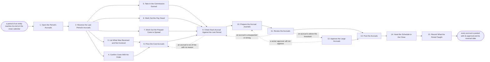

# Reference process: Book the Period-End Accruals

`ref/fin/book-the-period-end-accruals v1`

**value stream:** [Closing the books](../../streams/finance/closing-the-books.md)
A period has ended, and the books have to show what the company owes for
it even where no invoice has arrived and no payment has gone out. The
ledger-accountant agent opens the period's accruals and reverses the ones
the last period marked to reverse. The purchasing-coordinator agent lists
the goods and services received against an order and not yet invoiced,
and each budget owner confirms any cost incurred with no order or receipt
behind it. The commission-calculator agent supplies the commission earned
in the period and not yet paid. The ledger-accountant agent works out the
pay owed for days already worked from the last approved pay register, the
prepaid costs to spread over the period, and the cost of everything
received and not invoiced, and it sets each accrual beside the last
period and the invoices that have arrived since. It prepares the journals
with their support and their reversal dates. A named reviewer who
prepared none of them reviews the accruals, and those above
`<your threshold>` also go to each senior approver the delegation of
authority names before anything posts. The run closes when every accrual
is posted in the period with its approval and its reversal date, and the
schedule is with the close.

**delivers:** sheet, the period-end accrual schedule

## The goals

- Post every accrual within [3 working days] of the period end
- Land each cost accrual within [10%] of the invoice that follows
- Catch [98%] of costs incurred before the books close
- Keep the accrual work under [2 days] of accountant time each period

## The activities

| # | Activity | What happens | Agents |
|---|---|---|---|
| 1 | Open the Period's Accruals | the period, the cutoff and the accruals marked to reverse | [ledger-accountant](../../agents/ledger-accountant.md) |
| 2 | Reverse the Last Period's Accruals | each accrual marked to reverse, reversed on the first day | ledger-accountant |
| 3 | List What Was Received and Not Invoiced | ordered goods and services received with no invoice yet | [purchasing-coordinator](../../agents/purchasing-coordinator.md) |
| 4 | Confirm Costs With No Order | services with no order or receipt, confirmed by owners | ledger-accountant · budget owner (person) |
| 5 | Take In the Commission Earned | commission earned and still unpaid, line by line | [commission-calculator](../../agents/commission-calculator.md) |
| 6 | Work Out the Pay Owed | days worked and not yet paid, and leave and bonus earned | ledger-accountant |
| 7 | Work Out the Prepaid Costs to Spread | each prepayment spread over the months it covers | ledger-accountant |
| 8 | Price the Cost Accruals | each cost priced from its order, its contract or its rate | ledger-accountant |
| 9 | Check Each Accrual Against the Last Period | each accrual beside the last period and the invoices since | ledger-accountant |
| 10 | Prepare the Accrual Journals | each with its support, its accounts and its reversal date | ledger-accountant |
| 11 | Review the Accruals | a named reviewer who prepared none reads each with support | accrual reviewer (person) |
| 12 | Approve the Large Accruals | each senior approver named for amounts above the threshold | senior approver (person) |
| 13 | Post the Accruals | posted in the period with the approval and the reversal date | ledger-accountant |
| 14 | Hand the Schedule to the Close | the accrual schedule and the posted journals, for the close | ledger-accountant |
| 15 | Record What the Period Taught | late invoices, missed costs and estimates that were off | ledger-accountant |

The commission figures are the ones `ref/rev/calculate-commission`
computed for the period, and Revenue operations keeps the calculation,
the approval and any dispute. Finance accrues what was earned and not yet
paid, and the commission is paid through payroll once the signed file
reaches `ref/hr/run-payroll`. The pay owed is worked out from the
registers that `ref/hr/run-payroll` approved, and Finance never runs a
second payroll to find it. What was received comes from the receipts
recorded against orders at `ref/fin/issue-a-purchase-order`, and an
invoice that arrives after the cutoff is matched at
`ref/fin/process-a-supplier-invoice`. Each accrual journal is approved
under the same rules as `ref/fin/post-a-manual-journal-entry`, and the
accrual accounts are reconciled at
`ref/fin/reconcile-a-balance-sheet-account`.

## The graph



## The document, with the blanks marked

```
PROCESS: book the period-end accruals id: <team>/book-the-period-end-accruals   v1
from: ref/fin/book-the-period-end-accruals v1
owner: <who>                          effective: <date>
trigger: a period of an entity reaches its end on <your close calendar>
         watch: record=<accounting period> system=<your general ledger>
                change=<the period end passes>
concurrency: runs may overlap across entities - one period of one entity
             is one run, an entity has one run open at a time, and the
             next period's run starts only once this one has posted
goal: every cost incurred, commission earned, day of pay worked and
      prepaid cost of <the period> accrued with its support, reviewed by a
      named person who prepared none of it, and posted with its reversal
      date within <days> of the period end
phases:
  open-accruals        - system: the period opened with its dates, the
                         cutoff for receipts, and the accruals the last
                         period marked to reverse
                         owner: ledger-accountant   after: trigger
                         automation: <level>
  reverse-last-period  - system: each accrual the last period marked to
                         reverse, reversed on the first day of this period
                         under the approval it carried
                         owner: ledger-accountant
                         after: open-accruals       automation: <level>
  list-received        - runs collect-and-report: every receipt recorded
                         against an order in <your ERP> by the cutoff with
                         no invoice matched to it, with the order line, the
                         quantity and the price
                         owner: purchasing-coordinator
                         after: reverse-last-period automation: <level>
  confirm-costs        - human: each budget owner confirms the services
                         used in the period that have no order or receipt
                         behind them, such as a utility or a contractor's
                         hours, with the evidence
                         owner: <your budget owner role>
                         after: reverse-last-period by: <days>
                         automation: never
  take-in-commission   - system: the commission earned in the period and
                         not yet paid, from ref/rev/calculate-commission at
                         its version, with each line naming the deal and
                         the plan behind it
                         owner: commission-calculator
                         after: reverse-last-period automation: <level>
  work-out-pay-owed    - runs assessment: the pay owed for days worked
                         after the last payday, and the leave and bonus
                         earned and not yet paid, worked out from the
                         registers ref/hr/run-payroll approved under <your
                         accounting framework>
                         owner: ledger-accountant
                         after: reverse-last-period automation: <level>
  spread-prepaid-costs - runs assessment: each prepayment on the schedule
                         spread over the months it covers, with the part
                         that belongs to this period
                         owner: ledger-accountant
                         after: reverse-last-period automation: <level>
  price-cost-accruals  - runs assessment: each received and confirmed cost
                         priced from its order, its contract or its rate,
                         with any cost below <your accrual threshold> left
                         out under <your accrual policy>
                         owner: ledger-accountant
                         after: list-received + confirm-costs
                         automation: <level>
  check-accruals       - runs assessment: each accrual set beside the last
                         period and the invoices that arrived since, and
                         each one out of line by more than <threshold>
                         traced to its cause
                         owner: ledger-accountant
                         after: price-cost-accruals + take-in-commission +
                         work-out-pay-owed + spread-prepaid-costs
                         automation: <level>
  prepare-journals     - human: the accrual journals drafted in <your
                         general ledger>, each with its support, its
                         accounts and its reversal date
                         owner: ledger-accountant
                         after: check-accruals      automation: <level>
  review-accruals      - convenes approval: <your accrual reviewer role>,
                         who prepared none of the accruals, reads each
                         journal with its support and approves it at its
                         version
                         owner: <your accrual reviewer role>
                         after: prepare-journals    by: <hours>
                         automation: never
  approve-large        - convenes approval: each accrual above <your
                         threshold> approved at the same version by each
                         senior approver <your delegation of authority>
                         names
                         owner: <your senior approver role>
                         after: review-accruals, when an accrual is above
                         the threshold              by: <hours>
                         automation: never
  post-accruals        - system: the approved journals posted in the
                         period in <your general ledger>, each marked with
                         its reversal date and its approvals
                         owner: ledger-accountant
                         after: review-accruals, and approve-large when it
                         ran                        automation: <level>
  hand-to-close        - system: the accrual schedule and the posted
                         journals handed to ref/fin/close-the-month, and
                         the accrual accounts named for their
                         reconciliation
                         owner: ledger-accountant
                         after: post-accruals       automation: <level>
  record-learning      - convenes debrief: which invoices arrived late,
                         which costs were missed, how far each estimate
                         was from its invoice, and what the next period
                         does differently
                         owner: ledger-accountant
                         after: hand-to-close       automation: <level>
run-scoped:
  cutoff   - runs roll-call                     owner: ledger-accountant
             every: <cadence>
             from: open-accruals       until: check-accruals
handoffs:
  open-accruals -> reverse-last-period [accrual-period]: the dates, the
    cutoff and the accruals marked to reverse
  reverse-last-period -> list-received / confirm-costs /
    take-in-commission / work-out-pay-owed / spread-prepaid-costs
    [reversed-accruals]: each reversal posted, with the date
  list-received -> price-cost-accruals [received-not-invoiced]: each
    receipt with no invoice, with its order line, quantity and price
  confirm-costs -> price-cost-accruals [confirmed-costs]: each cost with no
    order, with its owner's confirmation and evidence
  take-in-commission -> check-accruals [commission-earned]: the commission
    earned and not yet paid, line by line
  work-out-pay-owed -> check-accruals [pay-owed]: the pay owed and the
    leave and bonus earned, with the register behind each
  spread-prepaid-costs -> check-accruals [prepaid-spread]: the part of
    each prepayment that belongs to this period
  price-cost-accruals -> check-accruals [priced-costs]: each cost accrual
    with its price and the source of the price
  check-accruals -> prepare-journals [checked-accruals]: each accrual set
    beside the last period, with any large movement explained
  prepare-journals -> review-accruals [draft-journals]: the journals at a
    version, each with its support and its reversal date
  review-accruals -> approve-large / post-accruals [reviewed-journals]:
    the journals as the reviewer approved them. A change to any line voids
    the approval
  approve-large -> post-accruals [senior-approval]: each senior approver's
    approval of the same version
  post-accruals -> hand-to-close [posted-accruals]: the journals as
    posted, with their ledger references and reversal dates
  hand-to-close -> record-learning [accrual-schedule]: the schedule as the
    close received it
deviations:
  check-accruals -> price-cost-accruals [accrual-out-of-line]: an accrual
    moved from the last period by more than <threshold> with no reason, so
    it is priced again from its source
  review-accruals -> check-accruals [accrual-unsupported]: the reviewer
    finds an accrual unsupported or wrong, so it is worked out again and
    checked before the journal returns
  approve-large -> prepare-journals [senior-approver-refuses]: a senior
    approver will not approve, so the journal is prepared again on the
    lines that approver named
bindings:
  roster:  <who holds each role - agents claiming the abstract agents
           above, and named people for the budget owners, the accrual
           reviewer, the senior approvers and the controller>
  systems: the general ledger (write), the ERP (read), <your close
           calendar> (read), the payroll system (read), the commission
           records (read), the document store (write), the notification
           channel (write)
  data:    <your accrual policy> <version>, <your accrual threshold>
           <version>, <your accounting framework> <version>, <your
           delegation of authority> <version>, the prepaid cost schedule
           <version>
policy:
  no accrual posts before a named reviewer who prepared none of the
    accruals has approved it at its version, and a change to any line
    voids the approval
  an accrual above <your threshold> posts only once each senior approver
    that <your delegation of authority> names has approved it
  every accrual carries its support, such as the order and the receipt,
    the owner's confirmation, the commission lines or the pay register
  every accrual carries a reversal date or a reason why it does not
    reverse
  the commission accrued is the commission ref/rev/calculate-commission
    computed, and Finance changes no commission figure
  the pay owed is worked out from the registers ref/hr/run-payroll
    approved, and the accrual never pays anyone
  accruals follow <your accounting framework> and <your accrual policy>,
    and a cost below <your accrual threshold> is left out only as that
    policy allows
measures:
  cycle time: <days> from the period end to the accruals posted
  accuracy: <target> share of cost accruals within <percent> of the
            invoice that followed
  volume: <accruals per period>
  quality gate: every posted accrual carries its support, a reversal date
                and the approval of a named person who prepared none of
                it
```

## The failure edges

- **A budget owner does not confirm a cost by the cutoff.** The
  ledger-accountant agent accrues on the evidence it has, such as the
  contract rate or the last invoice, marks the accrual as unconfirmed, and
  tells the reviewer. The budget owner's confirmation or correction goes
  into the next period's check.
- **An accrual is out of line with no reason.** An accrual that moved from
  the last period by more than the threshold is priced again from its
  order, its contract or its rate. A figure that nobody can trace to a
  source never reaches a journal because it is close to last month's.
- **The commission figures are not ready.** Where
  `ref/rev/calculate-commission` has not computed the whole period by the
  cutoff, the commission-calculator agent supplies the figures it has
  computed so far, the accrual is marked as incomplete, and the reviewer
  is told. The difference is set right in the next period once the full
  figures arrive, and Finance changes no commission figure.
- **The reviewer finds an accrual unsupported or wrong.** It is worked
  out again from its source and checked before the journal returns to
  the reviewer. The other accruals post once approved, so one open
  question does not hold the whole period.
- **A senior approver will not approve.** The journal is prepared again on
  the lines that approver named. Where the close cannot wait, the
  controller decides whether the period closes without that accrual, and
  the reason is recorded with the close.
- **An invoice arrives after the accrual posts.** It is matched at
  `ref/fin/process-a-supplier-invoice`, the accrual reverses on its date,
  and the difference between the two goes into the next period's check.
- **The trigger fires while a run is in flight.** An entity has one run
  open at a time. The next period's run starts only once this one has
  posted, so no accrual is reversed before it was ever posted.
- **A run is abandoned.** The run cannot finish, for example when the
  ledger is down at the period end. No unreviewed accrual posts. The run
  starts again from the last posted reversal, and the controller decides
  whether the close date moves.
