# Reference process: Calculate the Tax Provision

`ref/fin/calculate-the-tax-provision v1`

**value stream:** [Filing and paying tax](../../streams/finance/filing-and-paying-tax.md)
A quarter or a year has closed far enough at `ref/fin/close-the-month`
for the results before tax to be final, and the income tax in the
accounts has to be worked out for each entity under
`<your accounting framework>` and the rules of each jurisdiction where it
owes tax. The reporting-accountant agent supplies each entity's results
before tax at a version. The tax-analyst agent asks the head of tax to
confirm the rates and rules each jurisdiction applies for the period,
carries in each difference between a past provision and the return since
filed for it, and finds each item the tax rules treat differently from
the accounts. It works out the current tax each entity owes and the
deferred tax on each difference that reverses in a later year and on each
loss carried forward, and it sets out every uncertain position and every
deferred tax asset whose recovery is in doubt for a named person to
decide. The head of tax decides each one, and the chief financial officer
(CFO) decides those above `<your threshold>`. The tax-analyst agent
reconciles the tax charge to the headline rate in each jurisdiction and
explains every movement from the last period, and the head of tax
approves the provision. The entry is approved and posted at
`ref/fin/post-a-manual-journal-entry`, and the reporting-accountant agent
brings the tax into the group accounts and drafts the tax note with the
tax-analyst agent. The run closes when the provision is approved, posted
and in the consolidated trial balance, and the tax note is reviewed and
ready for the financial statements.

**delivers:** report, the period's tax provision

**starts:** on a schedule, the results before tax for a quarter or a year are final at the close

## The goals

- Deliver the provision within [4 working days] of the results before tax
- Keep each year's provision within [5%] of the tax in the returns filed for it
- Have [zero] adjustments to the provision proposed by the external auditor
- Keep outside adviser fees for the provision within [10%] of their budget

## The activities

| # | Activity | What happens | Agents |
|---|---|---|---|
| 1 | Supply the Results Before Tax | each entity's results from the closed ledger, at a version | [reporting-accountant](../../agents/reporting-accountant.md) |
| 2 | Confirm the Rates and Rules | each jurisdiction's rates, and any change the period brings | [tax-analyst](../../agents/tax-analyst.md) · head of tax (person) |
| 3 | Carry In the Return Differences | each gap between a past provision and its filed return | tax-analyst |
| 4 | Find the Differences From the Accounts | each item the tax rules treat differently from the accounts | tax-analyst |
| 5 | Work Out the Current Tax | the tax each entity owes for the period, by jurisdiction | tax-analyst |
| 6 | Work Out the Deferred Tax | the tax on timing differences and on losses carried forward | tax-analyst |
| 7 | Set Out Each Judgment | each uncertain position and asset in doubt, with support | tax-analyst |
| 8 | Decide Each Judgment | the head of tax decides, and the CFO above the threshold | head of tax (person) · CFO (person) |
| 9 | Reconcile the Effective Rate | the tax charge against the headline rate, item by item | tax-analyst |
| 10 | Compare With the Last Period | each movement in the charge and the balances explained | tax-analyst |
| 11 | Approve the Provision | a named person who prepared none of it approves it | head of tax (person) |
| 12 | Hand the Provision to the Ledger | the entry and its support, for approval and posting | tax-analyst |
| 13 | Bring the Tax Into the Group Accounts | the posted tax in the consolidated trial balance | reporting-accountant |
| 14 | Draft the Tax Note | the disclosures the framework asks for on income tax | reporting-accountant · tax-analyst |
| 15 | Review the Tax Note | the head of tax and the controller read it | head of tax (person) · controller (person) |
| 16 | Record What the Provision Taught | late items, return differences and what changes next period | tax-analyst |

The results before tax come from `ref/fin/close-the-month` for a quarter
and from the year-end close for the year, and the tax note goes into the
statements drafted and signed at `ref/fin/prepare-the-financial-statements`.
The differences between each year's provision and its return come from
`ref/fin/file-the-income-tax-return`, and an amount an authority assesses
comes from `ref/fin/respond-to-a-tax-notice` or
`ref/fin/respond-to-a-tax-audit`. The latest outlook for the effective
rate is read from `ref/fin/reforecast-the-year`. At the year end the
external auditor's questions on the provision arrive through
`ref/fin/run-the-external-audit`, and the tax accounts are reconciled
each month at `ref/fin/reconcile-a-balance-sheet-account`.

## The graph

```mermaid
flowchart LR
  T([the results before tax for a quarter or a year are final at the close]) --> A1[1. Supply the Results Before Tax]
  A1 --> A2[2. Confirm the Rates and Rules]
  A2 --> A3[3. Carry In the Return Differences]
  A3 --> A4[4. Find the Differences From the Accounts]
  A4 --> A5[5. Work Out the Current Tax]
  A4 --> A6[6. Work Out the Deferred Tax]
  A5 --> A7[7. Set Out Each Judgment]
  A6 --> A7
  A7 --> A8[8. Decide Each Judgment]
  A8 --> A9[9. Reconcile the Effective Rate]
  A9 --> A10[10. Compare With the Last Period]
  A10 -. a movement from the last period has no explanation .-> A4
  A10 --> A11[11. Approve the Provision]
  A11 -. the head of tax sends the provision back .-> A4
  A11 --> A12[12. Hand the Provision to the Ledger]
  A12 --> A13[13. Bring the Tax Into the Group Accounts]
  A13 -. the results before tax change after a late entry .-> A1
  A13 --> A14[14. Draft the Tax Note]
  A14 --> A15[15. Review the Tax Note]
  A15 -. the reviewers send the note back .-> A14
  A15 --> A16[16. Record What the Provision Taught]
  A16 --> DONE([the provision is approved, posted and in the group accounts, and the tax note is ready])
```



## The document, with the blanks marked

```
PROCESS: calculate the tax provision  id: <team>/calculate-the-tax-provision   v1
from: ref/fin/calculate-the-tax-provision v1
owner: <who>                          effective: <date>
trigger: the close calendar for a quarter or a year reaches the tax
         provision task, with the results before tax marked final in
         <your general ledger>
         watch: record=<close period> system=<your close calendar>
                change=<the results before tax are marked final>
concurrency: one quarter or one year for the group is one run, and a
             period has one provision open at a time. A provision worked
             out again after a late entry belongs to the run it corrects,
             and the next period's run reads this run's record
goal: the current and deferred income tax for every entity worked out
      under <your accounting framework>, every uncertain position and
      every doubtful deferred tax asset decided by a named person, the
      provision approved and posted by <the close day>, and the tax note
      reviewed and ready for the financial statements
phases:
  supply-results       - system: each entity's results before tax from
                         <your general ledger> after the close entries, at
                         a version, with the trial balance they came from
                         owner: reporting-accountant
                         after: trigger             automation: <level>
  confirm-rates        - runs assessment: the rates and rules each
                         jurisdiction applies for the period read against
                         the last provision, including any change in law
                         that <your accounting framework> says the period
                         must reflect, and <your head of tax role> asked to
                         confirm each one
                         owner: tax-analyst         after: supply-results
                         by: <days>                 automation: <level>
  carry-in-returns     - runs allocate-and-reconcile: each difference
                         between a past provision and the return since
                         filed for it at ref/fin/file-the-income-tax-return,
                         and each amount agreed or assessed after a notice
                         or an audit
                         owner: tax-analyst         after: confirm-rates
                         automation: <level>
  find-differences     - runs assessment: each item the tax rules treat
                         differently from the accounts, such as a cost the
                         rules never allow or income and costs taxed in a
                         different year, worked out entity by entity
                         owner: tax-analyst
                         after: carry-in-returns    automation: <level>
  current-tax          - system: the tax each entity owes for the period in
                         each jurisdiction after credits and losses, set
                         against the instalments already paid
                         owner: tax-analyst
                         after: find-differences    automation: <level>
  deferred-tax         - system: the tax on each difference that reverses
                         in a later year and on each loss and credit
                         carried forward, at the rate <your accounting
                         framework> says to use
                         owner: tax-analyst
                         after: find-differences    automation: <level>
  set-out-judgments    - runs assessment: each position an authority might
                         challenge, with its support, the amount at stake
                         and the reading of <your accounting framework> on
                         uncertain tax, and each deferred tax asset whose
                         recovery rests on future profits, with the
                         evidence for and against
                         owner: tax-analyst
                         after: current-tax + deferred-tax
                         automation: <level>
  decide-judgments     - convenes decide-and-announce: <your head of tax
                         role> decides each judgment in writing, and <your
                         CFO role> decides each one above <your threshold>
                         in <your delegation of authority>
                         owner: <your head of tax role>
                         after: set-out-judgments   by: <days>
                         automation: never
  reconcile-rate       - runs allocate-and-reconcile: the tax charge set
                         against the results before tax at the headline
                         rate in each jurisdiction, with each item between
                         them named
                         owner: tax-analyst
                         after: decide-judgments    automation: <level>
  compare-last         - runs assessment: the charge, the balances and the
                         effective rate set beside the last period and the
                         latest forecast, and every movement beyond <your
                         tolerance> explained
                         owner: tax-analyst         after: reconcile-rate
                         automation: <level>
  approve-provision    - convenes approval: <your head of tax role>
                         approves the provision at its version as a named
                         person who prepared none of it
                         owner: <your head of tax role>
                         after: compare-last        by: <days>
                         automation: never
  hand-to-ledger       - system: the provision entry for each entity, with
                         its support, sent for approval and posting at
                         ref/fin/post-a-manual-journal-entry
                         owner: tax-analyst
                         after: approve-provision   automation: <level>
  consolidate-tax      - runs allocate-and-reconcile: the posted tax
                         brought into the consolidated trial balance
                         entity by entity, and agreed to the approved
                         provision
                         owner: reporting-accountant
                         after: hand-to-ledger, once the entry is posted
                         automation: <level>
  draft-tax-note       - human: the tax note drafted under <your accounting
                         framework>, with the rate reconciliation, the
                         deferred tax balances and the uncertain positions
                         as the framework asks for them, from the
                         tax-analyst agent's schedules
                         owner: reporting-accountant
                         after: consolidate-tax     automation: <level>
  review-tax-note      - convenes approval: <your head of tax role> and
                         <your controller role> read the note against the
                         approved provision before it goes to
                         ref/fin/prepare-the-financial-statements
                         owner: <your head of tax role>
                         after: draft-tax-note      by: <days>
                         automation: <level>
  record-learning      - convenes debrief: which items arrived late, how
                         far past provisions moved from their returns, what
                         the auditor asked, and what the next period does
                         differently
                         owner: tax-analyst         after: review-tax-note
                         automation: <level>
run-scoped:
  close-day  - runs roll-call               owner: tax-analyst
               every: <cadence>
               from: supply-results   until: hand-to-ledger
  workpapers - runs collect-and-report      owner: tax-analyst
               from: carry-in-returns until: run close
handoffs:
  supply-results -> confirm-rates [results-before-tax]: each entity's
    results before tax and the trial balance, at a version
  confirm-rates -> carry-in-returns [period-rates]: the rates and rules
    for each jurisdiction, and what the head of tax confirmed has changed
  carry-in-returns -> find-differences [return-differences]: each
    difference from a past provision and each assessed amount, with its
    source
  find-differences -> current-tax / deferred-tax [tax-differences]: each
    item the rules treat differently, entity by entity
  current-tax -> set-out-judgments [current-tax]: the tax owed by each
    entity in each jurisdiction, and the instalments set against it
  deferred-tax -> set-out-judgments [deferred-tax]: the deferred tax on
    each difference, loss and credit, at its rate
  set-out-judgments -> decide-judgments [open-judgments]: each uncertain
    position and each doubtful asset with its support and the amount at
    stake
  decide-judgments -> reconcile-rate [judgment-decisions]: each judgment
    decided, with who decided it and when
  reconcile-rate -> compare-last [rate-reconciliation]: the charge set
    against the headline rate, with each item named
  compare-last -> approve-provision [compared-provision]: the provision
    with every movement from the last period explained
  approve-provision -> hand-to-ledger [approved-provision]: the provision
    as approved, at its version. A change to any figure voids the approval
  hand-to-ledger -> consolidate-tax [provision-entry]: the entry for each
    entity and its support, and the posting reference once it is posted
  consolidate-tax -> draft-tax-note [consolidated-tax]: the tax in the
    consolidated trial balance, agreed to the approved provision
  draft-tax-note -> review-tax-note [draft-tax-note]: the note at a
    version, with each figure traced to the provision
  review-tax-note -> record-learning [reviewed-tax-note]: the note as the
    reviewers approved it, at its version
deviations:
  compare-last -> find-differences [movement-unexplained]: a movement from
    the last period has no explanation, so the differences behind it are
    found again before the provision goes on
  approve-provision -> find-differences [head-of-tax-sends-back]: the head
    of tax sends the provision back, so the lines named are worked out
    again from the differences
  consolidate-tax -> supply-results [results-change]: a late entry changes
    the results before tax after the provision is worked out, so the
    provision is worked out again from the new results
  review-tax-note -> draft-tax-note [note-sent-back]: the reviewers send
    the note back, so it is drafted again on their points
bindings:
  roster:  <who holds each role - agents claiming the abstract agents
           above, or an outside tax adviser where it prepares part of the
           provision for the company, and named people for the head of
           tax, the CFO and the controller>
  systems: <your general ledger> (read), <your consolidation system>
           (read), <your close calendar> (read), <your tax workpapers>
           (write), the document store (write), the notification channel
           (write)
  data:    <your accounting framework> <version>, each jurisdiction's
           rates and rules for the period, the last provision and its
           workpapers, the returns filed since the last year end, <your
           delegation of authority> <version>, <your tolerance> for
           movements, the latest forecast from ref/fin/reforecast-the-year
policy:
  every uncertain position and every doubtful deferred tax asset is
    decided in writing by <your head of tax role>, or by <your CFO role>
    above <your threshold>, and the agents never decide one
  the provision is approved by a named person who prepared none of it
    before its entry is sent for posting, and a change to any figure after
    approval voids the approval
  the entry posts only through ref/fin/post-a-manual-journal-entry,
    approved by the people <your delegation of authority> names, and never
    straight to the ledger
  the provision is worked out from results before tax at a version, and a
    late entry that changes them reopens the provision
  each rate and rule is the one <your accounting framework> says the
    period must reflect, confirmed by <your head of tax role>
  every movement from the last period beyond <your tolerance> is explained
    in writing before approval
  a judgment rests only on the facts and the support set out for it, and
    the provision is never worked back from a rate someone wants to report
  nothing from the provision is reported outside the company before the
    financial statements are signed at
    ref/fin/prepare-the-financial-statements
measures:
  cycle time: <days> from the results before tax to the provision posted
  accuracy: <share> difference between each year's provision and its
            returns
  audit: <provision adjustments proposed by the external auditor per year>
  volume: <entities and jurisdictions in the provision>
  quality gate: every figure traces to the results at a version and to a
                rule, and every judgment to a named decision
```

## The failure edges

- **The results before tax change after the provision is worked out.** A
  late close entry reopens the provision, and it is worked out again from
  the new results at their version. The tax-analyst agent shows what
  moved, and the head of tax approves the new provision before any entry
  posts.
- **A rate or a rule changes during the period.** The head of tax confirms
  when `<your accounting framework>` says the change must be reflected,
  and the tax-analyst agent works out its effect on the current and the
  deferred tax and names it in the rate reconciliation.
- **An entity's figures arrive late.** The close-day roll-call raises it at
  the warning point the company sets. The head of tax decides whether that
  entity's tax is estimated for this run, and an estimate is marked as one
  and replaced once the figures arrive.
- **A movement from the last period has no explanation.** The differences
  behind it are found again. The provision does not go to approval with a
  movement nobody has explained in writing.
- **A judgment is close.** The tax-analyst agent sets out the facts, the
  support and the amount at stake, and the head of tax asks the outside
  tax adviser where the doubt calls for it. A judgment above
  `<your threshold>` goes to the CFO, and each decision is recorded with
  its reasons.
- **The head of tax sends the provision back.** The lines named are worked
  out again from the differences and go back through the comparison with
  the last period.
- **The posted tax does not agree with the approved provision.** The
  reporting-accountant agent names the difference, and the entry is
  corrected through `ref/fin/post-a-manual-journal-entry`. Nothing is
  patched in the consolidation alone.
- **The auditor proposes an adjustment.** The proposal arrives through
  `ref/fin/run-the-external-audit`, where named people decide it. An
  agreed adjustment reopens the provision, and the reasons go into the
  record for the next period.
- **The trigger fires while a run is in flight.** A period has one
  provision open at a time. A late entry reopens the open run, and the
  next period's run waits until this one is posted.
- **A run is abandoned.** The period's close is reopened before the
  provision is posted. The head of tax confirms it in writing, nothing is
  posted from the abandoned run, and the next run starts from the new
  results.
