# Reference process: Change a Bank Account or Signer

`ref/fin/change-a-bank-account-or-signer v1`

**value stream:** [Cash and banking](../../streams/finance/cash-and-banking.md)
Someone has asked to open or close one of the company's bank accounts, or
to add, change or remove a person who may sign for an account or release
payments from it, or a leaver or a mover who holds that authority has
been recorded in Human resources. The treasury-analyst agent takes in the
request with the account, the entity, the person and the reason, and for
a leaver it has the leaver's access to every bank portal removed at the
end of the last day, whatever else is still open. It reads the account
as it stands on the bank account record, the delegation-keeper agent
names who must approve a change of that kind at the version in force,
and the treasury-analyst agent checks that every account would still
have the releasers `<your dual control rule>` needs and that nobody would
both prepare and release the same payment. The named approvers approve
the change, with a resolution of the board where `<your bank>` asks for
one. For an account being closed, the payments into and out of it are
moved to another account and its balance is moved at
`ref/fin/move-cash-between-accounts`. The treasury-analyst agent fills in
the bank's own forms from the approved change, the signature-manager
agent gets them signed by the named signers and files them, and the
treasurer sends them through the channel the bank set for the
relationship and confirms the change with the bank through a contact
already on file. Two administrators set the access in the bank portal as
it was approved, and the people who use a new account are told. The run
closes when the bank has confirmed the change, the bank account record
shows it with the approval behind it, and the bank's own list of signers
and users matches the record.

**delivers:** status board, an updated bank account record

## The goals

- Complete each approved change with the bank within [10 working days]
- End [100%] of leavers' bank authority by the end of the last day
- Keep at least [2] people able to release payments on every account
- Keep the bank's list of signers matching the record on [100%] of accounts

## The activities

| # | Activity | What happens | Agents |
|---|---|---|---|
| 1 | Take In the Request | the account, the entity, the person and the reason | [treasury-analyst](../../agents/treasury-analyst.md) |
| 2 | End a Leaver's Access on the Last Day | each bank portal user the leaver holds, removed that day | treasury-analyst · portal administrator (person) |
| 3 | Read the Account as It Stands | the account, its signers, its releasers and their limits | treasury-analyst |
| 4 | Name the Approvers | who must approve a change of this kind | [delegation-keeper](../../agents/delegation-keeper.md) |
| 5 | Check Dual Control Still Holds | enough releasers on every account, and duties kept apart | treasury-analyst |
| 6 | Approve the Change | the named approvers, with a board resolution if needed | change approver (person) · company secretary (person) |
| 7 | Redirect a Closing Account | the payments into and out of it moved to another account | treasury-analyst |
| 8 | Move the Balance of a Closing Account | the balance moved before the bank closes the account | treasury-analyst |
| 9 | Fill In the Bank's Forms | the bank's forms and the documents it asks of each signer | treasury-analyst |
| 10 | Get the Forms Signed | each named signer signs, and the forms are filed | [signature-manager](../../agents/signature-manager.md) |
| 11 | Send the Forms to the Bank | through the channel the bank set for the relationship | treasurer (person) |
| 12 | Confirm the Change with the Bank | the bank's confirmation, checked with a known contact | treasurer (person) · treasury-analyst |
| 13 | Set the Access in the Bank Portal | each user and limit as approved, set by two administrators | portal administrator (person) · second administrator (person) |
| 14 | Tell the People Who Use a New Account | payables, payroll and billing, each through its own process | treasury-analyst |
| 15 | Update the Bank Account Record | the account, its signers and the approval behind each | treasury-analyst |
| 16 | Check the Bank's List Against the Record | the bank's own list of signers and users matches the record | treasury-analyst |
| 17 | Record What the Change Taught | delays, refusals, and what the next change does differently | treasury-analyst |

A leaver comes from the leaving checklist at `ref/hr/offboard-a-leaver`,
which tells treasury only that the person holds bank authority and the
last day, and a mover from `ref/hr/move-an-employee-to-a-new-role`. The
leaver's other accounts are closed in that process, and
`ref/fin/review-access-to-finance-systems` checks each period that the
bank portal users match this record and that nobody can both prepare and
approve the same thing. The balance of a closing account moves at
`ref/fin/move-cash-between-accounts`. A new account for customers to pay
into is announced to them by the billing lead through the contacts
already on file, and an old account stays open until payments into it
have stopped. A supplier's
bank details are changed at `ref/fin/change-a-suppliers-bank-details`,
outside this process.

## The graph

```mermaid
flowchart LR
  T([a request to open or close an account or change a signer, or a leaver or mover holds bank authority]) --> A1[1. Take In the Request]
  A1 -. the person holding authority is leaving .-> A2[2. End a Leaver's Access on the Last Day]
  A1 --> A3[3. Read the Account as It Stands]
  A2 --> A3
  A3 --> A4[4. Name the Approvers]
  A4 --> A5[5. Check Dual Control Still Holds]
  A5 -. the change would leave an account short of releasers or join duties .-> A1
  A5 --> A6[6. Approve the Change]
  A6 -. an approver refuses or changes the request .-> A1
  A6 -. the account is to be closed .-> A7[7. Redirect a Closing Account]
  A6 --> A9[9. Fill In the Bank's Forms]
  A7 --> A8[8. Move the Balance of a Closing Account]
  A8 --> A9
  A9 --> A10[10. Get the Forms Signed]
  A10 --> A11[11. Send the Forms to the Bank]
  A11 --> A12[12. Confirm the Change with the Bank]
  A12 -. the bank rejects the forms or asks for more .-> A9
  A12 --> A13[13. Set the Access in the Bank Portal]
  A13 -. the account is new .-> A14[14. Tell the People Who Use a New Account]
  A13 --> A15[15. Update the Bank Account Record]
  A14 --> A15
  A15 --> A16[16. Check the Bank's List Against the Record]
  A16 -. the bank's list does not match the record .-> A12
  A16 --> A17[17. Record What the Change Taught]
  A17 --> DONE([the bank has confirmed the change, and its list matches the record])
```



## The document, with the blanks marked

```
PROCESS: change a bank account or signer  id: <team>/change-a-bank-account-or-signer   v1
from: ref/fin/change-a-bank-account-or-signer v1
owner: <who>                          effective: <date>
trigger: a request to open or close a bank account, or to add, change or
         remove a person who may sign for an account or release payments
         from it, is recorded in <your treasury system>, or the leaving
         checklist at ref/hr/offboard-a-leaver or a move at
         ref/hr/move-an-employee-to-a-new-role names a person who holds
         that authority
         watch: record=<bank account change request>
                system=<your treasury system>
                change=<a request is recorded, or a leaver or a mover
                holds bank authority>
concurrency: runs may overlap - one change to one account is one run, a
             change to several accounts at the same bank may run as one,
             and a leaver's removal from every account runs as one run
             that goes ahead of any other open change
goal: the change approved by the people <your delegation of authority>
      names, signed on the bank's own forms, confirmed with the bank
      through a contact already on file, set in the bank portal and
      recorded with the approval behind it, every account still holding
      the releasers <your dual control rule> needs, and a leaver's
      authority ended by <the end of the last day>
phases:
  take-in-request    - system: the request recorded with the account, the
                       entity, the person, the change asked for, the
                       reason and who asked, and a request that came by
                       email alone confirmed with the person who made it
                       through a contact already on file
                       owner: treasury-analyst    after: trigger
                       automation: <level>
  end-leaver-access  - human: every bank portal user the leaver holds
                       removed by <your portal administrator role> at the
                       end of the last day, or at the time a named person
                       sets for a dismissal, ahead of the bank's forms
                       owner: <your portal administrator role>
                       after: take-in-request, when the person is leaving
                       by: <the end of the last day>
                       automation: never
  read-account       - runs collect-and-report: the account as it stands
                       on <your bank account record>, with its signers,
                       its releasers, their limits and the approval
                       behind each
                       owner: treasury-analyst
                       after: take-in-request, and end-leaver-access when
                       it ran                     automation: <level>
  name-approvers     - runs assessment: the approvers <your delegation of
                       authority> names for a change of this kind at the
                       version in force, and whether <your bank> needs a
                       resolution of the board
                       owner: delegation-keeper
                       after: read-account        automation: <level>
  check-dual-control - runs assessment: every account affected would
                       still have the releasers <your dual control rule>
                       needs, and nobody would hold the right both to
                       prepare and to release the same payment
                       owner: treasury-analyst
                       after: name-approvers      automation: <level>
  approve-change     - convenes approval: <your change approver role>
                       approves the change as named in <your delegation
                       of authority>, and <your company secretary role>
                       records the board's resolution where the bank
                       needs one
                       owner: <your change approver role>
                       after: check-dual-control  by: <days>
                       automation: never
  redirect-account   - system: every payment into and out of an account
                       being closed moved to the account the approval
                       names, with each team that pays from it or bills
                       customers into it told to make the change through
                       its own process
                       owner: treasury-analyst
                       after: approve-change, when the account is closing
                       automation: <level>
  move-balance       - system: the balance of the closing account moved
                       at ref/fin/move-cash-between-accounts, under that
                       process's approvals, before the bank is asked to
                       close it
                       owner: treasury-analyst
                       after: redirect-account    automation: <level>
  fill-in-forms      - human: the bank's own account or mandate forms
                       filled in from the approved change, with the
                       documents <your bank> and <your jurisdiction's
                       rules on identifying a bank's customers> ask of
                       each signer
                       owner: treasury-analyst
                       after: approve-change, and move-balance when it
                       ran                        automation: <level>
  get-forms-signed   - runs collect-and-report: the forms sent to each
                       named signer in the order the mandate sets, and
                       the executed forms filed with the approval and the
                       resolution they rest on
                       owner: signature-manager
                       after: fill-in-forms       by: <days>
                       automation: <level>
  send-forms         - human: <your treasurer role> sends the signed
                       forms to <your bank> through the channel the bank
                       set for the relationship
                       owner: <your treasurer role>
                       after: get-forms-signed    automation: never
  confirm-with-bank  - runs collect-and-report: the bank's written
                       confirmation of the change, checked by
                       <your treasurer role> with the bank through a
                       contact already on <your bank account record>
                       owner: <your treasurer role>
                       after: send-forms          by: <days>
                       automation: never
  set-portal-access  - human: each portal user and limit set as approved
                       by <your portal administrator role> and a second
                       administrator under <your dual control rule>
                       owner: <your portal administrator role>
                       after: confirm-with-bank   automation: never
  tell-users         - system: the details of a new account given to the
                       payables, payroll and billing teams, each to put
                       through its own process, with <your billing lead
                       role> telling the customers who will pay into it
                       through the contacts already on file
                       owner: treasury-analyst
                       after: set-portal-access, when the account is new
                       automation: <level>
  update-record      - system: <your bank account record> updated with
                       the account, its signers, its releasers and their
                       limits, each with its approval, its bank
                       confirmation and its dates
                       owner: treasury-analyst
                       after: set-portal-access, and tell-users when it
                       ran                        automation: <level>
  check-bank-list    - runs assessment: the bank's own list of signers
                       and the portal's list of users and limits set
                       beside the record, with every difference named
                       owner: treasury-analyst
                       after: update-record       by: <days>
                       automation: <level>
  record-learning    - convenes debrief: how long the bank took, which
                       forms came back, which approvals were slow, and
                       what the next change does differently
                       owner: treasury-analyst
                       after: check-bank-list     automation: <level>
run-scoped:
  status   - runs roll-call                     owner: treasury-analyst
             every: <cadence>
             from: take-in-request     until: check-bank-list
handoffs:
  take-in-request -> end-leaver-access / read-account [change-request]:
    the account, the entity, the person, the change, the reason and who
    asked
  end-leaver-access -> read-account [leaver-access-ended]: each portal
    user removed, and when
  read-account -> name-approvers [account-as-it-stands]: the account, its
    signers, its releasers and their limits
  name-approvers -> check-dual-control [named-approvers]: the approvers
    for this change, and whether the bank needs a resolution
  check-dual-control -> approve-change [checked-change]: the change with
    the releasers left on each account and any duty it would join
  approve-change -> redirect-account / fill-in-forms [approved-change]:
    the change as approved, with the resolution where one was needed. A
    change to what was approved needs the approval again
  redirect-account -> move-balance [redirected-account]: the payments
    moved, and the people told
  move-balance -> fill-in-forms [balance-moved]: the closing account's
    balance moved, with the transfer's confirmation
  fill-in-forms -> get-forms-signed [bank-forms]: the bank's forms at a
    version, with the documents the bank asks for
  get-forms-signed -> send-forms [signed-forms]: the executed forms as
    filed
  send-forms -> confirm-with-bank [sent-forms]: the forms as sent, the
    channel and the date
  confirm-with-bank -> set-portal-access [bank-confirmation]: the bank's
    written confirmation, and the contact it was checked with
  set-portal-access -> tell-users / update-record [portal-set]: each user
    and limit set, and the two administrators who set them
  tell-users -> update-record [users-told]: each team and customer told
    of a new account, and when
  update-record -> check-bank-list [updated-record]: the record with the
    change, its approval and its confirmation
  check-bank-list -> record-learning [matched-list]: the bank's list and
    the portal's list matched to the record
deviations:
  check-dual-control -> take-in-request [dual-control-broken]: the change
    would leave an account short of releasers or let one person both
    prepare and release, so the request comes back with a second change
    that keeps dual control, and a leaver's removal goes ahead either way
  approve-change -> take-in-request [approver-refuses]: an approver
    refuses or changes the request, so it is taken in again as the
    approver named it
  confirm-with-bank -> fill-in-forms [bank-asks-for-more]: the bank
    rejects the forms or asks for more, so the forms are filled in again
    and signed again
  check-bank-list -> confirm-with-bank [list-does-not-match]: the bank's
    list or the portal's list does not match the record, so the
    treasurer takes the difference to the bank through a known contact
bindings:
  roster:  <who holds each role - agents claiming the abstract agents
           above, and named people for the treasurer, the change
           approvers, the company secretary, the signers on each account
           and the two portal administrators>
  systems: <your treasury system> (write), <your bank account record>
           (write), each bank's portal (read), <your HR system> (read),
           the signature system (trigger), the notification channel
           (write)
  data:    <your delegation of authority> <version>, <your dual control
           rule> <version>, <your treasury policy> <version>, each
           bank's mandate and forms <version>, <your jurisdiction's
           rules on identifying a bank's customers> <version>
policy:
  every account opened, closed or changed, and every signer or releaser
    added or removed, is approved by the people <your delegation of
    authority> names at the version in force, and the approval is a human
    decision
  a request that arrives by email alone, or from someone outside the
    company, is confirmed with the person who made it through a contact
    already on file before it goes further, and the message that asked is
    never used to confirm it
  every account keeps the releasers <your dual control rule> needs, and
    nobody holds the right both to prepare and to release the same
    payment
  the bank's forms are signed only by the people the mandate and the
    approval name, and the agents sign nothing and send nothing to a bank
  the bank portal's users and limits are set by two administrators under
    <your dual control rule>, and the agents hold no administrator right
    in any bank portal
  a leaver's portal access ends at the end of the last day, ahead of the
    bank's forms, whatever else is still open
  an account is opened only at a bank <your treasury policy> allows, in
    the name of the entity that will use it
  each signer's identity documents go only to the bank that asks for
    them, and are kept only as long as <your jurisdiction's rules on
    personal data> allow
measures:
  cycle time: <days> from the approval to the bank's confirmation
  on time: <target> share of leavers whose bank authority ended by the
           end of the last day
  volume: <changes per period>
  quality gate: every account, signer and portal user on the bank's lists
                matches the record, with a named approval and a bank
                confirmation behind each
```

## The failure edges

- **A request arrives by email alone, or from outside the company.** It
  is treated as an attempt at fraud until the person who made it has
  confirmed it through a contact already on file. The message that asked
  for the change is kept as evidence and never used to confirm it, and a
  request that claims to come from a bank is checked with the bank
  through the contact on the record.
- **The change would leave an account short of releasers.** The
  treasurer names a second change that keeps dual control, such as a new
  releaser, before the removal goes ahead. A leaver's removal never waits
  for it, and until the new releaser is in place the chief financial
  officer (CFO) decides which payments wait.
- **An approver refuses or changes the request.** The request is taken in
  again as the approver named it, and the person who asked is told the
  reason.
- **The bank rejects the forms or asks for more.** The forms are filled
  in again and signed again by the named signers. Nobody signs a blank
  form or a form whose text differs from the approval.
- **The bank has not processed a leaver's removal by the last day.** The
  leaver's portal access is already removed, the treasurer asks the bank
  in writing to refuse any instruction from the leaver, and the run stays
  open until the bank confirms the removal.
- **The bank's list does not match the record.** The treasurer takes the
  difference to the bank through a known contact. A payment released by
  someone who is not on the record is treated as a suspected fraud and
  goes to the CFO the same day.
- **The trigger fires while a run is in flight.** One change to one
  account is one run. A leaver's removal goes ahead of any other open
  change on the same accounts, and a second request for the same account
  waits until the first is confirmed by the bank.
- **A run is abandoned.** The request is withdrawn or the bank refuses
  the change. Every step already taken is undone or recorded, an access
  already granted in the portal is removed, and the record shows the
  account as it stands with the reason the change stopped.
