# Reference process: Change a Supplier's Bank Details

`ref/fin/change-a-suppliers-bank-details v1`

**value stream:** [Buying and paying](../../streams/finance/buying-and-paying.md)
Someone asks to change the bank account a supplier is paid into, by
email, by letter, by phone, through the supplier portal or through a
colleague inside the company, and a false request of this kind is a common
way to steal from a company. The supplier-record-keeper agent logs the
request as it arrived, keeps the message and its attachments unchanged as
evidence, and holds the change, so every payment keeps going to the
account already on the record. The wire-check agent checks the channel,
the sender, the timing and the new account for the signs of fraud, and
finds a contact for the supplier that was on the record before the request
arrived. A person calls that contact, and the message that asked for the
change is never used to confirm it. A change the supplier does not confirm
is reported to the controller the same day as a suspected fraud. A named
approver who neither took the request nor made the call approves a
confirmed change, the supplier-record-keeper agent applies it on its date
with the old details kept, and the supplier hears of the change through
the contact on file. The wire-check agent marks the first payment to the
new account and confirms with the supplier, through the contact on file,
that it landed. The run closes when that first payment is confirmed, or
when the change is refused and reported, and the record shows who asked,
who confirmed and who approved.

**delivers:** status board, a confirmed change of bank details

**starts:** on an event, someone asks to change where a supplier is paid

## The goals

- Confirm [100%] of changes by a call to a contact already on file
- Apply each confirmed change within [3 working days] of the request
- Hold fewer than [1%] of payments past their due date while a change is confirmed
- Pay [0] invoices into an account that a false request named

## The activities

| # | Activity | What happens | Agents |
|---|---|---|---|
| 1 | Take in the Request | the request as received, with its channel, sender and date | [supplier-record-keeper](../../agents/supplier-record-keeper.md) |
| 2 | Keep the Request as Evidence | the message and its attachments kept unchanged on the record | supplier-record-keeper |
| 3 | Hold the Change | the details on record stay in force until it is approved | supplier-record-keeper |
| 4 | Check the Request | the channel, the sender, the timing and the signs of fraud | [wire-check](../../agents/wire-check.md) |
| 5 | Check the New Account | the account name and bank against the supplier's legal name | wire-check |
| 6 | Find the Contact on File | a contact on the supplier's record from before the request | wire-check |
| 7 | Confirm with the Supplier | a person calls that contact and records who confirmed | payables lead (person) |
| 8 | Report a Suspected Fraud | an unconfirmed change, to the controller the same day | wire-check · controller (person) |
| 9 | Approve the Change | a named approver who took neither the request nor the call | bank change approver (person) |
| 10 | Apply the Change on Its Date | the new details dated, and the old ones kept with dates | supplier-record-keeper |
| 11 | Tell the Supplier | a notice through the contact on file that details changed | supplier-record-keeper |
| 12 | Mark the First Payment | the first payment to the new account flagged for a check | wire-check |
| 13 | Confirm the First Payment Landed | the supplier confirms receipt through the contact on file | wire-check |
| 14 | Close the Change on the Record | who asked, who confirmed, who approved, and the evidence | supplier-record-keeper |
| 15 | Record What the Change Taught | the signs of fraud seen, and how long the confirmation took | wire-check · supplier-record-keeper |

The first payment to the new account is made in an ordinary run at
`ref/fin/pay-approved-invoices`, where the wire-check agent checks every
payment against the verified record, and an item that waits on a held
change stays out of a run with that reason. The same rule protects
employees' pay at `ref/hr/change-an-employee-record`. Who can change a
supplier's bank details in `<your ERP>` is checked each period at
`ref/fin/review-access-to-finance-systems`, and the bank details of a
supplier being set up for the first time are confirmed at
`ref/fin/set-up-a-supplier`.

## The graph

```mermaid
flowchart LR
  T([someone asks to change where a supplier is paid]) --> A1[1. Take in the Request]
  A1 --> A2[2. Keep the Request as Evidence]
  A1 --> A3[3. Hold the Change]
  A2 --> A4[4. Check the Request]
  A3 --> A4
  A4 --> A5[5. Check the New Account]
  A4 --> A6[6. Find the Contact on File]
  A5 --> A7[7. Confirm with the Supplier]
  A6 --> A7
  A7 -. the supplier does not confirm the change .-> A8[8. Report a Suspected Fraud]
  A7 --> A9[9. Approve the Change]
  A9 -. the approver finds a gap in the confirmation .-> A7
  A9 --> A10[10. Apply the Change on Its Date]
  A10 --> A11[11. Tell the Supplier]
  A10 --> A12[12. Mark the First Payment]
  A12 --> A13[13. Confirm the First Payment Landed]
  A13 -. the supplier did not receive the payment .-> A8
  A8 --> A14[14. Close the Change on the Record]
  A11 --> A14
  A13 --> A14
  A14 --> A15[15. Record What the Change Taught]
  A15 --> DONE([the change is confirmed, approved and applied with its first payment landed, or refused and reported])
```



## The document, with the blanks marked

```
PROCESS: change a supplier's bank details  id: <team>/change-a-suppliers-bank-details   v1
from: ref/fin/change-a-suppliers-bank-details v1
owner: <who>                          effective: <date>
trigger: a request to change the bank account a supplier is paid into
         arrives by any channel, such as the payables inbox, a letter, a
         call or <your supplier portal>, and is logged against the
         supplier's record in <your ERP>
         watch: record=<supplier record> system=<your ERP>
                change=<a change to the bank details is requested>
concurrency: runs may overlap across suppliers - one supplier has one
             change open at a time, a second request while one is open
             joins it and is treated as suspect, and the run stays open
             until the first payment to the new account is confirmed
goal: the supplier's new bank details confirmed by a person through a
      contact on the record from before the request, approved by a named
      person who neither took the request nor made the call, applied on
      their date with the old details kept, and the first payment to the
      new account confirmed as received, or the change refused and
      reported to <your controller role> the same day
phases:
  take-in-request    - system: the request logged as it arrived, with its
                       channel, its sender, its date and the details it
                       asks for
                       owner: supplier-record-keeper   after: trigger
                       automation: <level>
  keep-evidence      - system: the message, its headers and its
                       attachments kept unchanged on the supplier's record
                       as evidence, and never used to reply with a
                       confirmation
                       owner: supplier-record-keeper
                       after: take-in-request     automation: <level>
  hold-change        - system: the change held, the bank details on the
                       record kept in force, and every payment due to the
                       supplier named so it goes on to the account on the
                       record
                       owner: supplier-record-keeper
                       after: take-in-request     automation: <level>
  check-request      - runs assessment: the channel, the sender's address,
                       the timing against the next payment date, any
                       pressure to pay quickly and any other sign of
                       fraud, with a request by email alone recorded as an
                       attempted fraud until it is confirmed
                       owner: wire-check
                       after: keep-evidence + hold-change
                       automation: <level>
  check-account      - runs assessment: the new account name and bank set
                       against the supplier's legal name and its country,
                       and against accounts already on other records
                       owner: wire-check
                       after: check-request       automation: <level>
  find-contact       - runs assessment: a contact on the supplier's record
                       from before the request arrived, with the date it
                       was put there, and no contact detail taken from the
                       request
                       owner: wire-check
                       after: check-request       automation: <level>
  confirm-change     - human: <your bank detail confirmer role> calls that
                       contact, asks the supplier to state the new details
                       and reads them back, and records the person
                       reached, the number called, the date and the result
                       owner: <your bank detail confirmer role>
                       after: check-account + find-contact
                       by: <days>                 automation: never
  report-fraud       - convenes decide-and-announce: <your controller
                       role> reads the wire-check agent's report the same
                       day and decides what follows, such as warning the
                       supplier through the contact on file, asking <your
                       bank> to recall a payment and reporting the attempt
                       to <who>
                       owner: <your controller role>
                       after: confirm-change, when the supplier does not
                       confirm the change, or confirm-landed when the
                       payment did not land       automation: never
  approve-change     - convenes approval: <your bank change approver
                       role>, who neither took the request nor made the
                       call, approves the change at its version with the
                       evidence and the call record beside it
                       owner: <your bank change approver role>
                       after: confirm-change      by: <days>
                       automation: never
  apply-change       - system: the new bank details recorded in <your ERP>
                       with their effective date, the old ones kept with
                       their dates, and the hold lifted
                       owner: supplier-record-keeper
                       after: approve-change      automation: <level>
  tell-supplier      - system: a notice to the contact on file, and to the
                       supplier's remittance contact, that the bank details
                       changed and from what date
                       owner: supplier-record-keeper
                       after: apply-change        automation: <level>
  mark-first-payment - system: the first payment to the new account
                       flagged in <your ERP> for the wire-check agent to
                       check in the next payment run
                       owner: wire-check
                       after: apply-change        automation: <level>
  confirm-landed     - runs collect-and-report: the first payment that a
                       run at ref/fin/pay-approved-invoices made into the
                       new account matched to the bank's report, and the
                       supplier's confirmation through the contact on file
                       that it arrived
                       owner: wire-check
                       after: mark-first-payment  by: <days>
                       automation: <level>
  close-change       - system: the change closed on the record with who
                       asked, who confirmed, who approved, the evidence,
                       and the first payment or the report of the fraud
                       owner: supplier-record-keeper
                       after: tell-supplier + confirm-landed, or
                       report-fraud when the change was refused
                       automation: <level>
  record-learning    - convenes debrief: the signs of fraud seen, how long
                       the confirmation took, how many payments waited,
                       and what the next change does differently
                       owner: wire-check
                       after: close-change        automation: <level>
run-scoped:
  hold          - runs roll-call                owner: supplier-record-keeper
                  every: <cadence>
                  from: hold-change         until: apply-change
  first-payment - runs allocate-and-reconcile   owner: wire-check
                  from: mark-first-payment  until: confirm-landed
handoffs:
  take-in-request -> keep-evidence / hold-change [change-request]: the
    request as it arrived, its channel, its sender, its date and the
    details it asks for
  keep-evidence -> check-request [kept-request]: the message and its
    attachments, unchanged, with where they are kept
  hold-change -> check-request [held-change]: the change held, with the
    details on the record still in force and each payment due to the
    supplier named
  check-request -> check-account / find-contact [request-check]: the
    channel, the sender, the timing and each sign of fraud found
  check-account -> confirm-change [account-check]: the new account name
    and bank against the supplier's legal name and country
  find-contact -> confirm-change [contact-on-file]: the contact from the
    supplier's record, and the date it was put on the record
  confirm-change -> approve-change [confirmed-change]: who called, who
    confirmed, the number called, the date and the details read back
  confirm-change -> report-fraud [unconfirmed-change]: the request, the
    checks and the call, with what the person reached said
  approve-change -> apply-change [approved-change]: the change as
    approved, with the approver and the date. A change to any detail
    voids the approval
  apply-change -> tell-supplier / mark-first-payment [applied-change]: the
    new details with their effective date, and the old ones kept with
    their dates
  tell-supplier -> close-change [supplier-told]: the notice sent through
    the contact on file, and when
  mark-first-payment -> confirm-landed [marked-payment]: the first payment
    to the new account, with its run and its amount
  confirm-landed -> close-change [first-payment-landed]: the supplier's
    confirmation through the contact on file that the payment arrived
  confirm-landed -> report-fraud [payment-missing]: the payment the
    supplier did not receive, with the bank's report
  report-fraud -> close-change [fraud-report]: the controller's decision,
    what was done, and who was told
  close-change -> record-learning [closed-change]: who asked, who
    confirmed, who approved, the evidence and the first payment
deviations:
  confirm-change -> report-fraud [supplier-does-not-confirm]: the person
    reached through the contact on file does not confirm the change, so
    it is refused and reported as a suspected fraud the same day
  approve-change -> confirm-change [confirmation-incomplete]: the
    approver finds the call went to a contact that was not on file, or
    the details were not read back, so the call is made again
  confirm-landed -> report-fraud [payment-did-not-land]: the supplier did
    not receive the first payment, so the new account is treated as false
    until the controller decides, and the bank is asked to recall the
    payment
bindings:
  roster:  <who holds each role - agents claiming the abstract agents
           above, and named people for <your bank detail confirmer
           role>, <your bank change approver role> and <your controller
           role>>
  systems: <your ERP> (write), <your supplier portal> (read), the
           payables inbox (read), <your bank portal> (read), the
           notification channel (write)
  data:    <your supplier bank change procedure> <version>, <your fraud
           reporting procedure> <version>, <your delegation of
           authority> <version>
policy:
  a change to a supplier's bank details takes effect only once a person
    has confirmed it with the supplier through a contact on the record
    from before the request arrived, and a named approver has approved it
  the message that asked for the change, and any contact detail in it,
    is never used to confirm it
  a request that arrives by email alone is treated as an attempt at
    fraud until it is confirmed, and one the supplier does not confirm is
    reported to <your controller role> the same day
  the approver is someone other than whoever took the request and
    whoever made the call
  while a change is held, payments keep going to the account on the
    record, and a payment the supplier says it cannot receive there waits
    for the change
  the old details are kept with their dates, so a false change can be
    undone the day it is found
  the agents confirm no change, approve no change, and change no bank
    details on the record before the approval
  a change asked for close to a payment date, or with pressure to pay
    quickly, is recorded as suspect and checked like any other
measures:
  cycle time: <days> from the request to the change applied
  confirmed: <target> share of changes confirmed through a contact on
             file before approval
  volume: <changes per period>
  quality gate: every applied change has its request kept as evidence, a
                call to a contact on file recorded, an approval by
                someone who neither took the request nor made the call,
                and its first payment confirmed
```

## The failure edges

- **The request arrives by email alone.** It is treated as an attempt at
  fraud until a person has confirmed it through a contact on file,
  whoever it seems to come from, including a senior person inside the
  company. The wire-check agent records the sender's address and the
  headers, and the email is never answered with the confirmation.
- **There is no contact on file.** The wire-check agent finds a contact
  in the signed agreement or on the public record, and the controller
  approves its use in writing before the call. A contact that the
  request itself supplies is never used.
- **The supplier does not confirm the change.** The change is refused,
  the controller hears of it the same day as a suspected fraud, and the
  supplier is warned through the contact on file. Payments keep going to
  the account already on record.
- **The supplier says it can no longer receive at the old account.**
  Payments to the supplier wait for the change and are held at
  `ref/fin/pay-approved-invoices` with that reason. Pressure to pay
  quickly is never a reason to skip the call.
- **The first payment to the new account does not land.** The new
  account is treated as false until the controller decides, the bank is
  asked to recall the payment the same day, and the old details are
  restored from the record. Nothing is paid a second time on the hope
  that the first was lost.
- **The trigger fires while a run is in flight.** A supplier has one
  change open at a time. A second request while one is open joins it, is
  treated as suspect, and is confirmed in the same call.
- **A run is abandoned.** The supplier withdraws the request, or it
  cannot be reached through any contact on file. The change is closed
  unapplied with its evidence kept, and payments go on to the account
  already on record.
