# Reference process: Check the Debt Covenants

`ref/fin/check-the-debt-covenants v1`

**value stream:** [Cash and banking](../../streams/finance/cash-and-banking.md)
A loan or a credit facility reaches a date on which its covenants are
tested, usually once the quarter or the year it tests is closed, or a new
or amended facility is signed. The treasury-analyst agent holds each
facility as its dates, its covenants and the agreement's own definitions,
and opens the test with every covenant and every report that falls due.
The reporting-accountant agent supplies the figures the tests read from
the closed and signed-off accounts. The treasury-analyst agent works out
each financial covenant on the agreement's own definitions, with every
adjustment shown, and checks the other undertakings, such as the reports
the lenders are owed and the limits on further borrowing. The controller
works the calculation out again. The planning-analyst agent projects the
covenant figures forward from the latest forecast and reforecast, and the
treasury-analyst agent raises any breach at risk to the chief financial
officer (CFO) with the headroom, the date it would run out and the
options. The CFO decides the response with counsel before the lenders
hear of it. The treasury-analyst agent drafts the compliance certificate
on the lender's form, the controller reviews it, a named officer signs
it, and the treasurer sends it to the lenders through the channel the
agreement names by its date.
The run closes when every certificate and report the test owes has
reached the lenders, and the calculation, the certificate and the
lenders' acknowledgment are recorded.

**delivers:** document, a signed compliance certificate

## The goals

- Deliver [100%] of compliance certificates by the date the agreement sets
- Raise each breach at risk at least [2 quarters] before the test it would fail
- Raise no more than [one] warning a year for a test that then passes with room
- Have lenders question under [5%] of the certificates sent

## The activities

| # | Activity | What happens | Agents |
|---|---|---|---|
| 1 | Open the Test | the facilities, covenants and reports due, with their dates | [treasury-analyst](../../agents/treasury-analyst.md) |
| 2 | Read Each Covenant's Definitions | each term as the agreement and every amendment define it | treasury-analyst |
| 3 | Take In the Closed Figures | the figures the tests read, from the signed-off accounts | [reporting-accountant](../../agents/reporting-accountant.md) |
| 4 | Work Out Each Financial Covenant | each ratio as the agreement defines it, adjustments shown | treasury-analyst |
| 5 | Check the Other Undertakings | the reports owed and limits on debt, security and disposals | treasury-analyst |
| 6 | Check the Calculation Independently | the controller works each covenant out again | controller (person) |
| 7 | Project the Covenants Forward | the next tests, from the forecast and the reforecast | [planning-analyst](../../agents/planning-analyst.md) · treasury-analyst |
| 8 | Raise a Breach at Risk | the headroom, when it runs out, and the options | treasury-analyst |
| 9 | Decide the Response | the CFO, with counsel, decides before the lenders hear | CFO (person) · counsel (person) |
| 10 | Draft the Compliance Certificate | on the lender's form, with the calculation attached | treasury-analyst |
| 11 | Review the Certificate | the controller checks it against the calculation | controller (person) |
| 12 | Sign the Certificate | the named officer signs it | signing officer (person) |
| 13 | Send the Certificate to the Lenders | by its date, through the channel the agreement names | treasurer (person) |
| 14 | Record the Test | the calculation, the certificate and the acknowledgment | treasury-analyst |
| 15 | Record What the Test Taught | how close each covenant came, and what the next test changes | treasury-analyst |

The figures come from the accounts signed off at `ref/fin/close-the-month`
and, where a lender tests the reported figures for a quarter or a year,
from `ref/fin/prepare-the-financial-statements`. The reports the lenders
are owed, such as the annual accounts, go with the certificate once the
named officers have signed them in that process. The projection reads the
cash forecast at `ref/fin/forecast-cash` and the reforecast at
`ref/fin/reforecast-the-year`, and the interest and repayments of each
facility held here reach the cash forecast each week. A waiver or an
amendment the CFO agrees with the lenders is signed under
`<your delegation of authority>`, often by the board, and the agreement
is read at its amended version from the next test.

## The graph

```mermaid
flowchart LR
  T([a facility reaches a testing date, or a new or amended facility is signed]) --> A1[1. Open the Test]
  A1 --> A2[2. Read Each Covenant's Definitions]
  A1 --> A3[3. Take In the Closed Figures]
  A2 --> A4[4. Work Out Each Financial Covenant]
  A3 --> A4
  A2 --> A5[5. Check the Other Undertakings]
  A4 --> A6[6. Check the Calculation Independently]
  A6 -. the two workings disagree .-> A4
  A6 --> A7[7. Project the Covenants Forward]
  A7 -. a covenant could fail at this test or a later one .-> A8[8. Raise a Breach at Risk]
  A5 -. an undertaking is not met or will not be .-> A8
  A7 --> A10[10. Draft the Compliance Certificate]
  A5 --> A10
  A8 --> A9[9. Decide the Response]
  A9 -. the CFO asks for another projection .-> A7
  A9 --> A10
  A10 --> A11[11. Review the Certificate]
  A11 -. the certificate does not agree with the calculation .-> A10
  A11 --> A12[12. Sign the Certificate]
  A12 -. the officer will not sign as drafted .-> A10
  A12 --> A13[13. Send the Certificate to the Lenders]
  A13 --> A14[14. Record the Test]
  A14 --> A15[15. Record What the Test Taught]
  A15 --> DONE([the certificate and the reports have reached the lenders, and the test is recorded])
```



## The document, with the blanks marked

```
PROCESS: check the debt covenants     id: <team>/check-the-debt-covenants   v1
from: ref/fin/check-the-debt-covenants v1
owner: <who>                          effective: <date>
trigger: a testing date in a facility agreement held in <your facility
         record> comes up and the period it tests is signed off at
         ref/fin/close-the-month, or a new or amended facility is signed
         watch: record=<facility test date> system=<your facility record>
                change=<a test date comes up and its period is signed
                off, or a facility is signed or amended>
concurrency: runs may overlap across facilities - one test date of one
             facility is one run, facilities tested on the same date
             with the same figures may run as one, and a test waits for
             the period it reads to be signed off
goal: every covenant due at <the test date> worked out on the agreement's
      own definitions and checked by a second person, every breach at
      risk raised to <your CFO role> before the lenders hear of it, and
      the compliance certificate signed by <your signing officer role>
      and received by the lenders by <the date the agreement sets>
phases:
  open-test          - system: the test opened with each facility due,
                       its covenants, the reports the lenders are owed
                       and the date each falls due, and a new or amended
                       facility entered in <your facility record> with
                       its dates, its covenants and its definitions
                       owner: treasury-analyst    after: trigger
                       automation: <level>
  read-definitions   - runs assessment: each term each covenant uses read
                       as the agreement and every amendment define it,
                       with each place it differs from <your accounting
                       framework> named
                       owner: treasury-analyst
                       after: open-test           automation: <level>
  take-in-figures    - runs collect-and-report: the figures the tests
                       read, taken from the accounts signed off at
                       ref/fin/close-the-month or
                       ref/fin/prepare-the-financial-statements, each
                       with its source and its sign-off
                       owner: reporting-accountant
                       after: open-test           automation: <level>
  work-out-covenants - runs assessment: each financial covenant worked
                       out on the agreement's own definitions, with every
                       adjustment the agreement allows shown beside the
                       figure it changes, and the headroom on each
                       owner: treasury-analyst
                       after: read-definitions + take-in-figures, and
                       recheck-covenants when the workings disagree
                       automation: <level>
  check-undertakings - runs assessment: each undertaking that is not a
                       ratio checked, such as the reports the lenders are
                       owed and their dates, the limits on further
                       borrowing, security and disposals, and the
                       insurance the agreement requires
                       owner: treasury-analyst
                       after: read-definitions    automation: <level>
  recheck-covenants  - runs assessment: <your controller role> works each
                       covenant out again from the same figures and
                       definitions, and the two workings are set side by
                       side
                       owner: <your controller role>
                       after: work-out-covenants  by: <days>
                       automation: never
  project-forward    - runs assessment: each covenant projected to the
                       next <number> test dates from the forecast at
                       ref/fin/forecast-cash and the reforecast at
                       ref/fin/reforecast-the-year, at their versions
                       owner: planning-analyst
                       after: recheck-covenants, and decide-response when
                       the CFO asks for another   automation: <level>
  raise-risk         - system: each covenant or undertaking at risk sent
                       to <your CFO role> with the headroom, the date it
                       would run out and the options, such as a waiver,
                       an amendment or a change to the plan
                       owner: treasury-analyst
                       after: project-forward or check-undertakings, when
                       a covenant or an undertaking is at risk
                       automation: <level>
  decide-response    - convenes decide-and-announce: <your CFO role>
                       decides with <your counsel role> how to respond to
                       each breach at risk, and what the lenders are told
                       and when, before anyone outside the company hears
                       of it
                       owner: <your CFO role>
                       after: raise-risk          by: <days>
                       automation: never
  draft-certificate  - human: the compliance certificate drafted on the
                       lender's form, stating each covenant as the
                       calculation found it, with the calculation and any
                       report the lenders are owed attached
                       owner: treasury-analyst
                       after: project-forward + check-undertakings, and
                       decide-response when it ran
                       automation: <level>
  review-certificate - runs assessment: <your controller role> checks the
                       certificate against the calculation, the
                       definitions and the signed-off figures
                       owner: <your controller role>
                       after: draft-certificate   by: <days>
                       automation: never
  sign-certificate   - convenes approval: <your signing officer role>
                       signs the certificate at its version, as the
                       agreement requires
                       owner: <your signing officer role>
                       after: review-certificate  by: <days>
                       automation: never
  send-certificate   - human: <your treasurer role> sends the signed
                       certificate and the reports owed to the lenders,
                       or to the agent for the lenders, through the
                       channel the agreement names
                       owner: <your treasurer role>
                       after: sign-certificate
                       by: <the date the agreement sets>
                       automation: never
  record-test        - system: the calculation, the controller's
                       working, the signed certificate, what was sent and
                       the lenders' acknowledgment kept at their versions
                       in <your facility record>
                       owner: treasury-analyst
                       after: send-certificate    automation: <level>
  record-learning    - convenes debrief: how close each covenant came,
                       which definitions caused a question, how early any
                       risk was seen, and what the next test changes
                       owner: treasury-analyst
                       after: record-test         automation: <level>
run-scoped:
  dates    - runs roll-call                     owner: treasury-analyst
             every: <cadence>
             from: open-test           until: send-certificate
handoffs:
  open-test -> read-definitions / take-in-figures [test-opened]: each
    facility, covenant and report due, with its date
  read-definitions -> work-out-covenants / check-undertakings
    [covenant-definitions]: each term as the agreement defines it, with
    each difference from the accounting framework named
  take-in-figures -> work-out-covenants [closed-figures]: each figure the
    tests read, with its source and its sign-off
  work-out-covenants -> recheck-covenants [covenant-workings]: each
    covenant worked out, with every adjustment and the headroom
  recheck-covenants -> project-forward [checked-workings]: the two
    workings side by side, agreed
  project-forward -> raise-risk / draft-certificate [projection]: each
    covenant projected to the next test dates
  check-undertakings -> raise-risk / draft-certificate [undertakings]:
    each undertaking met or at risk, with its evidence
  raise-risk -> decide-response [breach-at-risk]: the covenant or the
    undertaking, the headroom, the date it would run out and the options
  decide-response -> draft-certificate [response]: the CFO's decision,
    and what the lenders are told and when
  draft-certificate -> review-certificate [draft-certificate]: the
    certificate at a version, with the calculation attached
  review-certificate -> sign-certificate [reviewed-certificate]: the
    certificate as the controller checked it
  sign-certificate -> send-certificate [signed-certificate]: the
    certificate as signed. A change to any figure voids the signature
  send-certificate -> record-test [sent-certificate]: what was sent, to
    whom, through which channel and when
  record-test -> record-learning [recorded-test]: the test at its
    version, with the lenders' acknowledgment
deviations:
  recheck-covenants -> work-out-covenants [workings-disagree]: the two
    workings disagree, so the covenant is worked out again once the cause
    is found, and checked again in full
  decide-response -> project-forward [another-projection]: the CFO asks
    for another projection, so the covenants are projected again on the
    assumptions the CFO names
  review-certificate -> draft-certificate [certificate-does-not-agree]:
    the certificate does not agree with the calculation, so it is drafted
    again from the calculation
  sign-certificate -> draft-certificate [officer-will-not-sign]: the
    officer will not sign as drafted, so the certificate is drafted again
    on the lines the officer named and goes through the review again
bindings:
  roster:  <who holds each role - agents claiming the abstract agents
           above, and named people for the treasurer, the controller,
           the CFO, counsel and the signing officer>
  systems: <your facility record> (write), <your general ledger> (read),
           <your consolidation system> (read), <your treasury system>
           (read), <your planning system> (read), the signature system
           (trigger), the notification channel (write)
  data:    each facility agreement and every amendment <version>, the
           signed-off accounts for the period <version>, the cash
           forecast <version>, the latest reforecast <version>, <your
           accounting framework> <version>, <your delegation of
           authority> <version>
policy:
  each covenant is worked out on the agreement's own definitions and
    every amendment, and a definition that differs from <your accounting
    framework> is applied as the agreement writes it, with the difference
    shown
  every figure the tests read comes from accounts signed off at
    ref/fin/close-the-month or ref/fin/prepare-the-financial-statements,
    and a figure changed after sign-off reopens the test
  whoever works out the covenants never checks them, and the controller's
    working is kept beside the agent's
  a breach at risk reaches <your CFO role> in the week it first shows,
    and the response to it, and any waiver or amendment, is a human
    decision taken with <your counsel role>
  the certificate states each covenant as the calculation found it, and
    no figure, adjustment or definition is changed to pass a test
  nothing goes to a lender before <your signing officer role> has signed
    it, and the agents sign nothing and send nothing to a lender
measures:
  cycle time: <days> from the period's sign-off to the certificate sent
  on time: <target> share of certificates received by their date
  volume: <facilities> and <tests per year>
  quality gate: every covenant figure traces to signed-off accounts and
                the agreement's definitions, with a second person's
                working beside it
```

## The failure edges

- **The period is not signed off in time for the certificate.** The
  treasurer tells the CFO the date the certificate is at risk, and the
  CFO decides whether to ask the lenders for more time. The test never
  runs on figures that have not been signed off.
- **The two workings disagree.** The covenant is worked out again once
  the cause is found, and the controller checks it again in full. A
  definition the two read differently goes to counsel, and the reading
  counsel gives is recorded for every later test.
- **A covenant could fail at this test or a later one.** The CFO hears
  in the week the risk first shows, with the headroom and the options,
  and decides the response with counsel before the lenders hear of it.
  The earlier the warning, the more of the options are still open.
- **A covenant fails at this test.** The certificate states the breach as
  the calculation found it. The CFO, with counsel, decides how to
  approach the lenders and whether to use any right the agreement gives
  to cure it, and any waiver or amendment is signed under the delegation
  of authority. Nobody changes a figure, an adjustment or a definition to
  pass.
- **The officer will not sign as drafted.** The certificate is drafted
  again on the lines the officer named and goes through the review again.
  It never goes to the lenders unsigned or signed by someone the
  agreement does not name.
- **The trigger fires while a run is in flight.** One test date of one
  facility is one run. A facility amended while its test is open is
  tested on the version in force at the test date, and the amendment
  applies from the next test.
- **A run is abandoned.** The test cannot finish, for example when the
  facility is repaid before the certificate falls due. The treasurer asks
  the lenders in writing whether the certificate is still owed, and the
  record shows the answer and the reason the test stopped.
